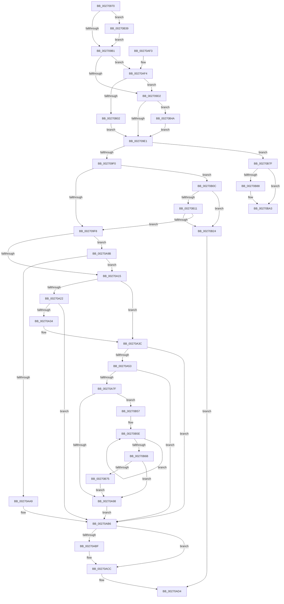

# IopDecrementDeviceObjectRef

- RVA: `0x00270970`–`0x00270BC0` (길이 `592` bytes)
- VA: `0x0000000140270970`
- 실행 섹션: `.text`
- PDB 이름 있음: `예`; PDB Function 태그: `아니요`
- unwind 정보 RVA: `0x00065A60`
- 디코드: `143`개 명령, `592/592` bytes 표시
- 미해석 바이트: `0` (있으면 어셈블리에 `.byte`로 보존)

> 이 문서는 커널 이미지의 기계어와 PDB 기호를 분석해 생성했습니다. 4번과 5번은 함수 원형과 자료형을 바이너리 사용 방식에서 추정한 C 해석이며 원본 소스 복구 결과는 아닙니다.

## 1. Dependencies

- 직접 호출 지점: **13**; 고유 호출 대상: **12**
- 직접 호출자로 확인된 함수: **8**
- RIP 상대 이미지 참조: **4**

### Outgoing calls
- `0x00270A37` → [KxWaitForLockChainValid](../21/KxWaitForLockChainValid_function_00217AA0.md) (function, `0x00217AA0`)
- `0x00270A66` → [KeDisableInterrupts](../21/KeDisableInterrupts_function_00217BE0.md) (function, `0x00217BE0`)
- `0x00270A75` → [KiHaltOnAddressWakeEntireList](../21/KiHaltOnAddressWakeEntireList_function_00217AF4.md) (function, `0x00217AF4`)
- `0x00270AB1` → [KiReleaseQueuedSpinLockInstrumented](../21/KiReleaseQueuedSpinLockInstrumented_function_002179F0.md) (function, `0x002179F0`)
- `0x00270AC7` → [KiLowerIrqlProcessIrqlFlags](../4F/KiLowerIrqlProcessIrqlFlags_function_004F5698.md) (function, `0x004F5698`)
- `0x00270B02` → [KiAcquireQueuedSpinLockInstrumented](KiAcquireQueuedSpinLockInstrumented_function_00275850.md) (function, `0x00275850`)
- `0x00270B2F` → [IopCompleteUnloadOrDelete](IopCompleteUnloadOrDelete_function_00270BC8.md) (function, `0x00270BC8`)
- `0x00270B40` → [KiRaiseIrqlProcessIrqlFlags](../4F/KiRaiseIrqlProcessIrqlFlags_function_004F56FC.md) (function, `0x004F56FC`)
- `0x00270B4D` → [KxWaitForLockOwnerShip](../25/KxWaitForLockOwnerShip_function_00257EB0.md) (function, `0x00257EB0`)
- `0x00270B75` → [KiRemoveSystemWorkPriorityKick](../26/KiRemoveSystemWorkPriorityKick_function_002631D0.md) (function, `0x002631D0`)
- `0x00270B8D` → [IoAddTriageDumpDataBlock](../42/IoAddTriageDumpDataBlock_function_00428374.md) (function, `0x00428374`)
- `0x00270B9E` → [IoAddTriageDumpDataBlock](../42/IoAddTriageDumpDataBlock_function_00428374.md) (function, `0x00428374`)
- `0x00270BBA` → [KeBugCheckEx](../4F/KeBugCheckEx_function_004FD660.md) (function, `0x004FD660`)

### Direct callers
- [IopCheckVpbMounted](IopCheckVpbMounted_function_00270540.md) at `0x00270894`
- [IopDecrementDeviceObjectHandleCount](../59/IopDecrementDeviceObjectHandleCount_function_00596FE4.md) at `0x00596FED`
- [IopLoadFileSystemDriver](../../page/71/IopLoadFileSystemDriver_function_0071BB1C.md) at `0x0071BBDF`
- [sub_00863F57](../../page/86/Unknown_function_00863F57.md) at `0x00864018`
- [sub_00863F57](../../page/86/Unknown_function_00863F57.md) at `0x00864056`
- [IopParseDevice](../../page/89/IopParseDevice_function_0089E510.md) at `0x0089E9C4`
- [IopParseDevice](../../page/89/IopParseDevice_function_0089E510.md) at `0x0089F001`
- [IopParseDevice](../../page/89/IopParseDevice_function_0089E510.md) at `0x0089F136`
- [IopParseDevice](../../page/89/IopParseDevice_function_0089E510.md) at `0x0089F896`
- [IopParseDevice](../../page/89/IopParseDevice_function_0089E510.md) at `0x0089F989`
- [IopParseDevice](../../page/89/IopParseDevice_function_0089E510.md) at `0x0089FA12`
- [IopParseDevice](../../page/89/IopParseDevice_function_0089E510.md) at `0x0089FAEE`
- [IopParseDevice](../../page/89/IopParseDevice_function_0089E510.md) at `0x0089FB0E`
- [IopParseDevice](../../page/89/IopParseDevice_function_0089E510.md) at `0x0089FC2D`
- [IopParseDevice](../../page/89/IopParseDevice_function_0089E510.md) at `0x0089FD3E`
- [IopParseDevice](../../page/89/IopParseDevice_function_0089E510.md) at `0x008A01BB`
- [IopParseDevice](../../page/89/IopParseDevice_function_0089E510.md) at `0x008A060B`
- [IopParseDevice](../../page/89/IopParseDevice_function_0089E510.md) at `0x008A0633`
- [IopParseDevice](../../page/89/IopParseDevice_function_0089E510.md) at `0x008A0689`
- [IopParseDevice](../../page/89/IopParseDevice_function_0089E510.md) at `0x008A0849`
- [sub_009A5B88](../../page/9A/Unknown_function_009A5B88.md) at `0x009A5B8E`
- [IopMountVolume](../../page/A3/IopMountVolume_function_00A329D0.md) at `0x00A32CCD`
- [IopShutdownBaseFileSystems](../../pagelk/B6/IopShutdownBaseFileSystems_function_00B63E10.md) at `0x00B63F24`

### Static image references
- `0x002709A4` → RVA `0x00FC6D20` (`ALMOSTRO`; read)
- `0x002709C5` → RVA `0x00FC6B06` (`ALMOSTRO`; read)
- `0x00270A5B` → RVA `0x00F21B20` (`.data`; read)
- `0x00270A9B` → RVA `0x00F0DE58` (`.data`; read)

## 2. Other-region calls and transfers

- 다른 실행 섹션으로 향하는 call: **0**
- 별도 외부 분기/꼬리 이동을 확인하지 못했습니다.

## 3. Assembly (complete function range)

```asm
00270970  48 89 5C 24 08                  mov qword ptr [rsp + 8], rbx
00270975  48 89 6C 24 10                  mov qword ptr [rsp + 0x10], rbp
0027097A  48 89 74 24 18                  mov qword ptr [rsp + 0x18], rsi
0027097F  48 89 7C 24 20                  mov qword ptr [rsp + 0x20], rdi
00270984  41 56                           push r14
00270986  48 83 EC 30                     sub rsp, 0x30
0027098A  45 0F B6 F0                     movzx r14d, r8b
0027098E  0F B6 FA                        movzx edi, dl
00270991  48 8B D9                        mov rbx, rcx
00270994  40 32 ED                        xor bpl, bpl
00270997  44 0F 20 C6                     mov rsi, cr8
0027099B  B8 02 00 00 00                  mov eax, 2
002709A0  44 0F 22 C0                     mov cr8, rax
002709A4  83 3D 75 63 D5 00 00            cmp dword ptr [rip + 0xd56375], 0
002709AB  0F 85 88 01 00 00               jne 0x140270b39
002709B1  65 48 8B 04 25 28 00 00 00      mov rax, qword ptr gs:[0x28]
002709BA  48 8D 88 A0 00 00 00            lea rcx, [rax + 0xa0]
002709C1  48 8B 51 08                     mov rdx, qword ptr [rcx + 8]
002709C5  F6 05 3A 61 D5 00 21            test byte ptr [rip + 0xd5613a], 0x21
002709CC  0F 85 22 01 00 00               jne 0x140270af4
002709D2  48 8B C1                        mov rax, rcx
002709D5  48 87 02                        xchg qword ptr [rdx], rax
002709D8  48 85 C0                        test rax, rax
002709DB  0F 85 69 01 00 00               jne 0x140270b4a
002709E1  8B 43 04                        mov eax, dword ptr [rbx + 4]
002709E4  83 E8 01                        sub eax, 1
002709E7  89 43 04                        mov dword ptr [rbx + 4], eax
002709EA  0F 88 8F 01 00 00               js 0x140270b7f
002709F0  85 C0                           test eax, eax
002709F2  0F 84 14 01 00 00               je 0x140270b0c
002709F8  65 48 8B 04 25 28 00 00 00      mov rax, qword ptr gs:[0x28]
00270A01  F6 05 FE 60 D5 00 01            test byte ptr [rip + 0xd560fe], 1
00270A08  48 8D B8 A0 00 00 00            lea rdi, [rax + 0xa0]
00270A0F  0F 85 86 00 00 00               jne 0x140270a9b
00270A15  0F 0D 0F                        prefetchw byte ptr [rdi]
00270A18  48 8B 07                        mov rax, qword ptr [rdi]
00270A1B  33 DB                           xor ebx, ebx
00270A1D  48 85 C0                        test rax, rax
00270A20  75 1A                           jne 0x140270a3c
00270A22  48 8B 4F 08                     mov rcx, qword ptr [rdi + 8]
00270A26  48 8B C7                        mov rax, rdi
00270A29  F0 48 0F B1 19                  lock cmpxchg qword ptr [rcx], rbx
00270A2E  0F 84 82 00 00 00               je 0x140270ab6
00270A34  48 8B CF                        mov rcx, rdi
00270A37  E8 64 70 FA FF                  call 0x140217aa0
00270A3C  4C 8D 40 08                     lea r8, [rax + 8]
00270A40  48 89 1F                        mov qword ptr [rdi], rbx
00270A43  48 8B 4F 08                     mov rcx, qword ptr [rdi + 8]
00270A47  48 8B C1                        mov rax, rcx
00270A4A  49 87 00                        xchg qword ptr [r8], rax
00270A4D  32 C1                           xor al, cl
00270A4F  A8 04                           test al, 4
00270A51  74 63                           je 0x140270ab6
00270A53  F0 09 1C 24                     lock or dword ptr [rsp], ebx
00270A57  49 C1 E8 05                     shr r8, 5
00270A5B  4C 8D 0D BE 10 CB 00            lea r9, [rip + 0xcb10be]
00270A62  41 83 E0 7F                     and r8d, 0x7f
00270A66  E8 75 71 FA FF                  call 0x140217be0
00270A6B  4B 87 1C C1                     xchg qword ptr [r9 + r8*8], rbx
00270A6F  48 8B D3                        mov rdx, rbx
00270A72  0F B6 F8                        movzx edi, al
00270A75  E8 7A 70 FA FF                  call 0x140217af4
00270A7A  40 84 FF                        test dil, dil
00270A7D  74 37                           je 0x140270ab6
00270A7F  65 48 8B 0C 25 20 00 00 00      mov rcx, qword ptr gs:[0x20]
00270A88  4C 8B 81 B8 8E 00 00            mov r8, qword ptr [rcx + 0x8eb8]
00270A8F  4D 85 C0                        test r8, r8
00270A92  0F 85 BF 00 00 00               jne 0x140270b57
00270A98  FB                              sti
00270A99  EB 1B                           jmp 0x140270ab6
00270A9B  8B 05 B7 D3 C9 00               mov eax, dword ptr [rip + 0xc9d3b7]
00270AA1  85 C0                           test eax, eax
00270AA3  0F 85 6C FF FF FF               jne 0x140270a15
00270AA9  48 8B 54 24 38                  mov rdx, qword ptr [rsp + 0x38]
00270AAE  48 8B CF                        mov rcx, rdi
00270AB1  E8 3A 6F FA FF                  call 0x1402179f0
00270AB6  83 3D 63 62 D5 00 00            cmp dword ptr [rip + 0xd56263], 0
00270ABD  74 0D                           je 0x140270acc
00270ABF  44 0F 20 C1                     mov rcx, cr8
00270AC3  40 0F B6 D6                     movzx edx, sil
00270AC7  E8 CC 4B 28 00                  call 0x1404f5698
00270ACC  40 0F B6 C6                     movzx eax, sil
00270AD0  44 0F 22 C0                     mov cr8, rax
00270AD4  48 8B 5C 24 40                  mov rbx, qword ptr [rsp + 0x40]
00270AD9  40 0F B6 C5                     movzx eax, bpl
00270ADD  48 8B 6C 24 48                  mov rbp, qword ptr [rsp + 0x48]
00270AE2  48 8B 74 24 50                  mov rsi, qword ptr [rsp + 0x50]
00270AE7  48 8B 7C 24 58                  mov rdi, qword ptr [rsp + 0x58]
00270AEC  48 83 C4 30                     add rsp, 0x30
00270AF0  41 5E                           pop r14
00270AF2  C3                              ret
00270AF3  CC                              int3
00270AF4  8B 05 5E D3 C9 00               mov eax, dword ptr [rip + 0xc9d35e]
00270AFA  85 C0                           test eax, eax
00270AFC  0F 85 D0 FE FF FF               jne 0x1402709d2
00270B02  E8 49 4D 00 00                  call 0x140275850
00270B07  E9 D5 FE FF FF                  jmp 0x1402709e1
00270B0C  40 84 FF                        test dil, dil
00270B0F  75 13                           jne 0x140270b24
00270B11  48 8B 83 38 01 00 00            mov rax, qword ptr [rbx + 0x138]
00270B18  8B 48 20                        mov ecx, dword ptr [rax + 0x20]
00270B1B  F6 C1 07                        test cl, 7
00270B1E  0F 84 D4 FE FF FF               je 0x1402709f8
00270B24  44 0F B6 C6                     movzx r8d, sil
00270B28  41 0F B6 D6                     movzx edx, r14b
00270B2C  48 8B CB                        mov rcx, rbx
00270B2F  E8 94 00 00 00                  call 0x140270bc8
00270B34  0F B6 E8                        movzx ebp, al
00270B37  EB 9B                           jmp 0x140270ad4
00270B39  0F B6 D0                        movzx edx, al
00270B3C  40 0F B6 CE                     movzx ecx, sil
00270B40  E8 B7 4B 28 00                  call 0x1404f56fc
00270B45  E9 67 FE FF FF                  jmp 0x1402709b1
00270B4A  48 8B D0                        mov rdx, rax
00270B4D  E8 5E 73 FE FF                  call 0x140257eb0
00270B52  E9 8A FE FF FF                  jmp 0x1402709e1
00270B57  41 0F 0D 08                     prefetchw byte ptr [r8]
00270B5B  41 8B 00                        mov eax, dword ptr [r8]
00270B5E  8B D0                           mov edx, eax
00270B60  0F BA F2 15                     btr edx, 0x15
00270B64  F0 41 0F B1 10                  lock cmpxchg dword ptr [r8], edx
00270B69  75 F3                           jne 0x140270b5e
00270B6B  0F BA E0 15                     bt eax, 0x15
00270B6F  0F 83 23 FF FF FF               jae 0x140270a98
00270B75  E8 56 26 FF FF                  call 0x1402631d0
00270B7A  E9 19 FF FF FF                  jmp 0x140270a98
00270B7F  48 8B 4B 08                     mov rcx, qword ptr [rbx + 8]
00270B83  48 85 C9                        test rcx, rcx
00270B86  74 1B                           je 0x140270ba3
00270B88  BA 50 01 00 00                  mov edx, 0x150
00270B8D  E8 E2 77 1B 00                  call 0x140428374
00270B92  48 8B 4B 08                     mov rcx, qword ptr [rbx + 8]
00270B96  0F B7 51 38                     movzx edx, word ptr [rcx + 0x38]
00270B9A  48 8B 49 40                     mov rcx, qword ptr [rcx + 0x40]
00270B9E  E8 D1 77 1B 00                  call 0x140428374
00270BA3  48 63 43 04                     movsxd rax, dword ptr [rbx + 4]
00270BA7  33 D2                           xor edx, edx
00270BA9  41 B9 06 00 00 00               mov r9d, 6
00270BAF  48 89 44 24 20                  mov qword ptr [rsp + 0x20], rax
00270BB4  4C 8B C3                        mov r8, rbx
00270BB7  8D 4A 18                        lea ecx, [rdx + 0x18]
00270BBA  E8 A1 CA 28 00                  call 0x1404fd660
00270BBF  CC                              int3
```

## 4. C-style interpretation (structured pseudocode)

```c
__int64 __fastcall IopDecrementDeviceObjectRef(__int64 a1, unsigned __int8 a2, unsigned __int8 a3)
{
    __int64 result;
    __int64 v_rbp;
    __int64 v_rbx;
    __int64 v_rsp;
    unsigned int v_stack_m38;
    unsigned __int64 v_stack_p0;
    unsigned __int64 v_stack_p10;
    unsigned __int64 v_stack_p18;
    unsigned __int64 v_stack_p20;
    unsigned __int64 v_stack_p8;

    v_stack_p8 = v_rbx;
    v_stack_p10 = v_rbp;
    v_stack_p18 = v_rsi;
    v_stack_p20 = v_rdi;
    v_rsp = (v_rsp) - (48);
    v_rbp = 0;
    if ((*(unsigned int *)(v_rip + 13984629)) != 0) goto loc_00270B39;
loc_002709B1:
    if (((*(unsigned __int8 *)(v_rip + 13984058)) & (33)) != 0) goto loc_00270AF4;
loc_002709D2:
    if (*(unsigned __int64 *)(gs_base + (0 + 40)) + 160 != 0) goto loc_00270B4A;
loc_002709E1:
    result = (unsigned int)(((unsigned int)(*(unsigned int *)(a1 + 4))) - (1));
    *(unsigned int *)(a1 + 4) = (unsigned int)(result);
    if (sign_flag) goto loc_00270B7F;
    if ((unsigned int)(result) == 0) goto loc_00270B0C;
loc_002709F8:
    if (((*(unsigned __int8 *)(v_rip + 13983998)) & (1)) != 0) goto loc_00270A9B;
loc_00270A15:
    v_rbx = 0;
    if (*(unsigned __int64 *)(*(unsigned __int64 *)(gs_base + (0 + 40)) + 160) != 0) goto loc_00270A3C;
    if (*(unsigned __int64 *)(*(unsigned __int64 *)(gs_base + (0 + 40)) + 160) == 0) goto loc_00270AB6;
    result = KxWaitForLockChainValid(*(unsigned __int64 *)(gs_base + (0 + 40)) + 160, *(unsigned __int64 *)(*(unsigned __int64 *)(gs_base + (0 + 40)) + 160 + 8), a3, a4);
loc_00270A3C:
    *(unsigned __int64 *)(*(unsigned __int64 *)(gs_base + (0 + 40)) + 160) = 0;
    result = (unsigned __int8)((*(unsigned __int64 *)(*(unsigned __int64 *)(gs_base + (0 + 40)) + 160 + 8)) ^ ((unsigned __int8)(*(unsigned __int64 *)(*(unsigned __int64 *)(gs_base + (0 + 40)) + 160 + 8))));
    if ((((unsigned __int8)(result)) & (4)) == 0) goto loc_00270AB6;
    a3 = (result + 8) >> (5);
    a3 = (unsigned int)((a3) & (127));
    result = KeDisableInterrupts(*(unsigned __int64 *)(*(unsigned __int64 *)(gs_base + (0 + 40)) + 160 + 8), *(unsigned __int64 *)(*(unsigned __int64 *)(gs_base + (0 + 40)) + 160 + 8), a3, v_rip + 13308094);
    result = KiHaltOnAddressWakeEntireList(*(unsigned __int64 *)(*(unsigned __int64 *)(gs_base + (0 + 40)) + 160 + 8), 0, a3, v_rip + 13308094);
    if ((unsigned __int8)((unsigned __int8)(result)) == 0) goto loc_00270AB6;
    if (*(unsigned __int64 *)(*(unsigned __int64 *)(gs_base + (0 + 32)) + 36536) != 0) goto loc_00270B57;
loc_00270A98:
    goto loc_00270AB6;
loc_00270A9B:
    if ((unsigned int)((unsigned int)(*(unsigned int *)(v_rip + 13226935))) != 0) goto loc_00270A15;
    result = KiReleaseQueuedSpinLockInstrumented((unsigned __int8)(result), v_stack_p0, *(unsigned __int64 *)(*(unsigned __int64 *)(gs_base + (0 + 32)) + 36536), v_rip + 13308094);
loc_00270AB6:
    if ((*(unsigned int *)(v_rip + 13984355)) != 0) {
        a1 = 2;
        a2 = (unsigned __int8)(v_cr8);
        result = KiLowerIrqlProcessIrqlFlags(a1, a2, *(unsigned __int64 *)(*(unsigned __int64 *)(gs_base + (0 + 32)) + 36536), v_rip + 13308094);
    }
loc_00270AD4:
    v_rsp = (v_rsp) + (48);
    return 0;
loc_00270AF4:
    if ((unsigned int)((unsigned int)(*(unsigned int *)(v_rip + 13226846))) != 0) goto loc_002709D2;
    result = KiAcquireQueuedSpinLockInstrumented(a1, a2, *(unsigned __int64 *)(*(unsigned __int64 *)(gs_base + (0 + 32)) + 36536), v_rip + 13308094);
    goto loc_002709E1;
loc_00270B0C:
    if ((unsigned __int8)(v_stack_p20) != 0) goto loc_00270B24;
    if ((((unsigned __int8)((unsigned int)(*(unsigned int *)(*(unsigned __int64 *)(v_stack_p8 + 312) + 32)))) & (7)) == 0) goto loc_002709F8;
loc_00270B24:
    result = IopCompleteUnloadOrDelete(v_stack_p8, a3, (unsigned __int8)(v_stack_p18), v_rip + 13308094);
    goto loc_00270AD4;
loc_00270B39:
    result = KiRaiseIrqlProcessIrqlFlags((unsigned __int8)(v_stack_p18), (unsigned __int8)(result), (unsigned __int8)(v_stack_p18), v_rip + 13308094);
    goto loc_002709B1;
loc_00270B4A:
    result = KxWaitForLockOwnerShip((unsigned __int8)(v_stack_p18), result, (unsigned __int8)(v_stack_p18), v_rip + 13308094);
    goto loc_002709E1;
loc_00270B57:
loc_00270B5E:
    if ((((unsigned __int8)((unsigned int)(*(unsigned int *)(*(unsigned __int64 *)(v_stack_p8 + 312) + 32)))) & (7)) != 0) goto loc_00270B5E;
    if (condition_is_above_or_equal) goto loc_00270A98;
    result = KiRemoveSystemWorkPriorityKick((unsigned __int8)(v_stack_p18), (unsigned int)((unsigned int)((unsigned int)(*(unsigned int *)((unsigned __int8)(v_stack_p18))))), (unsigned __int8)(v_stack_p18), v_rip + 13308094);
    goto loc_00270A98;
loc_00270B7F:
    if (*(unsigned __int64 *)(v_stack_p8 + 8) != 0) {
        a2 = 336;
        result = IoAddTriageDumpDataBlock(*(unsigned __int64 *)(v_stack_p8 + 8), a2, (unsigned __int8)(v_stack_p18), v_rip + 13308094);
        a1 = *(unsigned __int64 *)(v_stack_p8 + 8);
        a2 = *(unsigned __int16 *)(a1 + 56);
        a1 = *(unsigned __int64 *)(a1 + 64);
        result = IoAddTriageDumpDataBlock(a1, a2, (unsigned __int8)(v_stack_p18), v_rip + 13308094);
    }
    a2 = 0;
    v_stack_p20 = (int)(*(unsigned int *)(v_stack_p8 + 4));
    result = KeBugCheckEx(a2 + 24, a2, v_stack_p8, 6);
    return result;
}
```

## 5. (Beta) C Style

```c
int64_t IopDecrementDeviceObjectRef(void *Arg1, uint8_t Arg2, uint8_t Arg3)
{
    uint8_t *arg1 = (uint8_t *)Arg1;

    int64_t result;
    int64_t local_rbp;
    int64_t local_rbx;
    int64_t local_rsp;
    uint32_t v_stack_m38;
    uint64_t v_stack_p0;
    uint64_t v_stack_p10;
    uint64_t v_stack_p18;
    uint64_t v_stack_p20;
    uint64_t v_stack_p8;

    v_stack_p8 = local_rbx;
    v_stack_p10 = local_rbp;
    v_stack_p18 = local_rsi;
    v_stack_p20 = local_rdi;
    local_rsp = (local_rsp) - (48);
    local_rbp = 0;
    if ((*(uint32_t *)(v_rip + 0xD56375)) != 0) goto loc_00270B39;
loc_002709B1:
    if (((*(uint8_t *)(v_rip + 0xD5613A)) & (33)) != 0) goto loc_00270AF4;
loc_002709D2:
    if (*(uint64_t *)(gs_base + (0 + 0x28)) + 160 != 0) goto loc_00270B4A;
loc_002709E1:
    result = (uint32_t)(((uint32_t)(*(uint32_t *)(arg1 + 0x4))) - (1));
    *(uint32_t *)(arg1 + 0x4) = (uint32_t)(result);
    if (sign_flag) goto loc_00270B7F;
    if ((uint32_t)(result) == 0) goto loc_00270B0C;
loc_002709F8:
    if (((*(uint8_t *)(v_rip + 0xD560FE)) & (1)) != 0) goto loc_00270A9B;
loc_00270A15:
    local_rbx = 0;
    if (*(uint64_t *)(*(uint64_t *)(gs_base + (0 + 0x28)) + 0xA0) != 0) goto loc_00270A3C;
    if (*(uint64_t *)(*(uint64_t *)(gs_base + (0 + 0x28)) + 0xA0) == 0) goto loc_00270AB6;
    result = KxWaitForLockChainValid(*(uint64_t *)(gs_base + (0 + 0x28)) + 160, *(uint64_t *)(*(uint64_t *)(gs_base + (0 + 0x28)) + 0xA0 + 0x8), Arg3, a4);
loc_00270A3C:
    *(uint64_t *)(*(uint64_t *)(gs_base + (0 + 0x28)) + 0xA0) = 0;
    result = (uint8_t)((*(uint64_t *)(*(uint64_t *)(gs_base + (0 + 0x28)) + 0xA0 + 0x8)) ^ ((uint8_t)(*(uint64_t *)(*(uint64_t *)(gs_base + (0 + 0x28)) + 0xA0 + 0x8))));
    if ((((uint8_t)(result)) & (4)) == 0) goto loc_00270AB6;
    Arg3 = (result + 8) >> (5);
    Arg3 = (uint32_t)((Arg3) & (127));
    result = KeDisableInterrupts(*(uint64_t *)(*(uint64_t *)(gs_base + (0 + 0x28)) + 0xA0 + 0x8), *(uint64_t *)(*(uint64_t *)(gs_base + (0 + 0x28)) + 0xA0 + 0x8), Arg3, v_rip + 13308094);
    result = KiHaltOnAddressWakeEntireList(*(uint64_t *)(*(uint64_t *)(gs_base + (0 + 0x28)) + 0xA0 + 0x8), 0, Arg3, v_rip + 13308094);
    if ((uint8_t)((uint8_t)(result)) == 0) goto loc_00270AB6;
    if (*(uint64_t *)(*(uint64_t *)(gs_base + (0 + 0x20)) + 0x8EB8) != 0) goto loc_00270B57;
loc_00270A98:
    goto loc_00270AB6;
loc_00270A9B:
    if ((uint32_t)((uint32_t)(*(uint32_t *)(v_rip + 0xC9D3B7))) != 0) goto loc_00270A15;
    result = KiReleaseQueuedSpinLockInstrumented((uint8_t)(result), v_stack_p0, *(uint64_t *)(*(uint64_t *)(gs_base + (0 + 0x20)) + 0x8EB8), v_rip + 13308094);
loc_00270AB6:
    if ((*(uint32_t *)(v_rip + 0xD56263)) != 0) {
        Arg1 = 2;
        Arg2 = (uint8_t)(v_cr8);
        result = KiLowerIrqlProcessIrqlFlags(Arg1, Arg2, *(uint64_t *)(*(uint64_t *)(gs_base + (0 + 0x20)) + 0x8EB8), v_rip + 13308094);
    }
loc_00270AD4:
    local_rsp = (local_rsp) + (48);
    return 0;
loc_00270AF4:
    if ((uint32_t)((uint32_t)(*(uint32_t *)(v_rip + 0xC9D35E))) != 0) goto loc_002709D2;
    result = KiAcquireQueuedSpinLockInstrumented(Arg1, Arg2, *(uint64_t *)(*(uint64_t *)(gs_base + (0 + 0x20)) + 0x8EB8), v_rip + 13308094);
    goto loc_002709E1;
loc_00270B0C:
    if ((uint8_t)(v_stack_p20) != 0) goto loc_00270B24;
    if ((((uint8_t)((uint32_t)(*(uint32_t *)(*(uint64_t *)(v_stack_p8 + 0x138) + 0x20)))) & (7)) == 0) goto loc_002709F8;
loc_00270B24:
    result = IopCompleteUnloadOrDelete(v_stack_p8, Arg3, (uint8_t)(v_stack_p18), v_rip + 13308094);
    goto loc_00270AD4;
loc_00270B39:
    result = KiRaiseIrqlProcessIrqlFlags((uint8_t)(v_stack_p18), (uint8_t)(result), (uint8_t)(v_stack_p18), v_rip + 13308094);
    goto loc_002709B1;
loc_00270B4A:
    result = KxWaitForLockOwnerShip((uint8_t)(v_stack_p18), result, (uint8_t)(v_stack_p18), v_rip + 13308094);
    goto loc_002709E1;
loc_00270B57:
loc_00270B5E:
    if ((((uint8_t)((uint32_t)(*(uint32_t *)(*(uint64_t *)(v_stack_p8 + 0x138) + 0x20)))) & (7)) != 0) goto loc_00270B5E;
    if (condition_is_above_or_equal) goto loc_00270A98;
    result = KiRemoveSystemWorkPriorityKick((uint8_t)(v_stack_p18), (uint32_t)((uint32_t)((uint32_t)(*(uint32_t *)((uint8_t)(v_stack_p18))))), (uint8_t)(v_stack_p18), v_rip + 13308094);
    goto loc_00270A98;
loc_00270B7F:
    if (*(uint64_t *)(v_stack_p8 + 0x8) != 0) {
        Arg2 = 336;
        result = IoAddTriageDumpDataBlock(*(uint64_t *)(v_stack_p8 + 0x8), Arg2, (uint8_t)(v_stack_p18), v_rip + 13308094);
        Arg1 = *(uint64_t *)(v_stack_p8 + 0x8);
        Arg2 = *(uint16_t *)(arg1 + 0x38);
        Arg1 = *(uint64_t *)(arg1 + 0x40);
        result = IoAddTriageDumpDataBlock(Arg1, Arg2, (uint8_t)(v_stack_p18), v_rip + 13308094);
    }
    Arg2 = 0;
    v_stack_p20 = (int32_t)(*(uint32_t *)(v_stack_p8 + 0x4));
    result = KeBugCheckEx(Arg2 + 24, Arg2, v_stack_p8, 6);
    return result;
}
```

### 관측된 메모리 오프셋

구조체 형식이 확인되지 않은 접근은 인자 기준의 오프셋으로만 기록했습니다.

| 기준 인자 | 오프셋 표현 | 폭 (bit) | 접근 |
|---|---:|---:|---|
| `Arg1` | `+ 0x4` | `32` | `R` |
| `Arg1` | `+ 0x4` | `32` | `W` |
| `Arg1` | `+ 0x8` | `64` | `R` |
| `Arg1` | `+ 0x138` | `64` | `R` |

## 6. Execution-region graph

[열기: 2D/3D 그래프와 함수 탐색 컨트롤 패널](../../../control-panel.html?section=text&rva=0x00270970&view=graph)

- 2D 그래프는 위에서 아래로 흐르고, 3D 그래프는 빈 공간을 드래그해 회전합니다. Shift+드래그는 이동, 휠은 확대·축소, 함수 노드 선택은 대상 보고서 이동입니다.

### Static fallback


