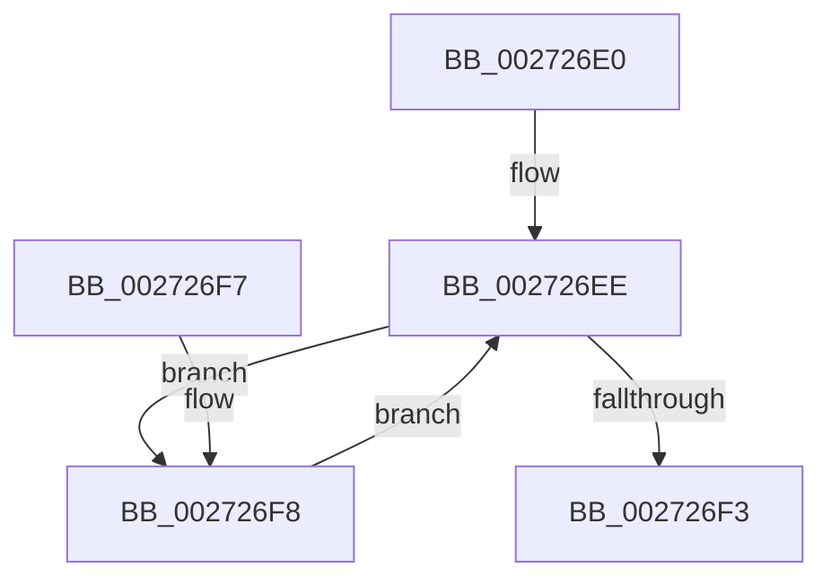

# IopGetDeviceAttachmentBase

- RVA: `0x002726E0`–`0x00272708` (길이 `40` bytes)
- VA: `0x00000001402726E0`
- 실행 섹션: `.text`
- PDB 이름 있음: `예`; PDB Function 태그: `아니요`
- unwind 정보 RVA: `0x000DB714`
- 디코드: `12`개 명령, `40/40` bytes 표시
- 미해석 바이트: `0` (있으면 어셈블리에 `.byte`로 보존)

> 이 문서는 커널 이미지의 기계어와 PDB 기호를 분석해 생성했습니다. 4번과 5번은 함수 원형과 자료형을 바이너리 사용 방식에서 추정한 C 해석이며 원본 소스 복구 결과는 아닙니다.

## 1. Dependencies

- 직접 호출 지점: **0**; 고유 호출 대상: **0**
- 직접 호출자로 확인된 함수: **5**
- RIP 상대 이미지 참조: **0**

### Outgoing calls
- 직접 디코드된 call 명령이 없습니다.

### Direct callers
- [IopCompleteUnloadOrDelete](IopCompleteUnloadOrDelete_function_00270BC8.md) at `0x00270C0A`
- [IopGetDevicePDO](IopGetDevicePDO_function_002724D8.md) at `0x002724F5`
- [IoGetDeviceAttachmentBaseRef](IoGetDeviceAttachmentBaseRef_function_00272710.md) at `0x0027272D`
- [IopAttachDeviceToDeviceStackSafe](../41/IopAttachDeviceToDeviceStackSafe_function_00410574.md) at `0x004105EE`
- [IopVerifyDriverObjectOnStack](../59/IopVerifyDriverObjectOnStack_function_0059771C.md) at `0x00597723`

### Static image references
- 디코드된 RIP-relative 메모리 참조가 없습니다.

## 2. Other-region calls and transfers

- 다른 실행 섹션으로 향하는 call: **0**
- 별도 외부 분기/꼬리 이동을 확인하지 못했습니다.

## 3. Assembly (complete function range)

```asm
002726E0  48 8B 81 38 01 00 00            mov rax, qword ptr [rcx + 0x138]
002726E7  48 8B D1                        mov rdx, rcx
002726EA  48 8B 48 30                     mov rcx, qword ptr [rax + 0x30]
002726EE  48 85 C9                        test rcx, rcx
002726F1  75 05                           jne 0x1402726f8
002726F3  48 8B C2                        mov rax, rdx
002726F6  C3                              ret
002726F7  CC                              int3
002726F8  48 8B D1                        mov rdx, rcx
002726FB  48 8B 89 38 01 00 00            mov rcx, qword ptr [rcx + 0x138]
00272702  48 8B 49 30                     mov rcx, qword ptr [rcx + 0x30]
00272706  EB E6                           jmp 0x1402726ee
```

## 4. C-style interpretation (structured pseudocode)

```c
__int64 __fastcall IopGetDeviceAttachmentBase(__int64 a1)
{
loc_002726EE:
    if (*(unsigned __int64 *)(*(unsigned __int64 *)(a1 + 312) + 48) != 0) goto loc_002726F8;
    return a1;
loc_002726F8:
    goto loc_002726EE;
}
```

## 5. (Beta) C Style

```c
void *IopGetDeviceAttachmentBase(void *Arg1)
{
    uint8_t *arg1 = (uint8_t *)Arg1;

loc_002726EE:
    if (*(uint64_t *)(*(uint64_t *)(arg1 + 0x138) + 0x30) != 0) goto loc_002726F8;
    return Arg1;
loc_002726F8:
    goto loc_002726EE;
}
```

### 관측된 메모리 오프셋

구조체 형식이 확인되지 않은 접근은 인자 기준의 오프셋으로만 기록했습니다.

| 기준 인자 | 오프셋 표현 | 폭 (bit) | 접근 |
|---|---:|---:|---|
| `Arg1` | `+ 0x138` | `64` | `R` |

## 6. Execution-region graph

[열기: 2D/3D 그래프와 함수 탐색 컨트롤 패널](../../../control-panel.html?section=text&rva=0x002726E0&view=graph)

- 2D 그래프는 위에서 아래로 흐르고, 3D 그래프는 빈 공간을 드래그해 회전합니다. Shift+드래그는 이동, 휠은 확대·축소, 함수 노드 선택은 대상 보고서 이동입니다.

### Static fallback


