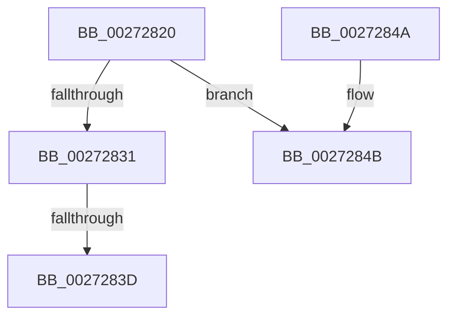

# IopIncrementVpbRefCount

- RVA: `0x00272820`–`0x00272850` (길이 `48` bytes)
- VA: `0x0000000140272820`
- 실행 섹션: `.text`
- PDB 이름 있음: `예`; PDB Function 태그: `아니요`
- unwind 정보 RVA: `0x00065C5C`
- 디코드: `18`개 명령, `48/48` bytes 표시
- 미해석 바이트: `0` (있으면 어셈블리에 `.byte`로 보존)

> 이 문서는 커널 이미지의 기계어와 PDB 기호를 분석해 생성했습니다. 4번과 5번은 함수 원형과 자료형을 바이너리 사용 방식에서 추정한 C 해석이며 원본 소스 복구 결과는 아닙니다.

## 1. Dependencies

- 직접 호출 지점: **0**; 고유 호출 대상: **0**
- 직접 호출자로 확인된 함수: **4**
- RIP 상대 이미지 참조: **0**

### Outgoing calls
- 직접 디코드된 call 명령이 없습니다.

### Direct callers
- [IopMountInitializeVpb](../49/IopMountInitializeVpb_function_004972C4.md) at `0x00497341`
- [IopReferenceVerifyVpb](../4C/IopReferenceVerifyVpb_function_004C87B4.md) at `0x004C8807`
- [IopParseDevice](../../page/89/IopParseDevice_function_0089E510.md) at `0x0089EC16`
- [IopParseDevice](../../page/89/IopParseDevice_function_0089E510.md) at `0x008A06F1`
- [sub_009A5974](../../page/9A/Unknown_function_009A5974.md) at `0x009A5AE5`

### Static image references
- 디코드된 RIP-relative 메모리 참조가 없습니다.

## 2. Other-region calls and transfers

- 다른 실행 섹션으로 향하는 call: **0**
- call이 아닌 외부 분기/꼬리 이동: **1**
  - `0x0027283B` → [sub_0027289E](Unknown_function_0027289E.md) (`tail-transfer`)

## 3. Assembly (complete function range)

```asm
00272820  48 89 5C 24 10                  mov qword ptr [rsp + 0x10], rbx
00272825  57                              push rdi
00272826  48 83 EC 30                     sub rsp, 0x30
0027282A  48 8B F9                        mov rdi, rcx
0027282D  84 D2                           test dl, dl
0027282F  75 1A                           jne 0x14027284b
00272831  8B 59 1C                        mov ebx, dword ptr [rcx + 0x1c]
00272834  FF C3                           inc ebx
00272836  89 59 1C                        mov dword ptr [rcx + 0x1c], ebx
00272839  85 DB                           test ebx, ebx
0027283B  7E 61                           jle 0x14027289e
0027283D  8B C3                           mov eax, ebx
0027283F  48 8B 5C 24 48                  mov rbx, qword ptr [rsp + 0x48]
00272844  48 83 C4 30                     add rsp, 0x30
00272848  5F                              pop rdi
00272849  C3                              ret
0027284A  CC                              int3
0027284B  B9 09 00 00 00                  mov ecx, 9
```

## 4. C-style interpretation (structured pseudocode)

```c
__int64 __fastcall IopIncrementVpbRefCount(__int64 a1, unsigned __int8 a2)
{
    __int64 v_rbx;
    __int64 v_rsp;
    unsigned __int64 v_stack_p10;

    v_stack_p10 = v_rbx;
    v_rsp = (v_rsp) - (48);
    if (a2 != 0) goto loc_0027284B;
    v_rbx = (unsigned int)(((unsigned int)(*(unsigned int *)(a1 + 28))) + 1);
    *(unsigned int *)(a1 + 28) = (unsigned int)(v_rbx);
    v_rsp = (v_rsp) + (48);
    return (unsigned int)((unsigned int)(v_rbx));
loc_0027284B:
    return (unsigned int)((unsigned int)(v_rbx));
}
```

## 5. (Beta) C Style

```c
int64_t IopIncrementVpbRefCount(void *Arg1, uint8_t Arg2)
{
    uint8_t *arg1 = (uint8_t *)Arg1;

    int64_t local_rbx;
    int64_t local_rsp;
    uint64_t v_stack_p10;

    v_stack_p10 = local_rbx;
    local_rsp = (local_rsp) - (48);
    if (Arg2 != 0) goto loc_0027284B;
    local_rbx = (uint32_t)(((uint32_t)(*(uint32_t *)(arg1 + 0x1C))) + 1);
    *(uint32_t *)(arg1 + 0x1C) = (uint32_t)(local_rbx);
    local_rsp = (local_rsp) + (48);
    return (uint32_t)((uint32_t)(local_rbx));
loc_0027284B:
    return (uint32_t)((uint32_t)(local_rbx));
}
```

### 관측된 메모리 오프셋

구조체 형식이 확인되지 않은 접근은 인자 기준의 오프셋으로만 기록했습니다.

| 기준 인자 | 오프셋 표현 | 폭 (bit) | 접근 |
|---|---:|---:|---|
| `Arg1` | `+ 0x1C` | `32` | `R` |
| `Arg1` | `+ 0x1C` | `32` | `W` |

## 6. Execution-region graph

[열기: 2D/3D 그래프와 함수 탐색 컨트롤 패널](../../../control-panel.html?section=text&rva=0x00272820&view=graph)

- 2D 그래프는 위에서 아래로 흐르고, 3D 그래프는 빈 공간을 드래그해 회전합니다. Shift+드래그는 이동, 휠은 확대·축소, 함수 노드 선택은 대상 보고서 이동입니다.

### Static fallback


