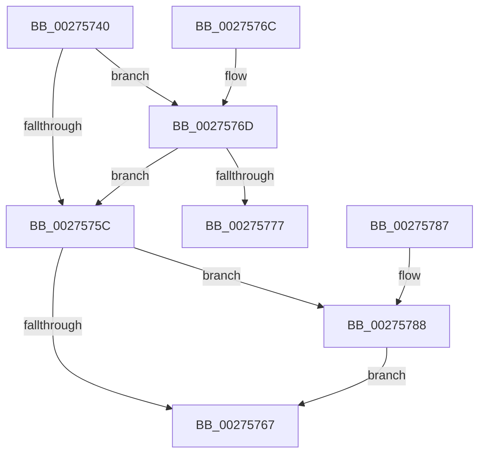

# KeAcquireInStackQueuedSpinLockAtDpcLevel

- RVA: `0x00275740`–`0x00275792` (길이 `82` bytes)
- VA: `0x0000000140275740`
- 실행 섹션: `.text`
- PDB 이름 있음: `예`; PDB Function 태그: `아니요`
- unwind 정보 RVA: `0x00065E30`
- 디코드: `26`개 명령, `82/82` bytes 표시
- 미해석 바이트: `0` (있으면 어셈블리에 `.byte`로 보존)

> 이 문서는 커널 이미지의 기계어와 PDB 기호를 분석해 생성했습니다. 4번과 5번은 함수 원형과 자료형을 바이너리 사용 방식에서 추정한 C 해석이며 원본 소스 복구 결과는 아닙니다.

## 1. Dependencies

- 직접 호출 지점: **2**; 고유 호출 대상: **2**
- 직접 호출자로 확인된 함수: **39**
- RIP 상대 이미지 참조: **2**

### Outgoing calls
- `0x0027577D` → [KiAcquireQueuedSpinLockInstrumented](KiAcquireQueuedSpinLockInstrumented_function_00275850.md) (function, `0x00275850`)
- `0x0027578B` → [KxWaitForLockOwnerShip](../25/KxWaitForLockOwnerShip_function_00257EB0.md) (function, `0x00257EB0`)

### Direct callers
- [KiAbConvertWaiterToOwnerEntry](../21/KiAbConvertWaiterToOwnerEntry_function_00219430.md) at `0x00219561`
- [CcReferenceSharedCacheMapByVacb](../26/CcReferenceSharedCacheMapByVacb_function_0026FCBC.md) at `0x0026FCF2`
- [CcFlushCachePreProcess](../35/CcFlushCachePreProcess_function_0035A9B0.md) at `0x0035AB00`
- [CcNotifyExternalCachesInternal](../3C/CcNotifyExternalCachesInternal_function_003C9E00.md) at `0x003C9E63`
- [CcMapAndCopyInToCache](../3C/CcMapAndCopyInToCache_function_003CA7F0.md) at `0x003CB33E`
- [CcInitializeCacheMapInternal](../3C/CcInitializeCacheMapInternal_function_003CC720.md) at `0x003CCA45`
- [CcInitializeCacheMapInternal](../3C/CcInitializeCacheMapInternal_function_003CC720.md) at `0x003CCAA2`
- [CcInitializeCacheMapInternal](../3C/CcInitializeCacheMapInternal_function_003CC720.md) at `0x003CCE72`
- [CcInitializeCacheMapInternal](../3C/CcInitializeCacheMapInternal_function_003CC720.md) at `0x003CCFCF`
- [CcInitializeCacheMapInternal](../3C/CcInitializeCacheMapInternal_function_003CC720.md) at `0x003CD0A6`
- [CcInitializeCacheMapInternal](../3C/CcInitializeCacheMapInternal_function_003CC720.md) at `0x003CD185`
- [ExpConvertFastResourceExclusiveToShared](../41/ExpConvertFastResourceExclusiveToShared_function_00416110.md) at `0x004161B0`
- [ExpReleaseDisownedFastResourceShared](../41/ExpReleaseDisownedFastResourceShared_function_00416338.md) at `0x0041639C`
- [ExpReleaseDisownedFastResourceExclusive](../41/ExpReleaseDisownedFastResourceExclusive_function_00416470.md) at `0x00416506`
- [HsaAttachDeviceDomainInternal](../44/HsaAttachDeviceDomainInternal_function_0044DD24.md) at `0x0044DDC0`
- [CcWaitForUninitializeCacheMap](../46/CcWaitForUninitializeCacheMap_function_004633F0.md) at `0x004634D7`
- [IvtIommuWaitCommand](../46/IvtIommuWaitCommand_function_0046A594.md) at `0x0046A5F9`
- [IvtIommuSendCommand](../46/IvtIommuSendCommand_function_0046A6E4.md) at `0x0046A881`
- [CcSerializeWithLazyWriter](../4B/CcSerializeWithLazyWriter_function_004B4490.md) at `0x004B44C9`
- [CcUpdateTimeOnLogHandles](../4C/CcUpdateTimeOnLogHandles_function_004C6D0C.md) at `0x004C6D69`
- [CcSetLoggedDataThreshold](../4C/CcSetLoggedDataThreshold_function_004C8D50.md) at `0x004C8DC4`
- [IvtAllocateContextTable](../4D/IvtAllocateContextTable_function_004DE0D4.md) at `0x004DE1D2`
- [IvtAllocateScalableModePasidTables](../56/IvtAllocateScalableModePasidTables_function_0056E8DC.md) at `0x0056EAC0`
- [IvtAttachDeviceDomainInternal](../56/IvtAttachDeviceDomainInternal_function_0056ED90.md) at `0x0056EE66`
- [IvtConfigureAts](../56/IvtConfigureAts_function_0056F1F0.md) at `0x0056F2CD`
- [IvtDrainSvmPageRequests](../56/IvtDrainSvmPageRequests_function_0056F4B0.md) at `0x0056F518`
- [IvtFreeScalableModePasidTables](../56/IvtFreeScalableModePasidTables_function_0056F980.md) at `0x0056F9CF`
- [IvtLegacyAllocateScalableModePasidTables](../57/IvtLegacyAllocateScalableModePasidTables_function_00570B20.md) at `0x00570CE3`
- [IvtLegacyAttachDeviceDomainInternal](../57/IvtLegacyAttachDeviceDomainInternal_function_00570EDC.md) at `0x00570F91`
- [IvtLegacyConfigureAts](../57/IvtLegacyConfigureAts_function_00571270.md) at `0x005712DE`
- [IvtLegacySetDevicePasidTable](../57/IvtLegacySetDevicePasidTable_function_00571EE0.md) at `0x00571F48`
- [IvtSetDevicePasidTable](../57/IvtSetDevicePasidTable_function_005724D0.md) at `0x00572529`
- [HsaAllocatePasidTables](../57/HsaAllocatePasidTables_function_005735DC.md) at `0x005736C8`
- [HsaFreePasidTables](../57/HsaFreePasidTables_function_0057401C.md) at `0x00574071`
- [HsaUpdateRemappingTableInDeviceTableEntry](../57/HsaUpdateRemappingTableInDeviceTableEntry_function_005751DC.md) at `0x00575233`
- [CcIncrementWriteBehindPriority](../57/CcIncrementWriteBehindPriority_function_0057B8AC.md) at `0x0057B947`
- [CcIsThereDirtyDataEx](../57/CcIsThereDirtyDataEx_function_0057D7B0.md) at `0x0057D83A`
- [DifKeAcquireInStackQueuedSpinLockAtDpcLevelWrapper](../62/DifKeAcquireInStackQueuedSpinLockAtDpcLevelWrapper_function_0062E2B0.md) at `0x0062E387`
- [ExpAcquireSvmAgentsLock](../65/ExpAcquireSvmAgentsLock_function_0065AF0C.md) at `0x0065AF4C`
- [ExpShareAddressSpaceWithDevice](../65/ExpShareAddressSpaceWithDevice_function_0065B528.md) at `0x0065B6FC`
- [ExpShareAddressSpaceWithDevice](../65/ExpShareAddressSpaceWithDevice_function_0065B528.md) at `0x0065B8EC`
- [ExpShareAddressSpaceWithDevice](../65/ExpShareAddressSpaceWithDevice_function_0065B528.md) at `0x0065BA5F`
- [sub_006E8840](../6E/Unknown_function_006E8840.md) at `0x006E884B`
- [sub_006EA56C](../6E/Unknown_function_006EA56C.md) at `0x006EA64C`
- [sub_006EA56C](../6E/Unknown_function_006EA56C.md) at `0x006EA6C3`
- [sub_006F2A56](../6F/Unknown_function_006F2A56.md) at `0x006F2A6F`
- [PnprMirrorMarkedPages](../../pagelk/B6/PnprMirrorMarkedPages_function_00B6480C.md) at `0x00B64899`
- [PnprMirrorMarkedPages](../../pagelk/B6/PnprMirrorMarkedPages_function_00B6480C.md) at `0x00B64928`

### Static image references
- `0x00275753` → RVA `0x00FC6B06` (`ALMOSTRO`; read)
- `0x0027576D` → RVA `0x00F0DE58` (`.data`; read)

## 2. Other-region calls and transfers

- 다른 실행 섹션으로 향하는 call: **0**
- 별도 외부 분기/꼬리 이동을 확인하지 못했습니다.

## 3. Assembly (complete function range)

```asm
00275740  48 83 EC 28                     sub rsp, 0x28
00275744  48 89 4A 08                     mov qword ptr [rdx + 8], rcx
00275748  48 8B C2                        mov rax, rdx
0027574B  48 C7 02 00 00 00 00            mov qword ptr [rdx], 0
00275752  90                              nop
00275753  F6 05 AC 13 D5 00 21            test byte ptr [rip + 0xd513ac], 0x21
0027575A  75 11                           jne 0x14027576d
0027575C  48 8B D0                        mov rdx, rax
0027575F  48 87 11                        xchg qword ptr [rcx], rdx
00275762  48 85 D2                        test rdx, rdx
00275765  75 21                           jne 0x140275788
00275767  48 83 C4 28                     add rsp, 0x28
0027576B  C3                              ret
0027576C  CC                              int3
0027576D  8B 15 E5 86 C9 00               mov edx, dword ptr [rip + 0xc986e5]
00275773  85 D2                           test edx, edx
00275775  75 E5                           jne 0x14027575c
00275777  48 8B D1                        mov rdx, rcx
0027577A  48 8B C8                        mov rcx, rax
0027577D  E8 CE 00 00 00                  call 0x140275850
00275782  48 83 C4 28                     add rsp, 0x28
00275786  C3                              ret
00275787  CC                              int3
00275788  48 8B C8                        mov rcx, rax
0027578B  E8 20 27 FE FF                  call 0x140257eb0
00275790  EB D5                           jmp 0x140275767
```

## 4. C-style interpretation (structured pseudocode)

```c
__int64 __fastcall KeAcquireInStackQueuedSpinLockAtDpcLevel(__int64 a1, __int64 a2)
{
    __int64 result;
    __int64 v_rsp;

    v_rsp = (v_rsp) - (40);
    *(unsigned __int64 *)(a2 + 8) = a1;
    *(unsigned __int64 *)(a2) = 0;
    if (((*(unsigned __int8 *)(v_rip + 13964204)) & (33)) != 0) goto loc_0027576D;
loc_0027575C:
    if (a2 != 0) goto loc_00275788;
loc_00275767:
    v_rsp = (v_rsp) + (40);
    return a2;
loc_0027576D:
    if ((unsigned int)((unsigned int)(*(unsigned int *)(v_rip + 13207269))) != 0) goto loc_0027575C;
    result = KiAcquireQueuedSpinLockInstrumented(a2, a1, a3, a4);
    v_rsp = (v_rsp) + (40);
    return result;
loc_00275788:
    result = KxWaitForLockOwnerShip(result, a1, a3, a4);
    goto loc_00275767;
}
```

## 5. (Beta) C Style

```c
void *KeAcquireInStackQueuedSpinLockAtDpcLevel(void *Arg1, void *Arg2)
{
    uint8_t *arg1 = (uint8_t *)Arg1;
    uint8_t *arg2 = (uint8_t *)Arg2;

    int64_t result;
    int64_t local_rsp;

    local_rsp = (local_rsp) - (40);
    *(void **)(arg2 + 0x8) = Arg1;
    *(uint64_t *)(arg2) = 0;
    if (((*(uint8_t *)(v_rip + 0xD513AC)) & (33)) != 0) goto loc_0027576D;
loc_0027575C:
    if (Arg2 != NULL) goto loc_00275788;
loc_00275767:
    local_rsp = (local_rsp) + (40);
    return Arg2;
loc_0027576D:
    if ((uint32_t)((uint32_t)(*(uint32_t *)(v_rip + 0xC986E5))) != 0) goto loc_0027575C;
    result = KiAcquireQueuedSpinLockInstrumented(Arg2, Arg1, a3, a4);
    local_rsp = (local_rsp) + (40);
    return result;
loc_00275788:
    result = KxWaitForLockOwnerShip(result, Arg1, a3, a4);
    goto loc_00275767;
}
```

### 관측된 메모리 오프셋

구조체 형식이 확인되지 않은 접근은 인자 기준의 오프셋으로만 기록했습니다.

| 기준 인자 | 오프셋 표현 | 폭 (bit) | 접근 |
|---|---:|---:|---|
| `Arg1` | `+ 0x0` | `64` | `R/W` |
| `Arg2` | `+ 0x0` | `64` | `W` |
| `Arg2` | `+ 0x8` | `64` | `W` |

## 6. Execution-region graph

[열기: 2D/3D 그래프와 함수 탐색 컨트롤 패널](../../../control-panel.html?section=text&rva=0x00275740&view=graph)

- 2D 그래프는 위에서 아래로 흐르고, 3D 그래프는 빈 공간을 드래그해 회전합니다. Shift+드래그는 이동, 휠은 확대·축소, 함수 노드 선택은 대상 보고서 이동입니다.

### Static fallback


