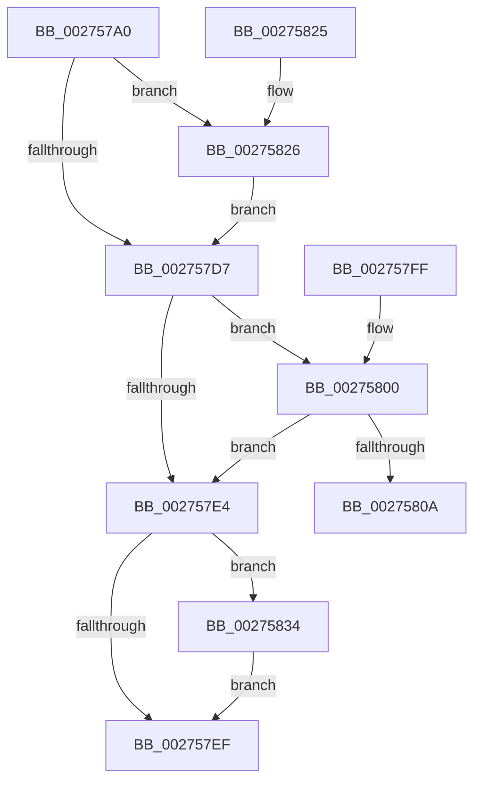

# KeAcquireInStackQueuedSpinLock

- RVA: `0x002757A0`–`0x0027583E` (길이 `158` bytes)
- VA: `0x00000001402757A0`
- 실행 섹션: `.text`
- PDB 이름 있음: `예`; PDB Function 태그: `아니요`
- unwind 정보 RVA: `0x00065E40`
- 디코드: `46`개 명령, `158/158` bytes 표시
- 미해석 바이트: `0` (있으면 어셈블리에 `.byte`로 보존)

> 이 문서는 커널 이미지의 기계어와 PDB 기호를 분석해 생성했습니다. 4번과 5번은 함수 원형과 자료형을 바이너리 사용 방식에서 추정한 C 해석이며 원본 소스 복구 결과는 아닙니다.

## 1. Dependencies

- 직접 호출 지점: **3**; 고유 호출 대상: **3**
- 직접 호출자로 확인된 함수: **201**
- RIP 상대 이미지 참조: **3**

### Outgoing calls
- `0x00275810` → [KiAcquireQueuedSpinLockInstrumented](KiAcquireQueuedSpinLockInstrumented_function_00275850.md) (function, `0x00275850`)
- `0x0027582D` → [KiRaiseIrqlProcessIrqlFlags](../4F/KiRaiseIrqlProcessIrqlFlags_function_004F56FC.md) (function, `0x004F56FC`)
- `0x00275837` → [KxWaitForLockOwnerShip](../25/KxWaitForLockOwnerShip_function_00257EB0.md) (function, `0x00257EB0`)

### Direct callers
- [SepRmCallLsa](../22/SepRmCallLsa_function_00223630.md) at `0x0022371D`
- [SepQueueWorkItem](../22/SepQueueWorkItem_function_00225844.md) at `0x002258A8`
- [CcFlushCacheOneRange](../23/CcFlushCacheOneRange_function_00236A30.md) at `0x00236E6E`
- [CcSetFileSizesEx](../26/CcSetFileSizesEx_function_0026D070.md) at `0x0026D0C5`
- [CcSetFileSizesEx](../26/CcSetFileSizesEx_function_0026D070.md) at `0x0026D0FD`
- [CcSetFileSizesEx](../26/CcSetFileSizesEx_function_0026D070.md) at `0x0026D138`
- [CcSetFileSizesEx](../26/CcSetFileSizesEx_function_0026D070.md) at `0x0026D257`
- [CcSetFileSizesEx](../26/CcSetFileSizesEx_function_0026D070.md) at `0x0026D2D1`
- [PopIrpWorker](../26/PopIrpWorker_function_0026D410.md) at `0x0026D505`
- [PopDequeueQuerySetIrp](../26/PopDequeueQuerySetIrp_function_0026EC34.md) at `0x0026ECAC`
- [PopFreeIrp](../26/PopFreeIrp_function_0026FAA0.md) at `0x0026FAF5`
- [PopAllocateIrp](PopAllocateIrp_function_0027116C.md) at `0x002713B2`
- [CcUnmapInactiveViewsInternal](CcUnmapInactiveViewsInternal_function_0027174C.md) at `0x00271ACE`
- [CcUnmapInactiveViewsInternal](CcUnmapInactiveViewsInternal_function_0027174C.md) at `0x00271CE4`
- [CcUnmapInactiveViewsInternal](CcUnmapInactiveViewsInternal_function_0027174C.md) at `0x00271D19`
- [NtShutdownWorkerFactory](../2A/NtShutdownWorkerFactory_function_002A4E60.md) at `0x002A4F33`
- [ExpShutdownWorkerFactory](../2A/ExpShutdownWorkerFactory_function_002A4F70.md) at `0x002A4F99`
- [PopQueueQuerySetIrp](../2B/PopQueueQuerySetIrp_function_002BEF18.md) at `0x002BF01F`
- [ExAllocateContiguousHeapPool](../2E/ExAllocateContiguousHeapPool_function_002EE960.md) at `0x002EEBAC`
- [ExpInsertPoolTracker](../2E/ExpInsertPoolTracker_function_002EEFAC.md) at `0x002EF101`
- [AlpcpSignalAndWait](../2F/AlpcpSignalAndWait_function_002F9620.md) at `0x002F9AD9`
- [sub_003422B4](../34/Unknown_function_003422B4.md) at `0x00342336`
- [sub_00344568](../34/Unknown_function_00344568.md) at `0x00344611`
- [ExpWorkerFactoryCreateThread](../34/ExpWorkerFactoryCreateThread_function_0034B620.md) at `0x0034B69A`
- [ExpWorkerFactoryCreateThread](../34/ExpWorkerFactoryCreateThread_function_0034B620.md) at `0x0034B72C`
- [ExpWorkerFactoryCreateThread](../34/ExpWorkerFactoryCreateThread_function_0034B620.md) at `0x0034B7BA`
- [NtSetInformationWorkerFactory](../35/NtSetInformationWorkerFactory_function_00350A30.md) at `0x00350F5E`
- [NtSetInformationWorkerFactory](../35/NtSetInformationWorkerFactory_function_00350A30.md) at `0x00351190`
- [IopDeleteIoCompletionInternal](../35/IopDeleteIoCompletionInternal_function_00351438.md) at `0x0035146C`
- [CcRepostToSynchronousLazywriter](../35/CcRepostToSynchronousLazywriter_function_0035492C.md) at `0x00354978`
- [CcAsyncLazywriteWorker](../35/CcAsyncLazywriteWorker_function_00354C28.md) at `0x00354CA2`
- [CcPostWorkQueueRegular](../35/CcPostWorkQueueRegular_function_00356834.md) at `0x003568A0`
- [CcWriteBehindPreProcess](../35/CcWriteBehindPreProcess_function_00357784.md) at `0x003577FE`
- [CcWriteBehindPreProcess](../35/CcWriteBehindPreProcess_function_00357784.md) at `0x00357832`
- [CcWriteBehindPreProcess](../35/CcWriteBehindPreProcess_function_00357784.md) at `0x003578BD`
- [CcWriteBehindPreProcess](../35/CcWriteBehindPreProcess_function_00357784.md) at `0x0035794C`
- [CcWriteBehindPreProcess](../35/CcWriteBehindPreProcess_function_00357784.md) at `0x00357B40`
- [CcWriteBehindPostProcess](../35/CcWriteBehindPostProcess_function_00357BB4.md) at `0x00357C6F`
- [CcWriteBehindPostProcess](../35/CcWriteBehindPostProcess_function_00357BB4.md) at `0x00357CDF`
- [CcWriteBehindPostProcess](../35/CcWriteBehindPostProcess_function_00357BB4.md) at `0x00357CEF`
- [CcAsyncCopyRead](../35/CcAsyncCopyRead_function_00358880.md) at `0x003589D6`
- [CcGetDirtyPagesHelper](../35/CcGetDirtyPagesHelper_function_00358D40.md) at `0x00358DBB`
- [CcFlushCachePostProcessOneRange](../35/CcFlushCachePostProcessOneRange_function_00359710.md) at `0x00359BE4`
- [CcUnpinFileDataEx](../35/CcUnpinFileDataEx_function_00359DEC.md) at `0x00359F13`
- [CcSetDirtyPinnedData](../35/CcSetDirtyPinnedData_function_0035A120.md) at `0x0035A2A9`
- [CcFlushCachePreProcess](../35/CcFlushCachePreProcess_function_0035A9B0.md) at `0x0035AAC6`
- [ExAllocateHeapPool](../35/ExAllocateHeapPool_function_0035BA30.md) at `0x0035EFC4`
- [IoDiskIoAttributionQuery](../37/IoDiskIoAttributionQuery_function_00379D38.md) at `0x00379D97`
- [CcAdjustWriteBehindThreadPoolIfNeeded](../38/CcAdjustWriteBehindThreadPoolIfNeeded_function_00386D94.md) at `0x00386E04`
- [CcCanIWrite](../38/CcCanIWrite_function_00388250.md) at `0x003885E7`
- [CcScheduleReadAheadNuma](../38/CcScheduleReadAheadNuma_function_0038883C.md) at `0x00388B21`
- [CcLazyWriteScanVolume](../38/CcLazyWriteScanVolume_function_00388DC0.md) at `0x00388E40`
- [CcLazyWriteScanVolume](../38/CcLazyWriteScanVolume_function_00388DC0.md) at `0x003890C8`
- [CcLazyWriteScanVolume](../38/CcLazyWriteScanVolume_function_00388DC0.md) at `0x00389452`
- [CcLazyWriteScanVolume](../38/CcLazyWriteScanVolume_function_00388DC0.md) at `0x003894AC`
- [CcForEachPrivateVolumeCacheMap](../38/CcForEachPrivateVolumeCacheMap_function_0038967C.md) at `0x003896C4`
- [CcForEachPrivateVolumeCacheMap](../38/CcForEachPrivateVolumeCacheMap_function_0038967C.md) at `0x00389705`
- [CcCanIWriteStreamEx](../38/CcCanIWriteStreamEx_function_0038993C.md) at `0x00389A20`
- [CcCanIWriteStreamEx](../38/CcCanIWriteStreamEx_function_0038993C.md) at `0x00389B5E`
- [CcDeleteBcbs](../38/CcDeleteBcbs_function_00389BF0.md) at `0x00389CE3`
- [CcForceWriteThrough](../38/CcForceWriteThrough_function_00389E50.md) at `0x00389F77`
- [CcScanLogHandleList](../38/CcScanLogHandleList_function_0038A26C.md) at `0x0038A31B`
- [CcDeleteSharedCacheMap](../38/CcDeleteSharedCacheMap_function_0038A804.md) at `0x0038AA4B`
- [CcPurgeCacheSection](../38/CcPurgeCacheSection_function_0038B130.md) at `0x0038B1FA`
- [CcPurgeCacheSection](../38/CcPurgeCacheSection_function_0038B130.md) at `0x0038B32F`
- [CcPurgeCacheSection](../38/CcPurgeCacheSection_function_0038B130.md) at `0x0038B3AD`
- [CcDecrementVolumeUseCountWithDelete](../38/CcDecrementVolumeUseCountWithDelete_function_0038B888.md) at `0x0038B8E9`
- [CcDeleteMbcb](../38/CcDeleteMbcb_function_0038C088.md) at `0x0038C0F4`
- [AlpcpSignal](../39/AlpcpSignal_function_003955E0.md) at `0x00396261`
- [CcLazyWriteScan](../3C/CcLazyWriteScan_function_003C9394.md) at `0x003C941C`
- [CcLazyWriteScan](../3C/CcLazyWriteScan_function_003C9394.md) at `0x003C9873`
- [CcLazyWriteScan](../3C/CcLazyWriteScan_function_003C9394.md) at `0x003C9922`
- [CcLazyWriteScan](../3C/CcLazyWriteScan_function_003C9394.md) at `0x003C9995`
- [CcQueueLazyWriteScanThreadForVolume](../3C/CcQueueLazyWriteScanThreadForVolume_function_003C9AF0.md) at `0x003C9C53`
- [CcQueueLazyWriteScanThreadForVolume](../3C/CcQueueLazyWriteScanThreadForVolume_function_003C9AF0.md) at `0x003C9CDA`
- [CcQueueLazyWriteScanThreadForVolume](../3C/CcQueueLazyWriteScanThreadForVolume_function_003C9AF0.md) at `0x003C9D7F`
- [CcCoalescingCallBackHelper](../3C/CcCoalescingCallBackHelper_function_003CA200.md) at `0x003CA252`
- [CcCoalescingCallBackHelper](../3C/CcCoalescingCallBackHelper_function_003CA200.md) at `0x003CA2DF`
- [CcCoalescingCallBackHelper](../3C/CcCoalescingCallBackHelper_function_003CA200.md) at `0x003CA303`
- [CcMdlWriteComplete2](../3C/CcMdlWriteComplete2_function_003CA36C.md) at `0x003CA424`
- [CcMapAndCopyInToCache](../3C/CcMapAndCopyInToCache_function_003CA7F0.md) at `0x003CB208`
- [CcMapAndCopyInToCache](../3C/CcMapAndCopyInToCache_function_003CA7F0.md) at `0x003CB292`
- [CcSetDirtyInMask](../3C/CcSetDirtyInMask_function_003CB688.md) at `0x003CB80D`
- [CcSetDirtyInMask](../3C/CcSetDirtyInMask_function_003CB688.md) at `0x003CBA10`
- [CcInitializeCacheMapInternal](../3C/CcInitializeCacheMapInternal_function_003CC720.md) at `0x003CCA06`
- [CcInitializeCacheMapInternal](../3C/CcInitializeCacheMapInternal_function_003CC720.md) at `0x003CCB3A`
- [CcInitializeCacheMapInternal](../3C/CcInitializeCacheMapInternal_function_003CC720.md) at `0x003CCCE4`
- [CcInitializeCacheMapInternal](../3C/CcInitializeCacheMapInternal_function_003CC720.md) at `0x003CCCF4`
- [CcInitializeCacheMapInternal](../3C/CcInitializeCacheMapInternal_function_003CC720.md) at `0x003CCE14`
- [CcInitializeCacheMapInternal](../3C/CcInitializeCacheMapInternal_function_003CC720.md) at `0x003CCE2C`
- [CcInitializeCacheMapInternal](../3C/CcInitializeCacheMapInternal_function_003CC720.md) at `0x003CCEE1`
- [CcInitializeCacheMapInternal](../3C/CcInitializeCacheMapInternal_function_003CC720.md) at `0x003CCF66`
- [CcInitializeCacheMapInternal](../3C/CcInitializeCacheMapInternal_function_003CC720.md) at `0x003CCFBF`
- [CcInitializeCacheMapInternal](../3C/CcInitializeCacheMapInternal_function_003CC720.md) at `0x003CD096`
- [CcInitializeCacheMapInternal](../3C/CcInitializeCacheMapInternal_function_003CC720.md) at `0x003CD175`
- [CcInitializeCacheMapInternal](../3C/CcInitializeCacheMapInternal_function_003CC720.md) at `0x003CD277`
- [CcUninitializeCacheMap](../3C/CcUninitializeCacheMap_function_003CD520.md) at `0x003CD57F`
- [CcUninitializeCacheMap](../3C/CcUninitializeCacheMap_function_003CD520.md) at `0x003CD5C2`
- [CcCreatePrivateVolumeCacheMap](../3C/CcCreatePrivateVolumeCacheMap_function_003CDB20.md) at `0x003CDC4A`
- [CcFindPrivateVolumeCacheMap](../3C/CcFindPrivateVolumeCacheMap_function_003CDC80.md) at `0x003CDDCB`
- [CcInsertPrivateVolumeCacheMap](../3C/CcInsertPrivateVolumeCacheMap_function_003CE714.md) at `0x003CE910`
- [CcDeletePrivateVolumeCacheMap](../3C/CcDeletePrivateVolumeCacheMap_function_003CE950.md) at `0x003CEB70`
- [CcReapPrivateVolumeCachemapWorkerThread](../3C/CcReapPrivateVolumeCachemapWorkerThread_function_003CF320.md) at `0x003CF35E`
- [ExAcquireSharedWaitForExclusive](../3D/ExAcquireSharedWaitForExclusive_function_003D43F0.md) at `0x003D4483`
- [ExpExpandResourceOwnerTable](../3D/ExpExpandResourceOwnerTable_function_003D489C.md) at `0x003D4901`
- [ExpExpandResourceOwnerTable](../3D/ExpExpandResourceOwnerTable_function_003D489C.md) at `0x003D4969`
- [HalpDmaAllocateScatterPagesFromScatterPoolV3](../3D/HalpDmaAllocateScatterPagesFromScatterPoolV3_function_003DC5D8.md) at `0x003DC610`
- [KeInsertDeviceQueue](../3D/KeInsertDeviceQueue_function_003DD900.md) at `0x003DD9F2`
- [HalpDmaAllocateMapRegisters](../3D/HalpDmaAllocateMapRegisters_function_003DDA0C.md) at `0x003DDB32`
- [HalpDmaAllocateMapRegisters](../3D/HalpDmaAllocateMapRegisters_function_003DDA0C.md) at `0x003DDBAE`
- [KeRemoveDeviceQueue](../3D/KeRemoveDeviceQueue_function_003DF890.md) at `0x003DF9A5`
- [HalpDmaDequeueAdapter](../3D/HalpDmaDequeueAdapter_function_003DF9C0.md) at `0x003DFA10`
- [HalpDmaDequeueAdapter](../3D/HalpDmaDequeueAdapter_function_003DF9C0.md) at `0x003DFA6A`
- [HalpDmaAllocateContiguousPagesFromContiguousPoolV2](../3E/HalpDmaAllocateContiguousPagesFromContiguousPoolV2_function_003E02A0.md) at `0x003E02DD`
- [HalpDmaReturnToContiguousPool](../3E/HalpDmaReturnToContiguousPool_function_003E1758.md) at `0x003E17DE`
- [HalpDmaAllocateScatterPagesFromContiguousPoolV2](../3E/HalpDmaAllocateScatterPagesFromContiguousPoolV2_function_003E1DC4.md) at `0x003E1E03`
- [AlpcpQueueIoCompletionPort](../3F/AlpcpQueueIoCompletionPort_function_003FF760.md) at `0x003FFDFD`
- [CcAcquireByteRangeForWrite](../40/CcAcquireByteRangeForWrite_function_00401E74.md) at `0x004020C1`
- [CcGetFlushedValidData](../40/CcGetFlushedValidData_function_00402920.md) at `0x00402A00`
- [CcGetFlushedValidData](../40/CcGetFlushedValidData_function_00402920.md) at `0x00402A4F`
- [CcGetFlushedValidData](../40/CcGetFlushedValidData_function_00402920.md) at `0x00402AB0`
- [CcNotifyOfMappedWrite](../40/CcNotifyOfMappedWrite_function_0040338C.md) at `0x004033E8`
- [CcNotifyOfMappedWrite](../40/CcNotifyOfMappedWrite_function_0040338C.md) at `0x0040343B`
- [CcNotifyOfMappedWrite](../40/CcNotifyOfMappedWrite_function_0040338C.md) at `0x004034B8`
- [CcNotifyOfMappedWrite](../40/CcNotifyOfMappedWrite_function_0040338C.md) at `0x004034E4`
- [CcNotifyOfMappedWriteComplete](../40/CcNotifyOfMappedWriteComplete_function_0040873C.md) at `0x00408800`
- [ExDisableResourceBoostLite](../41/ExDisableResourceBoostLite_function_0041F840.md) at `0x0041F880`
- [NtCancelWaitCompletionPacket](../42/NtCancelWaitCompletionPacket_function_0042F100.md) at `0x0042F1AC`
- [IopCloseWaitCompletionPacket](../42/IopCloseWaitCompletionPacket_function_0042F520.md) at `0x0042F5BD`
- [PopWakeDeviceList](../43/PopWakeDeviceList_function_00430238.md) at `0x0043036A`
- [PopSleepDeviceList](../43/PopSleepDeviceList_function_00430460.md) at `0x004305E0`
- [CcChangeBackingFileObject](../45/CcChangeBackingFileObject_function_00457E5C.md) at `0x00457ECD`
- [CcCompleteAsyncRead](../45/CcCompleteAsyncRead_function_0045E7DC.md) at `0x0045EA2F`
- [KeAcquireInStackQueuedSpinLockForDpc](../45/KeAcquireInStackQueuedSpinLockForDpc_function_0045FE50.md) at `0x0045FEAF`
- [CcWaitForUninitializeCacheMap](../46/CcWaitForUninitializeCacheMap_function_004633F0.md) at `0x004634AE`
- [CcWaitForUninitializeCacheMap](../46/CcWaitForUninitializeCacheMap_function_004633F0.md) at `0x00463578`
- [CcMapDataForOverwrite](../46/CcMapDataForOverwrite_function_00466160.md) at `0x00466315`
- [KeSetSchedulingGroupWeights](../46/KeSetSchedulingGroupWeights_function_0046D024.md) at `0x0046D05E`
- [KeInsertSchedulingGroup](../46/KeInsertSchedulingGroup_function_0046D324.md) at `0x0046D3DE`
- [KeSetSchedulingGroupCpuRates](../46/KeSetSchedulingGroupCpuRates_function_0046DE5C.md) at `0x0046DE93`
- [PoHandleIrp](../47/PoHandleIrp_function_004709D0.md) at `0x00470AAE`
- [PoHandleIrp](../47/PoHandleIrp_function_004709D0.md) at `0x00470B62`
- [NtWorkerFactoryWorkerReady](../47/NtWorkerFactoryWorkerReady_function_00474CF0.md) at `0x00474D51`
- [PopApplyLegacyPowerRequestFlags](../47/PopApplyLegacyPowerRequestFlags_function_00477364.md) at `0x004773F8`
- [PopPowerRequestReferenceRelease](../47/PopPowerRequestReferenceRelease_function_004775B0.md) at `0x00477635`
- [PopPowerRequestReferenceAcquire](../47/PopPowerRequestReferenceAcquire_function_004776C0.md) at `0x0047773B`
- [PopPowerRequestHandleRequestOverrideQueryResponse](../47/PopPowerRequestHandleRequestOverrideQueryResponse_function_004777FC.md) at `0x0047783D`
- [PopPowerRequestHandleClose](../47/PopPowerRequestHandleClose_function_00477894.md) at `0x004778CC`
- [PopPowerRequestCallbackWorker](../47/PopPowerRequestCallbackWorker_function_00477AD0.md) at `0x00477B03`
- [PopPowerRequestCallbackWorker](../47/PopPowerRequestCallbackWorker_function_00477AD0.md) at `0x00477C03`
- [AlpcpFreeCompletionPacketLookaside](../47/AlpcpFreeCompletionPacketLookaside_function_0047BBB0.md) at `0x0047BBD1`
- [PopCompleteNotifyTransitionCommon](../48/PopCompleteNotifyTransitionCommon_function_00483B4C.md) at `0x00483BC4`
- [ExpDeleteWorkerFactory](../48/ExpDeleteWorkerFactory_function_00486880.md) at `0x004868A9`
- [KeQuerySchedulingGroupHistory](../48/KeQuerySchedulingGroupHistory_function_0048B8B4.md) at `0x0048B8F3`
- [CcIsThereDirtyDataHelper](../48/CcIsThereDirtyDataHelper_function_0048BF30.md) at `0x0048BF70`
- [CcIsThereDirtyDataHelper](../48/CcIsThereDirtyDataHelper_function_0048BF30.md) at `0x0048BFEB`
- [CcWorkerThread](../48/CcWorkerThread_function_0048F0F0.md) at `0x0048F1AA`
- [CcWorkerThread](../48/CcWorkerThread_function_0048F0F0.md) at `0x0048F56E`
- [CcPerformReadAhead](../48/CcPerformReadAhead_function_0048F738.md) at `0x0048F877`
- [CcPerformReadAhead](../48/CcPerformReadAhead_function_0048F738.md) at `0x0048FC29`
- [CcPerformReadAhead](../48/CcPerformReadAhead_function_0048F738.md) at `0x0048FC75`
- [WmipWriteWnodeToObject](../49/WmipWriteWnodeToObject_function_00491C0C.md) at `0x00491C4B`
- [WmipCompleteGuidIrpWithError](../49/WmipCompleteGuidIrpWithError_function_004955BC.md) at `0x004955E0`
- [CcPrepareMdlWrite](../49/CcPrepareMdlWrite_function_004996D0.md) at `0x00499A08`
- [HalpDmaCommitScatterMapBuffers](../49/HalpDmaCommitScatterMapBuffers_function_0049A9D0.md) at `0x0049AAE3`
- [HalpDmaGetTranslationEntries](../49/HalpDmaGetTranslationEntries_function_0049AB3C.md) at `0x0049AB8D`
- [ExpWorkerFactoryDeferredThreadCreation](../49/ExpWorkerFactoryDeferredThreadCreation_function_0049F1A8.md) at `0x0049F1EA`
- [CcSetAdditionalCacheAttributesEx](../4A/CcSetAdditionalCacheAttributesEx_function_004A5000.md) at `0x004A5056`
- [CcDeductDirtyPagesFromExternalCache](../4A/CcDeductDirtyPagesFromExternalCache_function_004A65D0.md) at `0x004A6651`
- [PopUpdateWakeSource](../4A/PopUpdateWakeSource_function_004AA70C.md) at `0x004AA754`
- [KeRemoveSchedulingGroup](../4A/KeRemoveSchedulingGroup_function_004AD328.md) at `0x004AD35A`
- [CcGetFileObjectFromSectionPtrs](../4B/CcGetFileObjectFromSectionPtrs_function_004B0E60.md) at `0x004B0E8A`
- [CcAsyncLazywriteWorkerThread](../4B/CcAsyncLazywriteWorkerThread_function_004B2130.md) at `0x004B21C1`
- [CcAsyncLazywriteWorkerThread](../4B/CcAsyncLazywriteWorkerThread_function_004B2130.md) at `0x004B2275`
- [CcPostWorkQueueAsyncLazywrite](../4B/CcPostWorkQueueAsyncLazywrite_function_004BA17C.md) at `0x004BA1EA`
- [PopGetMostRecentWakeInfo](../4B/PopGetMostRecentWakeInfo_function_004BE4F8.md) at `0x004BE51B`
- [PopPowerRequestUnrevokeRequests](../4B/PopPowerRequestUnrevokeRequests_function_004BF3D0.md) at `0x004BF3F7`
- [CcQuickLazyWriteScanForVolume](../4B/CcQuickLazyWriteScanForVolume_function_004BFEE0.md) at `0x004BFF43`
- [PopPowerRequestRevokeRequests](../4C/PopPowerRequestRevokeRequests_function_004C0158.md) at `0x004C018A`
- [CcPostWorkQueueSpecial](../4C/CcPostWorkQueueSpecial_function_004C046C.md) at `0x004C04F0`
- [CcPostPVCMForDeleteToPartition](../4C/CcPostPVCMForDeleteToPartition_function_004C2DBC.md) at `0x004C2E2C`
- [CcPostPVCMDelayedDelete](../4C/CcPostPVCMDelayedDelete_function_004C2EE4.md) at `0x004C2F2C`
- [PopAcquireWakeSourceSpinLock](../4C/PopAcquireWakeSourceSpinLock_function_004C75D4.md) at `0x004C75E2`
- [PopGetCurrentWakeInfos](../4C/PopGetCurrentWakeInfos_function_004C8840.md) at `0x004C8875`
- [CcSetLoggedDataThreshold](../4C/CcSetLoggedDataThreshold_function_004C8D50.md) at `0x004C8D8A`
- [PopRecordPoIrpBlackboxInformation](../4C/PopRecordPoIrpBlackboxInformation_function_004CE14C.md) at `0x004CE1A2`
- [CcAsyncLazywriteWorkerMulti](../4D/CcAsyncLazywriteWorkerMulti_function_004D1574.md) at `0x004D183A`
- [CcAsyncLazywriteWorkerMulti](../4D/CcAsyncLazywriteWorkerMulti_function_004D1574.md) at `0x004D18AA`
- [CcAsyncLazywriteWorkerMulti](../4D/CcAsyncLazywriteWorkerMulti_function_004D1574.md) at `0x004D194B`
- [CcAsyncLazywriteWorkerMulti](../4D/CcAsyncLazywriteWorkerMulti_function_004D1574.md) at `0x004D195D`
- [NtQueryInformationWorkerFactory](../4D/NtQueryInformationWorkerFactory_function_004D4480.md) at `0x004D4597`
- [CcLogExtraWBThreadAction](../4D/CcLogExtraWBThreadAction_function_004D737C.md) at `0x004D73B7`
- [HalpDmaFlushBufferWithEmergencyResources](../4D/HalpDmaFlushBufferWithEmergencyResources_function_004D8024.md) at `0x004D8063`
- [IoPerfInit](../4D/IoPerfInit_function_004DC338.md) at `0x004DC361`
- [HalpDmaSyncMapBuffersWithEmergencyResources](../4D/HalpDmaSyncMapBuffersWithEmergencyResources_function_004DE714.md) at `0x004DE768`
- [HalpDmaQueueAdapter](../4E/HalpDmaQueueAdapter_function_004E2B3C.md) at `0x004E2B96`
- [HalpDmaQueueAdapter](../4E/HalpDmaQueueAdapter_function_004E2B3C.md) at `0x004E2BBB`
- [HalpDmaAllocateScatterPagesFromContiguousPoolV3](../4E/HalpDmaAllocateScatterPagesFromContiguousPoolV3_function_004E380C.md) at `0x004E3849`
- [WmipReceiveNotifications](../4E/WmipReceiveNotifications_function_004EC280.md) at `0x004EC689`
- [HalpDmaAllocateContiguousPagesFromContiguousPoolV3](../53/HalpDmaAllocateContiguousPagesFromContiguousPoolV3_function_0053DE24.md) at `0x0053DE61`
- [HalpDmaRemoveAdapterFromMasterQueue](../53/HalpDmaRemoveAdapterFromMasterQueue_function_0053E2FC.md) at `0x0053E33C`
- [HalReadDmaCounterV2](../53/HalReadDmaCounterV2_function_0053FB70.md) at `0x0053FB98`
- [HalpDmaCommitContiguousMapBuffers](../55/HalpDmaCommitContiguousMapBuffers_function_00550A84.md) at `0x00550BC6`
- [CcGetFileObjectFromSectionPtrsRef](../57/CcGetFileObjectFromSectionPtrsRef_function_0057B180.md) at `0x0057B1AA`
- [CcQueueLazyWriteScanThread](../57/CcQueueLazyWriteScanThread_function_0057BBD0.md) at `0x0057BD7D`
- [CcQueueLazyWriteScanThread](../57/CcQueueLazyWriteScanThread_function_0057BBD0.md) at `0x0057BDD7`
- [CcRegisterExternalCacheEx](../57/CcRegisterExternalCacheEx_function_0057C0B0.md) at `0x0057C1C7`
- [CcUpdateExternalCacheInfoEx](../57/CcUpdateExternalCacheInfoEx_function_0057C420.md) at `0x0057C4F1`
- [CcUpdateExternalCacheInfoEx](../57/CcUpdateExternalCacheInfoEx_function_0057C420.md) at `0x0057C560`
- [CcWaitForCurrentLazyWriterActivityOnNode](../57/CcWaitForCurrentLazyWriterActivityOnNode_function_0057C618.md) at `0x0057C6D3`
- [CcWaitForCurrentLazyWriterActivityOnNode](../57/CcWaitForCurrentLazyWriterActivityOnNode_function_0057C618.md) at `0x0057C790`
- [CcDeferWrite](../57/CcDeferWrite_function_0057C860.md) at `0x0057C97F`
- [CcErrorCallbackRoutine](../57/CcErrorCallbackRoutine_function_0057C9D0.md) at `0x0057CA1C`
- [CcIsThereDirtyDataEx](../57/CcIsThereDirtyDataEx_function_0057D7B0.md) at `0x0057D7ED`
- [CcSetLogHandleForFile](../57/CcSetLogHandleForFile_function_0057D890.md) at `0x0057D8EC`
- [CcMdlWriteAbort](../57/CcMdlWriteAbort_function_0057DA70.md) at `0x0057DAE2`
- [CcDrainDelayDeleteForPartitionExit](../57/CcDrainDelayDeleteForPartitionExit_function_0057DBB0.md) at `0x0057DBE4`
- [CcDrainDelayDeleteForPartitionExit](../57/CcDrainDelayDeleteForPartitionExit_function_0057DBB0.md) at `0x0057DC46`
- [CcProcessDelayedDeletePVCM](../57/CcProcessDelayedDeletePVCM_function_0057DCD0.md) at `0x0057DD27`
- [CcDeletePartition](../57/CcDeletePartition_function_0057DE9C.md) at `0x0057DFB0`
- [CcDeleteSectionsForPartition](../57/CcDeleteSectionsForPartition_function_0057E0F8.md) at `0x0057E16A`
- [CcDeleteSectionsForPartition](../57/CcDeleteSectionsForPartition_function_0057E0F8.md) at `0x0057E17D`
- [CcExitPartition](../57/CcExitPartition_function_0057E340.md) at `0x0057E3C1`
- [CcExitPartition](../57/CcExitPartition_function_0057E340.md) at `0x0057E442`
- [CcGetDeviceGuidAsync](../57/CcGetDeviceGuidAsync_function_0057ED70.md) at `0x0057EDEE`
- [CcCompleteAsyncLazywriteWorker](../57/CcCompleteAsyncLazywriteWorker_function_0057F6AC.md) at `0x0057F6F9`
- [CcCompleteAsyncLazywriteWorker](../57/CcCompleteAsyncLazywriteWorker_function_0057F6AC.md) at `0x0057F739`
- [CcCompleteAsyncLazywriteWorkerThread](../57/CcCompleteAsyncLazywriteWorkerThread_function_0057F770.md) at `0x0057F7C4`
- [CcCompleteAsyncWriteBehind](../57/CcCompleteAsyncWriteBehind_function_0057F824.md) at `0x0057F901`
- [CcCompleteAsyncWriteBehind](../57/CcCompleteAsyncWriteBehind_function_0057F824.md) at `0x0057F970`
- [IopIrpExtensionControl](../59/IopIrpExtensionControl_function_00597558.md) at `0x00597581`
- [IopUpdateFunctionPointers](../59/IopUpdateFunctionPointers_function_0059762C.md) at `0x00597662`
- [IoCancelMiniCompletionPacket](../59/IoCancelMiniCompletionPacket_function_00598150.md) at `0x00598178`
- [IoPerfReset](../59/IoPerfReset_function_0059863C.md) at `0x0059865F`
- [KeRemoveEntryDeviceQueue](../5B/KeRemoveEntryDeviceQueue_function_005BE410.md) at `0x005BE43C`
- [KiEnableGroupScheduling](../5C/KiEnableGroupScheduling_function_005C8914.md) at `0x005C8933`
- [KeTraceSchedulingGroupRundown](../5C/KeTraceSchedulingGroupRundown_function_005C8D20.md) at `0x005C8D52`
- [KeUpdateGroupSchedulingConstants](../5C/KeUpdateGroupSchedulingConstants_function_005C8E14.md) at `0x005C8E44`
- [PfpPartitionInsertToGlobals](../5C/PfpPartitionInsertToGlobals_function_005CE040.md) at `0x005CE077`
- [PfpPartitionRemoveFromGlobals](../5C/PfpPartitionRemoveFromGlobals_function_005CE11C.md) at `0x005CE144`
- [PopIrpWatchdogBugcheck](../5C/PopIrpWatchdogBugcheck_function_005CE868.md) at `0x005CE974`
- [PopDereferenceWakeInfos](../5D/PopDereferenceWakeInfos_function_005D498C.md) at `0x005D49BA`
- [SepAdtInitLsaDeadEventForNonPagedList](../60/SepAdtInitLsaDeadEventForNonPagedList_function_0060647C.md) at `0x006064A0`
- [DifKeAcquireInStackQueuedSpinLockWrapper](../62/DifKeAcquireInStackQueuedSpinLockWrapper_function_0062E700.md) at `0x0062E7D7`
- [ExPoolQueryLimits](../65/ExPoolQueryLimits_function_006562A0.md) at `0x006563C1`
- [ExpPlGrowTableIfNeeded](../65/ExpPlGrowTableIfNeeded_function_00656F14.md) at `0x00656F44`
- [ExpPlGrowTableIfNeeded](../65/ExpPlGrowTableIfNeeded_function_00656F14.md) at `0x00656FB5`
- [ExpTrackTableInsertLimit](../65/ExpTrackTableInsertLimit_function_006572D0.md) at `0x0065741E`
- [ExpTryConvertSharedToExclusiveLite](../65/ExpTryConvertSharedToExclusiveLite_function_00658F30.md) at `0x00658F62`
- [ExpTryToAcquireResourceExclusiveLite](../65/ExpTryToAcquireResourceExclusiveLite_function_00658FEC.md) at `0x0065904A`
- [ExpWorkerFactoryManagerThread](../65/ExpWorkerFactoryManagerThread_function_0065CCC0.md) at `0x0065CD53`
- [ExpWorkerFactoryManagerThread](../65/ExpWorkerFactoryManagerThread_function_0065CCC0.md) at `0x0065CDA7`
- [CcMapAndCopyInToCache$fin$1](../6D/CcMapAndCopyInToCache_fin_1_function_006D2AF9.md) at `0x006D2C63`
- [CcCompleteAsyncRead$fin$1](../6D/CcCompleteAsyncRead_fin_1_function_006D3387.md) at `0x006D34A8`
- [CcPerformReadAhead$fin$1](../6D/CcPerformReadAhead_fin_1_function_006D3929.md) at `0x006D399C`
- [CcPerformReadAhead$fin$1](../6D/CcPerformReadAhead_fin_1_function_006D3929.md) at `0x006D3A29`
- [CcPrepareMdlWrite$fin$0](../6D/CcPrepareMdlWrite_fin_0_function_006D3DF5.md) at `0x006D3F08`
- [sub_006E2B2A](../6E/Unknown_function_006E2B2A.md) at `0x006E2B75`
- [sub_006E4F4E](../6E/Unknown_function_006E4F4E.md) at `0x006E4F5D`
- [sub_006E5110](../6E/Unknown_function_006E5110.md) at `0x006E5193`
- [sub_006E85B0](../6E/Unknown_function_006E85B0.md) at `0x006E85F0`
- [sub_006E8790](../6E/Unknown_function_006E8790.md) at `0x006E87AD`
- [sub_006E8986](../6E/Unknown_function_006E8986.md) at `0x006E899F`
- [sub_006E96C4](../6E/Unknown_function_006E96C4.md) at `0x006E9764`
- [sub_006EA0C0](../6E/Unknown_function_006EA0C0.md) at `0x006EA0D0`
- [sub_006EA110](../6E/Unknown_function_006EA110.md) at `0x006EA11F`
- [sub_006EA22C](../6E/Unknown_function_006EA22C.md) at `0x006EA360`
- [sub_006EA3B0](../6E/Unknown_function_006EA3B0.md) at `0x006EA3C3`
- [sub_006EC29A](../6E/Unknown_function_006EC29A.md) at `0x006EC30A`
- [sub_006EC29A](../6E/Unknown_function_006EC29A.md) at `0x006EC34B`
- [sub_006F94DC](../6F/Unknown_function_006F94DC.md) at `0x006F94EF`
- [sub_006FC492](../6F/Unknown_function_006FC492.md) at `0x006FC4A7`
- [sub_006FCB7E](../6F/Unknown_function_006FCB7E.md) at `0x006FCB99`
- [PnprMarkOrMirrorPages](../../pagelk/B6/PnprMarkOrMirrorPages_function_00B646A8.md) at `0x00B647A8`
- [KiAddProcessorToGroupSchedulingDatabase](../../pagelk/B6/KiAddProcessorToGroupSchedulingDatabase_function_00B6B1D8.md) at `0x00B6B208`
- [PopBroadcastBlameBugcheckCallback](../../pagelk/B7/PopBroadcastBlameBugcheckCallback_function_00B70B40.md) at `0x00B70B88`
- [PopBroadcastBlameBugcheckCallback](../../pagelk/B7/PopBroadcastBlameBugcheckCallback_function_00B70B40.md) at `0x00B70B99`

### Static image references
- `0x002757CE` → RVA `0x00FC6D20` (`ALMOSTRO`; read)
- `0x002757DB` → RVA `0x00FC6B06` (`ALMOSTRO`; read)
- `0x00275800` → RVA `0x00F0DE58` (`.data`; read)

## 2. Other-region calls and transfers

- 다른 실행 섹션으로 향하는 call: **0**
- 별도 외부 분기/꼬리 이동을 확인하지 못했습니다.

## 3. Assembly (complete function range)

```asm
002757A0  48 89 5C 24 08                  mov qword ptr [rsp + 8], rbx
002757A5  48 89 74 24 10                  mov qword ptr [rsp + 0x10], rsi
002757AA  57                              push rdi
002757AB  48 83 EC 20                     sub rsp, 0x20
002757AF  48 89 4A 08                     mov qword ptr [rdx + 8], rcx
002757B3  48 8B DA                        mov rbx, rdx
002757B6  48 C7 02 00 00 00 00            mov qword ptr [rdx], 0
002757BD  48 8B F9                        mov rdi, rcx
002757C0  90                              nop
002757C1  44 0F 20 C6                     mov rsi, cr8
002757C5  B8 02 00 00 00                  mov eax, 2
002757CA  44 0F 22 C0                     mov cr8, rax
002757CE  83 3D 4B 15 D5 00 00            cmp dword ptr [rip + 0xd5154b], 0
002757D5  75 4F                           jne 0x140275826
002757D7  40 88 73 10                     mov byte ptr [rbx + 0x10], sil
002757DB  F6 05 24 13 D5 00 21            test byte ptr [rip + 0xd51324], 0x21
002757E2  75 1C                           jne 0x140275800
002757E4  48 8B D3                        mov rdx, rbx
002757E7  48 87 17                        xchg qword ptr [rdi], rdx
002757EA  48 85 D2                        test rdx, rdx
002757ED  75 45                           jne 0x140275834
002757EF  48 8B 5C 24 30                  mov rbx, qword ptr [rsp + 0x30]
002757F4  48 8B 74 24 38                  mov rsi, qword ptr [rsp + 0x38]
002757F9  48 83 C4 20                     add rsp, 0x20
002757FD  5F                              pop rdi
002757FE  C3                              ret
002757FF  CC                              int3
00275800  8B 05 52 86 C9 00               mov eax, dword ptr [rip + 0xc98652]
00275806  85 C0                           test eax, eax
00275808  75 DA                           jne 0x1402757e4
0027580A  48 8B D7                        mov rdx, rdi
0027580D  48 8B CB                        mov rcx, rbx
00275810  E8 3B 00 00 00                  call 0x140275850
00275815  48 8B 5C 24 30                  mov rbx, qword ptr [rsp + 0x30]
0027581A  48 8B 74 24 38                  mov rsi, qword ptr [rsp + 0x38]
0027581F  48 83 C4 20                     add rsp, 0x20
00275823  5F                              pop rdi
00275824  C3                              ret
00275825  CC                              int3
00275826  0F B6 D0                        movzx edx, al
00275829  40 0F B6 CE                     movzx ecx, sil
0027582D  E8 CA FE 27 00                  call 0x1404f56fc
00275832  EB A3                           jmp 0x1402757d7
00275834  48 8B CB                        mov rcx, rbx
00275837  E8 74 26 FE FF                  call 0x140257eb0
0027583C  EB B1                           jmp 0x1402757ef
```

## 4. C-style interpretation (structured pseudocode)

```c
__int64 __fastcall KeAcquireInStackQueuedSpinLock(__int64 a1, __int64 a2)
{
    __int64 result;
    __int64 v_rsp;
    unsigned __int64 v_stack_p10;
    unsigned __int64 v_stack_p30;
    unsigned __int64 v_stack_p38;
    unsigned __int64 v_stack_p8;

    v_stack_p8 = v_rbx;
    v_stack_p10 = v_rsi;
    v_rsp = (v_rsp) - (32);
    *(unsigned __int64 *)(a2 + 8) = a1;
    *(unsigned __int64 *)(a2) = 0;
    if ((*(unsigned int *)(v_rip + 13964619)) != 0) goto loc_00275826;
loc_002757D7:
    *(unsigned __int8 *)(a2 + 16) = (unsigned __int8)(v_cr8);
    if (((*(unsigned __int8 *)(v_rip + 13964068)) & (33)) != 0) goto loc_00275800;
loc_002757E4:
    if (a2 != 0) goto loc_00275834;
loc_002757EF:
    v_rsp = (v_rsp) + (32);
    return 2;
loc_00275800:
    if ((unsigned int)((unsigned int)(*(unsigned int *)(v_rip + 13207122))) != 0) goto loc_002757E4;
    result = KiAcquireQueuedSpinLockInstrumented(v_stack_p8, a1, a3, a4);
    v_rsp = (v_rsp) + (32);
    return result;
loc_00275826:
    result = KiRaiseIrqlProcessIrqlFlags((unsigned __int8)(v_stack_p38), (unsigned __int8)(result), a3, a4);
    goto loc_002757D7;
loc_00275834:
    result = KxWaitForLockOwnerShip(v_stack_p30, (unsigned __int8)(result), a3, a4);
    goto loc_002757EF;
}
```

## 5. (Beta) C Style

```c
int64_t KeAcquireInStackQueuedSpinLock(void *Arg1, void *Arg2)
{
    uint8_t *arg1 = (uint8_t *)Arg1;
    uint8_t *arg2 = (uint8_t *)Arg2;

    int64_t result;
    int64_t local_rsp;
    uint64_t v_stack_p10;
    uint64_t v_stack_p30;
    uint64_t v_stack_p38;
    uint64_t v_stack_p8;

    v_stack_p8 = local_rbx;
    v_stack_p10 = local_rsi;
    local_rsp = (local_rsp) - (32);
    *(void **)(arg2 + 0x8) = Arg1;
    *(uint64_t *)(arg2) = 0;
    if ((*(uint32_t *)(v_rip + 0xD5154B)) != 0) goto loc_00275826;
loc_002757D7:
    *(uint8_t *)(arg2 + 0x10) = (uint8_t)(v_cr8);
    if (((*(uint8_t *)(v_rip + 0xD51324)) & (33)) != 0) goto loc_00275800;
loc_002757E4:
    if (Arg2 != NULL) goto loc_00275834;
loc_002757EF:
    local_rsp = (local_rsp) + (32);
    return 2;
loc_00275800:
    if ((uint32_t)((uint32_t)(*(uint32_t *)(v_rip + 0xC98652))) != 0) goto loc_002757E4;
    result = KiAcquireQueuedSpinLockInstrumented(v_stack_p8, Arg1, a3, a4);
    local_rsp = (local_rsp) + (32);
    return result;
loc_00275826:
    result = KiRaiseIrqlProcessIrqlFlags((uint8_t)(v_stack_p38), (uint8_t)(result), a3, a4);
    goto loc_002757D7;
loc_00275834:
    result = KxWaitForLockOwnerShip(v_stack_p30, (uint8_t)(result), a3, a4);
    goto loc_002757EF;
}
```

### 관측된 메모리 오프셋

구조체 형식이 확인되지 않은 접근은 인자 기준의 오프셋으로만 기록했습니다.

| 기준 인자 | 오프셋 표현 | 폭 (bit) | 접근 |
|---|---:|---:|---|
| `Arg1` | `+ 0x0` | `64` | `R/W` |
| `Arg2` | `+ 0x0` | `64` | `W` |
| `Arg2` | `+ 0x8` | `64` | `W` |
| `Arg2` | `+ 0x10` | `8` | `W` |

## 6. Execution-region graph

[열기: 2D/3D 그래프와 함수 탐색 컨트롤 패널](../../../control-panel.html?section=text&rva=0x002757A0&view=graph)

- 2D 그래프는 위에서 아래로 흐르고, 3D 그래프는 빈 공간을 드래그해 회전합니다. Shift+드래그는 이동, 휠은 확대·축소, 함수 노드 선택은 대상 보고서 이동입니다.

### Static fallback


