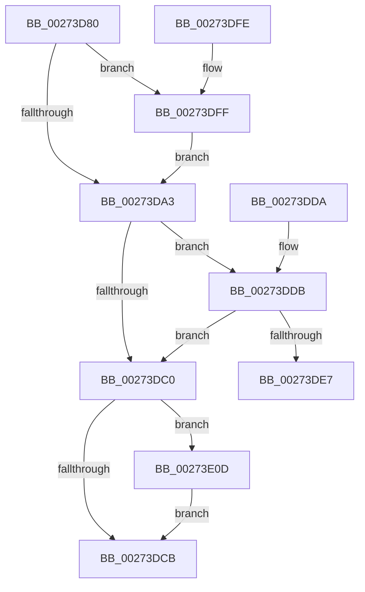

# KeAcquireQueuedSpinLock

- RVA: `0x00273D80`–`0x00273E14` (길이 `148` bytes)
- VA: `0x0000000140273D80`
- 실행 섹션: `.text`
- PDB 이름 있음: `예`; PDB Function 태그: `아니요`
- unwind 정보 RVA: `0x00065D44`
- 디코드: `42`개 명령, `148/148` bytes 표시
- 미해석 바이트: `0` (있으면 어셈블리에 `.byte`로 보존)

> 이 문서는 커널 이미지의 기계어와 PDB 기호를 분석해 생성했습니다. 4번과 5번은 함수 원형과 자료형을 바이너리 사용 방식에서 추정한 C 해석이며 원본 소스 복구 결과는 아닙니다.

## 1. Dependencies

- 직접 호출 지점: **3**; 고유 호출 대상: **3**
- 직접 호출자로 확인된 함수: **92**
- RIP 상대 이미지 참조: **3**

### Outgoing calls
- `0x00273DEA` → [KiAcquireQueuedSpinLockInstrumented](KiAcquireQueuedSpinLockInstrumented_function_00275850.md) (function, `0x00275850`)
- `0x00273E06` → [KiRaiseIrqlProcessIrqlFlags](../4F/KiRaiseIrqlProcessIrqlFlags_function_004F56FC.md) (function, `0x004F56FC`)
- `0x00273E0D` → [KxWaitForLockOwnerShip](../25/KxWaitForLockOwnerShip_function_00257EB0.md) (function, `0x00257EB0`)

### Direct callers
- [IoBoostThreadIoPriority](../21/IoBoostThreadIoPriority_function_00216110.md) at `0x00216313`
- [CcExtendVacbArray](../26/CcExtendVacbArray_function_0026DCD0.md) at `0x0026DFA9`
- [IoDetachDevice](../26/IoDetachDevice_function_0026FA10.md) at `0x0026FA22`
- [IoDeleteDevice](../26/IoDeleteDevice_function_0026FE90.md) at `0x0026FF24`
- [IopCheckVpbMounted](IopCheckVpbMounted_function_00270540.md) at `0x00270875`
- [IopCompleteUnloadOrDelete](IopCompleteUnloadOrDelete_function_00270BC8.md) at `0x00270D14`
- [IopCompleteUnloadOrDelete](IopCompleteUnloadOrDelete_function_00270BC8.md) at `0x00270D7D`
- [CcUnmapInactiveViewsInternal](CcUnmapInactiveViewsInternal_function_0027174C.md) at `0x00271806`
- [CcUnmapInactiveViewsInternal](CcUnmapInactiveViewsInternal_function_0027174C.md) at `0x00271926`
- [CcUnmapInactiveViewsInternal](CcUnmapInactiveViewsInternal_function_0027174C.md) at `0x00271A9C`
- [PnpGetRelatedTargetDevice](PnpGetRelatedTargetDevice_function_00271F54.md) at `0x00271F90`
- [IoAcquireVpbSpinLock](IoAcquireVpbSpinLock_function_00272090.md) at `0x0027209E`
- [IoCancelIrp](IoCancelIrp_function_002720E0.md) at `0x00272106`
- [FsRtlNotifySetCancelRoutine](FsRtlNotifySetCancelRoutine_function_0027239C.md) at `0x002723C4`
- [IopGetMountFlag](IopGetMountFlag_function_00272444.md) at `0x00272456`
- [IopGetDevicePDO](IopGetDevicePDO_function_002724D8.md) at `0x002724EA`
- [IoGetLowerDeviceObjectWithTag](IoGetLowerDeviceObjectWithTag_function_00272660.md) at `0x00272679`
- [IoGetDeviceAttachmentBaseRef](IoGetDeviceAttachmentBaseRef_function_00272710.md) at `0x00272722`
- [IoGetDeviceAttachmentBaseRefWithTag](IoGetDeviceAttachmentBaseRefWithTag_function_00272788.md) at `0x002727A1`
- [sub_00272850](Unknown_function_00272850.md) at `0x00272855`
- [CcGetVacbMiss](CcGetVacbMiss_function_00272900.md) at `0x00272CA1`
- [CcGetVacbMiss](CcGetVacbMiss_function_00272900.md) at `0x00272DA4`
- [CcGetVacbMiss](CcGetVacbMiss_function_00272900.md) at `0x00272EF4`
- [IoGetAttachedDeviceReferenceWithTag](IoGetAttachedDeviceReferenceWithTag_function_00273B84.md) at `0x00273B9D`
- [IopfCompleteRequest](../29/IopfCompleteRequest_function_0029B5F8.md) at `0x0029BC7A`
- [PopQueueQuerySetIrp](../2B/PopQueueQuerySetIrp_function_002BEF18.md) at `0x002BF0F8`
- [CcUnmapVacbArray](../38/CcUnmapVacbArray_function_0038AEAC.md) at `0x0038B01C`
- [FsRtlPrivateCheckWaitingLocks](../38/FsRtlPrivateCheckWaitingLocks_function_0038DCBC.md) at `0x0038DD76`
- [FsRtlpAcknowledgeOplockBreakByCacheFlags](../3F/FsRtlpAcknowledgeOplockBreakByCacheFlags_function_003F1988.md) at `0x003F21DA`
- [FsRtlpRequestExclusiveOplock](../3F/FsRtlpRequestExclusiveOplock_function_003F3800.md) at `0x003F3D03`
- [FsRtlpRequestExclusiveOplock](../3F/FsRtlpRequestExclusiveOplock_function_003F3800.md) at `0x003F3FE8`
- [IopAttachDeviceToDeviceStackSafe](../41/IopAttachDeviceToDeviceStackSafe_function_00410574.md) at `0x004105C8`
- [FsRtlpOplockCleanup](../42/FsRtlpOplockCleanup_function_00425030.md) at `0x0042559D`
- [FsRtlpRemoveAndCompleteRHIrp](../42/FsRtlpRemoveAndCompleteRHIrp_function_00425964.md) at `0x004259C8`
- [FsRtlpRemoveAndCompleteWaitingIrp](../42/FsRtlpRemoveAndCompleteWaitingIrp_function_00425FC0.md) at `0x00426096`
- [CcDereferenceVacbArray](../44/CcDereferenceVacbArray_function_004427B0.md) at `0x00442828`
- [IopStartNextPacket](../45/IopStartNextPacket_function_0045F9A4.md) at `0x0045F9D2`
- [IopStartNextPacketByKey](../45/IopStartNextPacketByKey_function_0045FA64.md) at `0x0045FA95`
- [IoStartPacket](../45/IoStartPacket_function_0045FC30.md) at `0x0045FC84`
- [PnpRemoveLockedDeviceNode](../47/PnpRemoveLockedDeviceNode_function_004702AC.md) at `0x00470358`
- [PnpRemoveLockedDeviceNode](../47/PnpRemoveLockedDeviceNode_function_004702AC.md) at `0x004703C2`
- [PnpRemoveLockedDeviceNode](../47/PnpRemoveLockedDeviceNode_function_004702AC.md) at `0x004705E3`
- [IoEnumerateDeviceObjectList](../47/IoEnumerateDeviceObjectList_function_0047D440.md) at `0x0047D469`
- [IopInsertRemoveDevice](../48/IopInsertRemoveDevice_function_0048E350.md) at `0x0048E36D`
- [RawInitiateDeleteVolume](../48/RawInitiateDeleteVolume_function_0048FDFC.md) at `0x0048FE33`
- [IopMountInitializeVpb](../49/IopMountInitializeVpb_function_004972C4.md) at `0x004972EE`
- [IoGetDriverObjectExtension](../49/IoGetDriverObjectExtension_function_00498B90.md) at `0x00498BA5`
- [IopQueryVpbFlagsSafe](../4A/IopQueryVpbFlagsSafe_function_004A1184.md) at `0x004A1196`
- [IoGetDiskDeviceObject](../4A/IoGetDiskDeviceObject_function_004A8540.md) at `0x004A8565`
- [CcGetRandomVacbArrayWithReference](../4A/CcGetRandomVacbArrayWithReference_function_004A98AC.md) at `0x004A98FB`
- [PnpIsChainDereferenced](../4A/PnpIsChainDereferenced_function_004ABAE8.md) at `0x004ABB29`
- [PnpIsChainDereferenced](../4A/PnpIsChainDereferenced_function_004ABAE8.md) at `0x004ABC0B`
- [PpMarkDeviceStackExtensionFlag](../4A/PpMarkDeviceStackExtensionFlag_function_004AD8D0.md) at `0x004AD8EC`
- [CcAllocateInitializeVacbArray](../4A/CcAllocateInitializeVacbArray_function_004AE2BC.md) at `0x004AE2CD`
- [CcAllocateInitializeVacbArray](../4A/CcAllocateInitializeVacbArray_function_004AE2BC.md) at `0x004AE341`
- [IopResurrectDriver](../4B/IopResurrectDriver_function_004B138C.md) at `0x004B13A9`
- [PnpFindMountableDevice](../4B/PnpFindMountableDevice_function_004B1418.md) at `0x004B1426`
- [FsRtlpRemoveAndCompleteReadOnlyIrp](../4B/FsRtlpRemoveAndCompleteReadOnlyIrp_function_004B495C.md) at `0x004B49C9`
- [IopInterlockedRemoveHeadList](../4B/IopInterlockedRemoveHeadList_function_004B4FB0.md) at `0x004B4FC2`
- [IoAllocateDriverObjectExtension](../4B/IoAllocateDriverObjectExtension_function_004B8650.md) at `0x004B86C8`
- [IoAdjustStackSizeForRedirection](../4B/IoAdjustStackSizeForRedirection_function_004BB3B0.md) at `0x004BB3D7`
- [FsRtlpOplockBreakToII](../4B/FsRtlpOplockBreakToII_function_004BB824.md) at `0x004BB8C6`
- [IopCheckStackForTransactionSupport](../4B/IopCheckStackForTransactionSupport_function_004BD59C.md) at `0x004BD5BD`
- [RawCheckForDeleteVolume](../4C/RawCheckForDeleteVolume_function_004C6FF4.md) at `0x004C7015`
- [IopReferenceVerifyVpb](../4C/IopReferenceVerifyVpb_function_004C87B4.md) at `0x004C87DB`
- [PnpHandleEnumerateHandlesAgainstPdoStack](../4C/PnpHandleEnumerateHandlesAgainstPdoStack_function_004C8F94.md) at `0x004C8FDF`
- [PnpHandleEnumerateHandlesAgainstPdoStack](../4C/PnpHandleEnumerateHandlesAgainstPdoStack_function_004C8F94.md) at `0x004C9057`
- [PnpMarkDeviceForRemove](../4C/PnpMarkDeviceForRemove_function_004C9DA8.md) at `0x004C9DEE`
- [PnpMarkDeviceForRemove](../4C/PnpMarkDeviceForRemove_function_004C9DA8.md) at `0x004C9E61`
- [PnpUnlockMountableDevice](../4C/PnpUnlockMountableDevice_function_004CDD2C.md) at `0x004CDD56`
- [PnpLockMountableDevice](../4C/PnpLockMountableDevice_function_004CFFAC.md) at `0x004CFFDF`
- [IopCheckUnloadDriver](../4D/IopCheckUnloadDriver_function_004DC454.md) at `0x004DC475`
- [FsRtlUninitializeOplock](../4E/FsRtlUninitializeOplock_function_004E42C0.md) at `0x004E435D`
- [FsRtlUninitializeOplock](../4E/FsRtlUninitializeOplock_function_004E42C0.md) at `0x004E45A7`
- [FsRtlUninitializeOplock](../4E/FsRtlUninitializeOplock_function_004E42C0.md) at `0x004E464B`
- [FsRtlpOplockBreakByCacheFlags](../4E/FsRtlpOplockBreakByCacheFlags_function_004E4990.md) at `0x004E52B5`
- [FsRtlpOplockBreakByCacheFlags](../4E/FsRtlpOplockBreakByCacheFlags_function_004E4990.md) at `0x004E53E4`
- [FsRtlpOplockBreakByCacheFlags](../4E/FsRtlpOplockBreakByCacheFlags_function_004E4990.md) at `0x004E54B9`
- [FsRtlpOplockBreakByCacheFlags](../4E/FsRtlpOplockBreakByCacheFlags_function_004E4990.md) at `0x004E562A`
- [FsRtlpOplockBreakByCacheFlags](../4E/FsRtlpOplockBreakByCacheFlags_function_004E4990.md) at `0x004E56CD`
- [FsRtlpRequestShareableOplock](../4E/FsRtlpRequestShareableOplock_function_004E6EC8.md) at `0x004E754C`
- [FsRtlpRequestShareableOplock](../4E/FsRtlpRequestShareableOplock_function_004E6EC8.md) at `0x004E78F8`
- [FsRtlpWaitOnIrp](../4E/FsRtlpWaitOnIrp_function_004E7998.md) at `0x004E7BC4`
- [FsRtlpWaitOnIrp](../4E/FsRtlpWaitOnIrp_function_004E7998.md) at `0x004E7BD2`
- [IopCopyCompleteReadIrp](../4E/IopCopyCompleteReadIrp_function_004E83F0.md) at `0x004E8519`
- [FsRtlpOplockBreakToNone](../4F/FsRtlpOplockBreakToNone_function_004F8354.md) at `0x004F83DB`
- [CcInitializePartitionVacbs](../57/CcInitializePartitionVacbs_function_0057EB60.md) at `0x0057EB99`
- [CcInitializePartitionVacbs](../57/CcInitializePartitionVacbs_function_0057EB60.md) at `0x0057EBCC`
- [CcInitializePartitionVacbs](../57/CcInitializePartitionVacbs_function_0057EB60.md) at `0x0057EC0B`
- [CcInitializePartitionVacbs](../57/CcInitializePartitionVacbs_function_0057EB60.md) at `0x0057EC2C`
- [CcUninitializePartitionVacbs](../57/CcUninitializePartitionVacbs_function_0057EC70.md) at `0x0057ECC9`
- [FsRtlpAcknowledgeOplockBreak](../58/FsRtlpAcknowledgeOplockBreak_function_00582144.md) at `0x0058225B`
- [FsRtlpGrantAnyOplockFromExclusive](../58/FsRtlpGrantAnyOplockFromExclusive_function_00582540.md) at `0x005828A7`
- [FsRtlDisallowLegacyFilterOnDevice](../58/FsRtlDisallowLegacyFilterOnDevice_function_00582F80.md) at `0x00582FA6`
- [IopDisassociateThreadIrp](../59/IopDisassociateThreadIrp_function_0059708C.md) at `0x005970E0`
- [IopGetDriverPathInformation](../59/IopGetDriverPathInformation_function_005973A8.md) at `0x00597434`
- [IopInterlockedInsertHeadList](../59/IopInterlockedInsertHeadList_function_005974A8.md) at `0x005974BD`
- [IopInterlockedInsertTailList](../59/IopInterlockedInsertTailList_function_00597500.md) at `0x00597515`
- [IopGetFsRegistrationInProgress](../59/IopGetFsRegistrationInProgress_function_00597F58.md) at `0x00597F63`
- [IopSetFsRegistrationInProgress](../59/IopSetFsRegistrationInProgress_function_00597FF0.md) at `0x00597FFD`
- [IopSetLegacyResourcesFlag](../5A/IopSetLegacyResourcesFlag_function_005A79A4.md) at `0x005A79B2`
- [RawVerifyVolume](../5E/RawVerifyVolume_function_005E5120.md) at `0x005E514E`
- [RawVerifyVolume](../5E/RawVerifyVolume_function_005E5120.md) at `0x005E51B8`
- [DifKeAcquireQueuedSpinLockWrapper](../62/DifKeAcquireQueuedSpinLockWrapper_function_0062E9E0.md) at `0x0062EAAD`
- [sub_006E206A](../6E/Unknown_function_006E206A.md) at `0x006E206F`
- [sub_006E4D86](../6E/Unknown_function_006E4D86.md) at `0x006E4D9C`
- [sub_006EBD42](../6E/Unknown_function_006EBD42.md) at `0x006EBDC3`
- [sub_006F6F06](../6F/Unknown_function_006F6F06.md) at `0x006F6F0D`
- [IoUnregisterShutdownNotification](../../pagelk/B7/IoUnregisterShutdownNotification_function_00B7CCC0.md) at `0x00B7CCED`
- [IovpCallDriver1](../../pagevrfy/B9/IovpCallDriver1_function_00B9CCA4.md) at `0x00B9D09F`
- [IovpExamineIrpStackForwarding](../../pagevrfy/B9/IovpExamineIrpStackForwarding_function_00B9D640.md) at `0x00B9D71F`
- [IovUtilGetBottomDeviceObjectWithTag](../../pagevrfy/BA/IovUtilGetBottomDeviceObjectWithTag_function_00BA2A20.md) at `0x00BA2A37`
- [IovUtilGetLowerDeviceObjectWithTag](../../pagevrfy/BA/IovUtilGetLowerDeviceObjectWithTag_function_00BA2A84.md) at `0x00BA2A96`
- [IovUtilGetUpperDeviceObjectWithTag](../../pagevrfy/BA/IovUtilGetUpperDeviceObjectWithTag_function_00BA2AE0.md) at `0x00BA2AF2`
- [IovUtilIsVerifiedDeviceStack](../../pagevrfy/BA/IovUtilIsVerifiedDeviceStack_function_00BA2B88.md) at `0x00BA2BC2`
- [IovUtilRelateDeviceObjects](../../pagevrfy/BA/IovUtilRelateDeviceObjects_function_00BA2C98.md) at `0x00BA2CC7`

### Static image references
- `0x00273D9A` → RVA `0x00FC6D20` (`ALMOSTRO`; read)
- `0x00273DB7` → RVA `0x00FC6B06` (`ALMOSTRO`; read)
- `0x00273DDB` → RVA `0x00F0DE58` (`.data`; read)

## 2. Other-region calls and transfers

- 다른 실행 섹션으로 향하는 call: **0**
- 별도 외부 분기/꼬리 이동을 확인하지 못했습니다.

## 3. Assembly (complete function range)

```asm
00273D80  48 89 5C 24 08                  mov qword ptr [rsp + 8], rbx
00273D85  57                              push rdi
00273D86  48 83 EC 20                     sub rsp, 0x20
00273D8A  48 8B D9                        mov rbx, rcx
00273D8D  44 0F 20 C7                     mov rdi, cr8
00273D91  B8 02 00 00 00                  mov eax, 2
00273D96  44 0F 22 C0                     mov cr8, rax
00273D9A  83 3D 7F 2F D5 00 00            cmp dword ptr [rip + 0xd52f7f], 0
00273DA1  75 5C                           jne 0x140273dff
00273DA3  65 48 8B 0C 25 28 00 00 00      mov rcx, qword ptr gs:[0x28]
00273DAC  48 C1 E3 04                     shl rbx, 4
00273DB0  48 03 CB                        add rcx, rbx
00273DB3  48 8B 41 08                     mov rax, qword ptr [rcx + 8]
00273DB7  F6 05 48 2D D5 00 21            test byte ptr [rip + 0xd52d48], 0x21
00273DBE  75 1B                           jne 0x140273ddb
00273DC0  48 8B D1                        mov rdx, rcx
00273DC3  48 87 10                        xchg qword ptr [rax], rdx
00273DC6  48 85 D2                        test rdx, rdx
00273DC9  75 42                           jne 0x140273e0d
00273DCB  40 0F B6 C7                     movzx eax, dil
00273DCF  48 8B 5C 24 30                  mov rbx, qword ptr [rsp + 0x30]
00273DD4  48 83 C4 20                     add rsp, 0x20
00273DD8  5F                              pop rdi
00273DD9  C3                              ret
00273DDA  CC                              int3
00273DDB  44 8B 05 76 A0 C9 00            mov r8d, dword ptr [rip + 0xc9a076]
00273DE2  45 85 C0                        test r8d, r8d
00273DE5  75 D9                           jne 0x140273dc0
00273DE7  48 8B D0                        mov rdx, rax
00273DEA  E8 61 1A 00 00                  call 0x140275850
00273DEF  48 8B 5C 24 30                  mov rbx, qword ptr [rsp + 0x30]
00273DF4  40 0F B6 C7                     movzx eax, dil
00273DF8  48 83 C4 20                     add rsp, 0x20
00273DFC  5F                              pop rdi
00273DFD  C3                              ret
00273DFE  CC                              int3
00273DFF  0F B6 D0                        movzx edx, al
00273E02  40 0F B6 CF                     movzx ecx, dil
00273E06  E8 F1 18 28 00                  call 0x1404f56fc
00273E0B  EB 96                           jmp 0x140273da3
00273E0D  E8 9E 40 FE FF                  call 0x140257eb0
00273E12  EB B7                           jmp 0x140273dcb
```

## 4. C-style interpretation (structured pseudocode)

```c
__int64 __fastcall KeAcquireQueuedSpinLock(__int64 a1)
{
    __int64 result;
    __int64 v_rbx;
    __int64 v_rsp;
    unsigned __int64 v_stack_p30;
    unsigned __int64 v_stack_p8;

    v_stack_p8 = v_rbx;
    v_rsp = (v_rsp) - (32);
    if ((*(unsigned int *)(v_rip + 13971327)) != 0) goto loc_00273DFF;
loc_00273DA3:
    v_rbx = (a1) << (4);
    a1 = (*(unsigned __int64 *)(gs_base + (0 + 40))) + (v_rbx);
    if (((*(unsigned __int8 *)(v_rip + 13970760)) & (33)) != 0) goto loc_00273DDB;
loc_00273DC0:
    if (a1 != 0) goto loc_00273E0D;
loc_00273DCB:
    v_rsp = (v_rsp) + (32);
    return (unsigned __int8)(v_cr8);
loc_00273DDB:
    if ((unsigned int)((unsigned int)(*(unsigned int *)(v_rip + 13213814))) != 0) goto loc_00273DC0;
    result = KiAcquireQueuedSpinLockInstrumented(a1, (unsigned __int8)(v_cr8), (unsigned int)(*(unsigned int *)(v_rip + 13213814)), a4);
    v_rsp = (v_rsp) + (32);
    return (unsigned __int8)(v_cr8);
loc_00273DFF:
    result = KiRaiseIrqlProcessIrqlFlags((unsigned __int8)(v_cr8), (unsigned __int8)((unsigned __int8)(v_cr8)), (unsigned int)(*(unsigned int *)(v_rip + 13213814)), a4);
    goto loc_00273DA3;
loc_00273E0D:
    result = KxWaitForLockOwnerShip((unsigned __int8)(v_cr8), (unsigned __int8)((unsigned __int8)(v_cr8)), (unsigned int)(*(unsigned int *)(v_rip + 13213814)), a4);
    goto loc_00273DCB;
}
```

## 5. (Beta) C Style

```c
int64_t KeAcquireQueuedSpinLock(int64_t Arg1)
{
    int64_t result;
    int64_t local_rbx;
    int64_t local_rsp;
    uint64_t v_stack_p30;
    uint64_t v_stack_p8;

    v_stack_p8 = local_rbx;
    local_rsp = (local_rsp) - (32);
    if ((*(uint32_t *)(v_rip + 0xD52F7F)) != 0) goto loc_00273DFF;
loc_00273DA3:
    local_rbx = (Arg1) << (4);
    Arg1 = (*(uint64_t *)(gs_base + (0 + 0x28))) + (local_rbx);
    if (((*(uint8_t *)(v_rip + 0xD52D48)) & (33)) != 0) goto loc_00273DDB;
loc_00273DC0:
    if (Arg1 != 0) goto loc_00273E0D;
loc_00273DCB:
    local_rsp = (local_rsp) + (32);
    return (uint8_t)(v_cr8);
loc_00273DDB:
    if ((uint32_t)((uint32_t)(*(uint32_t *)(v_rip + 0xC9A076))) != 0) goto loc_00273DC0;
    result = KiAcquireQueuedSpinLockInstrumented(Arg1, (uint8_t)(v_cr8), (uint32_t)(*(uint32_t *)(v_rip + 0xC9A076)), a4);
    local_rsp = (local_rsp) + (32);
    return (uint8_t)(v_cr8);
loc_00273DFF:
    result = KiRaiseIrqlProcessIrqlFlags((uint8_t)(v_cr8), (uint8_t)((uint8_t)(v_cr8)), (uint32_t)(*(uint32_t *)(v_rip + 0xC9A076)), a4);
    goto loc_00273DA3;
loc_00273E0D:
    result = KxWaitForLockOwnerShip((uint8_t)(v_cr8), (uint8_t)((uint8_t)(v_cr8)), (uint32_t)(*(uint32_t *)(v_rip + 0xC9A076)), a4);
    goto loc_00273DCB;
}
```

## 6. Execution-region graph

[열기: 2D/3D 그래프와 함수 탐색 컨트롤 패널](../../../control-panel.html?section=text&rva=0x00273D80&view=graph)

- 2D 그래프는 위에서 아래로 흐르고, 3D 그래프는 빈 공간을 드래그해 회전합니다. Shift+드래그는 이동, 휠은 확대·축소, 함수 노드 선택은 대상 보고서 이동입니다.

### Static fallback


