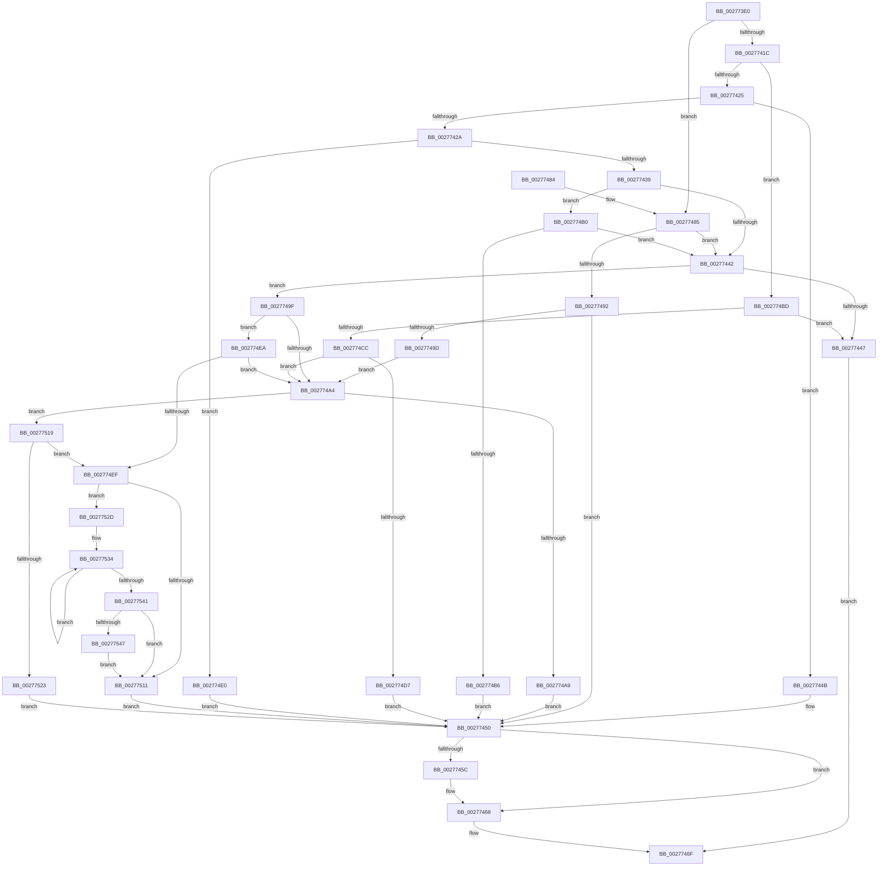

# KeShouldYieldProcessor

- RVA: `0x002773E0`–`0x0027754E` (길이 `366` bytes)
- VA: `0x00000001402773E0`
- 실행 섹션: `.text`
- PDB 이름 있음: `예`; PDB Function 태그: `아니요`
- unwind 정보 RVA: `0x00065F58`
- 디코드: `100`개 명령, `366/366` bytes 표시
- 미해석 바이트: `0` (있으면 어셈블리에 `.byte`로 보존)

> 이 문서는 커널 이미지의 기계어와 PDB 기호를 분석해 생성했습니다. 4번과 5번은 함수 원형과 자료형을 바이너리 사용 방식에서 추정한 C 해석이며 원본 소스 복구 결과는 아닙니다.

## 1. Dependencies

- 직접 호출 지점: **2**; 고유 호출 대상: **2**
- 직접 호출자로 확인된 함수: **65**
- RIP 상대 이미지 참조: **1**

### Outgoing calls
- `0x00277463` → [EtwTraceShouldYieldProcessor](EtwTraceShouldYieldProcessor_function_00279088.md) (function, `0x00279088`)
- `0x00277547` → [KiRemoveSystemWorkPriorityKick](../26/KiRemoveSystemWorkPriorityKick_function_002631D0.md) (function, `0x002631D0`)

### Direct callers
- [MiReferenceIoPages](../23/MiReferenceIoPages_function_0023C804.md) at `0x0023D06E`
- [MiUnlockMdlWritePages](../24/MiUnlockMdlWritePages_function_0024A7C0.md) at `0x0024A8ED`
- [MmUnlockPages](../29/MmUnlockPages_function_0029EEE0.md) at `0x0029F117`
- [MiChangePageAttributeBatch](../2A/MiChangePageAttributeBatch_function_002A06E0.md) at `0x002A0A10`
- [MiInsertViewOfPhysicalSection](../2A/MiInsertViewOfPhysicalSection_function_002A57E0.md) at `0x002A598E`
- [NtGetWriteWatch](../2A/NtGetWriteWatch_function_002A7CE0.md) at `0x002A80F2`
- [MiMoveDirtyBitsToPfns](../2A/MiMoveDirtyBitsToPfns_function_002A8624.md) at `0x002A8924`
- [MiReplaceRotateWithDemandZeroNoCopy](../2A/MiReplaceRotateWithDemandZeroNoCopy_function_002AAB04.md) at `0x002AAE55`
- [MiDereferenceIoPages](../2A/MiDereferenceIoPages_function_002AB1B0.md) at `0x002AB6E7`
- [MiFastTrimWorkingSet](../2A/MiFastTrimWorkingSet_function_002AD420.md) at `0x002AD77B`
- [MiMapLockedPagesInUserSpaceHelper](../2A/MiMapLockedPagesInUserSpaceHelper_function_002ADFE0.md) at `0x002AE17A`
- [MiProbePacketContended](../2A/MiProbePacketContended_function_002AE5A8.md) at `0x002AE62A`
- [MiGetWorkingSetInfoList](../2A/MiGetWorkingSetInfoList_function_002AF770.md) at `0x002AFC67`
- [MiStoreWriteModifiedPages](../2B/MiStoreWriteModifiedPages_function_002B46C4.md) at `0x002B4F59`
- [sub_002C3A7C](../2C/Unknown_function_002C3A7C.md) at `0x002C3BF1`
- [MiProtectPrivateMemory](../2C/MiProtectPrivateMemory_function_002C45B0.md) at `0x002C4C3E`
- [MiInitializeLargeMdlLeafPfns](../2C/MiInitializeLargeMdlLeafPfns_function_002C8EA4.md) at `0x002C8F58`
- [MiInitializeMdlBatchPages](../2C/MiInitializeMdlBatchPages_function_002C90E4.md) at `0x002C92BC`
- [MiSharePages](../31/MiSharePages_function_00315110.md) at `0x0031535C`
- [MiConvertLargeActivePageToChain](../31/MiConvertLargeActivePageToChain_function_0031D980.md) at `0x0031DBD3`
- [sub_00320866](../32/Unknown_function_00320866.md) at `0x0032095F`
- [MiCommitPoolMemory](../32/MiCommitPoolMemory_function_00329520.md) at `0x003296A0`
- [MiGetPageChain](../33/MiGetPageChain_function_00330130.md) at `0x00330778`
- [MiChangePageAttribute](../33/MiChangePageAttribute_function_00332ECC.md) at `0x003330D0`
- [sub_0034512B](../34/Unknown_function_0034512B.md) at `0x003451BD`
- [MiConvertSmallPageRangeToLarge](../34/MiConvertSmallPageRangeToLarge_function_003484DC.md) at `0x00348620`
- [MiSoftFaultMappedView](../36/MiSoftFaultMappedView_function_00365364.md) at `0x00365636`
- [MiCommitEnclavePages](../36/MiCommitEnclavePages_function_00367CCC.md) at `0x00367E96`
- [MiAddPagesToEnclave](../36/MiAddPagesToEnclave_function_00367EEC.md) at `0x0036821D`
- [MiDecommitHardwareEnclavePages](../36/MiDecommitHardwareEnclavePages_function_003688D4.md) at `0x00368A8E`
- [MiPurgeSubsection](../37/MiPurgeSubsection_function_003712F0.md) at `0x0037187F`
- [MiWritePageFileHash](../38/MiWritePageFileHash_function_00381DC8.md) at `0x00381FC8`
- [MiMapUserLargePages](../3D/MiMapUserLargePages_function_003D26F4.md) at `0x003D2A01`
- [NtLockVirtualMemory](../40/NtLockVirtualMemory_function_004088A0.md) at `0x00408FA5`
- [NtLockVirtualMemory](../40/NtLockVirtualMemory_function_004088A0.md) at `0x004091D9`
- [MiConvertLargeFreePageToActive](../42/MiConvertLargeFreePageToActive_function_00420974.md) at `0x00420A9E`
- [MiConvertActiveLargePageToSmall](../42/MiConvertActiveLargePageToSmall_function_00420AF8.md) at `0x00420C1C`
- [MiDemoteSlabEntriesDpc](../44/MiDemoteSlabEntriesDpc_function_0044C3C0.md) at `0x0044C6BF`
- [MiQueryAddressSpan](../45/MiQueryAddressSpan_function_0045CF14.md) at `0x0045D093`
- [MiGetPageChainYield](../46/MiGetPageChainYield_function_00466C3C.md) at `0x00466C7D`
- [IopMcShouldYield](../4C/IopMcShouldYield_function_004C8480.md) at `0x004C849E`
- [MiUpdatePrivateDemandZeroView](../4C/MiUpdatePrivateDemandZeroView_function_004CCC2C.md) at `0x004CCE72`
- [MiPurgeZeroListHead](../4C/MiPurgeZeroListHead_function_004CE464.md) at `0x004CE57D`
- [MiDecrementLargeSubsections](../4D/MiDecrementLargeSubsections_function_004D2BE0.md) at `0x004D2C7D`
- [MiArePageContentsZero](../4D/MiArePageContentsZero_function_004D4278.md) at `0x004D4371`
- [MiProtectEnclavePages](../4D/MiProtectEnclavePages_function_004D5528.md) at `0x004D57AC`
- [MiVadRangeIsIoSpace](../4D/MiVadRangeIsIoSpace_function_004D5CD4.md) at `0x004D5E0E`
- [MiDoGangAssignment](../4D/MiDoGangAssignment_function_004DE270.md) at `0x004DE416`
- [MiDeleteEmptySubsections](../4E/MiDeleteEmptySubsections_function_004ED818.md) at `0x004ED8AF`
- [MiDeleteEmptySubsections](../4E/MiDeleteEmptySubsections_function_004ED818.md) at `0x004ED915`
- [NtUnlockVirtualMemory](../4E/NtUnlockVirtualMemory_function_004EE890.md) at `0x004EEA0F`
- [NtUnlockVirtualMemory](../4E/NtUnlockVirtualMemory_function_004EE890.md) at `0x004EEE75`
- [MiFlushFileOnlyDeleteChain](../4F/MiFlushFileOnlyDeleteChain_function_004F5534.md) at `0x004F5579`
- [KeAlertMultipleThreadByThreadId](../5B/KeAlertMultipleThreadByThreadId_function_005B8DA0.md) at `0x005B8E17`
- [MiInitializeDynamicPfns](../67/MiInitializeDynamicPfns_function_00672BD0.md) at `0x00673056`
- [MiHugePurgeZeroList](../67/MiHugePurgeZeroList_function_00676124.md) at `0x006762D1`
- [MiSetGraphicsPtes](../67/MiSetGraphicsPtes_function_00678554.md) at `0x006786CD`
- [MiDeleteStaleCacheMaps](../67/MiDeleteStaleCacheMaps_function_0067B780.md) at `0x0067B92E`
- [MiDeleteStaleCacheMaps](../67/MiDeleteStaleCacheMaps_function_0067B780.md) at `0x0067BA5E`
- [MiMarkHugeRangeIoPfnDeleted](../67/MiMarkHugeRangeIoPfnDeleted_function_0067C770.md) at `0x0067C833`
- [MiEnableLargeSubsection](../68/MiEnableLargeSubsection_function_00680BC4.md) at `0x00680D5F`
- [MiQueryVaPhysicalContiguity](../68/MiQueryVaPhysicalContiguity_function_006875B8.md) at `0x006878CB`
- [MiBuildPhysicalPageFreeChain](../68/MiBuildPhysicalPageFreeChain_function_00687C80.md) at `0x00687E6E`
- [MiPreparePhysicalPagesMdlForFree](../68/MiPreparePhysicalPagesMdlForFree_function_006890A4.md) at `0x006891CC`
- [MiSoloZeroHugeRange](../68/MiSoloZeroHugeRange_function_0068C6E4.md) at `0x0068C7F5`
- [MiTransferPartitionPageRun](../69/MiTransferPartitionPageRun_function_00691DCC.md) at `0x00691E5C`
- [MiMakeVaRangePhysicallyContiguous](../69/MiMakeVaRangePhysicallyContiguous_function_006936E0.md) at `0x00693908`
- [MiScrubLargeMappedPage](../69/MiScrubLargeMappedPage_function_00693E2C.md) at `0x006941A3`
- [MiZeroPageCalibrateDpc](../69/MiZeroPageCalibrateDpc_function_0069AA90.md) at `0x0069AC1B`

### Static image references
- `0x00277450` → RVA `0x00FC6B04` (`ALMOSTRO`; read)

## 2. Other-region calls and transfers

- 다른 실행 섹션으로 향하는 call: **0**
- 별도 외부 분기/꼬리 이동을 확인하지 못했습니다.

## 3. Assembly (complete function range)

```asm
002773E0  48 89 5C 24 08                  mov qword ptr [rsp + 8], rbx
002773E5  48 89 6C 24 10                  mov qword ptr [rsp + 0x10], rbp
002773EA  48 89 74 24 18                  mov qword ptr [rsp + 0x18], rsi
002773EF  57                              push rdi
002773F0  48 83 EC 20                     sub rsp, 0x20
002773F4  65 48 8B 04 25 20 00 00 00      mov rax, qword ptr gs:[0x20]
002773FD  33 DB                           xor ebx, ebx
002773FF  44 8B C3                        mov r8d, ebx
00277402  44 8B CB                        mov r9d, ebx
00277405  8B 90 BC 38 00 00               mov edx, dword ptr [rax + 0x38bc]
0027740B  8B B0 AC 83 00 00               mov esi, dword ptr [rax + 0x83ac]
00277411  8B A8 5C 86 00 00               mov ebp, dword ptr [rax + 0x865c]
00277417  F6 C2 01                        test dl, 1
0027741A  75 69                           jne 0x140277485
0027741C  38 58 20                        cmp byte ptr [rax + 0x20], bl
0027741F  0F 85 98 00 00 00               jne 0x1402774bd
00277425  F6 C2 1E                        test dl, 0x1e
00277428  75 21                           jne 0x14027744b
0027742A  0F B6 88 B9 38 00 00            movzx ecx, byte ptr [rax + 0x38b9]
00277431  84 C9                           test cl, cl
00277433  0F 85 A7 00 00 00               jne 0x1402774e0
00277439  48 8B 48 10                     mov rcx, qword ptr [rax + 0x10]
0027743D  48 85 C9                        test rcx, rcx
00277440  75 6E                           jne 0x1402774b0
00277442  83 FE 07                        cmp esi, 7
00277445  77 58                           ja 0x14027749f
00277447  33 C0                           xor eax, eax
00277449  EB 24                           jmp 0x14027746f
0027744B  BF 02 00 00 00                  mov edi, 2
00277450  F7 05 AA F6 D4 00 00 00 00 04   test dword ptr [rip + 0xd4f6aa], 0x4000000
0027745A  74 0C                           je 0x140277468
0027745C  44 8B C5                        mov r8d, ebp
0027745F  8B D6                           mov edx, esi
00277461  8B CF                           mov ecx, edi
00277463  E8 20 1C 00 00                  call 0x140279088
00277468  85 FF                           test edi, edi
0027746A  0F 95 C3                        setne bl
0027746D  8B C3                           mov eax, ebx
0027746F  48 8B 5C 24 30                  mov rbx, qword ptr [rsp + 0x30]
00277474  48 8B 6C 24 38                  mov rbp, qword ptr [rsp + 0x38]
00277479  48 8B 74 24 40                  mov rsi, qword ptr [rsp + 0x40]
0027747E  48 83 C4 20                     add rsp, 0x20
00277482  5F                              pop rdi
00277483  C3                              ret
00277484  CC                              int3
00277485  BF 01 00 00 00                  mov edi, 1
0027748A  44 8B C7                        mov r8d, edi
0027748D  83 FD 07                        cmp ebp, 7
00277490  76 B0                           jbe 0x140277442
00277492  0F B6 88 B9 38 00 00            movzx ecx, byte ptr [rax + 0x38b9]
00277499  84 C9                           test cl, cl
0027749B  75 B3                           jne 0x140277450
0027749D  EB 05                           jmp 0x1402774a4
0027749F  45 85 C0                        test r8d, r8d
002774A2  74 46                           je 0x1402774ea
002774A4  F6 C2 1E                        test dl, 0x1e
002774A7  74 70                           je 0x140277519
002774A9  BF 05 00 00 00                  mov edi, 5
002774AE  EB A0                           jmp 0x140277450
002774B0  48 3B 48 08                     cmp rcx, qword ptr [rax + 8]
002774B4  74 8C                           je 0x140277442
002774B6  BF 04 00 00 00                  mov edi, 4
002774BB  EB 93                           jmp 0x140277450
002774BD  41 B9 01 00 00 00               mov r9d, 1
002774C3  83 FE 07                        cmp esi, 7
002774C6  0F 86 7B FF FF FF               jbe 0x140277447
002774CC  0F B6 88 B9 38 00 00            movzx ecx, byte ptr [rax + 0x38b9]
002774D3  84 C9                           test cl, cl
002774D5  74 CD                           je 0x1402774a4
002774D7  41 8D 79 06                     lea edi, [r9 + 6]
002774DB  E9 70 FF FF FF                  jmp 0x140277450
002774E0  BF 03 00 00 00                  mov edi, 3
002774E5  E9 66 FF FF FF                  jmp 0x140277450
002774EA  45 85 C9                        test r9d, r9d
002774ED  75 B5                           jne 0x1402774a4
002774EF  FA                              cli
002774F0  89 98 AC 83 00 00               mov dword ptr [rax + 0x83ac], ebx
002774F6  89 98 5C 86 00 00               mov dword ptr [rax + 0x865c], ebx
002774FC  65 48 8B 0C 25 20 00 00 00      mov rcx, qword ptr gs:[0x20]
00277505  4C 8B 81 B8 8E 00 00            mov r8, qword ptr [rcx + 0x8eb8]
0027750C  4D 85 C0                        test r8, r8
0027750F  75 1C                           jne 0x14027752d
00277511  FB                              sti
00277512  8B FB                           mov edi, ebx
00277514  E9 37 FF FF FF                  jmp 0x140277450
00277519  48 8B 48 18                     mov rcx, qword ptr [rax + 0x18]
0027751D  48 39 48 08                     cmp qword ptr [rax + 8], rcx
00277521  74 CC                           je 0x1402774ef
00277523  BF 06 00 00 00                  mov edi, 6
00277528  E9 23 FF FF FF                  jmp 0x140277450
0027752D  41 0F 0D 08                     prefetchw byte ptr [r8]
00277531  41 8B 00                        mov eax, dword ptr [r8]
00277534  8B D0                           mov edx, eax
00277536  0F BA F2 15                     btr edx, 0x15
0027753A  F0 41 0F B1 10                  lock cmpxchg dword ptr [r8], edx
0027753F  75 F3                           jne 0x140277534
00277541  0F BA E0 15                     bt eax, 0x15
00277545  73 CA                           jae 0x140277511
00277547  E8 84 BC FE FF                  call 0x1402631d0
0027754C  EB C3                           jmp 0x140277511
```

## 4. C-style interpretation (structured pseudocode)

```c
__int64 __fastcall KeShouldYieldProcessor(void)
{
    __int64 result;
    __int64 v_rbx;
    __int64 v_rsp;
    unsigned __int64 v_stack_p10;
    unsigned __int64 v_stack_p18;
    unsigned __int64 v_stack_p8;

    v_stack_p8 = v_rbx;
    v_stack_p10 = v_rbp;
    v_stack_p18 = v_rsi;
    v_rsp = (v_rsp) - (32);
    v_rbx = 0;
    if ((((unsigned __int8)((unsigned int)(*(unsigned int *)(*(unsigned __int64 *)(gs_base + (0 + 32)) + 14524)))) & (1)) != 0) goto loc_00277485;
    if ((*(unsigned __int8 *)(*(unsigned __int64 *)(gs_base + (0 + 32)) + 32)) != 0) goto loc_002774BD;
    if ((((unsigned __int8)((unsigned int)(*(unsigned int *)(*(unsigned __int64 *)(gs_base + (0 + 32)) + 14524)))) & (30)) != 0) goto loc_0027744B;
    if ((unsigned __int8)(*(unsigned __int8 *)(*(unsigned __int64 *)(gs_base + (0 + 32)) + 14521)) != 0) goto loc_002774E0;
    if (*(unsigned __int64 *)(*(unsigned __int64 *)(gs_base + (0 + 32)) + 16) != 0) goto loc_002774B0;
loc_00277442:
    if (((unsigned int)((unsigned int)(*(unsigned int *)(*(unsigned __int64 *)(gs_base + (0 + 32)) + 33708)))) > 7) goto loc_0027749F;
loc_00277447:
    result = 0;
    goto loc_0027746F;
loc_0027744B:
loc_00277450:
    if (((*(unsigned int *)(v_rip + 13956778)) & (0x4000000ULL)) != 0) {
        a3 = (unsigned int)((unsigned int)(*(unsigned int *)(*(unsigned __int64 *)(gs_base + (0 + 32)) + 34396)));
        a2 = (unsigned int)((unsigned int)(*(unsigned int *)(*(unsigned __int64 *)(gs_base + (0 + 32)) + 33708)));
        a1 = 2;
        result = EtwTraceShouldYieldProcessor(a1, a2, a3, 0);
    }
    v_rbx = (2 != 0) ? 1 : 0;
loc_0027746F:
    v_rsp = (v_rsp) + (32);
    return (unsigned int)((unsigned int)(v_rbx));
loc_00277485:
    if (((unsigned int)(v_stack_p10)) <= 7) goto loc_00277442;
    if ((unsigned __int8)(*(unsigned __int8 *)((unsigned int)((unsigned int)(v_rbx)) + 14521)) != 0) goto loc_00277450;
    goto loc_002774A4;
loc_0027749F:
    if (1 == 0) goto loc_002774EA;
loc_002774A4:
    if ((((unsigned __int8)(a2)) & (30)) == 0) goto loc_00277519;
    goto loc_00277450;
loc_002774B0:
    if ((*(unsigned __int8 *)((unsigned int)((unsigned int)(v_rbx)) + 14521)) == (*(unsigned __int64 *)((unsigned int)((unsigned int)(v_rbx)) + 8))) goto loc_00277442;
    goto loc_00277450;
loc_002774BD:
    if (((unsigned int)(v_stack_p18)) <= 7) goto loc_00277447;
    if ((unsigned __int8)(*(unsigned __int8 *)((unsigned int)((unsigned int)(v_rbx)) + 14521)) == 0) goto loc_002774A4;
    goto loc_00277450;
loc_002774E0:
    goto loc_00277450;
loc_002774EA:
    if (1 != 0) goto loc_002774A4;
loc_002774EF:
    *(unsigned int *)((unsigned int)((unsigned int)(v_rbx)) + 33708) = (unsigned int)(v_stack_p8);
    *(unsigned int *)((unsigned int)((unsigned int)(v_rbx)) + 34396) = (unsigned int)(v_stack_p8);
    if (*(unsigned __int64 *)(*(unsigned __int64 *)(gs_base + (0 + 32)) + 36536) != 0) goto loc_0027752D;
loc_00277511:
    goto loc_00277450;
loc_00277519:
    if ((*(unsigned __int64 *)((unsigned int)((unsigned int)(v_rbx)) + 8)) == (*(unsigned __int64 *)((unsigned int)((unsigned int)(v_rbx)) + 24))) goto loc_002774EF;
    goto loc_00277450;
loc_0027752D:
loc_00277534:
    if ((*(unsigned __int64 *)((unsigned int)((unsigned int)(v_rbx)) + 8)) != (*(unsigned __int64 *)((unsigned int)((unsigned int)(v_rbx)) + 24))) goto loc_00277534;
    if ((*(unsigned __int64 *)((unsigned int)((unsigned int)(v_rbx)) + 8)) >= (*(unsigned __int64 *)((unsigned int)((unsigned int)(v_rbx)) + 24))) goto loc_00277511;
    result = KiRemoveSystemWorkPriorityKick(*(unsigned __int64 *)((unsigned int)((unsigned int)(v_rbx)) + 24), (unsigned int)((unsigned int)((unsigned int)(*(unsigned int *)(*(unsigned __int64 *)(*(unsigned __int64 *)(gs_base + (0 + 32)) + 36536))))), *(unsigned __int64 *)(*(unsigned __int64 *)(gs_base + (0 + 32)) + 36536), 1);
    goto loc_00277511;
}
```

## 5. (Beta) C Style

```c
void KeShouldYieldProcessor(void)
{
    int64_t result;
    int64_t local_rbx;
    int64_t local_rsp;
    uint64_t v_stack_p10;
    uint64_t v_stack_p18;
    uint64_t v_stack_p8;

    v_stack_p8 = local_rbx;
    v_stack_p10 = local_rbp;
    v_stack_p18 = local_rsi;
    local_rsp = (local_rsp) - (32);
    local_rbx = 0;
    if ((((uint8_t)((uint32_t)(*(uint32_t *)(*(uint64_t *)(gs_base + (0 + 0x20)) + 0x38BC)))) & (1)) != 0) goto loc_00277485;
    if ((*(uint8_t *)(*(uint64_t *)(gs_base + (0 + 0x20)) + 0x20)) != 0) goto loc_002774BD;
    if ((((uint8_t)((uint32_t)(*(uint32_t *)(*(uint64_t *)(gs_base + (0 + 0x20)) + 0x38BC)))) & (30)) != 0) goto loc_0027744B;
    if ((uint8_t)(*(uint8_t *)(*(uint64_t *)(gs_base + (0 + 0x20)) + 0x38B9)) != 0) goto loc_002774E0;
    if (*(uint64_t *)(*(uint64_t *)(gs_base + (0 + 0x20)) + 0x10) != 0) goto loc_002774B0;
loc_00277442:
    if (((uint32_t)((uint32_t)(*(uint32_t *)(*(uint64_t *)(gs_base + (0 + 0x20)) + 0x83AC)))) > 7) goto loc_0027749F;
loc_00277447:
    result = 0;
    goto loc_0027746F;
loc_0027744B:
loc_00277450:
    if (((*(uint32_t *)(v_rip + 0xD4F6AA)) & (0x4000000ULL)) != 0) {
        a3 = (uint32_t)((uint32_t)(*(uint32_t *)(*(uint64_t *)(gs_base + (0 + 0x20)) + 0x865C)));
        a2 = (uint32_t)((uint32_t)(*(uint32_t *)(*(uint64_t *)(gs_base + (0 + 0x20)) + 0x83AC)));
        a1 = 2;
        result = EtwTraceShouldYieldProcessor(a1, a2, a3, 0);
    }
    local_rbx = (2 != 0) ? 1 : 0;
loc_0027746F:
    local_rsp = (local_rsp) + (32);
    return (uint32_t)((uint32_t)(local_rbx));
loc_00277485:
    if (((uint32_t)(v_stack_p10)) <= 7) goto loc_00277442;
    if ((uint8_t)(*(uint8_t *)((uint32_t)((uint32_t)(local_rbx)) + 0x38B9)) != 0) goto loc_00277450;
    goto loc_002774A4;
loc_0027749F:
    if (1 == 0) goto loc_002774EA;
loc_002774A4:
    if ((((uint8_t)(a2)) & (30)) == 0) goto loc_00277519;
    goto loc_00277450;
loc_002774B0:
    if ((*(uint8_t *)((uint32_t)((uint32_t)(local_rbx)) + 0x38B9)) == (*(uint64_t *)((uint32_t)((uint32_t)(local_rbx)) + 0x8))) goto loc_00277442;
    goto loc_00277450;
loc_002774BD:
    if (((uint32_t)(v_stack_p18)) <= 7) goto loc_00277447;
    if ((uint8_t)(*(uint8_t *)((uint32_t)((uint32_t)(local_rbx)) + 0x38B9)) == 0) goto loc_002774A4;
    goto loc_00277450;
loc_002774E0:
    goto loc_00277450;
loc_002774EA:
    if (1 != 0) goto loc_002774A4;
loc_002774EF:
    *(uint32_t *)((uint32_t)((uint32_t)(local_rbx)) + 0x83AC) = (uint32_t)(v_stack_p8);
    *(uint32_t *)((uint32_t)((uint32_t)(local_rbx)) + 0x865C) = (uint32_t)(v_stack_p8);
    if (*(uint64_t *)(*(uint64_t *)(gs_base + (0 + 0x20)) + 0x8EB8) != 0) goto loc_0027752D;
loc_00277511:
    goto loc_00277450;
loc_00277519:
    if ((*(uint64_t *)((uint32_t)((uint32_t)(local_rbx)) + 0x8)) == (*(uint64_t *)((uint32_t)((uint32_t)(local_rbx)) + 0x18))) goto loc_002774EF;
    goto loc_00277450;
loc_0027752D:
loc_00277534:
    if ((*(uint64_t *)((uint32_t)((uint32_t)(local_rbx)) + 0x8)) != (*(uint64_t *)((uint32_t)((uint32_t)(local_rbx)) + 0x18))) goto loc_00277534;
    if ((*(uint64_t *)((uint32_t)((uint32_t)(local_rbx)) + 0x8)) >= (*(uint64_t *)((uint32_t)((uint32_t)(local_rbx)) + 0x18))) goto loc_00277511;
    result = KiRemoveSystemWorkPriorityKick(*(uint64_t *)((uint32_t)((uint32_t)(local_rbx)) + 0x18), (uint32_t)((uint32_t)((uint32_t)(*(uint32_t *)(*(uint64_t *)(*(uint64_t *)(gs_base + (0 + 0x20)) + 0x8EB8))))), *(uint64_t *)(*(uint64_t *)(gs_base + (0 + 0x20)) + 0x8EB8), 1);
    goto loc_00277511;
}
```

## 6. Execution-region graph

[열기: 2D/3D 그래프와 함수 탐색 컨트롤 패널](../../../control-panel.html?section=text&rva=0x002773E0&view=graph)

- 2D 그래프는 위에서 아래로 흐르고, 3D 그래프는 빈 공간을 드래그해 회전합니다. Shift+드래그는 이동, 휠은 확대·축소, 함수 노드 선택은 대상 보고서 이동입니다.

### Static fallback


