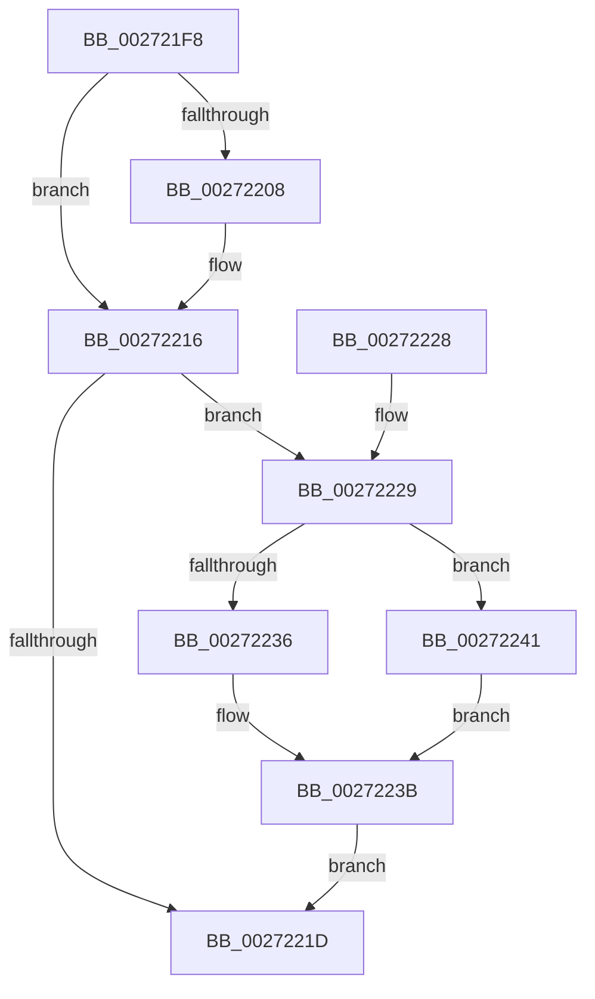

# KiAbReleaseLocksForEntry

- RVA: `0x002721F8`–`0x00272248` (길이 `80` bytes)
- VA: `0x00000001402721F8`
- 실행 섹션: `.text`
- PDB 이름 있음: `예`; PDB Function 태그: `아니요`
- unwind 정보 RVA: `0x00065B84`
- 디코드: `28`개 명령, `80/80` bytes 표시
- 미해석 바이트: `0` (있으면 어셈블리에 `.byte`로 보존)

> 이 문서는 커널 이미지의 기계어와 PDB 기호를 분석해 생성했습니다. 4번과 5번은 함수 원형과 자료형을 바이너리 사용 방식에서 추정한 C 해석이며 원본 소스 복구 결과는 아닙니다.

## 1. Dependencies

- 직접 호출 지점: **3**; 고유 호출 대상: **3**
- 직접 호출자로 확인된 함수: **1**
- RIP 상대 이미지 참조: **0**

### Outgoing calls
- `0x00272211` → [KeReleaseInStackQueuedSpinLockFromDpcLevel](../21/KeReleaseInStackQueuedSpinLockFromDpcLevel_function_002171B0.md) (function, `0x002171B0`)
- `0x00272236` → [ExReleaseSpinLockSharedFromDpcLevel](../24/ExReleaseSpinLockSharedFromDpcLevel_function_0024A590.md) (function, `0x0024A590`)
- `0x00272241` → [ExReleaseSpinLockExclusiveFromDpcLevel](../24/ExReleaseSpinLockExclusiveFromDpcLevel_function_002497E0.md) (function, `0x002497E0`)

### Direct callers
- [sub_00248B10](../24/Unknown_function_00248B10.md) at `0x00248CDE`

### Static image references
- 디코드된 RIP-relative 메모리 참조가 없습니다.

## 2. Other-region calls and transfers

- 다른 실행 섹션으로 향하는 call: **0**
- 별도 외부 분기/꼬리 이동을 확인하지 못했습니다.

## 3. Assembly (complete function range)

```asm
002721F8  40 53                           push rbx
002721FA  48 83 EC 20                     sub rsp, 0x20
002721FE  8A 41 30                        mov al, byte ptr [rcx + 0x30]
00272201  48 8B D9                        mov rbx, rcx
00272204  A8 04                           test al, 4
00272206  74 0E                           je 0x140272216
00272208  24 FB                           and al, 0xfb
0027220A  88 41 30                        mov byte ptr [rcx + 0x30], al
0027220D  48 83 C1 10                     add rcx, 0x10
00272211  E8 9A 4F FA FF                  call 0x1402171b0
00272216  8A 43 30                        mov al, byte ptr [rbx + 0x30]
00272219  A8 01                           test al, 1
0027221B  75 0C                           jne 0x140272229
0027221D  48 83 63 28 00                  and qword ptr [rbx + 0x28], 0
00272222  48 83 C4 20                     add rsp, 0x20
00272226  5B                              pop rbx
00272227  C3                              ret
00272228  CC                              int3
00272229  48 8B 4B 08                     mov rcx, qword ptr [rbx + 8]
0027222D  24 FE                           and al, 0xfe
0027222F  88 43 30                        mov byte ptr [rbx + 0x30], al
00272232  A8 02                           test al, 2
00272234  75 0B                           jne 0x140272241
00272236  E8 55 83 FD FF                  call 0x14024a590
0027223B  80 63 30 FD                     and byte ptr [rbx + 0x30], 0xfd
0027223F  EB DC                           jmp 0x14027221d
00272241  E8 9A 75 FD FF                  call 0x1402497e0
00272246  EB F3                           jmp 0x14027223b
```

## 4. C-style interpretation (structured pseudocode)

```c
__int64 __fastcall KiAbReleaseLocksForEntry(__int64 a1)
{
    __int64 result;
    __int64 v_rsp;

    v_rsp = (v_rsp) - (32);
    result = *(unsigned __int8 *)(a1 + 48);
    if ((((unsigned __int8)(*(unsigned __int8 *)(a1 + 48))) & (4)) != 0) {
        result = (unsigned __int8)((*(unsigned __int8 *)(a1 + 48)) & (251));
        *(unsigned __int8 *)(a1 + 48) = (unsigned __int8)(result);
        a1 = (a1) + (16);
        result = KeReleaseInStackQueuedSpinLockFromDpcLevel(a1, a2, a3, a4);
    }
    if ((((unsigned __int8)(*(unsigned __int8 *)(a1 + 48))) & (1)) != 0) goto loc_00272229;
loc_0027221D:
    v_rsp = (v_rsp) + (32);
    return *(unsigned __int8 *)(a1 + 48);
loc_00272229:
    result = (unsigned __int8)((*(unsigned __int8 *)(a1 + 48)) & (254));
    *(unsigned __int8 *)(a1 + 48) = (unsigned __int8)(result);
    if ((((unsigned __int8)(result)) & (2)) != 0) goto loc_00272241;
    result = ExReleaseSpinLockSharedFromDpcLevel(*(unsigned __int64 *)(a1 + 8), a2, a3, a4);
loc_0027223B:
    goto loc_0027221D;
loc_00272241:
    result = ExReleaseSpinLockExclusiveFromDpcLevel(*(unsigned __int64 *)(a1 + 8), a2, a3, a4);
    goto loc_0027223B;
}
```

## 5. (Beta) C Style

```c
int64_t KiAbReleaseLocksForEntry(void *Arg1)
{
    uint8_t *arg1 = (uint8_t *)Arg1;

    int64_t result;
    int64_t local_rsp;

    local_rsp = (local_rsp) - (32);
    result = *(uint8_t *)(arg1 + 0x30);
    if ((((uint8_t)(*(uint8_t *)(arg1 + 0x30))) & (4)) != 0) {
        result = (uint8_t)((*(uint8_t *)(arg1 + 0x30)) & (251));
        *(uint8_t *)(arg1 + 0x30) = (uint8_t)(result);
        Arg1 = (Arg1) + (16);
        result = KeReleaseInStackQueuedSpinLockFromDpcLevel(Arg1, a2, a3, a4);
    }
    if ((((uint8_t)(*(uint8_t *)(arg1 + 0x30))) & (1)) != 0) goto loc_00272229;
loc_0027221D:
    local_rsp = (local_rsp) + (32);
    return *(uint8_t *)(arg1 + 0x30);
loc_00272229:
    result = (uint8_t)((*(uint8_t *)(arg1 + 0x30)) & (254));
    *(uint8_t *)(arg1 + 0x30) = (uint8_t)(result);
    if ((((uint8_t)(result)) & (2)) != 0) goto loc_00272241;
    result = ExReleaseSpinLockSharedFromDpcLevel(*(uint64_t *)(arg1 + 0x8), a2, a3, a4);
loc_0027223B:
    goto loc_0027221D;
loc_00272241:
    result = ExReleaseSpinLockExclusiveFromDpcLevel(*(uint64_t *)(arg1 + 0x8), a2, a3, a4);
    goto loc_0027223B;
}
```

### 관측된 메모리 오프셋

구조체 형식이 확인되지 않은 접근은 인자 기준의 오프셋으로만 기록했습니다.

| 기준 인자 | 오프셋 표현 | 폭 (bit) | 접근 |
|---|---:|---:|---|
| `Arg1` | `+ 0x8` | `64` | `R` |
| `Arg1` | `+ 0x28` | `64` | `R/W` |
| `Arg1` | `+ 0x30` | `8` | `R` |
| `Arg1` | `+ 0x30` | `8` | `R/W` |
| `Arg1` | `+ 0x30` | `8` | `W` |

## 6. Execution-region graph

[열기: 2D/3D 그래프와 함수 탐색 컨트롤 패널](../../../control-panel.html?section=text&rva=0x002721F8&view=graph)

- 2D 그래프는 위에서 아래로 흐르고, 3D 그래프는 빈 공간을 드래그해 회전합니다. Shift+드래그는 이동, 휠은 확대·축소, 함수 노드 선택은 대상 보고서 이동입니다.

### Static fallback


