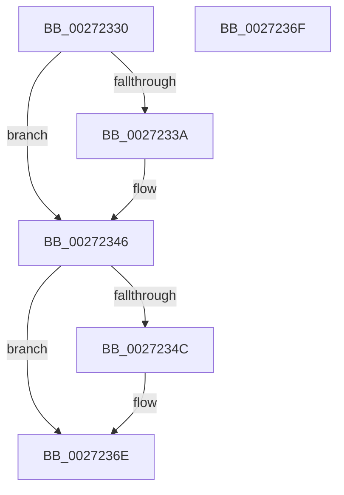

# KiAbTryDecrementIoWaiterCounts

- RVA: `0x00272330`–`0x00272370` (길이 `64` bytes)
- VA: `0x0000000140272330`
- 실행 섹션: `.text`
- PDB 이름 있음: `예`; PDB Function 태그: `아니요`
- unwind 정보 RVA: `0x000DB714`
- 디코드: `23`개 명령, `64/64` bytes 표시
- 미해석 바이트: `0` (있으면 어셈블리에 `.byte`로 보존)

> 이 문서는 커널 이미지의 기계어와 PDB 기호를 분석해 생성했습니다. 4번과 5번은 함수 원형과 자료형을 바이너리 사용 방식에서 추정한 C 해석이며 원본 소스 복구 결과는 아닙니다.

## 1. Dependencies

- 직접 호출 지점: **0**; 고유 호출 대상: **0**
- 직접 호출자로 확인된 함수: **2**
- RIP 상대 이미지 참조: **0**

### Outgoing calls
- 직접 디코드된 call 명령이 없습니다.

### Direct callers
- [KiAbConvertWaiterToOwnerEntry](../21/KiAbConvertWaiterToOwnerEntry_function_00219430.md) at `0x00219595`
- [sub_00248B10](../24/Unknown_function_00248B10.md) at `0x00248C3E`
- [sub_00248B10](../24/Unknown_function_00248B10.md) at `0x00248E11`

### Static image references
- 디코드된 RIP-relative 메모리 참조가 없습니다.

## 2. Other-region calls and transfers

- 다른 실행 섹션으로 향하는 call: **0**
- 별도 외부 분기/꼬리 이동을 확인하지 못했습니다.

## 3. Assembly (complete function range)

```asm
00272330  F6 41 0B 02                     test byte ptr [rcx + 0xb], 2
00272334  4C 8D 42 54                     lea r8, [rdx + 0x54]
00272338  74 0C                           je 0x140272346
0027233A  41 FE 08                        dec byte ptr [r8]
0027233D  0F B6 41 0B                     movzx eax, byte ptr [rcx + 0xb]
00272341  24 FD                           and al, 0xfd
00272343  88 41 0B                        mov byte ptr [rcx + 0xb], al
00272346  F6 41 0B 04                     test byte ptr [rcx + 0xb], 4
0027234A  74 22                           je 0x14027236e
0027234C  41 8B 10                        mov edx, dword ptr [r8]
0027234F  8B C2                           mov eax, edx
00272351  C1 E8 08                        shr eax, 8
00272354  FF C8                           dec eax
00272356  C1 E0 08                        shl eax, 8
00272359  33 C2                           xor eax, edx
0027235B  25 00 7F 00 00                  and eax, 0x7f00
00272360  33 C2                           xor eax, edx
00272362  41 89 00                        mov dword ptr [r8], eax
00272365  0F B6 41 0B                     movzx eax, byte ptr [rcx + 0xb]
00272369  24 FB                           and al, 0xfb
0027236B  88 41 0B                        mov byte ptr [rcx + 0xb], al
0027236E  C3                              ret
0027236F  CC                              int3
```

## 4. C-style interpretation (structured pseudocode)

```c
__int64 __fastcall KiAbTryDecrementIoWaiterCounts(__int64 a1, __int64 a2)
{
    __int64 result;

    if (((*(unsigned __int8 *)(a1 + 11)) & (2)) != 0) {
        result = *(unsigned __int8 *)(a1 + 11);
        result = (unsigned __int8)((result) & (253));
        *(unsigned __int8 *)(a1 + 11) = (unsigned __int8)(result);
    }
    if (((*(unsigned __int8 *)(a1 + 11)) & (4)) != 0) {
        a2 = *(unsigned int *)(a2 + 84);
        result = (unsigned int)(a2);
        result = (unsigned int)((result) >> (8));
        result = (unsigned int)((result) - 1);
        result = (unsigned int)((result) << (8));
        result = (unsigned int)((result) ^ ((unsigned int)(a2)));
        result = (unsigned int)((result) & (0x7F00ULL));
        result = (unsigned int)((result) ^ ((unsigned int)(a2)));
        *(unsigned int *)(a2 + 84) = (unsigned int)(result);
        result = *(unsigned __int8 *)(a1 + 11);
        result = (unsigned __int8)((result) & (251));
        *(unsigned __int8 *)(a1 + 11) = (unsigned __int8)(result);
    }
    return result;
}
```

## 5. (Beta) C Style

```c
int64_t KiAbTryDecrementIoWaiterCounts(void *Arg1, void *Arg2)
{
    uint8_t *arg1 = (uint8_t *)Arg1;
    uint8_t *arg2 = (uint8_t *)Arg2;

    int64_t result;

    if (((*(uint8_t *)(arg1 + 0xB)) & (2)) != 0) {
        result = *(uint8_t *)(arg1 + 0xB);
        result = (uint8_t)((result) & (253));
        *(uint8_t *)(arg1 + 0xB) = (uint8_t)(result);
    }
    if (((*(uint8_t *)(arg1 + 0xB)) & (4)) != 0) {
        Arg2 = *(uint32_t *)(arg2 + 0x54);
        result = (uint32_t)(Arg2);
        result = (uint32_t)((result) >> (8));
        result = (uint32_t)((result) - 1);
        result = (uint32_t)((result) << (8));
        result = (uint32_t)((result) ^ ((uint32_t)(Arg2)));
        result = (uint32_t)((result) & (0x7F00ULL));
        result = (uint32_t)((result) ^ ((uint32_t)(Arg2)));
        *(uint32_t *)(arg2 + 0x54) = (uint32_t)(result);
        result = *(uint8_t *)(arg1 + 0xB);
        result = (uint8_t)((result) & (251));
        *(uint8_t *)(arg1 + 0xB) = (uint8_t)(result);
    }
    return result;
}
```

### 관측된 메모리 오프셋

구조체 형식이 확인되지 않은 접근은 인자 기준의 오프셋으로만 기록했습니다.

| 기준 인자 | 오프셋 표현 | 폭 (bit) | 접근 |
|---|---:|---:|---|
| `Arg1` | `+ 0xB` | `8` | `R` |
| `Arg1` | `+ 0xB` | `8` | `W` |
| `Arg2` | `+ 0x0` | `8` | `R/W` |
| `Arg2` | `+ 0x0` | `32` | `R` |
| `Arg2` | `+ 0x0` | `32` | `W` |
| `Arg2` | `+ 0x54` | `64` | `R` |

## 6. Execution-region graph

[열기: 2D/3D 그래프와 함수 탐색 컨트롤 패널](../../../control-panel.html?section=text&rva=0x00272330&view=graph)

- 2D 그래프는 위에서 아래로 흐르고, 3D 그래프는 빈 공간을 드래그해 회전합니다. Shift+드래그는 이동, 휠은 확대·축소, 함수 노드 선택은 대상 보고서 이동입니다.

### Static fallback


