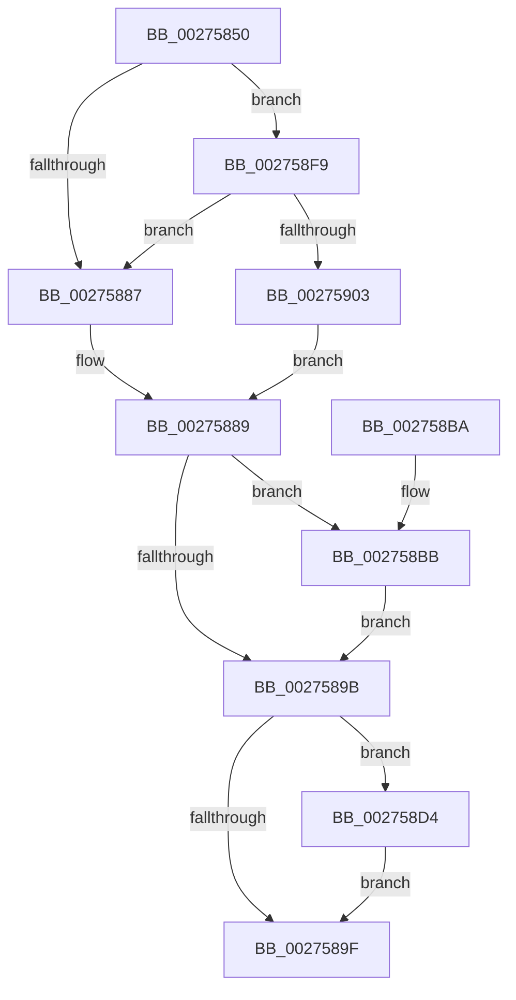

# KiAcquireQueuedSpinLockInstrumented

- RVA: `0x00275850`–`0x0027591C` (길이 `204` bytes)
- VA: `0x0000000140275850`
- 실행 섹션: `.text`
- PDB 이름 있음: `예`; PDB Function 태그: `아니요`
- unwind 정보 RVA: `0x00065E58`
- 디코드: `56`개 명령, `204/204` bytes 표시
- 미해석 바이트: `0` (있으면 어셈블리에 `.byte`로 보존)

> 이 문서는 커널 이미지의 기계어와 PDB 기호를 분석해 생성했습니다. 4번과 5번은 함수 원형과 자료형을 바이너리 사용 방식에서 추정한 C 해석이며 원본 소스 복구 결과는 아닙니다.

## 1. Dependencies

- 직접 호출 지점: **2**; 고유 호출 대상: **2**
- 직접 호출자로 확인된 함수: **84**
- RIP 상대 이미지 참조: **2**

### Outgoing calls
- `0x002758BE` → [KxWaitForLockOwnerShipWithIrql](../41/KxWaitForLockOwnerShipWithIrql_function_00414E30.md) (function, `0x00414E30`)
- `0x002758F2` → [PerfLogSpinLockAcquire](../41/PerfLogSpinLockAcquire_function_00414FC4.md) (function, `0x00414FC4`)

### Direct callers
- [ExpAcquireFastResourceSharedSlow](../21/ExpAcquireFastResourceSharedSlow_function_00211260.md) at `0x002115B3`
- [ExpAcquireResourceSharedLite](../21/ExpAcquireResourceSharedLite_function_00212040.md) at `0x00212467`
- [ExpAcquireResourceSharedLite](../21/ExpAcquireResourceSharedLite_function_00212040.md) at `0x002130B8`
- [sub_002142F9](../21/Unknown_function_002142F9.md) at `0x0021431D`
- [sub_002142F9](../21/Unknown_function_002142F9.md) at `0x00214505`
- [sub_002142F9](../21/Unknown_function_002142F9.md) at `0x002148DA`
- [sub_002150DC](../21/Unknown_function_002150DC.md) at `0x002150F1`
- [sub_00215166](../21/Unknown_function_00215166.md) at `0x0021566A`
- [sub_00215F5C](../21/Unknown_function_00215F5C.md) at `0x00215F72`
- [sub_00221771](../22/Unknown_function_00221771.md) at `0x00221782`
- [sub_0022178C](../22/Unknown_function_0022178C.md) at `0x002218F6`
- [sub_0022178C](../22/Unknown_function_0022178C.md) at `0x00221944`
- [sub_0022178C](../22/Unknown_function_0022178C.md) at `0x00221962`
- [sub_0022178C](../22/Unknown_function_0022178C.md) at `0x002219BE`
- [MiLockWorkingSetOptimal](../23/MiLockWorkingSetOptimal_function_00238FC0.md) at `0x0023932A`
- [sub_0023EAFC](../23/Unknown_function_0023EAFC.md) at `0x0023EB0A`
- [sub_00248B10](../24/Unknown_function_00248B10.md) at `0x00248B74`
- [IopCompleteIrpInFileObjectList](../24/IopCompleteIrpInFileObjectList_function_0024F330.md) at `0x0024F6FE`
- [sub_0025D903](../25/Unknown_function_0025D903.md) at `0x0025DA0E`
- [sub_0025FB3C](../25/Unknown_function_0025FB3C.md) at `0x0025FB52`
- [ExReleaseFastResource](../26/ExReleaseFastResource_function_002613D0.md) at `0x002616F1`
- [sub_00261DFE](../26/Unknown_function_00261DFE.md) at `0x00261E14`
- [KiAbEntryRemoveFromTree](../26/KiAbEntryRemoveFromTree_function_00262410.md) at `0x00262775`
- [KiAbEntryRemoveFromTree](../26/KiAbEntryRemoveFromTree_function_00262410.md) at `0x00262A06`
- [sub_00262F2A](../26/Unknown_function_00262F2A.md) at `0x00262F40`
- [IopCheckVpbMounted](IopCheckVpbMounted_function_00270540.md) at `0x0027078D`
- [IopCheckVpbMounted](IopCheckVpbMounted_function_00270540.md) at `0x002707A5`
- [IopDecrementDeviceObjectRef](IopDecrementDeviceObjectRef_function_00270970.md) at `0x00270B02`
- [CcGetVacbMiss](CcGetVacbMiss_function_00272900.md) at `0x002729F8`
- [IoAcquireCancelSpinLock](IoAcquireCancelSpinLock_function_00273CF0.md) at `0x00273D50`
- [KeAcquireQueuedSpinLock](KeAcquireQueuedSpinLock_function_00273D80.md) at `0x00273DEA`
- [KxAcquireQueuedSpinLock](KxAcquireQueuedSpinLock_function_00273E20.md) at `0x00273E48`
- [sub_00273F75](Unknown_function_00273F75.md) at `0x00273F8B`
- [KeAcquireInStackQueuedSpinLockAtDpcLevel](KeAcquireInStackQueuedSpinLockAtDpcLevel_function_00275740.md) at `0x0027577D`
- [KeAcquireInStackQueuedSpinLock](KeAcquireInStackQueuedSpinLock_function_002757A0.md) at `0x00275810`
- [sub_00275BEF](Unknown_function_00275BEF.md) at `0x0027608E`
- [sub_00275BEF](Unknown_function_00275BEF.md) at `0x002760A6`
- [MiFastLockLeafPageTable](MiFastLockLeafPageTable_function_00276340.md) at `0x00276C2E`
- [MiFastLockLeafPageTable](MiFastLockLeafPageTable_function_00276340.md) at `0x00276EE8`
- [MiWalkPageTablesRecursively](MiWalkPageTablesRecursively_function_002796C0.md) at `0x0027B071`
- [MiMakeSystemAddressValid](MiMakeSystemAddressValid_function_0027FF70.md) at `0x00280965`
- [MiMakeSystemAddressValid](MiMakeSystemAddressValid_function_0027FF70.md) at `0x0028097D`
- [MiLockLowestValidPageTableEx](../28/MiLockLowestValidPageTableEx_function_00280D10.md) at `0x00281491`
- [MiLockLowestValidPageTableEx](../28/MiLockLowestValidPageTableEx_function_00280D10.md) at `0x002814AC`
- [sub_002822AC](../28/Unknown_function_002822AC.md) at `0x002824A0`
- [sub_002822AC](../28/Unknown_function_002822AC.md) at `0x002824D0`
- [sub_002ADCF4](../2A/Unknown_function_002ADCF4.md) at `0x002ADD02`
- [ExpInsertPoolTrackerExpansion](../2E/ExpInsertPoolTrackerExpansion_function_002ECCC0.md) at `0x002ECDFA`
- [AlpcpSignalAndWait](../2F/AlpcpSignalAndWait_function_002F9620.md) at `0x002F9942`
- [ExpAcquireSharedStarveExclusive](../34/ExpAcquireSharedStarveExclusive_function_003411C0.md) at `0x00341514`
- [sub_00341C2E](../34/Unknown_function_00341C2E.md) at `0x00341C40`
- [sub_00341DB3](../34/Unknown_function_00341DB3.md) at `0x00341EEE`
- [PfpPartitionGetFirst](../34/PfpPartitionGetFirst_function_00342ED0.md) at `0x00343014`
- [sub_00343C30](../34/Unknown_function_00343C30.md) at `0x00343C46`
- [ExpSetResourceOwnerPointerEx](../34/ExpSetResourceOwnerPointerEx_function_00343E20.md) at `0x00343F6E`
- [sub_0034453D](../34/Unknown_function_0034453D.md) at `0x0034454F`
- [ExpWorkerFactoryCompletionPacketRoutine](../34/ExpWorkerFactoryCompletionPacketRoutine_function_00344810.md) at `0x003448C2`
- [IopRecordIoAttribution](../34/IopRecordIoAttribution_function_00349758.md) at `0x0034987A`
- [ExpConvertExclusiveToSharedLite](../34/ExpConvertExclusiveToSharedLite_function_0034F7A8.md) at `0x0034F879`
- [NtSetInformationWorkerFactory](../35/NtSetInformationWorkerFactory_function_00350A30.md) at `0x00350D74`
- [KeTerminateThread](../35/KeTerminateThread_function_00355138.md) at `0x00355247`
- [CcCachemapUninitWorkerThread](../35/CcCachemapUninitWorkerThread_function_003569D0.md) at `0x00356B53`
- [CcPostWorkQueueCachemapUninit](../35/CcPostWorkQueueCachemapUninit_function_00356C94.md) at `0x00356D5C`
- [CcGetDirtyPagesHelper](../35/CcGetDirtyPagesHelper_function_00358D40.md) at `0x0035907D`
- [CcFlushCachePostProcessOneRange](../35/CcFlushCachePostProcessOneRange_function_00359710.md) at `0x00359947`
- [sub_0035A7F8](../35/Unknown_function_0035A7F8.md) at `0x0035A80E`
- [ExAllocateHeapPool](../35/ExAllocateHeapPool_function_0035BA30.md) at `0x0035D2ED`
- [ExAllocateHeapPool](../35/ExAllocateHeapPool_function_0035BA30.md) at `0x0035DD83`
- [ExAllocateHeapPool](../35/ExAllocateHeapPool_function_0035BA30.md) at `0x0035E3A1`
- [sub_003602E3](../36/Unknown_function_003602E3.md) at `0x003607A9`
- [ExpRemovePoolTrackerExpansion](../36/ExpRemovePoolTrackerExpansion_function_00361300.md) at `0x00361438`
- [CcPurgeCacheSection](../38/CcPurgeCacheSection_function_0038B130.md) at `0x0038B309`
- [NtWaitForWorkViaWorkerFactory](../39/NtWaitForWorkViaWorkerFactory_function_00394270.md) at `0x003946EE`
- [NtWaitForWorkViaWorkerFactory](../39/NtWaitForWorkViaWorkerFactory_function_00394270.md) at `0x00394B98`
- [AlpcpSignal](../39/AlpcpSignal_function_003955E0.md) at `0x003958E3`
- [ExpAcquireFastResourceExclusiveSlow](../3B/ExpAcquireFastResourceExclusiveSlow_function_003BE2E0.md) at `0x003BE4FB`
- [CcFindPrivateVolumeCacheMap](../3C/CcFindPrivateVolumeCacheMap_function_003CDC80.md) at `0x003CDD69`
- [HalpDmaAllocateScatterPagesFromScatterPool](../3D/HalpDmaAllocateScatterPagesFromScatterPool_function_003DC3EC.md) at `0x003DC51D`
- [KeInsertDeviceQueue](../3D/KeInsertDeviceQueue_function_003DD900.md) at `0x003DD995`
- [HalpDmaFreeMapRegisters](../3D/HalpDmaFreeMapRegisters_function_003DF5F4.md) at `0x003DF751`
- [KeRemoveDeviceQueue](../3D/KeRemoveDeviceQueue_function_003DF890.md) at `0x003DF980`
- [HalpDmaReturnPageToOwner](../3D/HalpDmaReturnPageToOwner_function_003DFB94.md) at `0x003DFCBC`
- [HalpDmaReturnToScatterPool](../3D/HalpDmaReturnToScatterPool_function_003DFD00.md) at `0x003DFDC7`
- [IopCheckDeviceAndDriver](../3F/IopCheckDeviceAndDriver_function_003FCBE0.md) at `0x003FCD7E`
- [AlpcpQueueIoCompletionPort](../3F/AlpcpQueueIoCompletionPort_function_003FF760.md) at `0x003FFA20`
- [sub_0040EC21](../40/Unknown_function_0040EC21.md) at `0x0040EC32`
- [AlpcpLookasidePacketCallbackRoutine](../41/AlpcpLookasidePacketCallbackRoutine_function_00419D50.md) at `0x00419F06`
- [sub_0041B2EE](../41/Unknown_function_0041B2EE.md) at `0x0041B31C`
- [IopVerifyDeviceObjectOnStack](../41/IopVerifyDeviceObjectOnStack_function_0041B3B0.md) at `0x0041B500`
- [sub_0041DA61](../41/Unknown_function_0041DA61.md) at `0x0041DA8C`
- [IopInterlockedDecrementUlong](../42/IopInterlockedDecrementUlong_function_004282A0.md) at `0x0042834B`
- [IopDereferenceVpbAndFree](../43/IopDereferenceVpbAndFree_function_0043F474.md) at `0x0043F522`
- [PoQueryWatchdogTime](../44/PoQueryWatchdogTime_function_004479B0.md) at `0x00447ABF`
- [CcSetParallelFlushFile](../44/CcSetParallelFlushFile_function_0044B900.md) at `0x0044B9C4`
- [HsaIommuSendCommand](../44/HsaIommuSendCommand_function_0044E1DC.md) at `0x0044E36C`
- [CcSetLogHandleForFileEx](../44/CcSetLogHandleForFileEx_function_0044EA30.md) at `0x0044EBC4`
- [CcSetLogHandleForFileEx](../44/CcSetLogHandleForFileEx_function_0044EA30.md) at `0x0044EBE4`
- [CcIsThereDirtyLoggedPages](../45/CcIsThereDirtyLoggedPages_function_0045BBF0.md) at `0x0045BD2A`
- [CcIsThereDirtyLoggedPages](../45/CcIsThereDirtyLoggedPages_function_0045BBF0.md) at `0x0045BD45`
- [CcUpdateSharedCacheMapFlag](../45/CcUpdateSharedCacheMapFlag_function_0045EC14.md) at `0x0045ECD5`
- [KeAcquireInStackQueuedSpinLockForDpc](../45/KeAcquireInStackQueuedSpinLockForDpc_function_0045FE50.md) at `0x0045FE9E`
- [sub_00B830A9](../../poolcode/B8/Unknown_function_00B830A9.md) at `0x00B83563`

### Static image references
- `0x00275875` → RVA `0x00FC6B06` (`ALMOSTRO`; read)
- `0x002758F9` → RVA `0x00F0DE58` (`.data`; read)

## 2. Other-region calls and transfers

- 다른 실행 섹션으로 향하는 call: **0**
- 별도 외부 분기/꼬리 이동을 확인하지 못했습니다.

## 3. Assembly (complete function range)

```asm
00275850  48 89 5C 24 08                  mov qword ptr [rsp + 8], rbx
00275855  48 89 6C 24 10                  mov qword ptr [rsp + 0x10], rbp
0027585A  48 89 74 24 18                  mov qword ptr [rsp + 0x18], rsi
0027585F  48 89 7C 24 20                  mov qword ptr [rsp + 0x20], rdi
00275864  41 56                           push r14
00275866  48 83 EC 30                     sub rsp, 0x30
0027586A  65 48 8B 3C 25 20 00 00 00      mov rdi, qword ptr gs:[0x20]
00275873  33 F6                           xor esi, esi
00275875  F6 05 8A 12 D5 00 01            test byte ptr [rip + 0xd5128a], 1
0027587C  48 8B EA                        mov rbp, rdx
0027587F  44 8B F6                        mov r14d, esi
00275882  44 8B CE                        mov r9d, esi
00275885  75 72                           jne 0x1402758f9
00275887  32 DB                           xor bl, bl
00275889  FF 87 C0 8E 00 00               inc dword ptr [rdi + 0x8ec0]
0027588F  48 8B D1                        mov rdx, rcx
00275892  48 87 55 00                     xchg qword ptr [rbp], rdx
00275896  48 85 D2                        test rdx, rdx
00275899  75 20                           jne 0x1402758bb
0027589B  84 DB                           test bl, bl
0027589D  75 35                           jne 0x1402758d4
0027589F  48 8B 5C 24 40                  mov rbx, qword ptr [rsp + 0x40]
002758A4  48 8B 6C 24 48                  mov rbp, qword ptr [rsp + 0x48]
002758A9  48 8B 74 24 50                  mov rsi, qword ptr [rsp + 0x50]
002758AE  48 8B 7C 24 58                  mov rdi, qword ptr [rsp + 0x58]
002758B3  48 83 C4 30                     add rsp, 0x30
002758B7  41 5E                           pop r14
002758B9  C3                              ret
002758BA  CC                              int3
002758BB  45 33 C0                        xor r8d, r8d
002758BE  E8 6D F5 19 00                  call 0x140414e30
002758C3  FF 87 C4 8E 00 00               inc dword ptr [rdi + 0x8ec4]
002758C9  44 8B C8                        mov r9d, eax
002758CC  01 87 C8 8E 00 00               add dword ptr [rdi + 0x8ec8], eax
002758D2  EB C7                           jmp 0x14027589b
002758D4  0F 31                           rdtsc
002758D6  48 C1 E2 20                     shl rdx, 0x20
002758DA  48 8B CD                        mov rcx, rbp
002758DD  48 0B C2                        or rax, rdx
002758E0  C6 44 24 28 01                  mov byte ptr [rsp + 0x28], 1
002758E5  44 8B C0                        mov r8d, eax
002758E8  89 74 24 20                     mov dword ptr [rsp + 0x20], esi
002758EC  45 2B C6                        sub r8d, r14d
002758EF  48 8B D0                        mov rdx, rax
002758F2  E8 CD F6 19 00                  call 0x140414fc4
002758F7  EB A6                           jmp 0x14027589f
002758F9  8B 05 59 85 C9 00               mov eax, dword ptr [rip + 0xc98559]
002758FF  85 C0                           test eax, eax
00275901  75 84                           jne 0x140275887
00275903  B3 01                           mov bl, 1
00275905  0F 31                           rdtsc
00275907  8B B7 40 86 00 00               mov esi, dword ptr [rdi + 0x8640]
0027590D  48 C1 E2 20                     shl rdx, 0x20
00275911  48 0B C2                        or rax, rdx
00275914  4C 8B F0                        mov r14, rax
00275917  E9 6D FF FF FF                  jmp 0x140275889
```

## 4. C-style interpretation (structured pseudocode)

```c
__int64 __fastcall KiAcquireQueuedSpinLockInstrumented(__int64 a1, __int64 a2, int a3)
{
    __int64 result;
    __int64 v_rbx;
    __int64 v_rsi;
    __int64 v_rsp;
    unsigned __int64 v_stack_p10;
    unsigned __int64 v_stack_p18;
    unsigned __int64 v_stack_p20;
    unsigned __int8 v_stack_p28;
    unsigned __int64 v_stack_p8;

    v_stack_p8 = v_rbx;
    v_stack_p10 = v_rbp;
    v_stack_p18 = v_rsi;
    v_stack_p20 = v_rdi;
    v_rsp = (v_rsp) - (48);
    v_rsi = 0;
    if (((*(unsigned __int8 *)(v_rip + 13963914)) & (1)) != 0) goto loc_002758F9;
loc_00275887:
    v_rbx = 0;
loc_00275889:
    if (a1 != 0) goto loc_002758BB;
loc_0027589B:
    if (0 != 0) goto loc_002758D4;
loc_0027589F:
    v_rsp = (v_rsp) + (48);
    return result;
loc_002758BB:
    a3 = 0;
    result = KxWaitForLockOwnerShipWithIrql(a1, a1, a3, 0);
    goto loc_0027589B;
loc_002758D4:
    a2 = (a1) << (32);
    result = (result) | (a2);
    v_stack_p28 = 1;
    v_stack_p20 = (unsigned int)(v_stack_p18);
    a3 = (unsigned int)(((unsigned int)((unsigned int)(result))) - (0));
    result = PerfLogSpinLockAcquire(v_stack_p10, result, a3, (unsigned int)((unsigned int)(result)));
    goto loc_0027589F;
loc_002758F9:
    if ((unsigned int)((unsigned int)(*(unsigned int *)(v_rip + 13206873))) != 0) goto loc_00275887;
    a2 = (result) << (32);
    result = ((unsigned int)(*(unsigned int *)(v_rip + 13206873))) | (a2);
    goto loc_00275889;
}
```

## 5. (Beta) C Style

```c
int64_t KiAcquireQueuedSpinLockInstrumented(int64_t Arg1, void *Arg2, int32_t Arg3)
{
    uint8_t *arg2 = (uint8_t *)Arg2;

    int64_t result;
    int64_t local_rbx;
    int64_t local_rsi;
    int64_t local_rsp;
    uint64_t v_stack_p10;
    uint64_t v_stack_p18;
    uint64_t v_stack_p20;
    uint8_t v_stack_p28;
    uint64_t v_stack_p8;

    v_stack_p8 = local_rbx;
    v_stack_p10 = local_rbp;
    v_stack_p18 = local_rsi;
    v_stack_p20 = local_rdi;
    local_rsp = (local_rsp) - (48);
    local_rsi = 0;
    if (((*(uint8_t *)(v_rip + 0xD5128A)) & (1)) != 0) goto loc_002758F9;
loc_00275887:
    local_rbx = 0;
loc_00275889:
    if (Arg1 != 0) goto loc_002758BB;
loc_0027589B:
    if (0 != 0) goto loc_002758D4;
loc_0027589F:
    local_rsp = (local_rsp) + (48);
    return result;
loc_002758BB:
    Arg3 = 0;
    result = KxWaitForLockOwnerShipWithIrql(Arg1, Arg1, Arg3, 0);
    goto loc_0027589B;
loc_002758D4:
    Arg2 = (Arg1) << (32);
    result = (result) | (Arg2);
    v_stack_p28 = 1;
    v_stack_p20 = (uint32_t)(v_stack_p18);
    Arg3 = (uint32_t)(((uint32_t)((uint32_t)(result))) - (0));
    result = PerfLogSpinLockAcquire(v_stack_p10, result, Arg3, (uint32_t)((uint32_t)(result)));
    goto loc_0027589F;
loc_002758F9:
    if ((uint32_t)((uint32_t)(*(uint32_t *)(v_rip + 0xC98559))) != 0) goto loc_00275887;
    Arg2 = (result) << (32);
    result = ((uint32_t)(*(uint32_t *)(v_rip + 0xC98559))) | (Arg2);
    goto loc_00275889;
}
```

### 관측된 메모리 오프셋

구조체 형식이 확인되지 않은 접근은 인자 기준의 오프셋으로만 기록했습니다.

| 기준 인자 | 오프셋 표현 | 폭 (bit) | 접근 |
|---|---:|---:|---|
| `Arg2` | `+ 0x0` | `64` | `R/W` |

## 6. Execution-region graph

[열기: 2D/3D 그래프와 함수 탐색 컨트롤 패널](../../../control-panel.html?section=text&rva=0x00275850&view=graph)

- 2D 그래프는 위에서 아래로 흐르고, 3D 그래프는 빈 공간을 드래그해 회전합니다. Shift+드래그는 이동, 휠은 확대·축소, 함수 노드 선택은 대상 보고서 이동입니다.

### Static fallback


