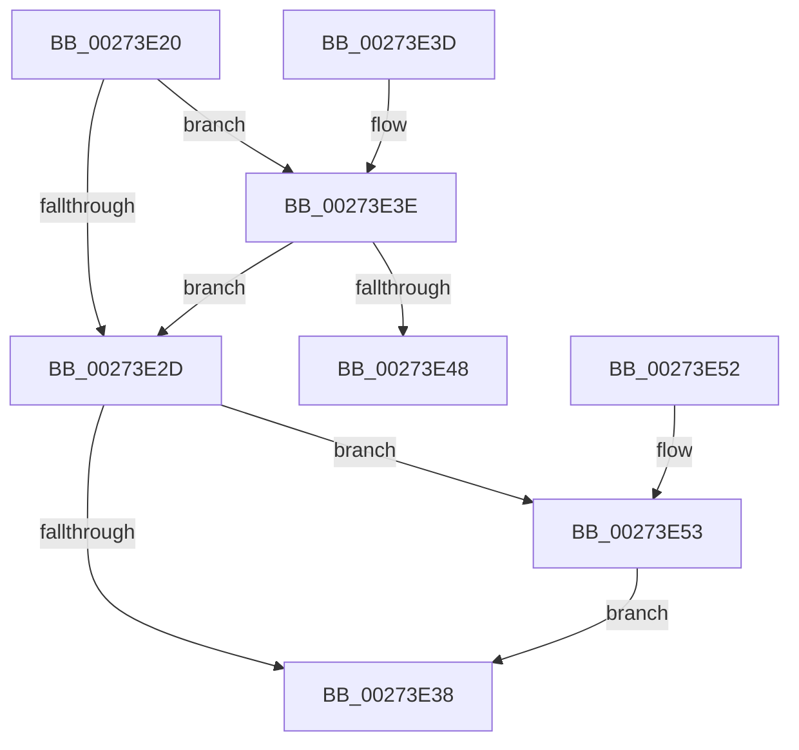

# KxAcquireQueuedSpinLock

- RVA: `0x00273E20`–`0x00273E5D` (길이 `61` bytes)
- VA: `0x0000000140273E20`
- 실행 섹션: `.text`
- PDB 이름 있음: `예`; PDB Function 태그: `아니요`
- unwind 정보 RVA: `0x00065D58`
- 디코드: `20`개 명령, `61/61` bytes 표시
- 미해석 바이트: `0` (있으면 어셈블리에 `.byte`로 보존)

> 이 문서는 커널 이미지의 기계어와 PDB 기호를 분석해 생성했습니다. 4번과 5번은 함수 원형과 자료형을 바이너리 사용 방식에서 추정한 C 해석이며 원본 소스 복구 결과는 아닙니다.

## 1. Dependencies

- 직접 호출 지점: **2**; 고유 호출 대상: **2**
- 직접 호출자로 확인된 함수: **6**
- RIP 상대 이미지 참조: **2**

### Outgoing calls
- `0x00273E48` → [KiAcquireQueuedSpinLockInstrumented](KiAcquireQueuedSpinLockInstrumented_function_00275850.md) (function, `0x00275850`)
- `0x00273E56` → [KxWaitForLockOwnerShip](../25/KxWaitForLockOwnerShip_function_00257EB0.md) (function, `0x00257EB0`)

### Direct callers
- [IoBoostThreadIoPriority](../21/IoBoostThreadIoPriority_function_00216110.md) at `0x002164F8`
- [sub_00248B10](../24/Unknown_function_00248B10.md) at `0x00248BE2`
- [KeStartThread](../3C/KeStartThread_function_003C21B8.md) at `0x003C23FA`
- [WmipNotificationIrpCancel](../49/WmipNotificationIrpCancel_function_00491BA0.md) at `0x00491BC5`
- [KeAcquireInStackQueuedSpinLockRaiseToSynch](../5B/KeAcquireInStackQueuedSpinLockRaiseToSynch_function_005BD3A0.md) at `0x005BD3E6`
- [KeAcquireQueuedSpinLockRaiseToSynch](../5B/KeAcquireQueuedSpinLockRaiseToSynch_function_005BD410.md) at `0x005BD44E`

### Static image references
- `0x00273E24` → RVA `0x00FC6B06` (`ALMOSTRO`; read)
- `0x00273E3E` → RVA `0x00F0DE58` (`.data`; read)

## 2. Other-region calls and transfers

- 다른 실행 섹션으로 향하는 call: **0**
- 별도 외부 분기/꼬리 이동을 확인하지 못했습니다.

## 3. Assembly (complete function range)

```asm
00273E20  48 83 EC 28                     sub rsp, 0x28
00273E24  F6 05 DB 2C D5 00 21            test byte ptr [rip + 0xd52cdb], 0x21
00273E2B  75 11                           jne 0x140273e3e
00273E2D  48 8B C1                        mov rax, rcx
00273E30  48 87 02                        xchg qword ptr [rdx], rax
00273E33  48 85 C0                        test rax, rax
00273E36  75 1B                           jne 0x140273e53
00273E38  48 83 C4 28                     add rsp, 0x28
00273E3C  C3                              ret
00273E3D  CC                              int3
00273E3E  8B 05 14 A0 C9 00               mov eax, dword ptr [rip + 0xc9a014]
00273E44  85 C0                           test eax, eax
00273E46  75 E5                           jne 0x140273e2d
00273E48  E8 03 1A 00 00                  call 0x140275850
00273E4D  48 83 C4 28                     add rsp, 0x28
00273E51  C3                              ret
00273E52  CC                              int3
00273E53  48 8B D0                        mov rdx, rax
00273E56  E8 55 40 FE FF                  call 0x140257eb0
00273E5B  EB DB                           jmp 0x140273e38
```

## 4. C-style interpretation (structured pseudocode)

```c
__int64 __fastcall KxAcquireQueuedSpinLock(__int64 a1, __int64 a2)
{
    __int64 result;
    __int64 v_rsp;

    v_rsp = (v_rsp) - (40);
    if (((*(unsigned __int8 *)(v_rip + 13970651)) & (33)) != 0) goto loc_00273E3E;
loc_00273E2D:
    if (a1 != 0) goto loc_00273E53;
loc_00273E38:
    v_rsp = (v_rsp) + (40);
    return a1;
loc_00273E3E:
    if ((unsigned int)((unsigned int)(*(unsigned int *)(v_rip + 13213716))) != 0) goto loc_00273E2D;
    result = KiAcquireQueuedSpinLockInstrumented(a1, a2, a3, a4);
    v_rsp = (v_rsp) + (40);
    return result;
loc_00273E53:
    result = KxWaitForLockOwnerShip(a1, result, a3, a4);
    goto loc_00273E38;
}
```

## 5. (Beta) C Style

```c
int64_t KxAcquireQueuedSpinLock(int64_t Arg1, void *Arg2)
{
    uint8_t *arg2 = (uint8_t *)Arg2;

    int64_t result;
    int64_t local_rsp;

    local_rsp = (local_rsp) - (40);
    if (((*(uint8_t *)(v_rip + 0xD52CDB)) & (33)) != 0) goto loc_00273E3E;
loc_00273E2D:
    if (Arg1 != 0) goto loc_00273E53;
loc_00273E38:
    local_rsp = (local_rsp) + (40);
    return Arg1;
loc_00273E3E:
    if ((uint32_t)((uint32_t)(*(uint32_t *)(v_rip + 0xC9A014))) != 0) goto loc_00273E2D;
    result = KiAcquireQueuedSpinLockInstrumented(Arg1, Arg2, a3, a4);
    local_rsp = (local_rsp) + (40);
    return result;
loc_00273E53:
    result = KxWaitForLockOwnerShip(Arg1, result, a3, a4);
    goto loc_00273E38;
}
```

### 관측된 메모리 오프셋

구조체 형식이 확인되지 않은 접근은 인자 기준의 오프셋으로만 기록했습니다.

| 기준 인자 | 오프셋 표현 | 폭 (bit) | 접근 |
|---|---:|---:|---|
| `Arg2` | `+ 0x0` | `64` | `R/W` |

## 6. Execution-region graph

[열기: 2D/3D 그래프와 함수 탐색 컨트롤 패널](../../../control-panel.html?section=text&rva=0x00273E20&view=graph)

- 2D 그래프는 위에서 아래로 흐르고, 3D 그래프는 빈 공간을 드래그해 회전합니다. Shift+드래그는 이동, 휠은 확대·축소, 함수 노드 선택은 대상 보고서 이동입니다.

### Static fallback


