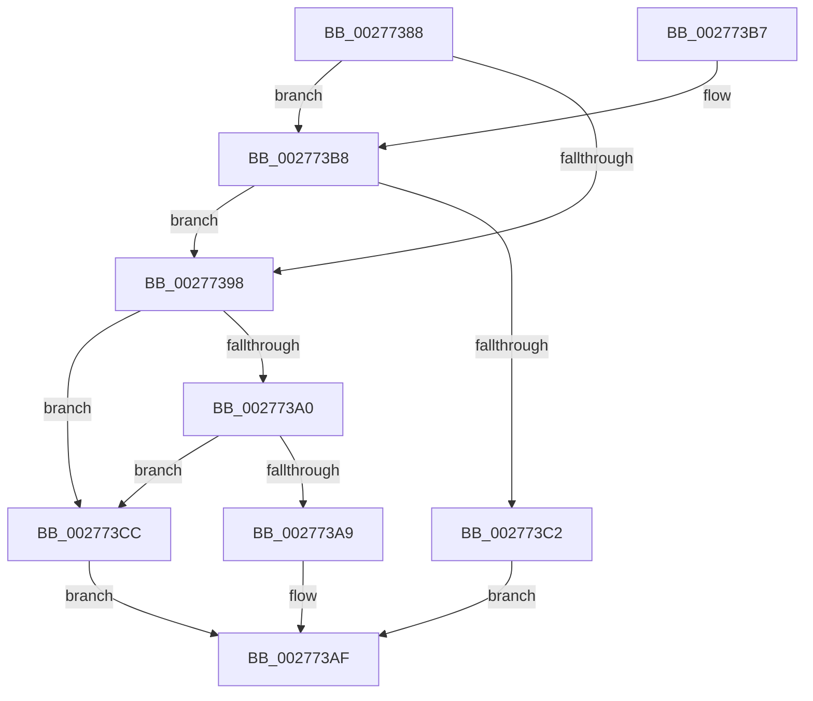

# KxTryToAcquireQueuedSpinLock

- RVA: `0x00277388`–`0x002773D0` (길이 `72` bytes)
- VA: `0x0000000140277388`
- 실행 섹션: `.text`
- PDB 이름 있음: `예`; PDB Function 태그: `아니요`
- unwind 정보 RVA: `0x00065F4C`
- 디코드: `23`개 명령, `72/72` bytes 표시
- 미해석 바이트: `0` (있으면 어셈블리에 `.byte`로 보존)

> 이 문서는 커널 이미지의 기계어와 PDB 기호를 분석해 생성했습니다. 4번과 5번은 함수 원형과 자료형을 바이너리 사용 방식에서 추정한 C 해석이며 원본 소스 복구 결과는 아닙니다.

## 1. Dependencies

- 직접 호출 지점: **1**; 고유 호출 대상: **1**
- 직접 호출자로 확인된 함수: **7**
- RIP 상대 이미지 참조: **2**

### Outgoing calls
- `0x002773C2` → [KiTryToAcquireQueuedSpinLockInstrumented](../2A/KiTryToAcquireQueuedSpinLockInstrumented_function_002ADF38.md) (function, `0x002ADF38`)

### Direct callers
- [MiReacquireHigherPageTableLock](../23/MiReacquireHigherPageTableLock_function_00239650.md) at `0x002398B1`
- [MiFastLockLeafPageTable](MiFastLockLeafPageTable_function_00276340.md) at `0x002765D7`
- [MiFastLockLeafPageTable](MiFastLockLeafPageTable_function_00276340.md) at `0x002768DE`
- [MiDeleteVaDirect](MiDeleteVaDirect_function_00277560.md) at `0x002780E4`
- [MiCheckProcessShadow](MiCheckProcessShadow_function_0027E4C0.md) at `0x0027E60C`
- [KeTryToAcquireInStackQueuedSpinLockAtDpcLevel](../47/KeTryToAcquireInStackQueuedSpinLockAtDpcLevel_function_004790A0.md) at `0x004790B6`
- [KeTryToAcquireQueuedSpinLock](../5B/KeTryToAcquireQueuedSpinLock_function_005BD470.md) at `0x005BD4B6`
- [KeTryToAcquireQueuedSpinLockRaiseToSynch](../5B/KeTryToAcquireQueuedSpinLockRaiseToSynch_function_005BD500.md) at `0x005BD546`

### Static image references
- `0x0027738F` → RVA `0x00FC6B06` (`ALMOSTRO`; read)
- `0x002773B8` → RVA `0x00F0DE58` (`.data`; read)

## 2. Other-region calls and transfers

- 다른 실행 섹션으로 향하는 call: **0**
- 별도 외부 분기/꼬리 이동을 확인하지 못했습니다.

## 3. Assembly (complete function range)

```asm
00277388  48 83 EC 28                     sub rsp, 0x28
0027738C  45 33 C0                        xor r8d, r8d
0027738F  F6 05 70 F7 D4 00 21            test byte ptr [rip + 0xd4f770], 0x21
00277396  75 20                           jne 0x1402773b8
00277398  0F 0D 0A                        prefetchw byte ptr [rdx]
0027739B  44 39 02                        cmp dword ptr [rdx], r8d
0027739E  75 2C                           jne 0x1402773cc
002773A0  33 C0                           xor eax, eax
002773A2  F0 48 0F B1 0A                  lock cmpxchg qword ptr [rdx], rcx
002773A7  75 23                           jne 0x1402773cc
002773A9  41 B8 01 00 00 00               mov r8d, 1
002773AF  41 8B C0                        mov eax, r8d
002773B2  48 83 C4 28                     add rsp, 0x28
002773B6  C3                              ret
002773B7  CC                              int3
002773B8  8B 05 9A 6A C9 00               mov eax, dword ptr [rip + 0xc96a9a]
002773BE  85 C0                           test eax, eax
002773C0  75 D6                           jne 0x140277398
002773C2  E8 71 6B 03 00                  call 0x1402adf38
002773C7  44 8B C0                        mov r8d, eax
002773CA  EB E3                           jmp 0x1402773af
002773CC  F3 90                           pause
002773CE  EB DF                           jmp 0x1402773af
```

## 4. C-style interpretation (structured pseudocode)

```c
__int64 __fastcall KxTryToAcquireQueuedSpinLock(__int64 a1, __int64 a2, int a3)
{
    __int64 result;
    __int64 v_rsp;

    v_rsp = (v_rsp) - (40);
    a3 = 0;
    if (((*(unsigned __int8 *)(v_rip + 13956976)) & (33)) != 0) goto loc_002773B8;
loc_00277398:
    if ((*(unsigned int *)(a2)) != 0) goto loc_002773CC;
    result = 0;
    if (condition_is_not_equal) goto loc_002773CC;
loc_002773AF:
    v_rsp = (v_rsp) + (40);
    return 1;
loc_002773B8:
    if ((unsigned int)((unsigned int)(*(unsigned int *)(v_rip + 13200026))) != 0) goto loc_00277398;
    result = KiTryToAcquireQueuedSpinLockInstrumented(a1, a2, 1, a4);
    goto loc_002773AF;
loc_002773CC:
    goto loc_002773AF;
}
```

## 5. (Beta) C Style

```c
int64_t KxTryToAcquireQueuedSpinLock(int64_t Arg1, void *Arg2, int32_t Arg3)
{
    uint8_t *arg2 = (uint8_t *)Arg2;

    int64_t result;
    int64_t local_rsp;

    local_rsp = (local_rsp) - (40);
    Arg3 = 0;
    if (((*(uint8_t *)(v_rip + 0xD4F770)) & (33)) != 0) goto loc_002773B8;
loc_00277398:
    if ((*(uint32_t *)(arg2)) != 0) goto loc_002773CC;
    result = 0;
    if (condition_is_not_equal) goto loc_002773CC;
loc_002773AF:
    local_rsp = (local_rsp) + (40);
    return 1;
loc_002773B8:
    if ((uint32_t)((uint32_t)(*(uint32_t *)(v_rip + 0xC96A9A))) != 0) goto loc_00277398;
    result = KiTryToAcquireQueuedSpinLockInstrumented(Arg1, Arg2, 1, a4);
    goto loc_002773AF;
loc_002773CC:
    goto loc_002773AF;
}
```

### 관측된 메모리 오프셋

구조체 형식이 확인되지 않은 접근은 인자 기준의 오프셋으로만 기록했습니다.

| 기준 인자 | 오프셋 표현 | 폭 (bit) | 접근 |
|---|---:|---:|---|
| `Arg2` | `+ 0x0` | `8` | `R` |
| `Arg2` | `+ 0x0` | `32` | `R` |
| `Arg2` | `+ 0x0` | `64` | `R` |

## 6. Execution-region graph

[열기: 2D/3D 그래프와 함수 탐색 컨트롤 패널](../../../control-panel.html?section=text&rva=0x00277388&view=graph)

- 2D 그래프는 위에서 아래로 흐르고, 3D 그래프는 빈 공간을 드래그해 회전합니다. Shift+드래그는 이동, 휠은 확대·축소, 함수 노드 선택은 대상 보고서 이동입니다.

### Static fallback


