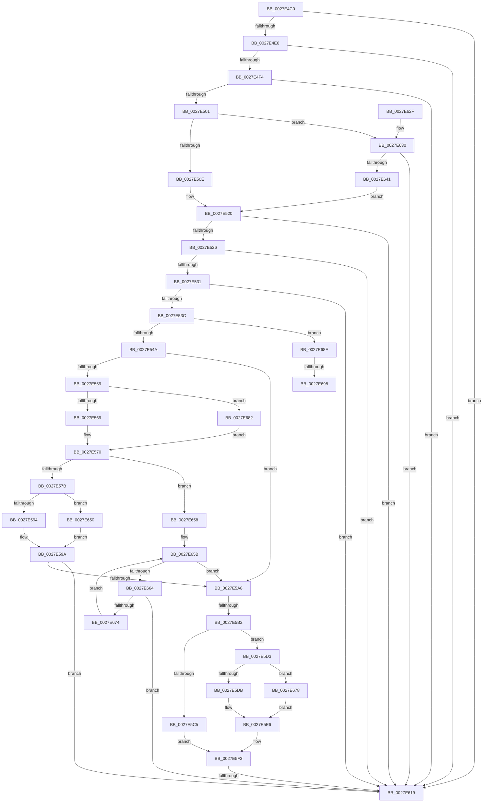

# MiCheckProcessShadow

- RVA: `0x0027E4C0`–`0x0027E69B` (길이 `475` bytes)
- VA: `0x000000014027E4C0`
- 실행 섹션: `.text`
- PDB 이름 있음: `예`; PDB Function 태그: `아니요`
- unwind 정보 RVA: `0x00066390`
- 디코드: `117`개 명령, `475/475` bytes 표시
- 미해석 바이트: `0` (있으면 어셈블리에 `.byte`로 보존)

> 이 문서는 커널 이미지의 기계어와 PDB 기호를 분석해 생성했습니다. 4번과 5번은 함수 원형과 자료형을 바이너리 사용 방식에서 추정한 C 해석이며 원본 소스 복구 결과는 아닙니다.

## 1. Dependencies

- 직접 호출 지점: **1**; 고유 호출 대상: **1**
- 직접 호출자로 확인된 함수: **3**
- RIP 상대 이미지 참조: **3**

### Outgoing calls
- `0x0027E60C` → [KxTryToAcquireQueuedSpinLock](KxTryToAcquireQueuedSpinLock_function_00277388.md) (function, `0x00277388`)

### Direct callers
- [sub_0027D718](Unknown_function_0027D718.md) at `0x0027D76C`
- [MiUnlockWorkingSetExclusive](MiUnlockWorkingSetExclusive_function_0027EC70.md) at `0x0027ED13`
- [MmCheckProcessShadow](../49/MmCheckProcessShadow_function_004931C0.md) at `0x0049324B`

### Static image references
- `0x0027E4D0` → RVA `0x00FC6A88` (`ALMOSTRO`; read)
- `0x0027E569` → RVA `0x00E38840` (`.data`; read)
- `0x0027E5E8` → RVA `0x00E2FDC0` (`.data`; read)

## 2. Other-region calls and transfers

- 다른 실행 섹션으로 향하는 call: **0**
- call이 아닌 외부 분기/꼬리 이동: **3**
  - `0x0027E5AC` → [sub_0027E69B](Unknown_function_0027E69B.md) (`tail-transfer`)
  - `0x0027E613` → [sub_0027E69B](Unknown_function_0027E69B.md) (`tail-transfer`)
  - `0x0027E692` → [sub_0027E822](Unknown_function_0027E822.md) (`tail-transfer`)

## 3. Assembly (complete function range)

```asm
0027E4C0  48 89 5C 24 18                  mov qword ptr [rsp + 0x18], rbx
0027E4C5  55                              push rbp
0027E4C6  56                              push rsi
0027E4C7  57                              push rdi
0027E4C8  41 56                           push r14
0027E4CA  41 57                           push r15
0027E4CC  48 83 EC 30                     sub rsp, 0x30
0027E4D0  48 F7 05 AD 85 D4 00 00 00 60 00  test qword ptr [rip + 0xd485ad], 0x600000
0027E4DB  8B EA                           mov ebp, edx
0027E4DD  48 8B F1                        mov rsi, rcx
0027E4E0  0F 84 33 01 00 00               je 0x14027e619
0027E4E6  8B 81 B8 00 00 00               mov eax, dword ptr [rcx + 0xb8]
0027E4EC  A8 0F                           test al, 0xf
0027E4EE  0F 85 25 01 00 00               jne 0x14027e619
0027E4F4  80 B9 60 FD FF FF 01            cmp byte ptr [rcx - 0x2a0], 1
0027E4FB  0F 84 18 01 00 00               je 0x14027e619
0027E501  44 8B C2                        mov r8d, edx
0027E504  41 83 E0 04                     and r8d, 4
0027E508  0F 84 22 01 00 00               je 0x14027e630
0027E50E  8B 81 F4 FD FF FF               mov eax, dword ptr [rcx - 0x20c]
0027E514  A9 00 00 00 04                  test eax, 0x4000000
0027E519  4C 8B B9 08 01 00 00            mov r15, qword ptr [rcx + 0x108]
0027E520  0F 84 F3 00 00 00               je 0x14027e619
0027E526  48 83 79 10 00                  cmp qword ptr [rcx + 0x10], 0
0027E52B  0F 84 E8 00 00 00               je 0x14027e619
0027E531  48 83 79 18 00                  cmp qword ptr [rcx + 0x18], 0
0027E536  0F 84 DD 00 00 00               je 0x14027e619
0027E53C  8B CD                           mov ecx, ebp
0027E53E  83 E1 02                        and ecx, 2
0027E541  45 85 C0                        test r8d, r8d
0027E544  0F 85 44 01 00 00               jne 0x14027e68e
0027E54A  8B 86 B8 00 00 00               mov eax, dword ptr [rsi + 0xb8]
0027E550  45 33 F6                        xor r14d, r14d
0027E553  24 0F                           and al, 0xf
0027E555  3C 05                           cmp al, 5
0027E557  77 4F                           ja 0x14027e5a8
0027E559  8B 86 B8 00 00 00               mov eax, dword ptr [rsi + 0xb8]
0027E55F  24 0F                           and al, 0xf
0027E561  3C 01                           cmp al, 1
0027E563  0F 85 19 01 00 00               jne 0x14027e682
0027E569  48 8D 05 D0 A2 BB 00            lea rax, [rip + 0xbba2d0]
0027E570  4C 8B 00                        mov r8, qword ptr [rax]
0027E573  85 C9                           test ecx, ecx
0027E575  0F 85 DD 00 00 00               jne 0x14027e658
0027E57B  65 48 8B 04 25 20 00 00 00      mov rax, qword ptr gs:[0x20]
0027E584  48 8B 88 38 88 00 00            mov rcx, qword ptr [rax + 0x8838]
0027E58B  48 85 C9                        test rcx, rcx
0027E58E  0F 84 BC 00 00 00               je 0x14027e650
0027E594  8B 81 44 01 00 00               mov eax, dword ptr [rcx + 0x144]
0027E59A  48 C1 E0 06                     shl rax, 6
0027E59E  42 8B 04 00                     mov eax, dword ptr [rax + r8]
0027E5A2  0F BA E0 1E                     bt eax, 0x1e
0027E5A6  72 71                           jb 0x14027e619
0027E5A8  40 F6 C5 01                     test bpl, 1
0027E5AC  0F 84 E9 00 00 00               je 0x14027e69b
0027E5B2  65 4C 8B 04 25 20 00 00 00      mov r8, qword ptr gs:[0x20]
0027E5BB  8B 86 B8 00 00 00               mov eax, dword ptr [rsi + 0xb8]
0027E5C1  24 0F                           and al, 0xf
0027E5C3  75 0E                           jne 0x14027e5d3
0027E5C5  B9 02 00 00 00                  mov ecx, 2
0027E5CA  48 8D 96 B0 00 00 00            lea rdx, [rsi + 0xb0]
0027E5D1  EB 20                           jmp 0x14027e5f3
0027E5D3  3C 07                           cmp al, 7
0027E5D5  0F 84 9D 00 00 00               je 0x14027e678
0027E5DB  3C 05                           cmp al, 5
0027E5DD  B9 03 00 00 00                  mov ecx, 3
0027E5E2  41 0F 44 CE                     cmove ecx, r14d
0027E5E6  8B C1                           mov eax, ecx
0027E5E8  48 8D 15 D1 17 BB 00            lea rdx, [rip + 0xbb17d1]
0027E5EF  48 8D 14 C2                     lea rdx, [rdx + rax*8]
0027E5F3  8B C1                           mov eax, ecx
0027E5F5  48 8D 88 C4 09 00 00            lea rcx, [rax + 0x9c4]
0027E5FC  48 8D 0C 48                     lea rcx, [rax + rcx*2]
0027E600  49 8D 0C C8                     lea rcx, [r8 + rcx*8]
0027E604  48 89 51 08                     mov qword ptr [rcx + 8], rdx
0027E608  4C 89 31                        mov qword ptr [rcx], r14
0027E60B  90                              nop
0027E60C  E8 77 8D FF FF                  call 0x140277388
0027E611  85 C0                           test eax, eax
0027E613  0F 85 82 00 00 00               jne 0x14027e69b
0027E619  B8 FF FF FF FF                  mov eax, 0xffffffff
0027E61E  48 8B 5C 24 70                  mov rbx, qword ptr [rsp + 0x70]
0027E623  48 83 C4 30                     add rsp, 0x30
0027E627  41 5F                           pop r15
0027E629  41 5E                           pop r14
0027E62B  5F                              pop rdi
0027E62C  5E                              pop rsi
0027E62D  5D                              pop rbp
0027E62E  C3                              ret
0027E62F  CC                              int3
0027E630  0F 31                           rdtsc
0027E632  48 C1 E2 20                     shl rdx, 0x20
0027E636  48 0B C2                        or rax, rdx
0027E639  48 A9 F0 3F 00 00               test rax, 0x3ff0
0027E63F  75 D8                           jne 0x14027e619
0027E641  4C 8B B9 08 01 00 00            mov r15, qword ptr [rcx + 0x108]
0027E648  4D 85 FF                        test r15, r15
0027E64B  E9 D0 FE FF FF                  jmp 0x14027e520
0027E650  41 8B C6                        mov eax, r14d
0027E653  E9 42 FF FF FF                  jmp 0x14027e59a
0027E658  41 8B D6                        mov edx, r14d
0027E65B  83 FA 04                        cmp edx, 4
0027E65E  0F 83 44 FF FF FF               jae 0x14027e5a8
0027E664  8B C2                           mov eax, edx
0027E666  48 C1 E0 06                     shl rax, 6
0027E66A  42 8B 0C 00                     mov ecx, dword ptr [rax + r8]
0027E66E  0F BA E1 1E                     bt ecx, 0x1e
0027E672  72 A5                           jb 0x14027e619
0027E674  FF C2                           inc edx
0027E676  EB E3                           jmp 0x14027e65b
0027E678  B9 01 00 00 00                  mov ecx, 1
0027E67D  E9 64 FF FF FF                  jmp 0x14027e5e6
0027E682  48 8D 86 C0 00 00 00            lea rax, [rsi + 0xc0]
0027E689  E9 E2 FE FF FF                  jmp 0x14027e570
0027E68E  40 F6 C5 01                     test bpl, 1
0027E692  0F 85 8A 01 00 00               jne 0x14027e822
0027E698  45 33 F6                        xor r14d, r14d
```

## 4. C-style interpretation (structured pseudocode)

```c
__int64 __fastcall MiCheckProcessShadow(__int64 a1, int a2)
{
    __int64 result;
    __int64 v_r14;
    __int64 v_rsp;
    unsigned __int64 v_stack_p18;

    v_stack_p18 = v_rbx;
    v_rsp = (v_rsp) - (48);
    if (((*(unsigned __int64 *)(v_rip + 13927853)) & (0x600000ULL)) == 0) goto loc_0027E619;
    if ((((unsigned __int8)((unsigned int)(*(unsigned int *)(a1 + 184)))) & (15)) != 0) goto loc_0027E619;
    if ((*(unsigned __int8 *)(a1 - 672)) == 1) goto loc_0027E619;
    a3 = (unsigned int)(((unsigned int)(a2)) & (4));
    if (condition_is_equal) goto loc_0027E630;
loc_0027E520:
    if ((((unsigned int)((unsigned int)(*(unsigned int *)(a1 - 524)))) & (0x4000000ULL)) == 0) goto loc_0027E619;
    if ((*(unsigned __int64 *)(a1 + 16)) == 0) goto loc_0027E619;
    if ((*(unsigned __int64 *)(a1 + 24)) == 0) goto loc_0027E619;
    a1 = (unsigned int)(((unsigned int)((unsigned int)((unsigned int)(a2)))) & (2));
    if ((unsigned int)(a3) != 0) goto loc_0027E68E;
    v_r14 = 0;
    result = (unsigned __int8)(((unsigned int)(*(unsigned int *)(a1 + 184))) & (15));
    if (((unsigned __int8)(result)) > 5) goto loc_0027E5A8;
    result = (unsigned __int8)(((unsigned int)(*(unsigned int *)(a1 + 184))) & (15));
    if (((unsigned __int8)(result)) != 1) goto loc_0027E682;
loc_0027E570:
    if ((unsigned int)(a1) != 0) goto loc_0027E658;
    if (*(unsigned __int64 *)(*(unsigned __int64 *)(gs_base + (0 + 32)) + 34872) == 0) goto loc_0027E650;
loc_0027E59A:
    result = ((unsigned int)(*(unsigned int *)(*(unsigned __int64 *)(*(unsigned __int64 *)(gs_base + (0 + 32)) + 34872) + 324))) << (6);
    if (condition_is_below) goto loc_0027E619;
loc_0027E5A8:
    result = (unsigned __int8)(((unsigned int)(*(unsigned int *)(a1 + 184))) & (15));
    if (condition_is_not_equal) goto loc_0027E5D3;
    goto loc_0027E5F3;
loc_0027E5D3:
    if (((unsigned __int8)(result)) == 7) goto loc_0027E678;
    a1 = 3;
    if (((unsigned __int8)(result)) == 5) { a1 = 0; }
loc_0027E5E6:
loc_0027E5F3:
    *(unsigned __int64 *)(*(unsigned __int64 *)(gs_base + (0 + 32)) + (unsigned int)((unsigned int)(a1)) + (unsigned int)((unsigned int)(a1)) + 2500 * 2 * 8 + 8) = v_rip + 12261329 + (unsigned int)((unsigned int)(a1)) * 8;
    *(unsigned __int64 *)(*(unsigned __int64 *)(gs_base + (0 + 32)) + (unsigned int)((unsigned int)(a1)) + (unsigned int)((unsigned int)(a1)) + 2500 * 2 * 8) = 0;
    result = KxTryToAcquireQueuedSpinLock(*(unsigned __int64 *)(gs_base + (0 + 32)) + (unsigned int)((unsigned int)(a1)) + (unsigned int)((unsigned int)(a1)) + 2500 * 2 * 8, v_rip + 12261329 + (unsigned int)((unsigned int)(a1)) * 8, *(unsigned __int64 *)(gs_base + (0 + 32)), a4);
loc_0027E619:
    v_rsp = (v_rsp) + (48);
    return (unsigned int)(0xFFFFFFFFULL);
loc_0027E630:
    a2 = (v_rip + 12261329 + (unsigned int)((unsigned int)(a1)) * 8) << (32);
    result = ((unsigned int)(0xFFFFFFFFULL)) | (a2);
    if (((result) & (0x3FF0ULL)) != 0) goto loc_0027E619;
    goto loc_0027E520;
loc_0027E650:
    goto loc_0027E59A;
loc_0027E658:
loc_0027E65B:
    if (0 >= 4) goto loc_0027E5A8;
    result = (0) << (6);
    if (condition_is_below) goto loc_0027E619;
    a2 = (unsigned int)((0) + 1);
    goto loc_0027E65B;
loc_0027E678:
    goto loc_0027E5E6;
loc_0027E682:
    goto loc_0027E570;
loc_0027E68E:
    v_r14 = 0;
    return a1 + 192;
}
```

## 5. (Beta) C Style

```c
void *MiCheckProcessShadow(void *Arg1, int32_t Arg2)
{
    uint8_t *arg1 = (uint8_t *)Arg1;

    int64_t result;
    int64_t local_r14;
    int64_t local_rsp;
    uint64_t v_stack_p18;

    v_stack_p18 = local_rbx;
    local_rsp = (local_rsp) - (48);
    if (((*(uint64_t *)(v_rip + 0xD485AD)) & (0x600000ULL)) == 0) goto loc_0027E619;
    if ((((uint8_t)((uint32_t)(*(uint32_t *)(arg1 + 0xB8)))) & (15)) != 0) goto loc_0027E619;
    if ((*(uint8_t *)(arg1 - 0x2A0)) == 1) goto loc_0027E619;
    a3 = (uint32_t)(((uint32_t)(Arg2)) & (4));
    if (condition_is_equal) goto loc_0027E630;
loc_0027E520:
    if ((((uint32_t)((uint32_t)(*(uint32_t *)(arg1 - 0x20C)))) & (0x4000000ULL)) == 0) goto loc_0027E619;
    if ((*(uint64_t *)(arg1 + 0x10)) == 0) goto loc_0027E619;
    if ((*(uint64_t *)(arg1 + 0x18)) == 0) goto loc_0027E619;
    Arg1 = (uint32_t)(((uint32_t)((uint32_t)((uint32_t)(Arg2)))) & (2));
    if ((uint32_t)(a3) != 0) goto loc_0027E68E;
    local_r14 = 0;
    result = (uint8_t)(((uint32_t)(*(uint32_t *)(arg1 + 0xB8))) & (15));
    if (((uint8_t)(result)) > 5) goto loc_0027E5A8;
    result = (uint8_t)(((uint32_t)(*(uint32_t *)(arg1 + 0xB8))) & (15));
    if (((uint8_t)(result)) != 1) goto loc_0027E682;
loc_0027E570:
    if ((uint32_t)(Arg1) != 0) goto loc_0027E658;
    if (*(uint64_t *)(*(uint64_t *)(gs_base + (0 + 0x20)) + 0x8838) == 0) goto loc_0027E650;
loc_0027E59A:
    result = ((uint32_t)(*(uint32_t *)(*(uint64_t *)(*(uint64_t *)(gs_base + (0 + 0x20)) + 0x8838) + 0x144))) << (6);
    if (condition_is_below) goto loc_0027E619;
loc_0027E5A8:
    result = (uint8_t)(((uint32_t)(*(uint32_t *)(arg1 + 0xB8))) & (15));
    if (condition_is_not_equal) goto loc_0027E5D3;
    goto loc_0027E5F3;
loc_0027E5D3:
    if (((uint8_t)(result)) == 7) goto loc_0027E678;
    Arg1 = 3;
    if (((uint8_t)(result)) == 5) { Arg1 = 0; }
loc_0027E5E6:
loc_0027E5F3:
    *(uint64_t *)(*(uint64_t *)(gs_base + (0 + 0x20)) + (uint32_t)((uint32_t)(arg1)) + (uint32_t)((uint32_t)(arg1)) + 0x9C4 * 2 * 8 + 0x8) = v_rip + 12261329 + (uint32_t)((uint32_t)(Arg1)) * 8;
    *(uint64_t *)(*(uint64_t *)(gs_base + (0 + 0x20)) + (uint32_t)((uint32_t)(arg1)) + (uint32_t)((uint32_t)(arg1)) + 0x9C4 * 2 * 8) = 0;
    result = KxTryToAcquireQueuedSpinLock(*(uint64_t *)(gs_base + (0 + 0x20)) + (uint32_t)((uint32_t)(Arg1)) + (uint32_t)((uint32_t)(Arg1)) + 2500 * 2 * 8, v_rip + 12261329 + (uint32_t)((uint32_t)(Arg1)) * 8, *(uint64_t *)(gs_base + (0 + 0x20)), a4);
loc_0027E619:
    local_rsp = (local_rsp) + (48);
    return (uint32_t)(0xFFFFFFFFULL);
loc_0027E630:
    Arg2 = (v_rip + 12261329 + (uint32_t)((uint32_t)(Arg1)) * 8) << (32);
    result = ((uint32_t)(0xFFFFFFFFULL)) | (Arg2);
    if (((result) & (0x3FF0ULL)) != 0) goto loc_0027E619;
    goto loc_0027E520;
loc_0027E650:
    goto loc_0027E59A;
loc_0027E658:
loc_0027E65B:
    if (0 >= 4) goto loc_0027E5A8;
    result = (0) << (6);
    if (condition_is_below) goto loc_0027E619;
    Arg2 = (uint32_t)((0) + 1);
    goto loc_0027E65B;
loc_0027E678:
    goto loc_0027E5E6;
loc_0027E682:
    goto loc_0027E570;
loc_0027E68E:
    local_r14 = 0;
    return Arg1 + 192;
}
```

### 관측된 메모리 오프셋

구조체 형식이 확인되지 않은 접근은 인자 기준의 오프셋으로만 기록했습니다.

| 기준 인자 | 오프셋 표현 | 폭 (bit) | 접근 |
|---|---:|---:|---|
| `Arg1` | `- 0x2A0` | `8` | `R` |
| `Arg1` | `- 0x20C` | `32` | `R` |
| `Arg1` | `+ 0x10` | `64` | `R` |
| `Arg1` | `+ 0x18` | `64` | `R` |
| `Arg1` | `+ 0xB0` | `64` | `R` |
| `Arg1` | `+ 0xB8` | `32` | `R` |
| `Arg1` | `+ 0xC0` | `64` | `R` |
| `Arg1` | `+ 0x108` | `64` | `R` |

## 6. Execution-region graph

[열기: 2D/3D 그래프와 함수 탐색 컨트롤 패널](../../../control-panel.html?section=text&rva=0x0027E4C0&view=graph)

- 2D 그래프는 위에서 아래로 흐르고, 3D 그래프는 빈 공간을 드래그해 회전합니다. Shift+드래그는 이동, 휠은 확대·축소, 함수 노드 선택은 대상 보고서 이동입니다.

### Static fallback


