# MiDecommitPagesTail

- RVA: `0x002790FC`–`0x00279241` (길이 `325` bytes)
- VA: `0x00000001402790FC`
- 실행 섹션: `.text`
- PDB 이름 있음: `예`; PDB Function 태그: `아니요`
- unwind 정보 RVA: `0x00065FCC`
- 디코드: `74`개 명령, `325/325` bytes 표시
- 미해석 바이트: `0` (있으면 어셈블리에 `.byte`로 보존)

> 이 문서는 커널 이미지의 기계어와 PDB 기호를 분석해 생성했습니다. 4번과 5번은 함수 원형과 자료형을 바이너리 사용 방식에서 추정한 C 해석이며 원본 소스 복구 결과는 아닙니다.

## 1. Dependencies

- 직접 호출 지점: **9**; 고유 호출 대상: **9**
- 직접 호출자로 확인된 함수: **6**
- RIP 상대 이미지 참조: **0**

### Outgoing calls
- `0x0027912D` → [MiReducePteUseCount](../32/MiReducePteUseCount_function_0032A160.md) (function, `0x0032A160`)
- `0x00279150` → [MiFlushTbList](../31/MiFlushTbList_function_00311FC0.md) (function, `0x00311FC0`)
- `0x00279165` → [MiDecommitFreePagesTail](../41/MiDecommitFreePagesTail_function_0041ECE0.md) (function, `0x0041ECE0`)
- `0x00279186` → [MiRemoveWsleList](../29/MiRemoveWsleList_function_00292160.md) (function, `0x00292160`)
- `0x00279199` → [MiReleaseProcessorFlushList](../31/MiReleaseProcessorFlushList_function_00313C70.md) (function, `0x00313C70`)
- `0x002791CB` → [MiUnlockPageTable](../21/MiUnlockPageTable_function_00216EC0.md) (function, `0x00216EC0`)
- `0x002791DC` → [MiUnlockWorkingSetShared](MiUnlockWorkingSetShared_function_0027D690.md) (function, `0x0027D690`)
- `0x002791EC` → [MiDecayPfnFullyInitialized](../44/MiDecayPfnFullyInitialized_function_00447748.md) (function, `0x00447748`)
- `0x00279227` → [MiFlushGraphicsPtes](../4E/MiFlushGraphicsPtes_function_004E1374.md) (function, `0x004E1374`)

### Direct callers
- [sub_00241E74](../24/Unknown_function_00241E74.md) at `0x00241E79`
- [sub_00241E90](../24/Unknown_function_00241E90.md) at `0x002420F4`
- [sub_00241E90](../24/Unknown_function_00241E90.md) at `0x0024217B`
- [MiDeleteVaDirect](MiDeleteVaDirect_function_00277560.md) at `0x00277C0F`
- [MiDeleteVaTail](../47/MiDeleteVaTail_function_00473EF0.md) at `0x00473EFE`
- [MiDeleteEmptyPageTableTail](../48/MiDeleteEmptyPageTableTail_function_00483280.md) at `0x004832AC`
- [MiStoreDiscardPoisonedPage](../69/MiStoreDiscardPoisonedPage_function_00692858.md) at `0x00692BE2`

### Static image references
- 디코드된 RIP-relative 메모리 참조가 없습니다.

## 2. Other-region calls and transfers

- 다른 실행 섹션으로 향하는 call: **0**
- 별도 외부 분기/꼬리 이동을 확인하지 못했습니다.

## 3. Assembly (complete function range)

```asm
002790FC  48 89 5C 24 08                  mov qword ptr [rsp + 8], rbx
00279101  57                              push rdi
00279102  48 83 EC 20                     sub rsp, 0x20
00279106  44 8B 41 70                     mov r8d, dword ptr [rcx + 0x70]
0027910A  48 8B D9                        mov rbx, rcx
0027910D  45 85 C0                        test r8d, r8d
00279110  74 32                           je 0x140279144
00279112  48 8B 51 58                     mov rdx, qword ptr [rcx + 0x58]
00279116  48 83 C2 F8                     add rdx, -8
0027911A  48 B8 00 D0 BE 7D FB F6 FF FF   movabs rax, 0xfffff6fb7dbed000
00279124  48 3B D0                        cmp rdx, rax
00279127  0F 83 CB 00 00 00               jae 0x1402791f8
0027912D  E8 2E 10 0B 00                  call 0x14032a160
00279132  85 C0                           test eax, eax
00279134  74 0A                           je 0x140279140
00279136  C7 83 84 00 00 00 01 00 00 00   mov dword ptr [rbx + 0x84], 1
00279140  83 63 70 00                     and dword ptr [rbx + 0x70], 0
00279144  48 8B 7B 10                     mov rdi, qword ptr [rbx + 0x10]
00279148  48 85 FF                        test rdi, rdi
0027914B  74 5F                           je 0x1402791ac
0027914D  48 8B CF                        mov rcx, rdi
00279150  E8 6B 8E 09 00                  call 0x140311fc0
00279155  83 BB 88 00 00 00 00            cmp dword ptr [rbx + 0x88], 0
0027915C  0F 85 AE 00 00 00               jne 0x140279210
00279162  48 8B CB                        mov rcx, rbx
00279165  E8 76 5B 1A 00                  call 0x14041ece0
0027916A  83 BF 68 40 00 00 00            cmp dword ptr [rdi + 0x4068], 0
00279171  74 1F                           je 0x140279192
00279173  F7 83 A0 00 00 00 00 01 00 00   test dword ptr [rbx + 0xa0], 0x100
0027917D  75 0C                           jne 0x14027918b
0027917F  48 8B 4B 20                     mov rcx, qword ptr [rbx + 0x20]
00279183  48 8B D7                        mov rdx, rdi
00279186  E8 D5 8F 01 00                  call 0x140292160
0027918B  83 A7 68 40 00 00 00            and dword ptr [rdi + 0x4068], 0
00279192  83 A7 58 30 00 00 00            and dword ptr [rdi + 0x3058], 0
00279199  E8 D2 AA 09 00                  call 0x140313c70
0027919E  48 8B 4B 78                     mov rcx, qword ptr [rbx + 0x78]
002791A2  48 83 63 10 00                  and qword ptr [rbx + 0x10], 0
002791A7  48 85 C9                        test rcx, rcx
002791AA  75 3B                           jne 0x1402791e7
002791AC  80 7B 2C 11                     cmp byte ptr [rbx + 0x2c], 0x11
002791B0  75 0C                           jne 0x1402791be
002791B2  48 8B 5C 24 30                  mov rbx, qword ptr [rsp + 0x30]
002791B7  48 83 C4 20                     add rsp, 0x20
002791BB  5F                              pop rdi
002791BC  C3                              ret
002791BD  CC                              int3
002791BE  48 8B 53 40                     mov rdx, qword ptr [rbx + 0x40]
002791C2  48 85 D2                        test rdx, rdx
002791C5  74 0E                           je 0x1402791d5
002791C7  48 8B 4B 20                     mov rcx, qword ptr [rbx + 0x20]
002791CB  E8 F0 DC F9 FF                  call 0x140216ec0
002791D0  48 83 63 40 00                  and qword ptr [rbx + 0x40], 0
002791D5  8A 53 2C                        mov dl, byte ptr [rbx + 0x2c]
002791D8  48 8B 4B 20                     mov rcx, qword ptr [rbx + 0x20]
002791DC  E8 AF 44 00 00                  call 0x14027d690
002791E1  C6 43 2C 11                     mov byte ptr [rbx + 0x2c], 0x11
002791E5  EB CB                           jmp 0x1402791b2
002791E7  BA 01 00 00 00                  mov edx, 1
002791EC  E8 57 E5 1C 00                  call 0x140447748
002791F1  48 83 63 78 00                  and qword ptr [rbx + 0x78], 0
002791F6  EB B4                           jmp 0x1402791ac
002791F8  48 B8 FF DF BE 7D FB F6 FF FF   movabs rax, 0xfffff6fb7dbedfff
00279202  48 3B D0                        cmp rdx, rax
00279205  0F 86 35 FF FF FF               jbe 0x140279140
0027920B  E9 1D FF FF FF                  jmp 0x14027912d
00279210  48 8B 93 D8 00 00 00            mov rdx, qword ptr [rbx + 0xd8]
00279217  48 85 D2                        test rdx, rdx
0027921A  0F 84 42 FF FF FF               je 0x140279162
00279220  48 8B 8B D0 00 00 00            mov rcx, qword ptr [rbx + 0xd0]
00279227  E8 48 81 26 00                  call 0x1404e1374
0027922C  48 83 A3 D0 00 00 00 00         and qword ptr [rbx + 0xd0], 0
00279234  48 83 A3 D8 00 00 00 00         and qword ptr [rbx + 0xd8], 0
0027923C  E9 21 FF FF FF                  jmp 0x140279162
```

## 4. C-style interpretation (structured pseudocode)

```c
__int64 __fastcall MiDecommitPagesTail(__int64 a1)
{
    __int64 result;
    __int64 v_rsp;
    unsigned __int64 v_stack_p8;

    v_stack_p8 = v_rbx;
    v_rsp = (v_rsp) - (32);
    if ((unsigned int)((unsigned int)(*(unsigned int *)(a1 + 112))) == 0) goto loc_00279144;
    a2 = (*(unsigned __int64 *)(a1 + 88)) + (-8);
    if (a2 >= result) goto loc_002791F8;
loc_0027912D:
    result = MiReducePteUseCount(a1, a2, (unsigned int)(*(unsigned int *)(a1 + 112)), a4);
    if ((unsigned int)(result) != 0) {
        *(unsigned int *)(a1 + 132) = 1;
    }
loc_00279144:
    if (*(unsigned __int64 *)(a1 + 16) == 0) goto loc_002791AC;
    result = MiFlushTbList(*(unsigned __int64 *)(a1 + 16), a2, (unsigned int)(*(unsigned int *)(a1 + 112)), a4);
    if ((*(unsigned int *)(a1 + 136)) != 0) goto loc_00279210;
loc_00279162:
    result = MiDecommitFreePagesTail(a1, a2, (unsigned int)(*(unsigned int *)(a1 + 112)), a4);
    if ((*(unsigned int *)(*(unsigned __int64 *)(a1 + 16) + 16488)) == 0) goto loc_00279192;
    if (((*(unsigned int *)(a1 + 160)) & (256)) == 0) {
        a1 = *(unsigned __int64 *)(a1 + 32);
        a2 = *(unsigned __int64 *)(a1 + 16);
        result = MiRemoveWsleList(a1, a2, (unsigned int)(*(unsigned int *)(a1 + 112)), a4);
    }
loc_00279192:
    result = MiReleaseProcessorFlushList(a1, a2, (unsigned int)(*(unsigned int *)(a1 + 112)), a4);
    if (*(unsigned __int64 *)(a1 + 120) != 0) goto loc_002791E7;
loc_002791AC:
    if ((*(unsigned __int8 *)(a1 + 44)) != 17) goto loc_002791BE;
loc_002791B2:
    v_rsp = (v_rsp) + (32);
    return result;
loc_002791BE:
    if (*(unsigned __int64 *)(v_stack_p8 + 64) != 0) {
        a1 = *(unsigned __int64 *)(v_stack_p8 + 32);
        result = MiUnlockPageTable(a1, *(unsigned __int64 *)(v_stack_p8 + 64), (unsigned int)(*(unsigned int *)(a1 + 112)), a4);
    }
    result = MiUnlockWorkingSetShared(*(unsigned __int64 *)(v_stack_p8 + 32), *(unsigned __int8 *)(v_stack_p8 + 44), (unsigned int)(*(unsigned int *)(a1 + 112)), a4);
    *(unsigned __int8 *)(v_stack_p8 + 44) = 17;
    goto loc_002791B2;
loc_002791E7:
    result = MiDecayPfnFullyInitialized(*(unsigned __int64 *)(v_stack_p8 + 32), 1, (unsigned int)(*(unsigned int *)(a1 + 112)), a4);
    goto loc_002791AC;
loc_002791F8:
    if (1 <= result) goto loc_00279140;
    goto loc_0027912D;
loc_00279210:
    if (*(unsigned __int64 *)(v_stack_p8 + 216) == 0) goto loc_00279162;
    result = MiFlushGraphicsPtes(*(unsigned __int64 *)(v_stack_p8 + 208), *(unsigned __int64 *)(v_stack_p8 + 216), (unsigned int)(*(unsigned int *)(a1 + 112)), a4);
    goto loc_00279162;
}
```

## 5. (Beta) C Style

```c
int64_t MiDecommitPagesTail(void *Arg1)
{
    uint8_t *arg1 = (uint8_t *)Arg1;

    int64_t result;
    int64_t local_rsp;
    uint64_t v_stack_p8;

    v_stack_p8 = local_rbx;
    local_rsp = (local_rsp) - (32);
    if ((uint32_t)((uint32_t)(*(uint32_t *)(arg1 + 0x70))) == 0) goto loc_00279144;
    a2 = (*(uint64_t *)(arg1 + 0x58)) + (-8);
    if (a2 >= result) goto loc_002791F8;
loc_0027912D:
    result = MiReducePteUseCount(Arg1, a2, (uint32_t)(*(uint32_t *)(arg1 + 0x70)), a4);
    if ((uint32_t)(result) != 0) {
        *(uint32_t *)(arg1 + 0x84) = 1;
    }
loc_00279144:
    if (*(uint64_t *)(arg1 + 0x10) == 0) goto loc_002791AC;
    result = MiFlushTbList(*(uint64_t *)(arg1 + 0x10), a2, (uint32_t)(*(uint32_t *)(arg1 + 0x70)), a4);
    if ((*(uint32_t *)(arg1 + 0x88)) != 0) goto loc_00279210;
loc_00279162:
    result = MiDecommitFreePagesTail(Arg1, a2, (uint32_t)(*(uint32_t *)(arg1 + 0x70)), a4);
    if ((*(uint32_t *)(*(uint64_t *)(arg1 + 0x10) + 0x4068)) == 0) goto loc_00279192;
    if (((*(uint32_t *)(arg1 + 0xA0)) & (256)) == 0) {
        Arg1 = *(uint64_t *)(arg1 + 0x20);
        a2 = *(uint64_t *)(arg1 + 0x10);
        result = MiRemoveWsleList(Arg1, a2, (uint32_t)(*(uint32_t *)(arg1 + 0x70)), a4);
    }
loc_00279192:
    result = MiReleaseProcessorFlushList(Arg1, a2, (uint32_t)(*(uint32_t *)(arg1 + 0x70)), a4);
    if (*(uint64_t *)(arg1 + 0x78) != 0) goto loc_002791E7;
loc_002791AC:
    if ((*(uint8_t *)(arg1 + 0x2C)) != 17) goto loc_002791BE;
loc_002791B2:
    local_rsp = (local_rsp) + (32);
    return result;
loc_002791BE:
    if (*(uint64_t *)(v_stack_p8 + 0x40) != 0) {
        Arg1 = *(uint64_t *)(v_stack_p8 + 0x20);
        result = MiUnlockPageTable(Arg1, *(uint64_t *)(v_stack_p8 + 0x40), (uint32_t)(*(uint32_t *)(arg1 + 0x70)), a4);
    }
    result = MiUnlockWorkingSetShared(*(uint64_t *)(v_stack_p8 + 0x20), *(uint8_t *)(v_stack_p8 + 0x2C), (uint32_t)(*(uint32_t *)(arg1 + 0x70)), a4);
    *(uint8_t *)(v_stack_p8 + 0x2C) = 17;
    goto loc_002791B2;
loc_002791E7:
    result = MiDecayPfnFullyInitialized(*(uint64_t *)(v_stack_p8 + 0x20), 1, (uint32_t)(*(uint32_t *)(arg1 + 0x70)), a4);
    goto loc_002791AC;
loc_002791F8:
    if (1 <= result) goto loc_00279140;
    goto loc_0027912D;
loc_00279210:
    if (*(uint64_t *)(v_stack_p8 + 0xD8) == 0) goto loc_00279162;
    result = MiFlushGraphicsPtes(*(uint64_t *)(v_stack_p8 + 0xD0), *(uint64_t *)(v_stack_p8 + 0xD8), (uint32_t)(*(uint32_t *)(arg1 + 0x70)), a4);
    goto loc_00279162;
}
```

### 관측된 메모리 오프셋

구조체 형식이 확인되지 않은 접근은 인자 기준의 오프셋으로만 기록했습니다.

| 기준 인자 | 오프셋 표현 | 폭 (bit) | 접근 |
|---|---:|---:|---|
| `Arg1` | `+ 0x10` | `64` | `R` |
| `Arg1` | `+ 0x10` | `64` | `R/W` |
| `Arg1` | `+ 0x20` | `64` | `R` |
| `Arg1` | `+ 0x2C` | `8` | `R` |
| `Arg1` | `+ 0x2C` | `8` | `W` |
| `Arg1` | `+ 0x40` | `64` | `R` |
| `Arg1` | `+ 0x40` | `64` | `R/W` |
| `Arg1` | `+ 0x58` | `64` | `R` |
| `Arg1` | `+ 0x70` | `32` | `R` |
| `Arg1` | `+ 0x70` | `32` | `R/W` |
| `Arg1` | `+ 0x78` | `64` | `R` |
| `Arg1` | `+ 0x78` | `64` | `R/W` |
| `Arg1` | `+ 0x84` | `32` | `W` |
| `Arg1` | `+ 0x88` | `32` | `R` |
| `Arg1` | `+ 0xA0` | `32` | `R` |
| `Arg1` | `+ 0xD0` | `64` | `R` |
| `Arg1` | `+ 0xD0` | `64` | `R/W` |
| `Arg1` | `+ 0xD8` | `64` | `R` |
| `Arg1` | `+ 0xD8` | `64` | `R/W` |

## 6. Execution-region graph

[열기: 2D/3D 그래프와 함수 탐색 컨트롤 패널](../../../control-panel.html?section=text&rva=0x002790FC&view=graph)

- 2D 그래프는 위에서 아래로 흐르고, 3D 그래프는 빈 공간을 드래그해 회전합니다. Shift+드래그는 이동, 휠은 확대·축소, 함수 노드 선택은 대상 보고서 이동입니다.

### Static fallback

```mermaid
flowchart TD
  bb_002790FC[BB_002790FC]
  bb_00279112[BB_00279112]
  bb_0027912D[BB_0027912D]
  bb_00279136[BB_00279136]
  bb_00279140[BB_00279140]
  bb_00279144[BB_00279144]
  bb_0027914D[BB_0027914D]
  bb_00279162[BB_00279162]
  bb_00279173[BB_00279173]
  bb_0027917F[BB_0027917F]
  bb_0027918B[BB_0027918B]
  bb_00279192[BB_00279192]
  bb_002791AC[BB_002791AC]
  bb_002791B2[BB_002791B2]
  bb_002791BD[BB_002791BD]
  bb_002791BE[BB_002791BE]
  bb_002791C7[BB_002791C7]
  bb_002791D5[BB_002791D5]
  bb_002791E7[BB_002791E7]
  bb_002791F8[BB_002791F8]
  bb_0027920B[BB_0027920B]
  bb_00279210[BB_00279210]
  bb_00279220[BB_00279220]
  bb_002790FC -->|branch| bb_00279144
  bb_002790FC -->|fallthrough| bb_00279112
  bb_00279112 -->|branch| bb_002791F8
  bb_00279112 -->|fallthrough| bb_0027912D
  bb_0027912D -->|branch| bb_00279140
  bb_0027912D -->|fallthrough| bb_00279136
  bb_00279136 -->|flow| bb_00279140
  bb_00279140 -->|flow| bb_00279144
  bb_00279144 -->|branch| bb_002791AC
  bb_00279144 -->|fallthrough| bb_0027914D
  bb_0027914D -->|branch| bb_00279210
  bb_0027914D -->|fallthrough| bb_00279162
  bb_00279162 -->|branch| bb_00279192
  bb_00279162 -->|fallthrough| bb_00279173
  bb_00279173 -->|branch| bb_0027918B
  bb_00279173 -->|fallthrough| bb_0027917F
  bb_0027917F -->|flow| bb_0027918B
  bb_0027918B -->|flow| bb_00279192
  bb_00279192 -->|branch| bb_002791E7
  bb_00279192 -->|fallthrough| bb_002791AC
  bb_002791AC -->|branch| bb_002791BE
  bb_002791AC -->|fallthrough| bb_002791B2
  bb_002791BD -->|flow| bb_002791BE
  bb_002791BE -->|branch| bb_002791D5
  bb_002791BE -->|fallthrough| bb_002791C7
  bb_002791C7 -->|flow| bb_002791D5
  bb_002791D5 -->|branch| bb_002791B2
  bb_002791E7 -->|branch| bb_002791AC
  bb_002791F8 -->|branch| bb_00279140
  bb_002791F8 -->|fallthrough| bb_0027920B
  bb_0027920B -->|branch| bb_0027912D
  bb_00279210 -->|branch| bb_00279162
  bb_00279210 -->|fallthrough| bb_00279220
  bb_00279220 -->|branch| bb_00279162
```


