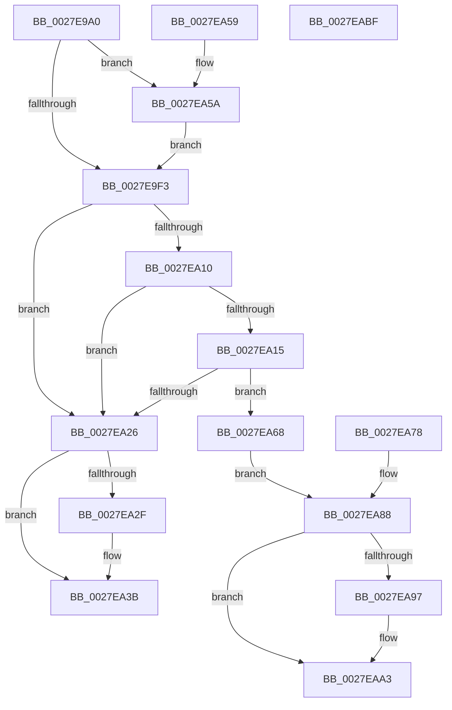

# MiFastReadLeafPte

- RVA: `0x0027E9A0`–`0x0027EAC0` (길이 `288` bytes)
- VA: `0x000000014027E9A0`
- 실행 섹션: `.text`
- PDB 이름 있음: `예`; PDB Function 태그: `아니요`
- unwind 정보 RVA: `0x00066418`
- 디코드: `78`개 명령, `288/288` bytes 표시
- 미해석 바이트: `0` (있으면 어셈블리에 `.byte`로 보존)

> 이 문서는 커널 이미지의 기계어와 PDB 기호를 분석해 생성했습니다. 4번과 5번은 함수 원형과 자료형을 바이너리 사용 방식에서 추정한 C 해석이며 원본 소스 복구 결과는 아닙니다.

## 1. Dependencies

- 직접 호출 지점: **4**; 고유 호출 대상: **3**
- 직접 호출자로 확인된 함수: **1**
- RIP 상대 이미지 참조: **2**

### Outgoing calls
- `0x0027EA36` → [KiLowerIrqlProcessIrqlFlags](../4F/KiLowerIrqlProcessIrqlFlags_function_004F5698.md) (function, `0x004F5698`)
- `0x0027EA61` → [KiRaiseIrqlProcessIrqlFlags](../4F/KiRaiseIrqlProcessIrqlFlags_function_004F56FC.md) (function, `0x004F56FC`)
- `0x0027EA6E` → [MI_READ_PTE_LOCK_FREE](../28/MI_READ_PTE_LOCK_FREE_function_002828A0.md) (function, `0x002828A0`)
- `0x0027EA9E` → [KiLowerIrqlProcessIrqlFlags](../4F/KiLowerIrqlProcessIrqlFlags_function_004F5698.md) (function, `0x004F5698`)

### Direct callers
- [MiMakeHyperRangeAccessible](MiMakeHyperRangeAccessible_function_0027CE10.md) at `0x0027CEA6`

### Static image references
- `0x0027E9EA` → RVA `0x00FC6D20` (`ALMOSTRO`; read)
- `0x0027EA03` → RVA `0x00FC6A88` (`ALMOSTRO`; read)

## 2. Other-region calls and transfers

- 다른 실행 섹션으로 향하는 call: **0**
- 별도 외부 분기/꼬리 이동을 확인하지 못했습니다.

## 3. Assembly (complete function range)

```asm
0027E9A0  48 89 5C 24 10                  mov qword ptr [rsp + 0x10], rbx
0027E9A5  56                              push rsi
0027E9A6  57                              push rdi
0027E9A7  41 54                           push r12
0027E9A9  41 56                           push r14
0027E9AB  41 57                           push r15
0027E9AD  48 83 EC 20                     sub rsp, 0x20
0027E9B1  4C 8B FA                        mov r15, rdx
0027E9B4  48 8B F1                        mov rsi, rcx
0027E9B7  45 33 F6                        xor r14d, r14d
0027E9BA  48 C1 EE 09                     shr rsi, 9
0027E9BE  48 B8 F8 FF FF FF 7F 00 00 00   movabs rax, 0x7ffffffff8
0027E9C8  48 23 F0                        and rsi, rax
0027E9CB  48 B8 00 00 00 00 80 F6 FF FF   movabs rax, 0xfffff68000000000
0027E9D5  48 03 F0                        add rsi, rax
0027E9D8  44 0F 20 C3                     mov rbx, cr8
0027E9DC  88 5C 24 50                     mov byte ptr [rsp + 0x50], bl
0027E9E0  41 BC 02 00 00 00               mov r12d, 2
0027E9E6  45 0F 22 C4                     mov cr8, r12
0027E9EA  44 39 35 2F 83 D4 00            cmp dword ptr [rip + 0xd4832f], r14d
0027E9F1  75 67                           jne 0x14027ea5a
0027E9F3  65 48 8B 04 25 20 00 00 00      mov rax, qword ptr gs:[0x20]
0027E9FC  48 8B 88 38 88 00 00            mov rcx, qword ptr [rax + 0x8838]
0027EA03  48 F7 05 7A 80 D4 00 00 00 80 00  test qword ptr [rip + 0xd4807a], 0x800000
0027EA0E  74 16                           je 0x14027ea26
0027EA10  48 85 C9                        test rcx, rcx
0027EA13  74 11                           je 0x14027ea26
0027EA15  48 8D B9 40 01 00 00            lea rdi, [rcx + 0x140]
0027EA1C  48 89 7C 24 60                  mov qword ptr [rsp + 0x60], rdi
0027EA21  44 39 37                        cmp dword ptr [rdi], r14d
0027EA24  74 42                           je 0x14027ea68
0027EA26  44 39 35 F3 82 D4 00            cmp dword ptr [rip + 0xd482f3], r14d
0027EA2D  74 0C                           je 0x14027ea3b
0027EA2F  0F B6 D3                        movzx edx, bl
0027EA32  44 0F 20 C1                     mov rcx, cr8
0027EA36  E8 5D 6C 27 00                  call 0x1404f5698
0027EA3B  0F B6 C3                        movzx eax, bl
0027EA3E  44 0F 22 C0                     mov cr8, rax
0027EA42  B8 01 00 00 C0                  mov eax, 0xc0000001
0027EA47  48 8B 5C 24 58                  mov rbx, qword ptr [rsp + 0x58]
0027EA4C  48 83 C4 20                     add rsp, 0x20
0027EA50  41 5F                           pop r15
0027EA52  41 5E                           pop r14
0027EA54  41 5C                           pop r12
0027EA56  5F                              pop rdi
0027EA57  5E                              pop rsi
0027EA58  C3                              ret
0027EA59  CC                              int3
0027EA5A  41 0F B6 D4                     movzx edx, r12b
0027EA5E  0F B6 CB                        movzx ecx, bl
0027EA61  E8 96 6C 27 00                  call 0x1404f56fc
0027EA66  EB 8B                           jmp 0x14027e9f3
0027EA68  44 89 27                        mov dword ptr [rdi], r12d
0027EA6B  48 8B CE                        mov rcx, rsi
0027EA6E  E8 2D 3E 00 00                  call 0x1402828a0
0027EA73  49 89 07                        mov qword ptr [r15], rax
0027EA76  EB 10                           jmp 0x14027ea88
0027EA78  41 BE 01 00 00 C0               mov r14d, 0xc0000001
0027EA7E  0F B6 5C 24 50                  movzx ebx, byte ptr [rsp + 0x50]
0027EA83  48 8B 7C 24 60                  mov rdi, qword ptr [rsp + 0x60]
0027EA88  C7 07 00 00 00 00               mov dword ptr [rdi], 0
0027EA8E  83 3D 8B 82 D4 00 00            cmp dword ptr [rip + 0xd4828b], 0
0027EA95  74 0C                           je 0x14027eaa3
0027EA97  44 0F 20 C1                     mov rcx, cr8
0027EA9B  0F B6 D3                        movzx edx, bl
0027EA9E  E8 F5 6B 27 00                  call 0x1404f5698
0027EAA3  0F B6 CB                        movzx ecx, bl
0027EAA6  44 0F 22 C1                     mov cr8, rcx
0027EAAA  41 8B C6                        mov eax, r14d
0027EAAD  48 8B 5C 24 58                  mov rbx, qword ptr [rsp + 0x58]
0027EAB2  48 83 C4 20                     add rsp, 0x20
0027EAB6  41 5F                           pop r15
0027EAB8  41 5E                           pop r14
0027EABA  41 5C                           pop r12
0027EABC  5F                              pop rdi
0027EABD  5E                              pop rsi
0027EABE  C3                              ret
0027EABF  CC                              int3
```

## 4. C-style interpretation (structured pseudocode)

```c
__int64 __fastcall MiFastReadLeafPte(__int64 a1, __int64 a2)
{
    __int64 result;
    __int64 v_r14;
    __int64 v_rsi;
    __int64 v_rsp;
    unsigned __int64 v_stack_p10;
    unsigned __int64 v_stack_p18;
    unsigned __int8 v_stack_p50;
    unsigned __int64 v_stack_p58;
    unsigned __int64 v_stack_p60;
    unsigned __int8 v_stack_p8;

    v_stack_p10 = v_rbx;
    v_rsp = (v_rsp) - (32);
    v_r14 = 0;
    v_rsi = (a1) >> (9);
    v_rsi = (v_rsi) & (result);
    v_rsi = (v_rsi) + (result);
    v_stack_p8 = (unsigned __int8)(v_cr8);
    if ((*(unsigned int *)(v_rip + 13927215)) != 0) goto loc_0027EA5A;
loc_0027E9F3:
    if (((*(unsigned __int64 *)(v_rip + 13926522)) & (0x800000ULL)) == 0) goto loc_0027EA26;
    if (*(unsigned __int64 *)(*(unsigned __int64 *)(gs_base + (0 + 32)) + 34872) == 0) goto loc_0027EA26;
    v_stack_p18 = *(unsigned __int64 *)(*(unsigned __int64 *)(gs_base + (0 + 32)) + 34872) + 320;
    if ((*(unsigned int *)(*(unsigned __int64 *)(*(unsigned __int64 *)(gs_base + (0 + 32)) + 34872) + 320)) == 0) goto loc_0027EA68;
loc_0027EA26:
    result = *(unsigned __int64 *)(gs_base + (0 + 32));
    if ((*(unsigned int *)(v_rip + 13927155)) != 0) {
        a2 = (unsigned __int8)(v_cr8);
        a1 = 2;
        result = KiLowerIrqlProcessIrqlFlags(a1, a2, a3, a4);
    }
    v_rsp = (v_rsp) + (32);
    return (unsigned int)(0xC0000001ULL);
loc_0027EA5A:
    result = KiRaiseIrqlProcessIrqlFlags((unsigned __int8)(v_stack_p10), 2, a3, a4);
    goto loc_0027E9F3;
loc_0027EA68:
    *(unsigned int *)(*(unsigned __int64 *)(*(unsigned __int64 *)(gs_base + (0 + 32)) + 34872) + 320) = 2;
    result = MI_READ_PTE_LOCK_FREE(v_rsi, 2, a3, a4);
    *(unsigned __int64 *)(a2) = result;
    goto loc_0027EA88;
loc_0027EA88:
    *(unsigned int *)(*(unsigned __int64 *)(*(unsigned __int64 *)(gs_base + (0 + 32)) + 34872) + 320) = 0;
    if ((*(unsigned int *)(v_rip + 13927051)) != 0) {
        a1 = (unsigned __int8)(v_cr8);
        a2 = (unsigned __int8)(v_stack_p10);
        result = KiLowerIrqlProcessIrqlFlags(a1, a2, a3, a4);
    }
    v_rsp = (v_rsp) + (32);
    return 0;
}
```

## 5. (Beta) C Style

```c
int64_t MiFastReadLeafPte(int64_t Arg1, void *Arg2)
{
    uint8_t *arg2 = (uint8_t *)Arg2;

    int64_t result;
    int64_t local_r14;
    int64_t local_rsi;
    int64_t local_rsp;
    uint64_t v_stack_p10;
    uint64_t v_stack_p18;
    uint8_t v_stack_p50;
    uint64_t v_stack_p58;
    uint64_t v_stack_p60;
    uint8_t v_stack_p8;

    v_stack_p10 = local_rbx;
    local_rsp = (local_rsp) - (32);
    local_r14 = 0;
    local_rsi = (Arg1) >> (9);
    local_rsi = (local_rsi) & (result);
    local_rsi = (local_rsi) + (result);
    v_stack_p8 = (uint8_t)(v_cr8);
    if ((*(uint32_t *)(v_rip + 0xD4832F)) != 0) goto loc_0027EA5A;
loc_0027E9F3:
    if (((*(uint64_t *)(v_rip + 0xD4807A)) & (0x800000ULL)) == 0) goto loc_0027EA26;
    if (*(uint64_t *)(*(uint64_t *)(gs_base + (0 + 0x20)) + 0x8838) == 0) goto loc_0027EA26;
    v_stack_p18 = *(uint64_t *)(*(uint64_t *)(gs_base + (0 + 0x20)) + 0x8838) + 320;
    if ((*(uint32_t *)(*(uint64_t *)(*(uint64_t *)(gs_base + (0 + 0x20)) + 0x8838) + 0x140)) == 0) goto loc_0027EA68;
loc_0027EA26:
    result = *(uint64_t *)(gs_base + (0 + 0x20));
    if ((*(uint32_t *)(v_rip + 0xD482F3)) != 0) {
        Arg2 = (uint8_t)(v_cr8);
        Arg1 = 2;
        result = KiLowerIrqlProcessIrqlFlags(Arg1, Arg2, a3, a4);
    }
    local_rsp = (local_rsp) + (32);
    return (uint32_t)(0xC0000001ULL);
loc_0027EA5A:
    result = KiRaiseIrqlProcessIrqlFlags((uint8_t)(v_stack_p10), 2, a3, a4);
    goto loc_0027E9F3;
loc_0027EA68:
    *(uint32_t *)(*(uint64_t *)(*(uint64_t *)(gs_base + (0 + 0x20)) + 0x8838) + 0x140) = 2;
    result = MI_READ_PTE_LOCK_FREE(local_rsi, 2, a3, a4);
    *(uint64_t *)(arg2) = result;
    goto loc_0027EA88;
loc_0027EA88:
    *(uint32_t *)(*(uint64_t *)(*(uint64_t *)(gs_base + (0 + 0x20)) + 0x8838) + 0x140) = 0;
    if ((*(uint32_t *)(v_rip + 0xD4828B)) != 0) {
        Arg1 = (uint8_t)(v_cr8);
        Arg2 = (uint8_t)(v_stack_p10);
        result = KiLowerIrqlProcessIrqlFlags(Arg1, Arg2, a3, a4);
    }
    local_rsp = (local_rsp) + (32);
    return 0;
}
```

### 관측된 메모리 오프셋

구조체 형식이 확인되지 않은 접근은 인자 기준의 오프셋으로만 기록했습니다.

| 기준 인자 | 오프셋 표현 | 폭 (bit) | 접근 |
|---|---:|---:|---|
| `Arg2` | `+ 0x0` | `64` | `W` |

## 6. Execution-region graph

[열기: 2D/3D 그래프와 함수 탐색 컨트롤 패널](../../../control-panel.html?section=text&rva=0x0027E9A0&view=graph)

- 2D 그래프는 위에서 아래로 흐르고, 3D 그래프는 빈 공간을 드래그해 회전합니다. Shift+드래그는 이동, 휠은 확대·축소, 함수 노드 선택은 대상 보고서 이동입니다.

### Static fallback


