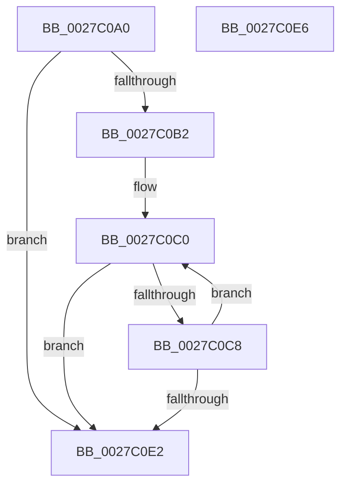

# MiGetLeafVa

- RVA: `0x0027C0A0`–`0x0027C0E7` (길이 `71` bytes)
- VA: `0x000000014027C0A0`
- 실행 섹션: `.text`
- PDB 이름 있음: `예`; PDB Function 태그: `아니요`
- unwind 정보 RVA: `0x000DB714`
- 디코드: `20`개 명령, `71/71` bytes 표시
- 미해석 바이트: `0` (있으면 어셈블리에 `.byte`로 보존)

> 이 문서는 커널 이미지의 기계어와 PDB 기호를 분석해 생성했습니다. 4번과 5번은 함수 원형과 자료형을 바이너리 사용 방식에서 추정한 C 해석이며 원본 소스 복구 결과는 아닙니다.

## 1. Dependencies

- 직접 호출 지점: **0**; 고유 호출 대상: **0**
- 직접 호출자로 확인된 함수: **46**
- RIP 상대 이미지 참조: **0**

### Outgoing calls
- 직접 디코드된 call 명령이 없습니다.

### Direct callers
- [sub_00243300](../24/Unknown_function_00243300.md) at `0x0024335C`
- [MiWalkVaRange](../24/MiWalkVaRange_function_00243BF0.md) at `0x00243D00`
- [MiDeleteVaDirect](MiDeleteVaDirect_function_00277560.md) at `0x002788B6`
- [MiWalkPageTablesRecursively](MiWalkPageTablesRecursively_function_002796C0.md) at `0x00279B6D`
- [MiUnlockCodePage](../2A/MiUnlockCodePage_function_002A2AB8.md) at `0x002A2AE3`
- [NtGetWriteWatch](../2A/NtGetWriteWatch_function_002A7CE0.md) at `0x002A81DE`
- [NtGetWriteWatch](../2A/NtGetWriteWatch_function_002A7CE0.md) at `0x002A8286`
- [MiMoveDirtyBitsToPfns](../2A/MiMoveDirtyBitsToPfns_function_002A8624.md) at `0x002A87C2`
- [MiMoveDirtyBitsToPfns](../2A/MiMoveDirtyBitsToPfns_function_002A8624.md) at `0x002A886C`
- [MiMoveDirtyBitsToPfns](../2A/MiMoveDirtyBitsToPfns_function_002A8624.md) at `0x002A8889`
- [MiStealPage](../2B/MiStealPage_function_002B28D0.md) at `0x002B2996`
- [MiClearNonPagedPtes](../2C/MiClearNonPagedPtes_function_002C17A0.md) at `0x002C1A2B`
- [sub_002C1E57](../2C/Unknown_function_002C1E57.md) at `0x002C1E66`
- [sub_002C2EF5](../2C/Unknown_function_002C2EF5.md) at `0x002C2F71`
- [MiRevertValidPte](../2C/MiRevertValidPte_function_002C5160.md) at `0x002C553E`
- [MiVaToFlushVm](../31/MiVaToFlushVm_function_0031AD84.md) at `0x0031AD88`
- [sub_0031D027](../31/Unknown_function_0031D027.md) at `0x0031D039`
- [sub_0031D09C](../31/Unknown_function_0031D09C.md) at `0x0031D177`
- [sub_0031EA17](../31/Unknown_function_0031EA17.md) at `0x0031EBDA`
- [MiQueryAddressState](../32/MiQueryAddressState_function_0032C380.md) at `0x0032C4A8`
- [MiQueryAddressState](../32/MiQueryAddressState_function_0032C380.md) at `0x0032D593`
- [MiSystemFault](../34/MiSystemFault_function_0034AA64.md) at `0x0034AAB3`
- [sub_0036CD3D](../36/Unknown_function_0036CD3D.md) at `0x0036CE14`
- [MiDecommitPrivatePageTail](../36/MiDecommitPrivatePageTail_function_0036F564.md) at `0x0036F86B`
- [MiDecommitSharedPageTail](../37/MiDecommitSharedPageTail_function_00370240.md) at `0x003707C6`
- [sub_00370B5B](../37/Unknown_function_00370B5B.md) at `0x00370D50`
- [MiFlushValidPteFromTb](../37/MiFlushValidPteFromTb_function_00376878.md) at `0x0037689C`
- [MiInsertLargeUserMapping](../3D/MiInsertLargeUserMapping_function_003D3154.md) at `0x003D31A0`
- [MiInPagePageTable](../3E/MiInPagePageTable_function_003EF8DC.md) at `0x003EFC73`
- [MiInitializeSystemPageTable](../45/MiInitializeSystemPageTable_function_00451C88.md) at `0x00451D45`
- [MiDeleteEmptyPageTableCommit](../48/MiDeleteEmptyPageTableCommit_function_004834F4.md) at `0x00483560`
- [MiDeleteEmptyPageTableCommit](../48/MiDeleteEmptyPageTableCommit_function_004834F4.md) at `0x00483576`
- [MiMirrorRemoveInactivePages](../4A/MiMirrorRemoveInactivePages_function_004AC24C.md) at `0x004AC39B`
- [MiWriteAwePtes](../4C/MiWriteAwePtes_function_004C51E0.md) at `0x004C5676`
- [MiWriteAwePtes](../4C/MiWriteAwePtes_function_004C51E0.md) at `0x004C569C`
- [MiWriteAwePtes](../4C/MiWriteAwePtes_function_004C51E0.md) at `0x004C56E1`
- [MiProtectAweRegion](../4C/MiProtectAweRegion_function_004CE62C.md) at `0x004CEB1F`
- [MiMapMdlWithLargePages](../4D/MiMapMdlWithLargePages_function_004D10B8.md) at `0x004D1441`
- [MiFinishPteChangesInPageTable](../4E/MiFinishPteChangesInPageTable_function_004EE660.md) at `0x004EE76C`
- [MiMakeLargePageTable](../4F/MiMakeLargePageTable_function_004F9198.md) at `0x004F91F3`
- [MiGetNextNonGapPfnPage](../67/MiGetNextNonGapPfnPage_function_006728D8.md) at `0x00672B5D`
- [MiGetNextNonGapPfnPage](../67/MiGetNextNonGapPfnPage_function_006728D8.md) at `0x00672B68`
- [MiPfnRangeIsZero](../67/MiPfnRangeIsZero_function_006735C0.md) at `0x006738BE`
- [MiPfnRangeIsZero](../67/MiPfnRangeIsZero_function_006735C0.md) at `0x006738DF`
- [MiUnlockPhysicalPageByVa](../67/MiUnlockPhysicalPageByVa_function_00673EB0.md) at `0x00673F1B`
- [MiCrashdumpRemovePte](../67/MiCrashdumpRemovePte_function_0067D430.md) at `0x0067D43D`
- [MiFilterCrashDumpPte](../67/MiFilterCrashDumpPte_function_0067D4D0.md) at `0x0067D510`
- [MiFilterCrashDumpPte](../67/MiFilterCrashDumpPte_function_0067D4D0.md) at `0x0067D5A9`
- [MiFilterCrashDumpPte](../67/MiFilterCrashDumpPte_function_0067D4D0.md) at `0x0067D5B5`
- [MiDbgCopyMemoryTarget](../68/MiDbgCopyMemoryTarget_function_00684E70.md) at `0x00684F3A`
- [MiRealVaToFlushType](../68/MiRealVaToFlushType_function_0068619C.md) at `0x006861A0`
- [sub_006EFE28](../6E/Unknown_function_006EFE28.md) at `0x006EFF11`
- [sub_006F91FE](../6F/Unknown_function_006F91FE.md) at `0x006F92DD`
- [MiScrubLargePageRegions](../../page/70/MiScrubLargePageRegions_function_007011B4.md) at `0x0070133A`
- [MiFreeEmptyBootPageTable](../../init/C6/MiFreeEmptyBootPageTable_function_00C62370.md) at `0x00C623EB`
- [MxCreatePfnsForPtes](../../init/C6/MxCreatePfnsForPtes_function_00C635B0.md) at `0x00C636CD`
- [MxMapVa](../../init/C6/MxMapVa_function_00C63EC4.md) at `0x00C63F21`
- [MxMapVa](../../init/C6/MxMapVa_function_00C63EC4.md) at `0x00C64033`
- [MxMapVa](../../init/C6/MxMapVa_function_00C63EC4.md) at `0x00C64056`
- [MxMapVa](../../init/C6/MxMapVa_function_00C63EC4.md) at `0x00C64073`

### Static image references
- 디코드된 RIP-relative 메모리 참조가 없습니다.

## 2. Other-region calls and transfers

- 다른 실행 섹션으로 향하는 call: **0**
- 별도 외부 분기/꼬리 이동을 확인하지 못했습니다.

## 3. Assembly (complete function range)

```asm
0027C0A0  48 BA 00 00 00 00 80 F6 FF FF   movabs rdx, 0xfffff68000000000
0027C0AA  48 8B C2                        mov rax, rdx
0027C0AD  48 3B C8                        cmp rcx, rax
0027C0B0  72 30                           jb 0x14027c0e2
0027C0B2  49 B8 FF FF FF FF FF F6 FF FF   movabs r8, 0xfffff6ffffffffff
0027C0BC  0F 1F 40 00                     nop dword ptr [rax]
0027C0C0  49 8B C0                        mov rax, r8
0027C0C3  48 3B C8                        cmp rcx, rax
0027C0C6  77 1A                           ja 0x14027c0e2
0027C0C8  48 C1 E1 19                     shl rcx, 0x19
0027C0CC  48 8B C2                        mov rax, rdx
0027C0CF  48 C1 E0 19                     shl rax, 0x19
0027C0D3  48 2B C8                        sub rcx, rax
0027C0D6  48 C1 F9 10                     sar rcx, 0x10
0027C0DA  48 8B C2                        mov rax, rdx
0027C0DD  48 3B C8                        cmp rcx, rax
0027C0E0  73 DE                           jae 0x14027c0c0
0027C0E2  48 8B C1                        mov rax, rcx
0027C0E5  C3                              ret
0027C0E6  CC                              int3
```

## 4. C-style interpretation (structured pseudocode)

```c
__int64 __fastcall MiGetLeafVa(__int64 a1)
{
    __int64 result;

    if (a1 < a2) goto loc_0027C0E2;
loc_0027C0C0:
    if (a1 > a3) goto loc_0027C0E2;
    a1 = (a1) << (25);
    result = (a2) << (25);
    a1 = (a1) - (result);
    a1 = (a1) >> (16);
    if (a1 >= a2) goto loc_0027C0C0;
loc_0027C0E2:
    return a1;
}
```

## 5. (Beta) C Style

```c
int64_t MiGetLeafVa(int64_t Arg1)
{
    int64_t result;

    if (Arg1 < a2) goto loc_0027C0E2;
loc_0027C0C0:
    if (Arg1 > a3) goto loc_0027C0E2;
    Arg1 = (Arg1) << (25);
    result = (a2) << (25);
    Arg1 = (Arg1) - (result);
    Arg1 = (Arg1) >> (16);
    if (Arg1 >= a2) goto loc_0027C0C0;
loc_0027C0E2:
    return Arg1;
}
```

## 6. Execution-region graph

[열기: 2D/3D 그래프와 함수 탐색 컨트롤 패널](../../../control-panel.html?section=text&rva=0x0027C0A0&view=graph)

- 2D 그래프는 위에서 아래로 흐르고, 3D 그래프는 빈 공간을 드래그해 회전합니다. Shift+드래그는 이동, 휠은 확대·축소, 함수 노드 선택은 대상 보고서 이동입니다.

### Static fallback


