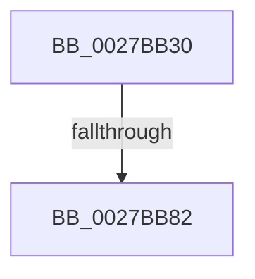

# MiGetNextPageTablePte

- RVA: `0x0027BB30`–`0x0027BB85` (길이 `85` bytes)
- VA: `0x000000014027BB30`
- 실행 섹션: `.text`
- PDB 이름 있음: `예`; PDB Function 태그: `아니요`
- unwind 정보 RVA: `0x00066068`
- 디코드: `23`개 명령, `85/85` bytes 표시
- 미해석 바이트: `0` (있으면 어셈블리에 `.byte`로 보존)

> 이 문서는 커널 이미지의 기계어와 PDB 기호를 분석해 생성했습니다. 4번과 5번은 함수 원형과 자료형을 바이너리 사용 방식에서 추정한 C 해석이며 원본 소스 복구 결과는 아닙니다.

## 1. Dependencies

- 직접 호출 지점: **0**; 고유 호출 대상: **0**
- 직접 호출자로 확인된 함수: **1**
- RIP 상대 이미지 참조: **0**

### Outgoing calls
- 직접 디코드된 call 명령이 없습니다.

### Direct callers
- [MiWalkPageTablesRecursively](MiWalkPageTablesRecursively_function_002796C0.md) at `0x00279DC2`

### Static image references
- 디코드된 RIP-relative 메모리 참조가 없습니다.

## 2. Other-region calls and transfers

- 다른 실행 섹션으로 향하는 call: **0**
- call이 아닌 외부 분기/꼬리 이동: **1**
  - `0x0027BB7C` → [sub_0027BF09](Unknown_function_0027BF09.md) (`tail-transfer`)

## 3. Assembly (complete function range)

```asm
0027BB30  4C 8B DC                        mov r11, rsp
0027BB33  49 89 5B 18                     mov qword ptr [r11 + 0x18], rbx
0027BB37  55                              push rbp
0027BB38  56                              push rsi
0027BB39  57                              push rdi
0027BB3A  48 81 EC B0 00 00 00            sub rsp, 0xb0
0027BB41  0F 57 C0                        xorps xmm0, xmm0
0027BB44  49 63 F0                        movsxd rsi, r8d
0027BB47  0F 11 44 24 30                  movups xmmword ptr [rsp + 0x30], xmm0
0027BB4C  33 C0                           xor eax, eax
0027BB4E  41 8B E9                        mov ebp, r9d
0027BB51  48 8B FA                        mov rdi, rdx
0027BB54  48 8B D9                        mov rbx, rcx
0027BB57  0F 11 44 24 40                  movups xmmword ptr [rsp + 0x40], xmm0
0027BB5C  0F 11 44 24 50                  movups xmmword ptr [rsp + 0x50], xmm0
0027BB61  0F 11 44 24 60                  movups xmmword ptr [rsp + 0x60], xmm0
0027BB66  0F 11 44 24 70                  movups xmmword ptr [rsp + 0x70], xmm0
0027BB6B  49 89 43 D8                     mov qword ptr [r11 - 0x28], rax
0027BB6F  41 0F 11 43 B8                  movups xmmword ptr [r11 - 0x48], xmm0
0027BB74  41 0F 11 43 C8                  movups xmmword ptr [r11 - 0x38], xmm0
0027BB79  83 FE 03                        cmp esi, 3
0027BB7C  0F 84 87 03 00 00               je 0x14027bf09
0027BB82  4C 8B 12                        mov r10, qword ptr [rdx]
```

## 4. C-style interpretation (structured pseudocode)

```c
__int64 __fastcall MiGetNextPageTablePte(__int64 a1, __int64 a2, int a3, int a4)
{
    __int64 result;
    __int64 v_rsp;
    unsigned __int64 v_stack_m58;
    unsigned __int64 v_stack_m68;
    unsigned __int64 v_stack_m78;
    unsigned __int64 v_stack_m88;
    unsigned __int64 v_stack_m98;

    *(unsigned __int64 *)(v_rsp + 24) = v_rbx;
    v_rsp = (v_rsp) - (176);
    v_stack_m98 = v_xmm0;
    result = 0;
    v_stack_m88 = v_xmm0;
    v_stack_m78 = v_xmm0;
    v_stack_m68 = v_xmm0;
    v_stack_m58 = v_xmm0;
    *(unsigned __int64 *)(v_rsp - 40) = 0;
    *(unsigned __int64 *)(v_rsp - 72) = v_xmm0;
    *(unsigned __int64 *)(v_rsp - 56) = v_xmm0;
    return result;
}
```

## 5. (Beta) C Style

```c
int64_t MiGetNextPageTablePte(int64_t Arg1, void *Arg2, int32_t Arg3, int32_t Arg4)
{
    uint8_t *arg2 = (uint8_t *)Arg2;

    int64_t result;
    int64_t local_rsp;
    uint64_t v_stack_m58;
    uint64_t v_stack_m68;
    uint64_t v_stack_m78;
    uint64_t v_stack_m88;
    uint64_t v_stack_m98;

    *(uint64_t *)(local_rsp + 0x18) = local_rbx;
    local_rsp = (local_rsp) - (176);
    v_stack_m98 = v_xmm0;
    result = 0;
    v_stack_m88 = v_xmm0;
    v_stack_m78 = v_xmm0;
    v_stack_m68 = v_xmm0;
    v_stack_m58 = v_xmm0;
    *(uint64_t *)(local_rsp - 0x28) = 0;
    *(uint64_t *)(local_rsp - 0x48) = v_xmm0;
    *(uint64_t *)(local_rsp - 0x38) = v_xmm0;
    return result;
}
```

### 관측된 메모리 오프셋

구조체 형식이 확인되지 않은 접근은 인자 기준의 오프셋으로만 기록했습니다.

| 기준 인자 | 오프셋 표현 | 폭 (bit) | 접근 |
|---|---:|---:|---|
| `Arg2` | `+ 0x0` | `64` | `R` |

## 6. Execution-region graph

[열기: 2D/3D 그래프와 함수 탐색 컨트롤 패널](../../../control-panel.html?section=text&rva=0x0027BB30&view=graph)

- 2D 그래프는 위에서 아래로 흐르고, 3D 그래프는 빈 공간을 드래그해 회전합니다. Shift+드래그는 이동, 휠은 확대·축소, 함수 노드 선택은 대상 보고서 이동입니다.

### Static fallback


