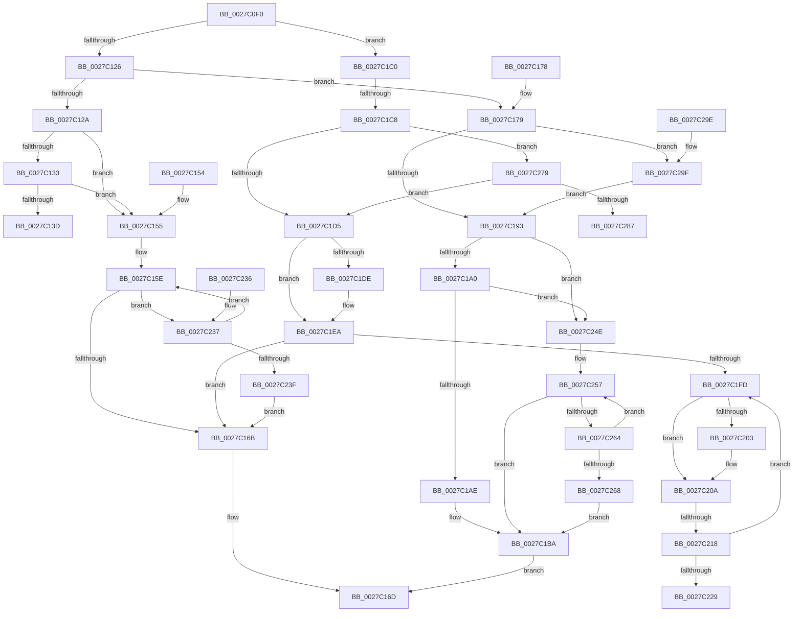

# MiLockVadTree

- RVA: `0x0027C0F0`–`0x0027C2B0` (길이 `448` bytes)
- VA: `0x000000014027C0F0`
- 실행 섹션: `.text`
- PDB 이름 있음: `예`; PDB Function 태그: `아니요`
- unwind 정보 RVA: `0x000660C0`
- 디코드: `122`개 명령, `448/448` bytes 표시
- 미해석 바이트: `0` (있으면 어셈블리에 `.byte`로 보존)

> 이 문서는 커널 이미지의 기계어와 PDB 기호를 분석해 생성했습니다. 4번과 5번은 함수 원형과 자료형을 바이너리 사용 방식에서 추정한 C 해석이며 원본 소스 복구 결과는 아닙니다.

## 1. Dependencies

- 직접 호출 지점: **7**; 고유 호출 대상: **5**
- 직접 호출자로 확인된 함수: **39**
- RIP 상대 이미지 참조: **4**

### Outgoing calls
- `0x0027C142` → [ExpAcquireSpinLockSharedAtDpcLevelInstrumented](ExpAcquireSpinLockSharedAtDpcLevelInstrumented_function_0027CD20.md) (function, `0x0027CD20`)
- `0x0027C1B5` → [ExpAcquireSpinLockSharedAtDpcLevelInstrumented](ExpAcquireSpinLockSharedAtDpcLevelInstrumented_function_0027CD20.md) (function, `0x0027CD20`)
- `0x0027C1E3` → [ExpWaitForSpinLockExclusiveAndAcquire](../32/ExpWaitForSpinLockExclusiveAndAcquire_function_003239A0.md) (function, `0x003239A0`)
- `0x0027C244` → [ExpWaitForSpinLockSharedAndAcquire](../36/ExpWaitForSpinLockSharedAndAcquire_function_00362380.md) (function, `0x00362380`)
- `0x0027C26F` → [ExpWaitForSpinLockSharedAndAcquire](../36/ExpWaitForSpinLockSharedAndAcquire_function_00362380.md) (function, `0x00362380`)
- `0x0027C28C` → [ExpAcquireSpinLockExclusiveAtDpcLevelInstrumented](../32/ExpAcquireSpinLockExclusiveAtDpcLevelInstrumented_function_00323A70.md) (function, `0x00323A70`)
- `0x0027C2A6` → [KiRaiseIrqlProcessIrqlFlags](../4F/KiRaiseIrqlProcessIrqlFlags_function_004F56FC.md) (function, `0x004F56FC`)

### Direct callers
- [MiInsertVad](../26/MiInsertVad_function_00265540.md) at `0x002655F3`
- [MiWalkPageTablesRecursively](MiWalkPageTablesRecursively_function_002796C0.md) at `0x00279B7D`
- [sub_0027F36E](Unknown_function_0027F36E.md) at `0x0027F3BF`
- [sub_00283850](../28/Unknown_function_00283850.md) at `0x002839B1`
- [sub_00283AFC](../28/Unknown_function_00283AFC.md) at `0x00283B6B`
- [sub_00283AFC](../28/Unknown_function_00283AFC.md) at `0x00283BE9`
- [MiObtainReferencedSecureVad](../29/MiObtainReferencedSecureVad_function_00295688.md) at `0x002956C3`
- [MiRemoveVad](../29/MiRemoveVad_function_00295C78.md) at `0x00295D91`
- [MiSetVadDeleted](../29/MiSetVadDeleted_function_00296E00.md) at `0x00296E85`
- [MiBeginProcessClean](../2A/MiBeginProcessClean_function_002A473C.md) at `0x002A478C`
- [MiPerformVadSplitting](../2A/MiPerformVadSplitting_function_002A5A80.md) at `0x002A5BC0`
- [MiLockStealUserVm](../2B/MiLockStealUserVm_function_002B3EDC.md) at `0x002B40BD`
- [sub_002B5C0F](../2B/Unknown_function_002B5C0F.md) at `0x002B5C24`
- [MiComputeFaultNode](../2B/MiComputeFaultNode_function_002B60C0.md) at `0x002B61B7`
- [sub_002B674F](../2B/Unknown_function_002B674F.md) at `0x002B6872`
- [MiInitializeReadInProgressPfn](../2B/MiInitializeReadInProgressPfn_function_002B6990.md) at `0x002B6E76`
- [MiTrimSharedPageFromViews](../2E/MiTrimSharedPageFromViews_function_002E16F8.md) at `0x002E1CAA`
- [MiSharePages](../31/MiSharePages_function_00315110.md) at `0x003155AA`
- [MiVadSupportsCombine](../31/MiVadSupportsCombine_function_00316610.md) at `0x0031661E`
- [MiObtainReferencedVadEx](../31/MiObtainReferencedVadEx_function_00316690.md) at `0x003166CF`
- [MiResolveProtoPteFault](../32/MiResolveProtoPteFault_function_00321750.md) at `0x003223FE`
- [MiValidFault](../32/MiValidFault_function_003280B4.md) at `0x00328412`
- [MiUserFault](../32/MiUserFault_function_00329840.md) at `0x0032A09B`
- [MiUserFault](../32/MiUserFault_function_00329840.md) at `0x0032A0EB`
- [sub_0032F7AB](../32/Unknown_function_0032F7AB.md) at `0x0032FB40`
- [MiCompletePrivateZeroFault](../33/MiCompletePrivateZeroFault_function_00330CC0.md) at `0x00331D68`
- [MiCompleteProtoPteFault](../34/MiCompleteProtoPteFault_function_00345710.md) at `0x0034610C`
- [MiCopyOnWrite](../36/MiCopyOnWrite_function_00362A0C.md) at `0x003634FE`
- [MiImagePageOk](../36/MiImagePageOk_function_00365AE0.md) at `0x00365BBA`
- [MiResolveMappedFileFault](../36/MiResolveMappedFileFault_function_0036B640.md) at `0x0036B80A`
- [MiResolveMappedFileFault](../36/MiResolveMappedFileFault_function_0036B640.md) at `0x0036BF4B`
- [MiResolvePageFileFault](../36/MiResolvePageFileFault_function_0036D968.md) at `0x0036DC62`
- [MiResolvePageFileFault](../36/MiResolvePageFileFault_function_0036D968.md) at `0x0036EA1B`
- [MiResolvePageFileFault](../36/MiResolvePageFileFault_function_0036D968.md) at `0x0036EC65`
- [MiReservePageFileSpace](../38/MiReservePageFileSpace_function_00383ED8.md) at `0x00383FA5`
- [MiUpdatePrefetchPriority](../40/MiUpdatePrefetchPriority_function_00402CB0.md) at `0x00402E02`
- [MiProcessCommitIntact](../40/MiProcessCommitIntact_function_004093C0.md) at `0x00409432`
- [MiComputeMaximumFaultCluster](../41/MiComputeMaximumFaultCluster_function_00418210.md) at `0x00418363`
- [MiSetVadFlags](../43/MiSetVadFlags_function_004311FC.md) at `0x004312D2`
- [MiCaptureWriteWatchDirtyBit](../46/MiCaptureWriteWatchDirtyBit_function_00465224.md) at `0x00465259`
- [MiStoreGetVadForAddress](../47/MiStoreGetVadForAddress_function_00474CB0.md) at `0x00474CBB`
- [MiCanGrantExecute](../4A/MiCanGrantExecute_function_004AD788.md) at `0x004AD7BE`
- [MiLeapPrefetch](../4C/MiLeapPrefetch_function_004CAED0.md) at `0x004CAF4E`
- [MiStoreDiscardPoisonedPage](../69/MiStoreDiscardPoisonedPage_function_00692858.md) at `0x006929EF`

### Static image references
- `0x0027C12A` → RVA `0x00FC6B06` (`ALMOSTRO`; read)
- `0x0027C133` → RVA `0x00F0DE58` (`.data`; read)
- `0x0027C186` → RVA `0x00FC6D20` (`ALMOSTRO`; read)
- `0x0027C20C` → RVA `0x00FC52AC` (`ALMOSTRO`; reference)

## 2. Other-region calls and transfers

- 다른 실행 섹션으로 향하는 call: **0**
- call이 아닌 외부 분기/꼬리 이동: **2**
  - `0x0027C1C2` → [sub_0027C2B0](Unknown_function_0027C2B0.md) (`tail-transfer`)
  - `0x0027C212` → [sub_0027C37D](Unknown_function_0027C37D.md) (`tail-transfer`)

## 3. Assembly (complete function range)

```asm
0027C0F0  48 89 5C 24 20                  mov qword ptr [rsp + 0x20], rbx
0027C0F5  57                              push rdi
0027C0F6  48 83 EC 20                     sub rsp, 0x20
0027C0FA  65 48 8B 04 25 88 01 00 00      mov rax, qword ptr gs:[0x188]
0027C103  48 8B 90 B8 00 00 00            mov rdx, qword ptr [rax + 0xb8]
0027C10A  8B C1                           mov eax, ecx
0027C10C  83 E0 01                        and eax, 1
0027C10F  48 8B 9A 10 04 00 00            mov rbx, qword ptr [rdx + 0x410]
0027C116  48 81 C3 EC 03 00 00            add rbx, 0x3ec
0027C11D  F6 C1 02                        test cl, 2
0027C120  0F 85 9A 00 00 00               jne 0x14027c1c0
0027C126  85 C0                           test eax, eax
0027C128  74 4F                           je 0x14027c179
0027C12A  F6 05 D5 A9 D4 00 21            test byte ptr [rip + 0xd4a9d5], 0x21
0027C131  74 22                           je 0x14027c155
0027C133  8B 0D 1F 1D C9 00               mov ecx, dword ptr [rip + 0xc91d1f]
0027C139  85 C9                           test ecx, ecx
0027C13B  75 18                           jne 0x14027c155
0027C13D  B2 FF                           mov dl, 0xff
0027C13F  48 8B CB                        mov rcx, rbx
0027C142  E8 D9 0B 00 00                  call 0x14027cd20
0027C147  B0 11                           mov al, 0x11
0027C149  48 8B 5C 24 48                  mov rbx, qword ptr [rsp + 0x48]
0027C14E  48 83 C4 20                     add rsp, 0x20
0027C152  5F                              pop rdi
0027C153  C3                              ret
0027C154  CC                              int3
0027C155  0F 0D 0B                        prefetchw byte ptr [rbx]
0027C158  8B 03                           mov eax, dword ptr [rbx]
0027C15A  0F BA F0 1F                     btr eax, 0x1f
0027C15E  8D 48 01                        lea ecx, [rax + 1]
0027C161  F0 0F B1 0B                     lock cmpxchg dword ptr [rbx], ecx
0027C165  0F 85 CC 00 00 00               jne 0x14027c237
0027C16B  B0 11                           mov al, 0x11
0027C16D  48 8B 5C 24 48                  mov rbx, qword ptr [rsp + 0x48]
0027C172  48 83 C4 20                     add rsp, 0x20
0027C176  5F                              pop rdi
0027C177  C3                              ret
0027C178  CC                              int3
0027C179  44 0F 20 C7                     mov rdi, cr8
0027C17D  B8 02 00 00 00                  mov eax, 2
0027C182  44 0F 22 C0                     mov cr8, rax
0027C186  83 3D 93 AB D4 00 00            cmp dword ptr [rip + 0xd4ab93], 0
0027C18D  0F 85 0C 01 00 00               jne 0x14027c29f
0027C193  F6 05 6C A9 D4 00 21            test byte ptr [rip + 0xd4a96c], 0x21
0027C19A  0F 84 AE 00 00 00               je 0x14027c24e
0027C1A0  8B 05 B2 1C C9 00               mov eax, dword ptr [rip + 0xc91cb2]
0027C1A6  85 C0                           test eax, eax
0027C1A8  0F 85 A0 00 00 00               jne 0x14027c24e
0027C1AE  40 0F B6 D7                     movzx edx, dil
0027C1B2  48 8B CB                        mov rcx, rbx
0027C1B5  E8 66 0B 00 00                  call 0x14027cd20
0027C1BA  40 0F B6 C7                     movzx eax, dil
0027C1BE  EB AD                           jmp 0x14027c16d
0027C1C0  85 C0                           test eax, eax
0027C1C2  0F 84 E8 00 00 00               je 0x14027c2b0
0027C1C8  F6 05 37 A9 D4 00 21            test byte ptr [rip + 0xd4a937], 0x21
0027C1CF  0F 85 A4 00 00 00               jne 0x14027c279
0027C1D5  33 FF                           xor edi, edi
0027C1D7  F0 0F BA 2B 1F                  lock bts dword ptr [rbx], 0x1f
0027C1DC  73 0C                           jae 0x14027c1ea
0027C1DE  B2 FF                           mov dl, 0xff
0027C1E0  48 8B CB                        mov rcx, rbx
0027C1E3  E8 B8 77 0A 00                  call 0x1403239a0
0027C1E8  8B F8                           mov edi, eax
0027C1EA  8B 0B                           mov ecx, dword ptr [rbx]
0027C1EC  8B C1                           mov eax, ecx
0027C1EE  0F BA F0 1E                     btr eax, 0x1e
0027C1F2  3D 00 00 00 80                  cmp eax, 0x80000000
0027C1F7  0F 84 6E FF FF FF               je 0x14027c16b
0027C1FD  0F BA E1 1E                     bt ecx, 0x1e
0027C201  72 07                           jb 0x14027c20a
0027C203  F0 81 0B 00 00 00 40            lock or dword ptr [rbx], 0x40000000
0027C20A  FF C7                           inc edi
0027C20C  85 3D 9A 90 D4 00               test dword ptr [rip + 0xd4909a], edi
0027C212  0F 84 65 01 00 00               je 0x14027c37d
0027C218  F3 90                           pause
0027C21A  8B 0B                           mov ecx, dword ptr [rbx]
0027C21C  8B C1                           mov eax, ecx
0027C21E  0F BA F0 1E                     btr eax, 0x1e
0027C222  3D 00 00 00 80                  cmp eax, 0x80000000
0027C227  75 D4                           jne 0x14027c1fd
0027C229  B0 11                           mov al, 0x11
0027C22B  48 8B 5C 24 48                  mov rbx, qword ptr [rsp + 0x48]
0027C230  48 83 C4 20                     add rsp, 0x20
0027C234  5F                              pop rdi
0027C235  C3                              ret
0027C236  CC                              int3
0027C237  85 C0                           test eax, eax
0027C239  0F 89 1F FF FF FF               jns 0x14027c15e
0027C23F  B2 FF                           mov dl, 0xff
0027C241  48 8B CB                        mov rcx, rbx
0027C244  E8 37 61 0E 00                  call 0x140362380
0027C249  E9 1D FF FF FF                  jmp 0x14027c16b
0027C24E  0F 0D 0B                        prefetchw byte ptr [rbx]
0027C251  8B 03                           mov eax, dword ptr [rbx]
0027C253  0F BA F0 1F                     btr eax, 0x1f
0027C257  8D 48 01                        lea ecx, [rax + 1]
0027C25A  F0 0F B1 0B                     lock cmpxchg dword ptr [rbx], ecx
0027C25E  0F 84 56 FF FF FF               je 0x14027c1ba
0027C264  85 C0                           test eax, eax
0027C266  79 EF                           jns 0x14027c257
0027C268  40 0F B6 D7                     movzx edx, dil
0027C26C  48 8B CB                        mov rcx, rbx
0027C26F  E8 0C 61 0E 00                  call 0x140362380
0027C274  E9 41 FF FF FF                  jmp 0x14027c1ba
0027C279  8B 0D D9 1B C9 00               mov ecx, dword ptr [rip + 0xc91bd9]
0027C27F  85 C9                           test ecx, ecx
0027C281  0F 85 4E FF FF FF               jne 0x14027c1d5
0027C287  B2 FF                           mov dl, 0xff
0027C289  48 8B CB                        mov rcx, rbx
0027C28C  E8 DF 77 0A 00                  call 0x140323a70
0027C291  B0 11                           mov al, 0x11
0027C293  48 8B 5C 24 48                  mov rbx, qword ptr [rsp + 0x48]
0027C298  48 83 C4 20                     add rsp, 0x20
0027C29C  5F                              pop rdi
0027C29D  C3                              ret
0027C29E  CC                              int3
0027C29F  0F B6 D0                        movzx edx, al
0027C2A2  40 0F B6 CF                     movzx ecx, dil
0027C2A6  E8 51 94 27 00                  call 0x1404f56fc
0027C2AB  E9 E3 FE FF FF                  jmp 0x14027c193
```

## 4. C-style interpretation (structured pseudocode)

```c
__int64 __fastcall MiLockVadTree(int a1)
{
    __int64 result;
    __int64 v_rbx;
    __int64 v_rdi;
    __int64 v_rsp;
    unsigned __int64 v_stack_p20;
    unsigned __int64 v_stack_p48;
    unsigned __int64 v_stack_p70;
    unsigned __int64 v_stack_p98;

    v_stack_p20 = v_rbx;
    v_rsp = (v_rsp) - (32);
    result = (unsigned int)(((unsigned int)(a1)) & (1));
    v_rbx = (*(unsigned __int64 *)(*(unsigned __int64 *)(*(unsigned __int64 *)(gs_base + (0 + 392)) + 184) + 1040)) + (0x3ECULL);
    if ((((unsigned __int8)(a1)) & (2)) != 0) goto loc_0027C1C0;
    if ((unsigned int)(result) == 0) goto loc_0027C179;
    if (((*(unsigned __int8 *)(v_rip + 13937109)) & (33)) == 0) goto loc_0027C155;
    if ((unsigned int)((unsigned int)(*(unsigned int *)(v_rip + 13180191))) != 0) goto loc_0027C155;
    result = ExpAcquireSpinLockSharedAtDpcLevelInstrumented(v_rbx, 255, a3, a4);
    v_rsp = (v_rsp) + (32);
    return 17;
loc_0027C155:
loc_0027C15E:
    if (condition_is_not_equal) goto loc_0027C237;
loc_0027C16B:
loc_0027C16D:
    v_rsp = (v_rsp) + (32);
    return 17;
loc_0027C179:
    if ((*(unsigned int *)(v_rip + 13937555)) != 0) goto loc_0027C29F;
loc_0027C193:
    if (((*(unsigned __int8 *)(v_rip + 13937004)) & (33)) == 0) goto loc_0027C24E;
    if ((unsigned int)((unsigned int)(*(unsigned int *)(v_rip + 13180082))) != 0) goto loc_0027C24E;
    result = ExpAcquireSpinLockSharedAtDpcLevelInstrumented(v_stack_p48, (unsigned __int8)(v_cr8), a3, a4);
loc_0027C1BA:
    goto loc_0027C16D;
loc_0027C1C0:
    if (((*(unsigned __int8 *)(v_rip + 13936951)) & (33)) != 0) goto loc_0027C279;
loc_0027C1D5:
    v_rdi = 0;
    result = (unsigned __int8)(v_cr8);
    if (!(condition_is_above_or_equal)) {
        a2 = 255;
        a1 = v_stack_p48;
        result = ExpWaitForSpinLockExclusiveAndAcquire(a1, a2, a3, a4);
        v_rdi = (unsigned int)(result);
    }
    if (((unsigned int)((unsigned int)((unsigned int)((unsigned int)(*(unsigned int *)(v_stack_p48)))))) == 0x80000000ULL) goto loc_0027C16B;
loc_0027C1FD:
    if (((unsigned int)((unsigned int)((unsigned int)((unsigned int)(*(unsigned int *)(v_stack_p48)))))) >= 0x80000000ULL) {
    }
    v_rdi = (unsigned int)((v_rdi) + 1);
    if (((unsigned int)((unsigned int)((unsigned int)((unsigned int)(*(unsigned int *)(v_stack_p48)))))) != 0x80000000ULL) goto loc_0027C1FD;
    v_rsp = (v_rsp) + (32);
    return 17;
loc_0027C237:
    if (!sign_flag) goto loc_0027C15E;
    result = ExpWaitForSpinLockSharedAndAcquire(v_stack_p70, 255, a3, a4);
    goto loc_0027C16B;
loc_0027C24E:
loc_0027C257:
    if (17 == 0) goto loc_0027C1BA;
    if (!sign_flag) goto loc_0027C257;
    result = ExpWaitForSpinLockSharedAndAcquire(v_stack_p70, (unsigned __int8)(v_rdi), a3, a4);
    goto loc_0027C1BA;
loc_0027C279:
    if ((unsigned int)((unsigned int)(*(unsigned int *)(v_rip + 13179865))) != 0) goto loc_0027C1D5;
    result = ExpAcquireSpinLockExclusiveAtDpcLevelInstrumented(v_stack_p70, 255, a3, a4);
    v_rsp = (v_rsp) + (32);
    return 17;
loc_0027C29F:
    result = KiRaiseIrqlProcessIrqlFlags((unsigned __int8)(v_rdi), 17, a3, a4);
    goto loc_0027C193;
}
```

## 5. (Beta) C Style

```c
int64_t MiLockVadTree(int32_t Arg1)
{
    int64_t result;
    int64_t local_rbx;
    int64_t local_rdi;
    int64_t local_rsp;
    uint64_t v_stack_p20;
    uint64_t v_stack_p48;
    uint64_t v_stack_p70;
    uint64_t v_stack_p98;

    v_stack_p20 = local_rbx;
    local_rsp = (local_rsp) - (32);
    result = (uint32_t)(((uint32_t)(Arg1)) & (1));
    local_rbx = (*(uint64_t *)(*(uint64_t *)(*(uint64_t *)(gs_base + (0 + 0x188)) + 0xB8) + 0x410)) + (0x3ECULL);
    if ((((uint8_t)(Arg1)) & (2)) != 0) goto loc_0027C1C0;
    if ((uint32_t)(result) == 0) goto loc_0027C179;
    if (((*(uint8_t *)(v_rip + 0xD4A9D5)) & (33)) == 0) goto loc_0027C155;
    if ((uint32_t)((uint32_t)(*(uint32_t *)(v_rip + 0xC91D1F))) != 0) goto loc_0027C155;
    result = ExpAcquireSpinLockSharedAtDpcLevelInstrumented(local_rbx, 255, a3, a4);
    local_rsp = (local_rsp) + (32);
    return 17;
loc_0027C155:
loc_0027C15E:
    if (condition_is_not_equal) goto loc_0027C237;
loc_0027C16B:
loc_0027C16D:
    local_rsp = (local_rsp) + (32);
    return 17;
loc_0027C179:
    if ((*(uint32_t *)(v_rip + 0xD4AB93)) != 0) goto loc_0027C29F;
loc_0027C193:
    if (((*(uint8_t *)(v_rip + 0xD4A96C)) & (33)) == 0) goto loc_0027C24E;
    if ((uint32_t)((uint32_t)(*(uint32_t *)(v_rip + 0xC91CB2))) != 0) goto loc_0027C24E;
    result = ExpAcquireSpinLockSharedAtDpcLevelInstrumented(v_stack_p48, (uint8_t)(v_cr8), a3, a4);
loc_0027C1BA:
    goto loc_0027C16D;
loc_0027C1C0:
    if (((*(uint8_t *)(v_rip + 0xD4A937)) & (33)) != 0) goto loc_0027C279;
loc_0027C1D5:
    local_rdi = 0;
    result = (uint8_t)(v_cr8);
    if (!(condition_is_above_or_equal)) {
        a2 = 255;
        Arg1 = v_stack_p48;
        result = ExpWaitForSpinLockExclusiveAndAcquire(Arg1, a2, a3, a4);
        local_rdi = (uint32_t)(result);
    }
    if (((uint32_t)((uint32_t)((uint32_t)((uint32_t)(*(uint32_t *)(v_stack_p48)))))) == 0x80000000ULL) goto loc_0027C16B;
loc_0027C1FD:
    if (((uint32_t)((uint32_t)((uint32_t)((uint32_t)(*(uint32_t *)(v_stack_p48)))))) >= 0x80000000ULL) {
    }
    local_rdi = (uint32_t)((local_rdi) + 1);
    if (((uint32_t)((uint32_t)((uint32_t)((uint32_t)(*(uint32_t *)(v_stack_p48)))))) != 0x80000000ULL) goto loc_0027C1FD;
    local_rsp = (local_rsp) + (32);
    return 17;
loc_0027C237:
    if (!sign_flag) goto loc_0027C15E;
    result = ExpWaitForSpinLockSharedAndAcquire(v_stack_p70, 255, a3, a4);
    goto loc_0027C16B;
loc_0027C24E:
loc_0027C257:
    if (17 == 0) goto loc_0027C1BA;
    if (!sign_flag) goto loc_0027C257;
    result = ExpWaitForSpinLockSharedAndAcquire(v_stack_p70, (uint8_t)(local_rdi), a3, a4);
    goto loc_0027C1BA;
loc_0027C279:
    if ((uint32_t)((uint32_t)(*(uint32_t *)(v_rip + 0xC91BD9))) != 0) goto loc_0027C1D5;
    result = ExpAcquireSpinLockExclusiveAtDpcLevelInstrumented(v_stack_p70, 255, a3, a4);
    local_rsp = (local_rsp) + (32);
    return 17;
loc_0027C29F:
    result = KiRaiseIrqlProcessIrqlFlags((uint8_t)(local_rdi), 17, a3, a4);
    goto loc_0027C193;
}
```

## 6. Execution-region graph

[열기: 2D/3D 그래프와 함수 탐색 컨트롤 패널](../../../control-panel.html?section=text&rva=0x0027C0F0&view=graph)

- 2D 그래프는 위에서 아래로 흐르고, 3D 그래프는 빈 공간을 드래그해 회전합니다. Shift+드래그는 이동, 휠은 확대·축소, 함수 노드 선택은 대상 보고서 이동입니다.

### Static fallback


