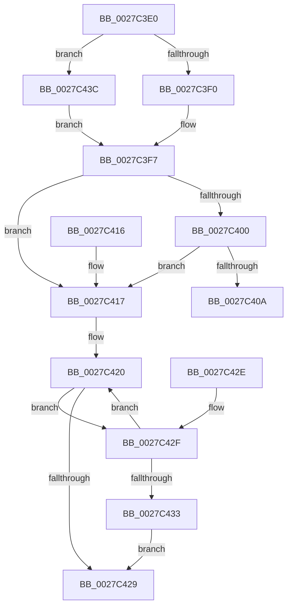

# MiLockWorkingSetCoreShared

- RVA: `0x0027C3E0`–`0x0027C445` (길이 `101` bytes)
- VA: `0x000000014027C3E0`
- 실행 섹션: `.text`
- PDB 이름 있음: `예`; PDB Function 태그: `아니요`
- unwind 정보 RVA: `0x0006613C`
- 디코드: `32`개 명령, `101/101` bytes 표시
- 미해석 바이트: `0` (있으면 어셈블리에 `.byte`로 보존)

> 이 문서는 커널 이미지의 기계어와 PDB 기호를 분석해 생성했습니다. 4번과 5번은 함수 원형과 자료형을 바이너리 사용 방식에서 추정한 C 해석이며 원본 소스 복구 결과는 아닙니다.

## 1. Dependencies

- 직접 호출 지점: **2**; 고유 호출 대상: **2**
- 직접 호출자로 확인된 함수: **3**
- RIP 상대 이미지 참조: **3**

### Outgoing calls
- `0x0027C40C` → [ExpAcquireSpinLockSharedAtDpcLevelInstrumented](ExpAcquireSpinLockSharedAtDpcLevelInstrumented_function_0027CD20.md) (function, `0x0027CD20`)
- `0x0027C435` → [ExpWaitForSpinLockSharedAndAcquire](../36/ExpWaitForSpinLockSharedAndAcquire_function_00362380.md) (function, `0x00362380`)

### Direct callers
- [MiRemoveWsle](../22/MiRemoveWsle_function_0022D0C4.md) at `0x0022D0F2`
- [sub_00292218](../29/Unknown_function_00292218.md) at `0x002922C5`
- [sub_0040D91B](../40/Unknown_function_0040D91B.md) at `0x0040D923`

### Static image references
- `0x0027C3F0` → RVA `0x00E38880` (`.data`; read)
- `0x0027C3F7` → RVA `0x00FC6B06` (`ALMOSTRO`; read)
- `0x0027C400` → RVA `0x00F0DE58` (`.data`; read)

## 2. Other-region calls and transfers

- 다른 실행 섹션으로 향하는 call: **0**
- 별도 외부 분기/꼬리 이동을 확인하지 못했습니다.

## 3. Assembly (complete function range)

```asm
0027C3E0  48 83 EC 28                     sub rsp, 0x28
0027C3E4  8B 81 B8 00 00 00               mov eax, dword ptr [rcx + 0xb8]
0027C3EA  24 0F                           and al, 0xf
0027C3EC  3C 01                           cmp al, 1
0027C3EE  75 4C                           jne 0x14027c43c
0027C3F0  48 8D 0D 89 C4 BB 00            lea rcx, [rip + 0xbbc489]
0027C3F7  F6 05 08 A7 D4 00 21            test byte ptr [rip + 0xd4a708], 0x21
0027C3FE  74 17                           je 0x14027c417
0027C400  8B 05 52 1A C9 00               mov eax, dword ptr [rip + 0xc91a52]
0027C406  85 C0                           test eax, eax
0027C408  75 0D                           jne 0x14027c417
0027C40A  B2 FF                           mov dl, 0xff
0027C40C  E8 0F 09 00 00                  call 0x14027cd20
0027C411  48 83 C4 28                     add rsp, 0x28
0027C415  C3                              ret
0027C416  CC                              int3
0027C417  0F 0D 09                        prefetchw byte ptr [rcx]
0027C41A  8B 01                           mov eax, dword ptr [rcx]
0027C41C  0F BA F0 1F                     btr eax, 0x1f
0027C420  8D 50 01                        lea edx, [rax + 1]
0027C423  F0 0F B1 11                     lock cmpxchg dword ptr [rcx], edx
0027C427  75 06                           jne 0x14027c42f
0027C429  48 83 C4 28                     add rsp, 0x28
0027C42D  C3                              ret
0027C42E  CC                              int3
0027C42F  85 C0                           test eax, eax
0027C431  79 ED                           jns 0x14027c420
0027C433  B2 FF                           mov dl, 0xff
0027C435  E8 46 5F 0E 00                  call 0x140362380
0027C43A  EB ED                           jmp 0x14027c429
0027C43C  48 81 C1 00 01 00 00            add rcx, 0x100
0027C443  EB B2                           jmp 0x14027c3f7
```

## 4. C-style interpretation (structured pseudocode)

```c
__int64 __fastcall MiLockWorkingSetCoreShared(__int64 a1)
{
    __int64 result;
    __int64 v_rsp;

    v_rsp = (v_rsp) - (40);
    result = (unsigned __int8)(((unsigned int)(*(unsigned int *)(a1 + 184))) & (15));
    if (((unsigned __int8)(result)) != 1) goto loc_0027C43C;
loc_0027C3F7:
    if (((*(unsigned __int8 *)(v_rip + 13936392)) & (33)) == 0) goto loc_0027C417;
    if ((unsigned int)((unsigned int)(*(unsigned int *)(v_rip + 13179474))) != 0) goto loc_0027C417;
    result = ExpAcquireSpinLockSharedAtDpcLevelInstrumented(v_rip + 12305545, 255, a3, a4);
    v_rsp = (v_rsp) + (40);
    return result;
loc_0027C417:
loc_0027C420:
    if (condition_is_not_equal) goto loc_0027C42F;
loc_0027C429:
    v_rsp = (v_rsp) + (40);
    return (unsigned int)(*(unsigned int *)(v_rip + 12305545));
loc_0027C42F:
    if (!sign_flag) goto loc_0027C420;
    result = ExpWaitForSpinLockSharedAndAcquire(v_rip + 12305545, 255, a3, a4);
    goto loc_0027C429;
loc_0027C43C:
    a1 = (v_rip + 12305545) + (256);
    goto loc_0027C3F7;
}
```

## 5. (Beta) C Style

```c
int64_t MiLockWorkingSetCoreShared(void *Arg1)
{
    uint8_t *arg1 = (uint8_t *)Arg1;

    int64_t result;
    int64_t local_rsp;

    local_rsp = (local_rsp) - (40);
    result = (uint8_t)(((uint32_t)(*(uint32_t *)(arg1 + 0xB8))) & (15));
    if (((uint8_t)(result)) != 1) goto loc_0027C43C;
loc_0027C3F7:
    if (((*(uint8_t *)(v_rip + 0xD4A708)) & (33)) == 0) goto loc_0027C417;
    if ((uint32_t)((uint32_t)(*(uint32_t *)(v_rip + 0xC91A52))) != 0) goto loc_0027C417;
    result = ExpAcquireSpinLockSharedAtDpcLevelInstrumented(v_rip + 12305545, 255, a3, a4);
    local_rsp = (local_rsp) + (40);
    return result;
loc_0027C417:
loc_0027C420:
    if (condition_is_not_equal) goto loc_0027C42F;
loc_0027C429:
    local_rsp = (local_rsp) + (40);
    return (uint32_t)(*(uint32_t *)(v_rip + 0xBBC489));
loc_0027C42F:
    if (!sign_flag) goto loc_0027C420;
    result = ExpWaitForSpinLockSharedAndAcquire(v_rip + 12305545, 255, a3, a4);
    goto loc_0027C429;
loc_0027C43C:
    Arg1 = (v_rip + 12305545) + (256);
    goto loc_0027C3F7;
}
```

### 관측된 메모리 오프셋

구조체 형식이 확인되지 않은 접근은 인자 기준의 오프셋으로만 기록했습니다.

| 기준 인자 | 오프셋 표현 | 폭 (bit) | 접근 |
|---|---:|---:|---|
| `Arg1` | `+ 0xB8` | `32` | `R` |

## 6. Execution-region graph

[열기: 2D/3D 그래프와 함수 탐색 컨트롤 패널](../../../control-panel.html?section=text&rva=0x0027C3E0&view=graph)

- 2D 그래프는 위에서 아래로 흐르고, 3D 그래프는 빈 공간을 드래그해 회전합니다. Shift+드래그는 이동, 휠은 확대·축소, 함수 노드 선택은 대상 보고서 이동입니다.

### Static fallback


