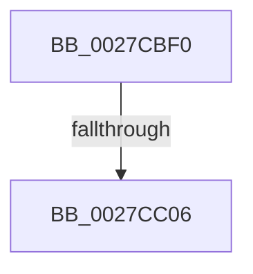

# MiLockWorkingSetShared

- RVA: `0x0027CBF0`–`0x0027CC0E` (길이 `30` bytes)
- VA: `0x000000014027CBF0`
- 실행 섹션: `.text`
- PDB 이름 있음: `예`; PDB Function 태그: `아니요`
- unwind 정보 RVA: `0x00066168`
- 디코드: `8`개 명령, `30/30` bytes 표시
- 미해석 바이트: `0` (있으면 어셈블리에 `.byte`로 보존)

> 이 문서는 커널 이미지의 기계어와 PDB 기호를 분석해 생성했습니다. 4번과 5번은 함수 원형과 자료형을 바이너리 사용 방식에서 추정한 C 해석이며 원본 소스 복구 결과는 아닙니다.

## 1. Dependencies

- 직접 호출 지점: **0**; 고유 호출 대상: **0**
- 직접 호출자로 확인된 함수: **140**
- RIP 상대 이미지 참조: **0**

### Outgoing calls
- 직접 디코드된 call 명령이 없습니다.

### Direct callers
- [MiTranslatePageForCopy](../22/MiTranslatePageForCopy_function_00228960.md) at `0x00228C03`
- [MiEncodeProtoFill](../22/MiEncodeProtoFill_function_0022F3B0.md) at `0x0022F409`
- [MiDecommitLockNewPageTable](../24/MiDecommitLockNewPageTable_function_00243270.md) at `0x00243292`
- [MiWalkVaRange](../24/MiWalkVaRange_function_00243BF0.md) at `0x00243CA5`
- [MiWalkVaRange](../24/MiWalkVaRange_function_00243BF0.md) at `0x002442AF`
- [MiClearMappingAndDereferenceIoSpace](../24/MiClearMappingAndDereferenceIoSpace_function_00247DF0.md) at `0x00248210`
- [MmProtectPool](../26/MmProtectPool_function_002697AC.md) at `0x002698CE`
- [MmProtectPool](../26/MmProtectPool_function_002697AC.md) at `0x00269E5B`
- [MiDeleteVaDirect](MiDeleteVaDirect_function_00277560.md) at `0x00277CE2`
- [MiDeleteVaDirect](MiDeleteVaDirect_function_00277560.md) at `0x002785B0`
- [MiWalkPageTablesRecursively](MiWalkPageTablesRecursively_function_002796C0.md) at `0x0027B087`
- [MiMakeHyperRangeAccessible](MiMakeHyperRangeAccessible_function_0027CE10.md) at `0x0027D080`
- [MiUnlockWorkingSetExclusive](MiUnlockWorkingSetExclusive_function_0027EC70.md) at `0x0027EDF1`
- [MiSynchronizeSystemVa](../28/MiSynchronizeSystemVa_function_0028ECB8.md) at `0x0028ED17`
- [MiSetReadOnlyOnSectionView](../29/MiSetReadOnlyOnSectionView_function_00294538.md) at `0x002945DA`
- [MiRemoveVad](../29/MiRemoveVad_function_00295C78.md) at `0x00295D6F`
- [MiGetWorkingSetInfoEx](../29/MiGetWorkingSetInfoEx_function_0029E640.md) at `0x0029E72F`
- [MiSwapStackPage](../29/MiSwapStackPage_function_0029FDE0.md) at `0x0029FF62`
- [MiOutPageSingleKernelStack](../2A/MiOutPageSingleKernelStack_function_002A1790.md) at `0x002A18BF`
- [MiAllocateKernelStackPages](../2A/MiAllocateKernelStackPages_function_002A1BEC.md) at `0x002A1E28`
- [MiUnlockCodePage](../2A/MiUnlockCodePage_function_002A2AB8.md) at `0x002A2AF6`
- [MiUnlockCodePage](../2A/MiUnlockCodePage_function_002A2AB8.md) at `0x002A2C9B`
- [MiDeleteEmptyPageTables](../2A/MiDeleteEmptyPageTables_function_002A5220.md) at `0x002A5473`
- [MiInsertViewOfPhysicalSection](../2A/MiInsertViewOfPhysicalSection_function_002A57E0.md) at `0x002A5894`
- [MiInsertViewOfPhysicalSection](../2A/MiInsertViewOfPhysicalSection_function_002A57E0.md) at `0x002A59B5`
- [MiSplitPrivatePage](../2A/MiSplitPrivatePage_function_002A6210.md) at `0x002A62C3`
- [MiSplitPrivatePage](../2A/MiSplitPrivatePage_function_002A6210.md) at `0x002A6566`
- [MiSplitPrivatePage](../2A/MiSplitPrivatePage_function_002A6210.md) at `0x002A66A1`
- [MiMakeProtoLeafValid](../2A/MiMakeProtoLeafValid_function_002A6710.md) at `0x002A67E2`
- [MiEmptyWorkingSetInitiate](../2A/MiEmptyWorkingSetInitiate_function_002A7128.md) at `0x002A71C8`
- [NtGetWriteWatch](../2A/NtGetWriteWatch_function_002A7CE0.md) at `0x002A8015`
- [NtGetWriteWatch](../2A/NtGetWriteWatch_function_002A7CE0.md) at `0x002A8449`
- [MiMoveDirtyBitsToPfns](../2A/MiMoveDirtyBitsToPfns_function_002A8624.md) at `0x002A86CF`
- [MiMoveDirtyBitsToPfns](../2A/MiMoveDirtyBitsToPfns_function_002A8624.md) at `0x002A893F`
- [MiDeletePagablePteRange](../2A/MiDeletePagablePteRange_function_002A96B4.md) at `0x002A9849`
- [MiUnlockOpportunisticPagesInPageTable](../2A/MiUnlockOpportunisticPagesInPageTable_function_002AA88C.md) at `0x002AAAE7`
- [MiReplaceRotateWithDemandZeroNoCopy](../2A/MiReplaceRotateWithDemandZeroNoCopy_function_002AAB04.md) at `0x002AAB99`
- [MiReplaceRotateWithDemandZeroNoCopy](../2A/MiReplaceRotateWithDemandZeroNoCopy_function_002AAB04.md) at `0x002AAEFA`
- [MiFastTrimWorkingSet](../2A/MiFastTrimWorkingSet_function_002AD420.md) at `0x002AD7A5`
- [MiFastTrimWorkingSet](../2A/MiFastTrimWorkingSet_function_002AD420.md) at `0x002AD83D`
- [MiMapLockedPagesInUserSpaceHelper](../2A/MiMapLockedPagesInUserSpaceHelper_function_002ADFE0.md) at `0x002AE094`
- [MiMapLockedPagesInUserSpaceHelper](../2A/MiMapLockedPagesInUserSpaceHelper_function_002ADFE0.md) at `0x002AE19E`
- [MiGetWorkingSetInfoList](../2A/MiGetWorkingSetInfoList_function_002AF770.md) at `0x002AFA85`
- [MiLockStealUserVm](../2B/MiLockStealUserVm_function_002B3EDC.md) at `0x002B442D`
- [MmQuerySystemWorkingSetInformation](../2C/MmQuerySystemWorkingSetInformation_function_002C0710.md) at `0x002C07AF`
- [MiDeleteSystemPageTables](../2C/MiDeleteSystemPageTables_function_002C1110.md) at `0x002C11B1`
- [MiIsCfgBitMapPageShared](../2C/MiIsCfgBitMapPageShared_function_002C1200.md) at `0x002C125A`
- [MiClearNonPagedPtes](../2C/MiClearNonPagedPtes_function_002C17A0.md) at `0x002C184F`
- [MiCountSharedPages](../2C/MiCountSharedPages_function_002C30A4.md) at `0x002C30DD`
- [sub_002C37D9](../2C/Unknown_function_002C37D9.md) at `0x002C3914`
- [sub_002C3A7C](../2C/Unknown_function_002C3A7C.md) at `0x002C3BEA`
- [sub_002C3A7C](../2C/Unknown_function_002C3A7C.md) at `0x002C3FD9`
- [sub_002C3A7C](../2C/Unknown_function_002C3A7C.md) at `0x002C4274`
- [MiProtectPrivateMemory](../2C/MiProtectPrivateMemory_function_002C45B0.md) at `0x002C46AB`
- [MiProtectPrivateMemory](../2C/MiProtectPrivateMemory_function_002C45B0.md) at `0x002C4C0B`
- [MiProtectPrivateMemory](../2C/MiProtectPrivateMemory_function_002C45B0.md) at `0x002C4D6C`
- [MiProtectPrivateMemory](../2C/MiProtectPrivateMemory_function_002C45B0.md) at `0x002C4F68`
- [MiProtectPrivateMemory](../2C/MiProtectPrivateMemory_function_002C45B0.md) at `0x002C50BD`
- [MiCountCommittedPages](../2C/MiCountCommittedPages_function_002C7950.md) at `0x002C7978`
- [MiTrimSharedPageFromViews](../2E/MiTrimSharedPageFromViews_function_002E16F8.md) at `0x002E1C5B`
- [MiSharePages](../31/MiSharePages_function_00315110.md) at `0x003152E5`
- [MiCommitExistingVad](../32/MiCommitExistingVad_function_0032A860.md) at `0x0032ABC0`
- [MiCommitExistingVad](../32/MiCommitExistingVad_function_0032A860.md) at `0x0032B083`
- [MiQueryAddressState](../32/MiQueryAddressState_function_0032C380.md) at `0x0032CC09`
- [MiQueryAddressState](../32/MiQueryAddressState_function_0032C380.md) at `0x0032D213`
- [MiQueryAddressState](../32/MiQueryAddressState_function_0032C380.md) at `0x0032D454`
- [MiTrimOrAgeWorkingSet](../34/MiTrimOrAgeWorkingSet_function_0034EFC0.md) at `0x0034F078`
- [MiSoftFaultMappedView](../36/MiSoftFaultMappedView_function_00365364.md) at `0x00365494`
- [MiSoftFaultMappedView](../36/MiSoftFaultMappedView_function_00365364.md) at `0x00365849`
- [MiCommitEnclavePages](../36/MiCommitEnclavePages_function_00367CCC.md) at `0x00367D7F`
- [MiAddPagesToEnclave](../36/MiAddPagesToEnclave_function_00367EEC.md) at `0x00368005`
- [MiWriteEnclavePte](../36/MiWriteEnclavePte_function_00368570.md) at `0x003685DC`
- [MiDecommitHardwareEnclavePages](../36/MiDecommitHardwareEnclavePages_function_003688D4.md) at `0x0036894A`
- [MiRelockFaultState](../36/MiRelockFaultState_function_0036A230.md) at `0x0036A255`
- [MiLockCode](../36/MiLockCode_function_0036F91C.md) at `0x0036F9D2`
- [MiLockCode](../36/MiLockCode_function_0036F91C.md) at `0x0036FC7F`
- [MiLockCode](../36/MiLockCode_function_0036F91C.md) at `0x0036FD28`
- [MiSetSystemCodeProtection](../38/MiSetSystemCodeProtection_function_00384420.md) at `0x003844F8`
- [MiSetSystemCodeProtection](../38/MiSetSystemCodeProtection_function_00384420.md) at `0x0038483B`
- [MiMakeDriverPagesPrivate](../38/MiMakeDriverPagesPrivate_function_00384C60.md) at `0x00384CF3`
- [MiMakeDriverPagesPrivate](../38/MiMakeDriverPagesPrivate_function_00384C60.md) at `0x00384DE5`
- [MiMakeDriverPagesPrivate](../38/MiMakeDriverPagesPrivate_function_00384C60.md) at `0x00384F2C`
- [MiMakeZeroedPageTablesEx](../3B/MiMakeZeroedPageTablesEx_function_003B59FC.md) at `0x003B5C47`
- [MiMapWithLargePages](../3B/MiMapWithLargePages_function_003B6624.md) at `0x003B681D`
- [MiCopyToUserVa](../3D/MiCopyToUserVa_function_003D1E68.md) at `0x003D1EF2`
- [MiMapUserLargePages](../3D/MiMapUserLargePages_function_003D26F4.md) at `0x003D2B51`
- [MiUnmapMdlCommon](../3E/MiUnmapMdlCommon_function_003E7DF0.md) at `0x003E7F05`
- [MiUnmapMdlCommon](../3E/MiUnmapMdlCommon_function_003E7DF0.md) at `0x003E82D5`
- [MiInPagePageTable](../3E/MiInPagePageTable_function_003EF8DC.md) at `0x003EFF87`
- [MiUnlockPageTableRange](../40/MiUnlockPageTableRange_function_00407E44.md) at `0x00407EA1`
- [NtLockVirtualMemory](../40/NtLockVirtualMemory_function_004088A0.md) at `0x00408AAB`
- [NtLockVirtualMemory](../40/NtLockVirtualMemory_function_004088A0.md) at `0x00408B5B`
- [NtLockVirtualMemory](../40/NtLockVirtualMemory_function_004088A0.md) at `0x00408D61`
- [NtLockVirtualMemory](../40/NtLockVirtualMemory_function_004088A0.md) at `0x00409344`
- [MiDeprioritizeVirtualAddresses](../42/MiDeprioritizeVirtualAddresses_function_0042AD1C.md) at `0x0042AD8F`
- [sub_004455F3](../44/Unknown_function_004455F3.md) at `0x00445642`
- [MiAllowProtectionChange](../44/MiAllowProtectionChange_function_00448834.md) at `0x0044889B`
- [MiUpdateImportRelocationsOnDriverPrivatePages](../44/MiUpdateImportRelocationsOnDriverPrivatePages_function_00449BCC.md) at `0x00449C2E`
- [MiComparePteProtections](../44/MiComparePteProtections_function_0044F4FC.md) at `0x0044F546`
- [MiQueryAddressSpan](../45/MiQueryAddressSpan_function_0045CF14.md) at `0x0045CF96`
- [MiQueryAddressSpan](../45/MiQueryAddressSpan_function_0045CF14.md) at `0x0045D0C5`
- [MmAdjustWorkingSetSizeEx](../47/MmAdjustWorkingSetSizeEx_function_0047D8D4.md) at `0x0047DB61`
- [MiDeleteEmptyPageTableCommit](../48/MiDeleteEmptyPageTableCommit_function_004834F4.md) at `0x0048367B`
- [MiLockPagedAddress](../48/MiLockPagedAddress_function_00484CDC.md) at `0x00484D3B`
- [MiLockPagedAddress](../48/MiLockPagedAddress_function_00484CDC.md) at `0x00484E86`
- [MiConvertAndFlushWsleVas](../49/MiConvertAndFlushWsleVas_function_00492CB4.md) at `0x00492CE1`
- [MmCheckProcessShadow](../49/MmCheckProcessShadow_function_004931C0.md) at `0x0049323C`
- [MmUpdateUserShadowStackValue](../49/MmUpdateUserShadowStackValue_function_004935D8.md) at `0x004937EA`
- [MiDeleteShadowStackPtes](../49/MiDeleteShadowStackPtes_function_00493AE4.md) at `0x00493B2F`
- [MiGetWsAndMakePageTablesNx](../49/MiGetWsAndMakePageTablesNx_function_00494240.md) at `0x00494299`
- [MiLockPageTableRange](../49/MiLockPageTableRange_function_0049A850.md) at `0x0049A8C0`
- [MiReleaseLargePdeMappings](../49/MiReleaseLargePdeMappings_function_0049D0B0.md) at `0x0049D230`
- [MiSetPagesModified](../49/MiSetPagesModified_function_0049DC2C.md) at `0x0049DED9`
- [MiObtainRotateProtectionRanges](../4A/MiObtainRotateProtectionRanges_function_004A4768.md) at `0x004A47B4`
- [MiSetPagingOfDriver](../4A/MiSetPagingOfDriver_function_004A76C4.md) at `0x004A7711`
- [MiUnmapKernelScp](../4A/MiUnmapKernelScp_function_004A82E8.md) at `0x004A8371`
- [MmRemoveExecuteGrants](../4A/MmRemoveExecuteGrants_function_004A8B60.md) at `0x004A8BCF`
- [MiBuildForkPageTable](../4A/MiBuildForkPageTable_function_004ACF5C.md) at `0x004AD02F`
- [MiInitializeWorkingSetList](../4A/MiInitializeWorkingSetList_function_004AE640.md) at `0x004AE70A`
- [MiFaultInPagedPool](../4B/MiFaultInPagedPool_function_004B3BC0.md) at `0x004B3C12`
- [MiSwitchToTransition](../4C/MiSwitchToTransition_function_004C0F5C.md) at `0x004C11BD`
- [MiWriteAwePtes](../4C/MiWriteAwePtes_function_004C51E0.md) at `0x004C56D0`
- [MiUpdatePrivateDemandZeroView](../4C/MiUpdatePrivateDemandZeroView_function_004CCC2C.md) at `0x004CCE19`
- [MiUpdatePrivateDemandZeroView](../4C/MiUpdatePrivateDemandZeroView_function_004CCC2C.md) at `0x004CCE89`
- [MiProtectAweRegion](../4C/MiProtectAweRegion_function_004CE62C.md) at `0x004CE94D`
- [MiProtectAweRegion](../4C/MiProtectAweRegion_function_004CE62C.md) at `0x004CE9EE`
- [MiZeroAndFlushGoodCitizen](../4D/MiZeroAndFlushGoodCitizen_function_004D0828.md) at `0x004D0903`
- [MiMapMdlWithLargePages](../4D/MiMapMdlWithLargePages_function_004D10B8.md) at `0x004D11AE`
- [MiProtectEnclavePages](../4D/MiProtectEnclavePages_function_004D5528.md) at `0x004D5757`
- [MiProtectEnclavePages](../4D/MiProtectEnclavePages_function_004D5528.md) at `0x004D5804`
- [MiVadRangeIsIoSpace](../4D/MiVadRangeIsIoSpace_function_004D5CD4.md) at `0x004D5D4E`
- [MiVadRangeIsIoSpace](../4D/MiVadRangeIsIoSpace_function_004D5CD4.md) at `0x004D5E33`
- [MiMapKernelScp](../4D/MiMapKernelScp_function_004DCAD4.md) at `0x004DCBAE`
- [MmUpdateOldWorkingSetPages](../4E/MmUpdateOldWorkingSetPages_function_004EDF18.md) at `0x004EE094`
- [MiQueryImageExtensionInformation](../4E/MiQueryImageExtensionInformation_function_004EE3C8.md) at `0x004EE54B`
- [NtUnlockVirtualMemory](../4E/NtUnlockVirtualMemory_function_004EE890.md) at `0x004EE9C4`
- [NtUnlockVirtualMemory](../4E/NtUnlockVirtualMemory_function_004EE890.md) at `0x004EEA5C`
- [NtUnlockVirtualMemory](../4E/NtUnlockVirtualMemory_function_004EE890.md) at `0x004EEE99`
- [MiDeleteBootRange](../66/MiDeleteBootRange_function_0066E450.md) at `0x0066E512`
- [MiDeleteBootRange](../66/MiDeleteBootRange_function_0066E450.md) at `0x0066E664`
- [MiPageBootRegistry](../66/MiPageBootRegistry_function_0066E82C.md) at `0x0066E89D`
- [MiCheckCommitReleaseFromVad](../66/MiCheckCommitReleaseFromVad_function_0066EB90.md) at `0x0066EC0F`
- [MiCopyWorkingSetFields](../66/MiCopyWorkingSetFields_function_0066F0F4.md) at `0x0066F161`
- [MiWalkResetCommitPages](../66/MiWalkResetCommitPages_function_0066FC58.md) at `0x0066FCF3`
- [MiLockDriverPageRange](../67/MiLockDriverPageRange_function_00670160.md) at `0x00670253`
- [MiLockDriverPageRange](../67/MiLockDriverPageRange_function_00670160.md) at `0x006704F0`
- [MiLockDriverPageRange](../67/MiLockDriverPageRange_function_00670160.md) at `0x00670548`
- [MiLockDriverPageRange](../67/MiLockDriverPageRange_function_00670160.md) at `0x006705CC`
- [MmProtectDriverSection](../67/MmProtectDriverSection_function_00670A80.md) at `0x00670C9E`
- [MmProtectDriverSection](../67/MmProtectDriverSection_function_00670A80.md) at `0x00670D7F`
- [MmProtectDriverSection](../67/MmProtectDriverSection_function_00670A80.md) at `0x00670DE2`
- [MmProtectDriverSection](../67/MmProtectDriverSection_function_00670A80.md) at `0x00670E1E`
- [MiReplaceImportEntry](../67/MiReplaceImportEntry_function_00671440.md) at `0x00671506`
- [MiReplaceImportEntry](../67/MiReplaceImportEntry_function_00671440.md) at `0x006715E2`
- [MiReplaceImportEntry](../67/MiReplaceImportEntry_function_00671440.md) at `0x00671613`
- [MiGetFileOnlyRanges](../67/MiGetFileOnlyRanges_function_00672684.md) at `0x006726E8`
- [MiMapMdlCommon](../67/MiMapMdlCommon_function_00674524.md) at `0x006748EC`
- [MiSetPageProtection](../67/MiSetPageProtection_function_00674BDC.md) at `0x00674C68`
- [MiSetGraphicsPtes](../67/MiSetGraphicsPtes_function_00678554.md) at `0x006785ED`
- [MiSetGraphicsPtes](../67/MiSetGraphicsPtes_function_00678554.md) at `0x006786E4`
- [MmAddRangeToCrashDump](../67/MmAddRangeToCrashDump_function_0067D8B0.md) at `0x0067D999`
- [MmRemoveSystemCacheFromDump](../67/MmRemoveSystemCacheFromDump_function_0067DD58.md) at `0x0067DDF4`
- [MiExceptionForMappedVa](../67/MiExceptionForMappedVa_function_0067E164.md) at `0x0067E186`
- [MiClearDriverTablePtes](../68/MiClearDriverTablePtes_function_00683024.md) at `0x00683084`
- [MiCommitHotPatchTable](../68/MiCommitHotPatchTable_function_00683420.md) at `0x006834EB`
- [MiPrepareImagePagesForHotPatch](../68/MiPrepareImagePagesForHotPatch_function_00683800.md) at `0x006838E2`
- [MiPrepareImagePagesForHotPatch](../68/MiPrepareImagePagesForHotPatch_function_00683800.md) at `0x006839AB`
- [MiPrepareImagePagesForHotPatch](../68/MiPrepareImagePagesForHotPatch_function_00683800.md) at `0x00683AF6`
- [MiQueryImageExtensionInformationOld](../68/MiQueryImageExtensionInformationOld_function_00687384.md) at `0x006874C4`
- [MiQueryVaPhysicalContiguity](../68/MiQueryVaPhysicalContiguity_function_006875B8.md) at `0x00687658`
- [MiQueryVaPhysicalContiguity](../68/MiQueryVaPhysicalContiguity_function_006875B8.md) at `0x006878F8`
- [MiCombineWorkingSet](../68/MiCombineWorkingSet_function_0068BB18.md) at `0x0068BB9E`
- [MiStoreDiscardPoisonedPage](../69/MiStoreDiscardPoisonedPage_function_00692858.md) at `0x00692AE8`
- [MmStoreIsVirtualAddressPoisoned](../69/MmStoreIsVirtualAddressPoisoned_function_00693120.md) at `0x0069317E`
- [MiMakeVaRangePhysicallyContiguous](../69/MiMakeVaRangePhysicallyContiguous_function_006936E0.md) at `0x00693766`
- [MiMakeVaRangePhysicallyContiguous](../69/MiMakeVaRangePhysicallyContiguous_function_006936E0.md) at `0x00693932`
- [MiScrubLargeMappedPage](../69/MiScrubLargeMappedPage_function_00693E2C.md) at `0x00693F3D`
- [MiComputeIdealLargePage](../69/MiComputeIdealLargePage_function_006987C0.md) at `0x006988CF`
- [sub_006D9212](../6D/Unknown_function_006D9212.md) at `0x006D94E0`
- [sub_006DB1E0](../6D/Unknown_function_006DB1E0.md) at `0x006DB279`
- [sub_006E35D2](../6E/Unknown_function_006E35D2.md) at `0x006E35F0`
- [sub_006E35FC](../6E/Unknown_function_006E35FC.md) at `0x006E361A`
- [sub_006E362E](../6E/Unknown_function_006E362E.md) at `0x006E36DE`
- [sub_006E362E](../6E/Unknown_function_006E362E.md) at `0x006E3862`
- [sub_006E3CBA](../6E/Unknown_function_006E3CBA.md) at `0x006E3D00`
- [sub_006E94B4](../6E/Unknown_function_006E94B4.md) at `0x006E954A`
- [sub_006F0B5A](../6F/Unknown_function_006F0B5A.md) at `0x006F0BA8`
- [sub_006F5914](../6F/Unknown_function_006F5914.md) at `0x006F5958`
- [MiProtectLargeKernelHalRange](../../page/7F/MiProtectLargeKernelHalRange_function_007F8D20.md) at `0x007F8D7E`
- [MmUnlockPhysicalPagesByVa](../../page/7F/MmUnlockPhysicalPagesByVa_function_007FBA3C.md) at `0x007FBAF6`
- [MiAddLoaderHalIoMappings](../../init/C5/MiAddLoaderHalIoMappings_function_00C5E568.md) at `0x00C5E5C8`
- [MiMarkLargePageMappings](../../init/C6/MiMarkLargePageMappings_function_00C60BC8.md) at `0x00C60C35`
- [MiCreateInitialSystemWsles](../../init/C6/MiCreateInitialSystemWsles_function_00C642C8.md) at `0x00C64339`
- [MiMarkBootKernelStack](../../init/C6/MiMarkBootKernelStack_function_00C68244.md) at `0x00C6826D`

### Static image references
- 디코드된 RIP-relative 메모리 참조가 없습니다.

## 2. Other-region calls and transfers

- 다른 실행 섹션으로 향하는 call: **0**
- call이 아닌 외부 분기/꼬리 이동: **1**
  - `0x0027CC00` → [sub_0027CCDA](Unknown_function_0027CCDA.md) (`tail-transfer`)

## 3. Assembly (complete function range)

```asm
0027CBF0  40 53                           push rbx
0027CBF2  48 83 EC 20                     sub rsp, 0x20
0027CBF6  8B 81 B8 00 00 00               mov eax, dword ptr [rcx + 0xb8]
0027CBFC  24 0F                           and al, 0xf
0027CBFE  3C 06                           cmp al, 6
0027CC00  0F 83 D4 00 00 00               jae 0x14027ccda
0027CC06  8B 81 B8 00 00 00               mov eax, dword ptr [rcx + 0xb8]
0027CC0C  24 0F                           and al, 0xf
```

## 4. C-style interpretation (structured pseudocode)

```c
__int64 __fastcall MiLockWorkingSetShared(__int64 a1)
{
    __int64 result;
    __int64 v_rsp;

    v_rsp = (v_rsp) - (32);
    result = (unsigned __int8)(((unsigned int)(*(unsigned int *)(a1 + 184))) & (15));
    result = (unsigned __int8)(((unsigned int)(*(unsigned int *)(a1 + 184))) & (15));
    return result;
}
```

## 5. (Beta) C Style

```c
int64_t MiLockWorkingSetShared(void *Arg1)
{
    uint8_t *arg1 = (uint8_t *)Arg1;

    int64_t result;
    int64_t local_rsp;

    local_rsp = (local_rsp) - (32);
    result = (uint8_t)(((uint32_t)(*(uint32_t *)(arg1 + 0xB8))) & (15));
    result = (uint8_t)(((uint32_t)(*(uint32_t *)(arg1 + 0xB8))) & (15));
    return result;
}
```

### 관측된 메모리 오프셋

구조체 형식이 확인되지 않은 접근은 인자 기준의 오프셋으로만 기록했습니다.

| 기준 인자 | 오프셋 표현 | 폭 (bit) | 접근 |
|---|---:|---:|---|
| `Arg1` | `+ 0xB8` | `32` | `R` |

## 6. Execution-region graph

[열기: 2D/3D 그래프와 함수 탐색 컨트롤 패널](../../../control-panel.html?section=text&rva=0x0027CBF0&view=graph)

- 2D 그래프는 위에서 아래로 흐르고, 3D 그래프는 빈 공간을 드래그해 회전합니다. Shift+드래그는 이동, 휠은 확대·축소, 함수 노드 선택은 대상 보고서 이동입니다.

### Static fallback


