# MiMakeHyperRangeAccessible

- RVA: `0x0027CE10`–`0x0027D284` (길이 `1,140` bytes)
- VA: `0x000000014027CE10`
- 실행 섹션: `.text`
- PDB 이름 있음: `예`; PDB Function 태그: `아니요`
- unwind 정보 RVA: `0x00066264`
- 디코드: `272`개 명령, `1,140/1,140` bytes 표시
- 미해석 바이트: `0` (있으면 어셈블리에 `.byte`로 보존)

> 이 문서는 커널 이미지의 기계어와 PDB 기호를 분석해 생성했습니다. 4번과 5번은 함수 원형과 자료형을 바이너리 사용 방식에서 추정한 C 해석이며 원본 소스 복구 결과는 아닙니다.

## 1. Dependencies

- 직접 호출 지점: **18**; 고유 호출 대상: **15**
- 직접 호출자로 확인된 함수: **3**
- RIP 상대 이미지 참조: **4**

### Outgoing calls
- `0x0027CEA6` → [MiFastReadLeafPte](MiFastReadLeafPte_function_0027E9A0.md) (function, `0x0027E9A0`)
- `0x0027CF3C` → [ExpAcquireSpinLockSharedAtDpcLevelInstrumented](ExpAcquireSpinLockSharedAtDpcLevelInstrumented_function_0027CD20.md) (function, `0x0027CD20`)
- `0x0027CFD6` → [MiGetNextPageTable](../2C/MiGetNextPageTable_function_002C2EE0.md) (function, `0x002C2EE0`)
- `0x0027D001` → [MiFillHyperPtes](../46/MiFillHyperPtes_function_004644AC.md) (function, `0x004644AC`)
- `0x0027D049` → [MiUnlockWorkingSetShared](MiUnlockWorkingSetShared_function_0027D690.md) (function, `0x0027D690`)
- `0x0027D05D` → [MiChargeFullProcessCommitment](../../page/88/MiChargeFullProcessCommitment_function_00887630.md) (function, `0x00887630`)
- `0x0027D080` → [MiLockWorkingSetShared](MiLockWorkingSetShared_function_0027CBF0.md) (function, `0x0027CBF0`)
- `0x0027D0B0` → [ExpWaitForSpinLockSharedAndAcquire](../36/ExpWaitForSpinLockSharedAndAcquire_function_00362380.md) (function, `0x00362380`)
- `0x0027D0CA` → [MiUnlockWorkingSetShared](MiUnlockWorkingSetShared_function_0027D690.md) (function, `0x0027D690`)
- `0x0027D0F4` → [MiReturnFullProcessCommitment](../../page/9E/MiReturnFullProcessCommitment_function_009E5D58.md) (function, `0x009E5D58`)
- `0x0027D117` → [KiRaiseIrqlProcessIrqlFlags](../4F/KiRaiseIrqlProcessIrqlFlags_function_004F56FC.md) (function, `0x004F56FC`)
- `0x0027D146` → [KiRaiseIrqlProcessIrqlFlags](../4F/KiRaiseIrqlProcessIrqlFlags_function_004F56FC.md) (function, `0x004F56FC`)
- `0x0027D1BD` → [MI_READ_PTE_LOCK_FREE](../28/MI_READ_PTE_LOCK_FREE_function_002828A0.md) (function, `0x002828A0`)
- `0x0027D1D7` → [MiMakeDemandZeroPte](../33/MiMakeDemandZeroPte_function_00337A00.md) (function, `0x00337A00`)
- `0x0027D1F6` → [MiIncreaseUsedPtes](../24/MiIncreaseUsedPtes_function_00243630.md) (function, `0x00243630`)
- `0x0027D22D` → [MiUnlockPageTable](../21/MiUnlockPageTable_function_00216EC0.md) (function, `0x00216EC0`)
- `0x0027D253` → [MiUnlockPageTable](../21/MiUnlockPageTable_function_00216EC0.md) (function, `0x00216EC0`)
- `0x0027D26F` → [MiUpdateChargedWsles](../4F/MiUpdateChargedWsles_function_004F6EA0.md) (function, `0x004F6EA0`)

### Direct callers
- [MiExpandVadBitMap](../../page/88/MiExpandVadBitMap_function_00886574.md) at `0x00886647`
- [MiCommitPageTablesForVad](../../page/88/MiCommitPageTablesForVad_function_00886D50.md) at `0x00886E10`
- [MiExpandVadBitMapDown](../../page/A9/MiExpandVadBitMapDown_function_00A95EC4.md) at `0x00A95F60`

### Static image references
- `0x0027CEE1` → RVA `0x00E38840` (`.data`; read)
- `0x0027CF0E` → RVA `0x00FC6D20` (`ALMOSTRO`; read)
- `0x0027CF1A` → RVA `0x00FC6B06` (`ALMOSTRO`; read)
- `0x0027CF27` → RVA `0x00F0DE58` (`.data`; read)

## 2. Other-region calls and transfers

- 다른 실행 섹션으로 향하는 call: **2**
  - `0x0027D05D` → [MiChargeFullProcessCommitment](../../page/88/MiChargeFullProcessCommitment_function_00887630.md) (`.text` → `PAGE`)
  - `0x0027D0F4` → [MiReturnFullProcessCommitment](../../page/9E/MiReturnFullProcessCommitment_function_009E5D58.md) (`.text` → `PAGE`)
- 별도 외부 분기/꼬리 이동을 확인하지 못했습니다.

## 3. Assembly (complete function range)

```asm
0027CE10  4C 8B DC                        mov r11, rsp
0027CE13  4D 89 43 18                     mov qword ptr [r11 + 0x18], r8
0027CE17  53                              push rbx
0027CE18  55                              push rbp
0027CE19  56                              push rsi
0027CE1A  57                              push rdi
0027CE1B  41 54                           push r12
0027CE1D  41 55                           push r13
0027CE1F  41 56                           push r14
0027CE21  41 57                           push r15
0027CE23  48 81 EC 88 00 00 00            sub rsp, 0x88
0027CE2A  65 48 8B 04 25 88 01 00 00      mov rax, qword ptr gs:[0x188]
0027CE33  4C 8B CA                        mov r9, rdx
0027CE36  33 FF                           xor edi, edi
0027CE38  48 8B D1                        mov rdx, rcx
0027CE3B  0F 57 C0                        xorps xmm0, xmm0
0027CE3E  48 C1 EA 09                     shr rdx, 9
0027CE42  49 BA F8 FF FF FF 7F 00 00 00   movabs r10, 0x7ffffffff8
0027CE4C  49 89 38                        mov qword ptr [r8], rdi
0027CE4F  4C 8B B8 B8 00 00 00            mov r15, qword ptr [rax + 0xb8]
0027CE56  4D 8B F0                        mov r14, r8
0027CE59  49 89 7B 08                     mov qword ptr [r11 + 8], rdi
0027CE5D  49 23 D2                        and rdx, r10
0027CE60  41 89 7B 20                     mov dword ptr [r11 + 0x20], edi
0027CE64  F3 0F 7F 44 24 44               movdqu xmmword ptr [rsp + 0x44], xmm0
0027CE6A  49 8D AF 00 04 00 00            lea rbp, [r15 + 0x400]
0027CE71  4C 89 7C 24 78                  mov qword ptr [rsp + 0x78], r15
0027CE76  49 B8 00 00 00 00 80 F6 FF FF   movabs r8, 0xfffff68000000000
0027CE80  49 8B C0                        mov rax, r8
0027CE83  48 03 D0                        add rdx, rax
0027CE86  49 C1 E9 09                     shr r9, 9
0027CE8A  48 89 54 24 68                  mov qword ptr [rsp + 0x68], rdx
0027CE8F  4D 23 CA                        and r9, r10
0027CE92  49 8B C0                        mov rax, r8
0027CE95  49 03 C1                        add rax, r9
0027CE98  48 89 44 24 38                  mov qword ptr [rsp + 0x38], rax
0027CE9D  48 3B D0                        cmp rdx, rax
0027CEA0  75 1B                           jne 0x14027cebd
0027CEA2  49 8D 53 08                     lea rdx, [r11 + 8]
0027CEA6  E8 F5 1A 00 00                  call 0x14027e9a0
0027CEAB  85 C0                           test eax, eax
0027CEAD  78 0E                           js 0x14027cebd
0027CEAF  48 39 BC 24 D0 00 00 00         cmp qword ptr [rsp + 0xd0], rdi
0027CEB7  0F 85 3C 02 00 00               jne 0x14027d0f9
0027CEBD  8B 85 B8 00 00 00               mov eax, dword ptr [rbp + 0xb8]
0027CEC3  24 0F                           and al, 0xf
0027CEC5  89 7C 24 40                     mov dword ptr [rsp + 0x40], edi
0027CEC9  3C 06                           cmp al, 6
0027CECB  0F 83 50 02 00 00               jae 0x14027d121
0027CED1  8B 85 B8 00 00 00               mov eax, dword ptr [rbp + 0xb8]
0027CED7  24 0F                           and al, 0xf
0027CED9  3C 01                           cmp al, 1
0027CEDB  0F 85 6F 02 00 00               jne 0x14027d150
0027CEE1  48 8D 05 58 B9 BB 00            lea rax, [rip + 0xbbb958]
0027CEE8  65 8B 34 25 A4 01 00 00         mov esi, dword ptr gs:[0x1a4]
0027CEF0  48 8B 00                        mov rax, qword ptr [rax]
0027CEF3  D1 EE                           shr esi, 1
0027CEF5  83 E6 03                        and esi, 3
0027CEF8  8B DE                           mov ebx, esi
0027CEFA  48 C1 E3 06                     shl rbx, 6
0027CEFE  48 03 D8                        add rbx, rax
0027CF01  45 0F 20 C4                     mov r12, cr8
0027CF05  B8 02 00 00 00                  mov eax, 2
0027CF0A  44 0F 22 C0                     mov cr8, rax
0027CF0E  39 3D 0C 9E D4 00               cmp dword ptr [rip + 0xd49e0c], edi
0027CF14  0F 85 F6 01 00 00               jne 0x14027d110
0027CF1A  F6 05 E5 9B D4 00 21            test byte ptr [rip + 0xd49be5], 0x21
0027CF21  0F 84 68 01 00 00               je 0x14027d08f
0027CF27  8B 05 2B 0F C9 00               mov eax, dword ptr [rip + 0xc90f2b]
0027CF2D  85 C0                           test eax, eax
0027CF2F  0F 85 5A 01 00 00               jne 0x14027d08f
0027CF35  41 0F B6 D4                     movzx edx, r12b
0027CF39  48 8B CB                        mov rcx, rbx
0027CF3C  E8 DF FD FF FF                  call 0x14027cd20
0027CF41  65 48 8B 04 25 20 00 00 00      mov rax, qword ptr gs:[0x20]
0027CF4A  48 8B 88 38 88 00 00            mov rcx, qword ptr [rax + 0x8838]
0027CF51  48 85 C9                        test rcx, rcx
0027CF54  74 06                           je 0x14027cf5c
0027CF56  89 B1 44 01 00 00               mov dword ptr [rcx + 0x144], esi
0027CF5C  4C 89 64 24 58                  mov qword ptr [rsp + 0x58], r12
0027CF61  8B 44 24 40                     mov eax, dword ptr [rsp + 0x40]
0027CF65  8B CF                           mov ecx, edi
0027CF67  89 84 24 D0 00 00 00            mov dword ptr [rsp + 0xd0], eax
0027CF6E  4C 8B EF                        mov r13, rdi
0027CF71  48 89 7C 24 60                  mov qword ptr [rsp + 0x60], rdi
0027CF76  48 8B 44 24 68                  mov rax, qword ptr [rsp + 0x68]
0027CF7B  48 8B DF                        mov rbx, rdi
0027CF7E  48 8B F7                        mov rsi, rdi
0027CF81  89 8C 24 D8 00 00 00            mov dword ptr [rsp + 0xd8], ecx
0027CF88  48 89 7C 24 48                  mov qword ptr [rsp + 0x48], rdi
0027CF8D  48 89 5C 24 50                  mov qword ptr [rsp + 0x50], rbx
0027CF92  48 89 44 24 30                  mov qword ptr [rsp + 0x30], rax
0027CF97  48 3B 44 24 38                  cmp rax, qword ptr [rsp + 0x38]
0027CF9C  0F 87 97 00 00 00               ja 0x14027d039
0027CFA2  48 8B 5C 24 38                  mov rbx, qword ptr [rsp + 0x38]
0027CFA7  4C 8B F0                        mov r14, rax
0027CFAA  44 8B AC 24 D0 00 00 00         mov r13d, dword ptr [rsp + 0xd0]
0027CFB2  48 BF 00 00 00 00 80 F6 FF FF   movabs rdi, 0xfffff68000000000
0027CFBC  48 8D 84 24 E8 00 00 00         lea rax, [rsp + 0xe8]
0027CFC4  45 33 C9                        xor r9d, r9d
0027CFC7  45 0F B6 C4                     movzx r8d, r12b
0027CFCB  48 89 44 24 20                  mov qword ptr [rsp + 0x20], rax
0027CFD0  48 8B D3                        mov rdx, rbx
0027CFD3  49 8B CE                        mov rcx, r14
0027CFD6  E8 05 5F 04 00                  call 0x1402c2ee0
0027CFDB  48 89 84 24 D0 00 00 00         mov qword ptr [rsp + 0xd0], rax
0027CFE3  48 8B C8                        mov rcx, rax
0027CFE6  48 85 C0                        test rax, rax
0027CFE9  0F 85 6D 01 00 00               jne 0x14027d15c
0027CFEF  48 8B F3                        mov rsi, rbx
0027CFF2  4C 8D 4C 24 40                  lea r9, [rsp + 0x40]
0027CFF7  45 0F B6 C4                     movzx r8d, r12b
0027CFFB  48 8B D6                        mov rdx, rsi
0027CFFE  49 8B CE                        mov rcx, r14
0027D001  E8 A6 74 1E 00                  call 0x1404644ac
0027D006  44 8B 6C 24 40                  mov r13d, dword ptr [rsp + 0x40]
0027D00B  4C 8D 76 08                     lea r14, [rsi + 8]
0027D00F  48 8B 74 24 48                  mov rsi, qword ptr [rsp + 0x48]
0027D014  4C 89 74 24 30                  mov qword ptr [rsp + 0x30], r14
0027D019  4C 3B F3                        cmp r14, rbx
0027D01C  76 9E                           jbe 0x14027cfbc
0027D01E  4C 8B B4 24 E0 00 00 00         mov r14, qword ptr [rsp + 0xe0]
0027D026  33 FF                           xor edi, edi
0027D028  4C 8B 6C 24 60                  mov r13, qword ptr [rsp + 0x60]
0027D02D  48 8B 5C 24 50                  mov rbx, qword ptr [rsp + 0x50]
0027D032  8B 8C 24 D8 00 00 00            mov ecx, dword ptr [rsp + 0xd8]
0027D039  85 C9                           test ecx, ecx
0027D03B  75 7D                           jne 0x14027d0ba
0027D03D  48 85 F6                        test rsi, rsi
0027D040  74 78                           je 0x14027d0ba
0027D042  41 0F B6 D4                     movzx edx, r12b
0027D046  48 8B CD                        mov rcx, rbp
0027D049  E8 42 06 00 00                  call 0x14027d690
0027D04E  48 8D 14 1E                     lea rdx, [rsi + rbx]
0027D052  48 89 5C 24 60                  mov qword ptr [rsp + 0x60], rbx
0027D057  49 8B CF                        mov rcx, r15
0027D05A  4C 8B EB                        mov r13, rbx
0027D05D  E8 CE A5 60 00                  call 0x140887630
0027D062  85 C0                           test eax, eax
0027D064  0F 88 91 00 00 00               js 0x14027d0fb
0027D06A  B8 01 00 00 00                  mov eax, 1
0027D06F  49 89 36                        mov qword ptr [r14], rsi
0027D072  48 8B CD                        mov rcx, rbp
0027D075  89 84 24 D0 00 00 00            mov dword ptr [rsp + 0xd0], eax
0027D07C  89 44 24 40                     mov dword ptr [rsp + 0x40], eax
0027D080  E8 6B FB FF FF                  call 0x14027cbf0
0027D085  B9 01 00 00 00                  mov ecx, 1
0027D08A  E9 E7 FE FF FF                  jmp 0x14027cf76
0027D08F  0F 0D 0B                        prefetchw byte ptr [rbx]
0027D092  8B 03                           mov eax, dword ptr [rbx]
0027D094  0F BA F0 1F                     btr eax, 0x1f
0027D098  8D 48 01                        lea ecx, [rax + 1]
0027D09B  F0 0F B1 0B                     lock cmpxchg dword ptr [rbx], ecx
0027D09F  0F 84 9C FE FF FF               je 0x14027cf41
0027D0A5  85 C0                           test eax, eax
0027D0A7  79 EF                           jns 0x14027d098
0027D0A9  41 0F B6 D4                     movzx edx, r12b
0027D0AD  48 8B CB                        mov rcx, rbx
0027D0B0  E8 CB 52 0E 00                  call 0x140362380
0027D0B5  E9 87 FE FF FF                  jmp 0x14027cf41
0027D0BA  48 85 DB                        test rbx, rbx
0027D0BD  0F 85 A6 01 00 00               jne 0x14027d269
0027D0C3  41 0F B6 D4                     movzx edx, r12b
0027D0C7  48 8B CD                        mov rcx, rbp
0027D0CA  E8 C1 05 00 00                  call 0x14027d690
0027D0CF  49 8B 06                        mov rax, qword ptr [r14]
0027D0D2  48 3B F0                        cmp rsi, rax
0027D0D5  74 09                           je 0x14027d0e0
0027D0D7  48 8B F8                        mov rdi, rax
0027D0DA  49 89 36                        mov qword ptr [r14], rsi
0027D0DD  48 2B FE                        sub rdi, rsi
0027D0E0  49 3B DD                        cmp rbx, r13
0027D0E3  0F 85 90 01 00 00               jne 0x14027d279
0027D0E9  48 85 FF                        test rdi, rdi
0027D0EC  74 0B                           je 0x14027d0f9
0027D0EE  48 8B D7                        mov rdx, rdi
0027D0F1  49 8B CF                        mov rcx, r15
0027D0F4  E8 5F 8C 76 00                  call 0x1409e5d58
0027D0F9  33 C0                           xor eax, eax
0027D0FB  48 81 C4 88 00 00 00            add rsp, 0x88
0027D102  41 5F                           pop r15
0027D104  41 5E                           pop r14
0027D106  41 5D                           pop r13
0027D108  41 5C                           pop r12
0027D10A  5F                              pop rdi
0027D10B  5E                              pop rsi
0027D10C  5D                              pop rbp
0027D10D  5B                              pop rbx
0027D10E  C3                              ret
0027D10F  CC                              int3
0027D110  0F B6 D0                        movzx edx, al
0027D113  41 0F B6 CC                     movzx ecx, r12b
0027D117  E8 E0 85 27 00                  call 0x1404f56fc
0027D11C  E9 F9 FD FF FF                  jmp 0x14027cf1a
0027D121  45 0F 20 C4                     mov r12, cr8
0027D125  4C 89 64 24 58                  mov qword ptr [rsp + 0x58], r12
0027D12A  B8 02 00 00 00                  mov eax, 2
0027D12F  44 0F 22 C0                     mov cr8, rax
0027D133  39 3D E7 9B D4 00               cmp dword ptr [rip + 0xd49be7], edi
0027D139  0F 84 22 FE FF FF               je 0x14027cf61
0027D13F  0F B6 D0                        movzx edx, al
0027D142  41 0F B6 CC                     movzx ecx, r12b
0027D146  E8 B1 85 27 00                  call 0x1404f56fc
0027D14B  E9 11 FE FF FF                  jmp 0x14027cf61
0027D150  48 8D 85 C0 00 00 00            lea rax, [rbp + 0xc0]
0027D157  E9 8C FD FF FF                  jmp 0x14027cee8
0027D15C  48 8B D1                        mov rdx, rcx
0027D15F  48 B8 F8 FF FF FF 7F 00 00 00   movabs rax, 0x7ffffffff8
0027D169  48 C1 EA 09                     shr rdx, 9
0027D16D  48 23 D0                        and rdx, rax
0027D170  48 8B C7                        mov rax, rdi
0027D173  48 03 D0                        add rdx, rax
0027D176  48 89 54 24 70                  mov qword ptr [rsp + 0x70], rdx
0027D17B  49 3B CE                        cmp rcx, r14
0027D17E  0F 85 CC 00 00 00               jne 0x14027d250
0027D184  48 8B 6C 24 30                  mov rbp, qword ptr [rsp + 0x30]
0027D189  49 BF F8 FF FF FF 7F 00 00 00   movabs r15, 0x7ffffffff8
0027D193  4C 8B F5                        mov r14, rbp
0027D196  49 BC 00 00 00 00 80 F6 FF FF   movabs r12, 0xfffff68000000000
0027D1A0  49 81 E6 00 F0 FF FF            and r14, 0xfffffffffffff000
0027D1A7  49 81 C6 F8 0F 00 00            add r14, 0xff8
0027D1AE  4C 3B F3                        cmp r14, rbx
0027D1B1  4C 0F 47 F3                     cmova r14, rbx
0027D1B5  49 3B EE                        cmp rbp, r14
0027D1B8  77 5A                           ja 0x14027d214
0027D1BA  48 8B CD                        mov rcx, rbp
0027D1BD  E8 DE 56 00 00                  call 0x1402828a0
0027D1C2  48 89 84 24 D0 00 00 00         mov qword ptr [rsp + 0xd0], rax
0027D1CA  48 85 C0                        test rax, rax
0027D1CD  75 38                           jne 0x14027d207
0027D1CF  45 85 ED                        test r13d, r13d
0027D1D2  74 2B                           je 0x14027d1ff
0027D1D4  8D 48 04                        lea ecx, [rax + 4]
0027D1D7  E8 24 A8 0B 00                  call 0x140337a00
0027D1DC  48 8B D5                        mov rdx, rbp
0027D1DF  48 8B D8                        mov rbx, rax
0027D1E2  48 C1 EA 09                     shr rdx, 9
0027D1E6  49 23 D7                        and rdx, r15
0027D1E9  49 8B C4                        mov rax, r12
0027D1EC  45 33 C9                        xor r9d, r9d
0027D1EF  48 03 D0                        add rdx, rax
0027D1F2  45 8D 41 01                     lea r8d, [r9 + 1]
0027D1F6  E8 35 64 FC FF                  call 0x140243630
0027D1FB  48 89 5D 00                     mov qword ptr [rbp], rbx
0027D1FF  48 FF C6                        inc rsi
0027D202  48 89 74 24 48                  mov qword ptr [rsp + 0x48], rsi
0027D207  48 83 C5 08                     add rbp, 8
0027D20B  48 F7 C5 FF 0F 00 00            test rbp, 0xfff
0027D212  75 A1                           jne 0x14027d1b5
0027D214  4C 8B 7C 24 78                  mov r15, qword ptr [rsp + 0x78]
0027D219  48 8B 54 24 70                  mov rdx, qword ptr [rsp + 0x70]
0027D21E  48 89 6C 24 30                  mov qword ptr [rsp + 0x30], rbp
0027D223  49 8D AF 00 04 00 00            lea rbp, [r15 + 0x400]
0027D22A  48 8B CD                        mov rcx, rbp
0027D22D  E8 8E 9C F9 FF                  call 0x140216ec0
0027D232  4C 8B 64 24 58                  mov r12, qword ptr [rsp + 0x58]
0027D237  48 8B 5C 24 38                  mov rbx, qword ptr [rsp + 0x38]
0027D23C  4C 8B 74 24 30                  mov r14, qword ptr [rsp + 0x30]
0027D241  48 BF 00 00 00 00 80 F6 FF FF   movabs rdi, 0xfffff68000000000
0027D24B  E9 C9 FD FF FF                  jmp 0x14027d019
0027D250  48 8B CD                        mov rcx, rbp
0027D253  E8 68 9C F9 FF                  call 0x140216ec0
0027D258  48 8B B4 24 D0 00 00 00         mov rsi, qword ptr [rsp + 0xd0]
0027D260  48 83 EE 08                     sub rsi, 8
0027D264  E9 89 FD FF FF                  jmp 0x14027cff2
0027D269  48 8B D3                        mov rdx, rbx
0027D26C  48 8B CD                        mov rcx, rbp
0027D26F  E8 2C 9C 27 00                  call 0x1404f6ea0
0027D274  E9 4A FE FF FF                  jmp 0x14027d0c3
0027D279  4C 2B EB                        sub r13, rbx
0027D27C  49 03 FD                        add rdi, r13
0027D27F  E9 65 FE FF FF                  jmp 0x14027d0e9
```

## 4. C-style interpretation (structured pseudocode)

```c
__int64 __fastcall MiMakeHyperRangeAccessible(__int64 a1, __int64 a2, __int64 a3)
{
    __int64 result;
    __int64 v_r13;
    __int64 v_r14;
    __int64 v_rbp;
    __int64 v_rbx;
    __int64 v_rdi;
    __int64 v_rsi;
    __int64 v_rsp;
    unsigned __int64 v_stack_m50;
    unsigned __int64 v_stack_m60;
    unsigned __int64 v_stack_m68;
    unsigned __int64 v_stack_m70;
    unsigned __int64 v_stack_m78;
    unsigned __int64 v_stack_m80;
    unsigned __int64 v_stack_m84;
    unsigned int v_stack_m88;
    unsigned __int64 v_stack_m90;
    unsigned __int64 v_stack_m98;
    unsigned __int64 v_stack_mA8;
    unsigned int v_stack_p10;
    unsigned __int64 v_stack_p18;
    unsigned __int64 v_stack_p20;
    unsigned __int64 v_stack_p30;
    unsigned __int64 v_stack_p38;
    unsigned __int64 v_stack_p48;
    unsigned __int64 v_stack_p58;
    unsigned __int64 v_stack_p70;
    unsigned __int64 v_stack_p78;
    unsigned __int64 v_stack_p8;
    unsigned __int64 v_stack_pD0;

    *(unsigned __int64 *)(v_rsp + 24) = a3;
    v_rsp = (v_rsp) - (136);
    v_rdi = 0;
    a2 = (a1) >> (9);
    *(unsigned __int64 *)(a3) = 0;
    *(unsigned __int64 *)(v_rsp + 8) = 0;
    a2 = (a2) & (v_r10);
    *(unsigned int *)(v_rsp + 32) = 0;
    v_stack_m84 = v_xmm0;
    v_stack_m50 = *(unsigned __int64 *)(*(unsigned __int64 *)(gs_base + (0 + 392)) + 184);
    a2 = (a2) + (a3);
    a4 = (a2) >> (9);
    v_stack_m60 = a2;
    a4 = (a4) & (v_r10);
    result = (a3) + (a4);
    v_stack_m90 = result;
    if (a2 != result) goto loc_0027CEBD;
    result = MiFastReadLeafPte(a1, v_rsp + 8, a3, a4);
    if (sign_flag) goto loc_0027CEBD;
    if (v_stack_p8 != 0) goto loc_0027D0F9;
loc_0027CEBD:
    result = (unsigned __int8)(((unsigned int)(*(unsigned int *)(*(unsigned __int64 *)(*(unsigned __int64 *)(gs_base + (0 + 392)) + 184) + 1024 + 184))) & (15));
    v_stack_m88 = 0;
    if (((unsigned __int8)(result)) >= 6) goto loc_0027D121;
    result = (unsigned __int8)(((unsigned int)(*(unsigned int *)(*(unsigned __int64 *)(*(unsigned __int64 *)(gs_base + (0 + 392)) + 184) + 1024 + 184))) & (15));
    if (((unsigned __int8)(result)) != 1) goto loc_0027D150;
loc_0027CEE8:
    v_rsi = (unsigned int)(((unsigned int)(*(unsigned int *)(gs_base + (0 + 420)))) >> (1));
    v_rsi = (unsigned int)((v_rsi) & (3));
    v_rbx = ((unsigned int)((unsigned int)(v_rsi))) << (6);
    v_rbx = (v_rbx) + (*(unsigned __int64 *)(v_rip + 12302680));
    if ((*(unsigned int *)(v_rip + 13934092)) != 0) goto loc_0027D110;
loc_0027CF1A:
    if (((*(unsigned __int8 *)(v_rip + 13933541)) & (33)) == 0) goto loc_0027D08F;
    if ((unsigned int)((unsigned int)(*(unsigned int *)(v_rip + 13176619))) != 0) goto loc_0027D08F;
    result = ExpAcquireSpinLockSharedAtDpcLevelInstrumented(v_rbx, (unsigned __int8)(v_cr8), a3, a4);
loc_0027CF41:
    if (*(unsigned __int64 *)(*(unsigned __int64 *)(gs_base + (0 + 32)) + 34872) != 0) {
        *(unsigned int *)(*(unsigned __int64 *)(*(unsigned __int64 *)(gs_base + (0 + 32)) + 34872) + 324) = (unsigned int)(v_rsi);
    }
    v_stack_m70 = v_cr8;
loc_0027CF61:
    v_stack_p8 = (unsigned int)((unsigned int)(v_stack_m88));
    v_stack_m68 = 0;
loc_0027CF76:
    v_stack_p10 = 0;
    v_stack_m80 = 0;
    v_stack_m78 = 0;
    v_stack_m98 = v_stack_m60;
    if (v_stack_m60 > v_stack_m90) goto loc_0027D039;
loc_0027CFBC:
    a4 = 0;
    v_stack_mA8 = v_stack_p20;
    result = MiGetNextPageTable(v_stack_m60, v_stack_m90, (unsigned __int8)(v_cr8), a4);
    v_stack_p8 = result;
    if (result != 0) goto loc_0027D15C;
loc_0027CFF2:
    result = MiFillHyperPtes(v_stack_m60, v_stack_m90, (unsigned __int8)(v_cr8), v_stack_m88);
    v_stack_m98 = v_stack_m90 + 8;
loc_0027D019:
    if ((v_stack_m90 + 8) <= v_stack_m90) goto loc_0027CFBC;
    v_rdi = 0;
loc_0027D039:
    if ((unsigned int)((unsigned int)(v_stack_p10)) != 0) goto loc_0027D0BA;
    if (v_stack_m80 == 0) goto loc_0027D0BA;
    result = MiUnlockWorkingSetShared(*(unsigned __int64 *)(*(unsigned __int64 *)(gs_base + (0 + 392)) + 184) + 1024, (unsigned __int8)(v_cr8), (unsigned __int8)(v_cr8), v_stack_m88);
    v_stack_m68 = v_stack_m78;
    result = MiChargeFullProcessCommitment(*(unsigned __int64 *)(*(unsigned __int64 *)(gs_base + (0 + 392)) + 184), v_stack_m80 + v_stack_m78 * 1, (unsigned __int8)(v_cr8), v_stack_m88);
    if (sign_flag) goto loc_0027D0FB;
    *(unsigned __int64 *)(v_stack_p18) = v_stack_m80;
    v_stack_p8 = 1;
    v_stack_m88 = 1;
    result = MiLockWorkingSetShared(*(unsigned __int64 *)(*(unsigned __int64 *)(gs_base + (0 + 392)) + 184) + 1024, v_stack_m80 + v_stack_m78 * 1, (unsigned __int8)(v_cr8), v_stack_m88);
    goto loc_0027CF76;
loc_0027D08F:
loc_0027D098:
    if ((unsigned int)(result) == 0) goto loc_0027CF41;
    if (!sign_flag) goto loc_0027D098;
    result = ExpWaitForSpinLockSharedAndAcquire(v_stack_m78, (unsigned __int8)(v_cr8), (unsigned __int8)(v_cr8), v_stack_m88);
    goto loc_0027CF41;
loc_0027D0BA:
    if (v_stack_m78 != 0) goto loc_0027D269;
loc_0027D0C3:
    result = MiUnlockWorkingSetShared(*(unsigned __int64 *)(*(unsigned __int64 *)(gs_base + (0 + 392)) + 184) + 1024, (unsigned __int8)(v_cr8), (unsigned __int8)(v_cr8), v_stack_m88);
    if (v_stack_m80 != (*(unsigned __int64 *)(v_stack_p18))) {
        v_rdi = *(unsigned __int64 *)(v_stack_p18);
        *(unsigned __int64 *)(v_stack_p18) = v_stack_m80;
        v_rdi = (v_rdi) - (v_stack_m80);
    }
    if (v_stack_m78 != v_stack_m78) goto loc_0027D279;
loc_0027D0E9:
    result = *(unsigned __int64 *)(v_stack_p18);
    if (v_rdi != 0) {
        a2 = v_rdi;
        a1 = *(unsigned __int64 *)(*(unsigned __int64 *)(gs_base + (0 + 392)) + 184);
        result = MiReturnFullProcessCommitment(a1, a2, (unsigned __int8)(v_cr8), v_stack_m88);
    }
    result = 0;
loc_0027D0FB:
    v_rsp = (v_rsp) + (136);
    return result;
loc_0027D110:
    result = KiRaiseIrqlProcessIrqlFlags((unsigned __int8)(v_cr8), 0, (unsigned __int8)(v_cr8), v_stack_m88);
    goto loc_0027CF1A;
loc_0027D121:
    v_stack_p58 = 2;
    if ((*(unsigned int *)(v_rip + 13933543)) == ((unsigned int)(v_rdi))) goto loc_0027CF61;
    result = KiRaiseIrqlProcessIrqlFlags(2, 2, (unsigned __int8)(v_cr8), v_stack_m88);
    goto loc_0027CF61;
loc_0027D150:
    goto loc_0027CEE8;
loc_0027D15C:
    a2 = (2) >> (9);
    a2 = (a2) & (*(unsigned __int64 *)(*(unsigned __int64 *)(gs_base + (0 + 392)) + 184) + 1024 + 192);
    a2 = (a2) + (v_rdi);
    v_stack_p70 = a2;
    if (2 != v_stack_p18) goto loc_0027D250;
    v_r14 = (v_stack_p30) & (0xFFFFFFFFFFFFF000ULL);
    v_r14 = (v_r14) + (0xFF8ULL);
    if (v_r14 > v_stack_m78) { v_r14 = v_stack_m78; }
loc_0027D1B5:
    if (v_stack_p30 > v_r14) goto loc_0027D214;
    result = MI_READ_PTE_LOCK_FREE(v_stack_p30, a2, (unsigned __int8)(v_cr8), v_stack_m88);
    v_stack_pD0 = result;
    if (result != 0) goto loc_0027D207;
    v_rbx = v_stack_m78;
    if ((unsigned int)(v_stack_m78) != 0) {
        a1 = result + 4;
        result = MiMakeDemandZeroPte(a1, a2, (unsigned __int8)(v_cr8), v_stack_m88);
        a2 = v_stack_p30;
        v_rbx = result;
        a2 = (a2) >> (9);
        a2 = (a2) & (*(unsigned __int64 *)(*(unsigned __int64 *)(gs_base + (0 + 392)) + 184));
        result = 2;
        a4 = 0;
        a2 = (a2) + (result);
        a3 = a4 + 1;
        result = MiIncreaseUsedPtes(a1, a2, a3, a4);
        *(unsigned __int64 *)(v_stack_p30) = v_rbx;
    }
    v_rsi = (v_stack_m80) + 1;
    v_stack_p48 = v_rsi;
loc_0027D207:
    v_rbp = (v_stack_p30) + (8);
    if (((v_rbp) & (0xFFFULL)) != 0) goto loc_0027D1B5;
loc_0027D214:
    v_stack_p30 = v_rbp;
    result = MiUnlockPageTable(v_stack_p78 + 1024, v_stack_p70, a3, a4);
    goto loc_0027D019;
loc_0027D250:
    result = MiUnlockPageTable(v_stack_p78 + 1024, v_stack_p70, a3, a4);
    v_rsi = (v_stack_pD0) - (8);
    goto loc_0027CFF2;
loc_0027D269:
    result = MiUpdateChargedWsles(v_stack_p78 + 1024, v_stack_p38, a3, a4);
    goto loc_0027D0C3;
loc_0027D279:
    v_r13 = (v_stack_m78) - (v_stack_p38);
    v_rdi = (v_rdi) + (v_r13);
    goto loc_0027D0E9;
}
```

## 5. (Beta) C Style

```c
int64_t MiMakeHyperRangeAccessible(int64_t Arg1, int64_t Arg2, void *Arg3)
{
    uint8_t *arg3 = (uint8_t *)Arg3;

    int64_t result;
    int64_t local_r13;
    int64_t local_r14;
    int64_t local_rbp;
    int64_t local_rbx;
    int64_t local_rdi;
    int64_t local_rsi;
    int64_t local_rsp;
    uint64_t v_stack_m50;
    uint64_t v_stack_m60;
    uint64_t v_stack_m68;
    uint64_t v_stack_m70;
    uint64_t v_stack_m78;
    uint64_t v_stack_m80;
    uint64_t v_stack_m84;
    uint32_t v_stack_m88;
    uint64_t v_stack_m90;
    uint64_t v_stack_m98;
    uint64_t v_stack_mA8;
    uint32_t v_stack_p10;
    uint64_t v_stack_p18;
    uint64_t v_stack_p20;
    uint64_t v_stack_p30;
    uint64_t v_stack_p38;
    uint64_t v_stack_p48;
    uint64_t v_stack_p58;
    uint64_t v_stack_p70;
    uint64_t v_stack_p78;
    uint64_t v_stack_p8;
    uint64_t v_stack_pD0;

    *(void **)(local_rsp + 0x18) = Arg3;
    local_rsp = (local_rsp) - (136);
    local_rdi = 0;
    Arg2 = (Arg1) >> (9);
    *(uint64_t *)(arg3) = 0;
    *(uint64_t *)(local_rsp + 0x8) = 0;
    Arg2 = (Arg2) & (local_r10);
    *(uint32_t *)(local_rsp + 0x20) = 0;
    v_stack_m84 = v_xmm0;
    v_stack_m50 = *(uint64_t *)(*(uint64_t *)(gs_base + (0 + 0x188)) + 0xB8);
    Arg2 = (Arg2) + (Arg3);
    a4 = (Arg2) >> (9);
    v_stack_m60 = Arg2;
    a4 = (a4) & (local_r10);
    result = (Arg3) + (a4);
    v_stack_m90 = result;
    if (Arg2 != result) goto loc_0027CEBD;
    result = MiFastReadLeafPte(Arg1, local_rsp + 8, Arg3, a4);
    if (sign_flag) goto loc_0027CEBD;
    if (v_stack_p8 != 0) goto loc_0027D0F9;
loc_0027CEBD:
    result = (uint8_t)(((uint32_t)(*(uint32_t *)(*(uint64_t *)(*(uint64_t *)(gs_base + (0 + 0x188)) + 0xB8) + 0x400 + 0xB8))) & (15));
    v_stack_m88 = 0;
    if (((uint8_t)(result)) >= 6) goto loc_0027D121;
    result = (uint8_t)(((uint32_t)(*(uint32_t *)(*(uint64_t *)(*(uint64_t *)(gs_base + (0 + 0x188)) + 0xB8) + 0x400 + 0xB8))) & (15));
    if (((uint8_t)(result)) != 1) goto loc_0027D150;
loc_0027CEE8:
    local_rsi = (uint32_t)(((uint32_t)(*(uint32_t *)(gs_base + (0 + 0x1A4)))) >> (1));
    local_rsi = (uint32_t)((local_rsi) & (3));
    local_rbx = ((uint32_t)((uint32_t)(local_rsi))) << (6);
    local_rbx = (local_rbx) + (*(uint64_t *)(v_rip + 0xBBB958));
    if ((*(uint32_t *)(v_rip + 0xD49E0C)) != 0) goto loc_0027D110;
loc_0027CF1A:
    if (((*(uint8_t *)(v_rip + 0xD49BE5)) & (33)) == 0) goto loc_0027D08F;
    if ((uint32_t)((uint32_t)(*(uint32_t *)(v_rip + 0xC90F2B))) != 0) goto loc_0027D08F;
    result = ExpAcquireSpinLockSharedAtDpcLevelInstrumented(local_rbx, (uint8_t)(v_cr8), Arg3, a4);
loc_0027CF41:
    if (*(uint64_t *)(*(uint64_t *)(gs_base + (0 + 0x20)) + 0x8838) != 0) {
        *(uint32_t *)(*(uint64_t *)(*(uint64_t *)(gs_base + (0 + 0x20)) + 0x8838) + 0x144) = (uint32_t)(local_rsi);
    }
    v_stack_m70 = v_cr8;
loc_0027CF61:
    v_stack_p8 = (uint32_t)((uint32_t)(v_stack_m88));
    v_stack_m68 = 0;
loc_0027CF76:
    v_stack_p10 = 0;
    v_stack_m80 = 0;
    v_stack_m78 = 0;
    v_stack_m98 = v_stack_m60;
    if (v_stack_m60 > v_stack_m90) goto loc_0027D039;
loc_0027CFBC:
    a4 = 0;
    v_stack_mA8 = v_stack_p20;
    result = MiGetNextPageTable(v_stack_m60, v_stack_m90, (uint8_t)(v_cr8), a4);
    v_stack_p8 = result;
    if (result != 0) goto loc_0027D15C;
loc_0027CFF2:
    result = MiFillHyperPtes(v_stack_m60, v_stack_m90, (uint8_t)(v_cr8), v_stack_m88);
    v_stack_m98 = v_stack_m90 + 8;
loc_0027D019:
    if ((v_stack_m90 + 8) <= v_stack_m90) goto loc_0027CFBC;
    local_rdi = 0;
loc_0027D039:
    if ((uint32_t)((uint32_t)(v_stack_p10)) != 0) goto loc_0027D0BA;
    if (v_stack_m80 == 0) goto loc_0027D0BA;
    result = MiUnlockWorkingSetShared(*(uint64_t *)(*(uint64_t *)(gs_base + (0 + 0x188)) + 0xB8) + 1024, (uint8_t)(v_cr8), (uint8_t)(v_cr8), v_stack_m88);
    v_stack_m68 = v_stack_m78;
    result = MiChargeFullProcessCommitment(*(uint64_t *)(*(uint64_t *)(gs_base + (0 + 0x188)) + 0xB8), v_stack_m80 + v_stack_m78 * 1, (uint8_t)(v_cr8), v_stack_m88);
    if (sign_flag) goto loc_0027D0FB;
    *(uint64_t *)(v_stack_p18) = v_stack_m80;
    v_stack_p8 = 1;
    v_stack_m88 = 1;
    result = MiLockWorkingSetShared(*(uint64_t *)(*(uint64_t *)(gs_base + (0 + 0x188)) + 0xB8) + 1024, v_stack_m80 + v_stack_m78 * 1, (uint8_t)(v_cr8), v_stack_m88);
    goto loc_0027CF76;
loc_0027D08F:
loc_0027D098:
    if ((uint32_t)(result) == 0) goto loc_0027CF41;
    if (!sign_flag) goto loc_0027D098;
    result = ExpWaitForSpinLockSharedAndAcquire(v_stack_m78, (uint8_t)(v_cr8), (uint8_t)(v_cr8), v_stack_m88);
    goto loc_0027CF41;
loc_0027D0BA:
    if (v_stack_m78 != 0) goto loc_0027D269;
loc_0027D0C3:
    result = MiUnlockWorkingSetShared(*(uint64_t *)(*(uint64_t *)(gs_base + (0 + 0x188)) + 0xB8) + 1024, (uint8_t)(v_cr8), (uint8_t)(v_cr8), v_stack_m88);
    if (v_stack_m80 != (*(uint64_t *)(v_stack_p18))) {
        local_rdi = *(uint64_t *)(v_stack_p18);
        *(uint64_t *)(v_stack_p18) = v_stack_m80;
        local_rdi = (local_rdi) - (v_stack_m80);
    }
    if (v_stack_m78 != v_stack_m78) goto loc_0027D279;
loc_0027D0E9:
    result = *(uint64_t *)(v_stack_p18);
    if (local_rdi != 0) {
        Arg2 = local_rdi;
        Arg1 = *(uint64_t *)(*(uint64_t *)(gs_base + (0 + 0x188)) + 0xB8);
        result = MiReturnFullProcessCommitment(Arg1, Arg2, (uint8_t)(v_cr8), v_stack_m88);
    }
    result = 0;
loc_0027D0FB:
    local_rsp = (local_rsp) + (136);
    return result;
loc_0027D110:
    result = KiRaiseIrqlProcessIrqlFlags((uint8_t)(v_cr8), 0, (uint8_t)(v_cr8), v_stack_m88);
    goto loc_0027CF1A;
loc_0027D121:
    v_stack_p58 = 2;
    if ((*(uint32_t *)(v_rip + 0xD49BE7)) == ((uint32_t)(local_rdi))) goto loc_0027CF61;
    result = KiRaiseIrqlProcessIrqlFlags(2, 2, (uint8_t)(v_cr8), v_stack_m88);
    goto loc_0027CF61;
loc_0027D150:
    goto loc_0027CEE8;
loc_0027D15C:
    Arg2 = (2) >> (9);
    Arg2 = (Arg2) & (*(uint64_t *)(*(uint64_t *)(gs_base + (0 + 0x188)) + 0xB8) + 1024 + 192);
    Arg2 = (Arg2) + (local_rdi);
    v_stack_p70 = Arg2;
    if (2 != v_stack_p18) goto loc_0027D250;
    local_r14 = (v_stack_p30) & (0xFFFFFFFFFFFFF000ULL);
    local_r14 = (local_r14) + (0xFF8ULL);
    if (local_r14 > v_stack_m78) { local_r14 = v_stack_m78; }
loc_0027D1B5:
    if (v_stack_p30 > local_r14) goto loc_0027D214;
    result = MI_READ_PTE_LOCK_FREE(v_stack_p30, Arg2, (uint8_t)(v_cr8), v_stack_m88);
    v_stack_pD0 = result;
    if (result != 0) goto loc_0027D207;
    local_rbx = v_stack_m78;
    if ((uint32_t)(v_stack_m78) != 0) {
        Arg1 = result + 4;
        result = MiMakeDemandZeroPte(Arg1, Arg2, (uint8_t)(v_cr8), v_stack_m88);
        Arg2 = v_stack_p30;
        local_rbx = result;
        Arg2 = (Arg2) >> (9);
        Arg2 = (Arg2) & (*(uint64_t *)(*(uint64_t *)(gs_base + (0 + 0x188)) + 0xB8));
        result = 2;
        a4 = 0;
        Arg2 = (Arg2) + (result);
        Arg3 = a4 + 1;
        result = MiIncreaseUsedPtes(Arg1, Arg2, Arg3, a4);
        *(uint64_t *)(v_stack_p30) = local_rbx;
    }
    local_rsi = (v_stack_m80) + 1;
    v_stack_p48 = local_rsi;
loc_0027D207:
    local_rbp = (v_stack_p30) + (8);
    if (((local_rbp) & (0xFFFULL)) != 0) goto loc_0027D1B5;
loc_0027D214:
    v_stack_p30 = local_rbp;
    result = MiUnlockPageTable(v_stack_p78 + 1024, v_stack_p70, Arg3, a4);
    goto loc_0027D019;
loc_0027D250:
    result = MiUnlockPageTable(v_stack_p78 + 1024, v_stack_p70, Arg3, a4);
    local_rsi = (v_stack_pD0) - (8);
    goto loc_0027CFF2;
loc_0027D269:
    result = MiUpdateChargedWsles(v_stack_p78 + 1024, v_stack_p38, Arg3, a4);
    goto loc_0027D0C3;
loc_0027D279:
    local_r13 = (v_stack_m78) - (v_stack_p38);
    local_rdi = (local_rdi) + (local_r13);
    goto loc_0027D0E9;
}
```

### 관측된 메모리 오프셋

구조체 형식이 확인되지 않은 접근은 인자 기준의 오프셋으로만 기록했습니다.

| 기준 인자 | 오프셋 표현 | 폭 (bit) | 접근 |
|---|---:|---:|---|
| `Arg3` | `+ 0x0` | `64` | `W` |

## 6. Execution-region graph

[열기: 2D/3D 그래프와 함수 탐색 컨트롤 패널](../../../control-panel.html?section=text&rva=0x0027CE10&view=graph)

- 2D 그래프는 위에서 아래로 흐르고, 3D 그래프는 빈 공간을 드래그해 회전합니다. Shift+드래그는 이동, 휠은 확대·축소, 함수 노드 선택은 대상 보고서 이동입니다.

### Static fallback

```mermaid
flowchart TD
  bb_0027CE10[BB_0027CE10]
  bb_0027CEA2[BB_0027CEA2]
  bb_0027CEAF[BB_0027CEAF]
  bb_0027CEBD[BB_0027CEBD]
  bb_0027CED1[BB_0027CED1]
  bb_0027CEE1[BB_0027CEE1]
  bb_0027CEE8[BB_0027CEE8]
  bb_0027CF1A[BB_0027CF1A]
  bb_0027CF27[BB_0027CF27]
  bb_0027CF35[BB_0027CF35]
  bb_0027CF41[BB_0027CF41]
  bb_0027CF56[BB_0027CF56]
  bb_0027CF5C[BB_0027CF5C]
  bb_0027CF61[BB_0027CF61]
  bb_0027CF76[BB_0027CF76]
  bb_0027CFA2[BB_0027CFA2]
  bb_0027CFBC[BB_0027CFBC]
  bb_0027CFEF[BB_0027CFEF]
  bb_0027CFF2[BB_0027CFF2]
  bb_0027D019[BB_0027D019]
  bb_0027D01E[BB_0027D01E]
  bb_0027D039[BB_0027D039]
  bb_0027D03D[BB_0027D03D]
  bb_0027D042[BB_0027D042]
  bb_0027D06A[BB_0027D06A]
  bb_0027D08F[BB_0027D08F]
  bb_0027D098[BB_0027D098]
  bb_0027D0A5[BB_0027D0A5]
  bb_0027D0A9[BB_0027D0A9]
  bb_0027D0BA[BB_0027D0BA]
  bb_0027D0C3[BB_0027D0C3]
  bb_0027D0D7[BB_0027D0D7]
  bb_0027D0E0[BB_0027D0E0]
  bb_0027D0E9[BB_0027D0E9]
  bb_0027D0EE[BB_0027D0EE]
  bb_0027D0F9[BB_0027D0F9]
  bb_0027D0FB[BB_0027D0FB]
  bb_0027D10F[BB_0027D10F]
  bb_0027D110[BB_0027D110]
  bb_0027D121[BB_0027D121]
  bb_0027D13F[BB_0027D13F]
  bb_0027D150[BB_0027D150]
  bb_0027D15C[BB_0027D15C]
  bb_0027D184[BB_0027D184]
  bb_0027D1B5[BB_0027D1B5]
  bb_0027D1BA[BB_0027D1BA]
  bb_0027D1CF[BB_0027D1CF]
  bb_0027D1D4[BB_0027D1D4]
  bb_0027D1FF[BB_0027D1FF]
  bb_0027D207[BB_0027D207]
  bb_0027D214[BB_0027D214]
  bb_0027D250[BB_0027D250]
  bb_0027D269[BB_0027D269]
  bb_0027D279[BB_0027D279]
  bb_0027CE10 -->|branch| bb_0027CEBD
  bb_0027CE10 -->|fallthrough| bb_0027CEA2
  bb_0027CEA2 -->|branch| bb_0027CEBD
  bb_0027CEA2 -->|fallthrough| bb_0027CEAF
  bb_0027CEAF -->|branch| bb_0027D0F9
  bb_0027CEAF -->|fallthrough| bb_0027CEBD
  bb_0027CEBD -->|branch| bb_0027D121
  bb_0027CEBD -->|fallthrough| bb_0027CED1
  bb_0027CED1 -->|branch| bb_0027D150
  bb_0027CED1 -->|fallthrough| bb_0027CEE1
  bb_0027CEE1 -->|flow| bb_0027CEE8
  bb_0027CEE8 -->|branch| bb_0027D110
  bb_0027CEE8 -->|fallthrough| bb_0027CF1A
  bb_0027CF1A -->|branch| bb_0027D08F
  bb_0027CF1A -->|fallthrough| bb_0027CF27
  bb_0027CF27 -->|branch| bb_0027D08F
  bb_0027CF27 -->|fallthrough| bb_0027CF35
  bb_0027CF35 -->|flow| bb_0027CF41
  bb_0027CF41 -->|branch| bb_0027CF5C
  bb_0027CF41 -->|fallthrough| bb_0027CF56
  bb_0027CF56 -->|flow| bb_0027CF5C
  bb_0027CF5C -->|flow| bb_0027CF61
  bb_0027CF61 -->|flow| bb_0027CF76
  bb_0027CF76 -->|branch| bb_0027D039
  bb_0027CF76 -->|fallthrough| bb_0027CFA2
  bb_0027CFA2 -->|flow| bb_0027CFBC
  bb_0027CFBC -->|branch| bb_0027D15C
  bb_0027CFBC -->|fallthrough| bb_0027CFEF
  bb_0027CFEF -->|flow| bb_0027CFF2
  bb_0027CFF2 -->|flow| bb_0027D019
  bb_0027D019 -->|branch| bb_0027CFBC
  bb_0027D019 -->|fallthrough| bb_0027D01E
  bb_0027D01E -->|flow| bb_0027D039
  bb_0027D039 -->|branch| bb_0027D0BA
  bb_0027D039 -->|fallthrough| bb_0027D03D
  bb_0027D03D -->|branch| bb_0027D0BA
  bb_0027D03D -->|fallthrough| bb_0027D042
  bb_0027D042 -->|branch| bb_0027D0FB
  bb_0027D042 -->|fallthrough| bb_0027D06A
  bb_0027D06A -->|branch| bb_0027CF76
  bb_0027D08F -->|flow| bb_0027D098
  bb_0027D098 -->|branch| bb_0027CF41
  bb_0027D098 -->|fallthrough| bb_0027D0A5
  bb_0027D0A5 -->|branch| bb_0027D098
  bb_0027D0A5 -->|fallthrough| bb_0027D0A9
  bb_0027D0A9 -->|branch| bb_0027CF41
  bb_0027D0BA -->|branch| bb_0027D269
  bb_0027D0BA -->|fallthrough| bb_0027D0C3
  bb_0027D0C3 -->|branch| bb_0027D0E0
  bb_0027D0C3 -->|fallthrough| bb_0027D0D7
  bb_0027D0D7 -->|flow| bb_0027D0E0
  bb_0027D0E0 -->|branch| bb_0027D279
  bb_0027D0E0 -->|fallthrough| bb_0027D0E9
  bb_0027D0E9 -->|branch| bb_0027D0F9
  bb_0027D0E9 -->|fallthrough| bb_0027D0EE
  bb_0027D0EE -->|flow| bb_0027D0F9
  bb_0027D0F9 -->|flow| bb_0027D0FB
  bb_0027D10F -->|flow| bb_0027D110
  bb_0027D110 -->|branch| bb_0027CF1A
  bb_0027D121 -->|branch| bb_0027CF61
  bb_0027D121 -->|fallthrough| bb_0027D13F
  bb_0027D13F -->|branch| bb_0027CF61
  bb_0027D150 -->|branch| bb_0027CEE8
  bb_0027D15C -->|branch| bb_0027D250
  bb_0027D15C -->|fallthrough| bb_0027D184
  bb_0027D184 -->|flow| bb_0027D1B5
  bb_0027D1B5 -->|branch| bb_0027D214
  bb_0027D1B5 -->|fallthrough| bb_0027D1BA
  bb_0027D1BA -->|branch| bb_0027D207
  bb_0027D1BA -->|fallthrough| bb_0027D1CF
  bb_0027D1CF -->|branch| bb_0027D1FF
  bb_0027D1CF -->|fallthrough| bb_0027D1D4
  bb_0027D1D4 -->|flow| bb_0027D1FF
  bb_0027D1FF -->|flow| bb_0027D207
  bb_0027D207 -->|branch| bb_0027D1B5
  bb_0027D207 -->|fallthrough| bb_0027D214
  bb_0027D214 -->|branch| bb_0027D019
  bb_0027D250 -->|branch| bb_0027CFF2
  bb_0027D269 -->|branch| bb_0027D0C3
  bb_0027D279 -->|branch| bb_0027D0E9
```


