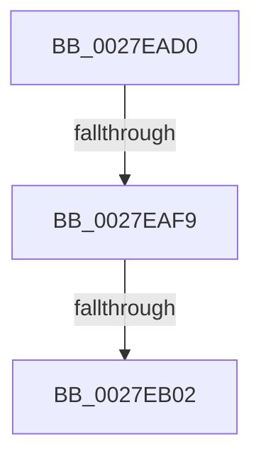

# MiQueueCoreWorkingSetEntries

- RVA: `0x0027EAD0`–`0x0027EB06` (길이 `54` bytes)
- VA: `0x000000014027EAD0`
- 실행 섹션: `.text`
- PDB 이름 있음: `예`; PDB Function 태그: `아니요`
- unwind 정보 RVA: `0x0006644C`
- 디코드: `15`개 명령, `54/54` bytes 표시
- 미해석 바이트: `0` (있으면 어셈블리에 `.byte`로 보존)

> 이 문서는 커널 이미지의 기계어와 PDB 기호를 분석해 생성했습니다. 4번과 5번은 함수 원형과 자료형을 바이너리 사용 방식에서 추정한 C 해석이며 원본 소스 복구 결과는 아닙니다.

## 1. Dependencies

- 직접 호출 지점: **0**; 고유 호출 대상: **0**
- 직접 호출자로 확인된 함수: **1**
- RIP 상대 이미지 참조: **0**

### Outgoing calls
- 직접 디코드된 call 명령이 없습니다.

### Direct callers
- [MiCompleteRestrictedImageFault](../2C/MiCompleteRestrictedImageFault_function_002C60D4.md) at `0x002C6284`

### Static image references
- 디코드된 RIP-relative 메모리 참조가 없습니다.

## 2. Other-region calls and transfers

- 다른 실행 섹션으로 향하는 call: **0**
- call이 아닌 외부 분기/꼬리 이동: **2**
  - `0x0027EAF3` → [sub_0027EC2D](Unknown_function_0027EC2D.md) (`tail-transfer`)
  - `0x0027EAFC` → [sub_0027EC2D](Unknown_function_0027EC2D.md) (`tail-transfer`)

## 3. Assembly (complete function range)

```asm
0027EAD0  48 89 5C 24 10                  mov qword ptr [rsp + 0x10], rbx
0027EAD5  48 89 74 24 18                  mov qword ptr [rsp + 0x18], rsi
0027EADA  57                              push rdi
0027EADB  48 83 EC 20                     sub rsp, 0x20
0027EADF  48 8B D9                        mov rbx, rcx
0027EAE2  49 8B F0                        mov rsi, r8
0027EAE5  0F B6 49 0D                     movzx ecx, byte ptr [rcx + 0xd]
0027EAE9  48 8B FA                        mov rdi, rdx
0027EAEC  0F B6 C1                        movzx eax, cl
0027EAEF  24 09                           and al, 9
0027EAF1  3C 08                           cmp al, 8
0027EAF3  0F 85 34 01 00 00               jne 0x14027ec2d
0027EAF9  F6 C1 04                        test cl, 4
0027EAFC  0F 85 2B 01 00 00               jne 0x14027ec2d
0027EB02  0F B7 43 0A                     movzx eax, word ptr [rbx + 0xa]
```

## 4. C-style interpretation (structured pseudocode)

```c
__int64 __fastcall MiQueueCoreWorkingSetEntries(__int64 a1, __int64 a2, __int64 a3)
{
    __int64 result;
    __int64 v_rsp;
    unsigned __int64 v_stack_p10;
    unsigned __int64 v_stack_p18;

    v_stack_p10 = v_rbx;
    v_stack_p18 = v_rsi;
    v_rsp = (v_rsp) - (32);
    result = (unsigned __int8)(((unsigned __int8)(*(unsigned __int8 *)(a1 + 13))) & (9));
    return *(unsigned __int16 *)(a1 + 10);
}
```

## 5. (Beta) C Style

```c
int64_t MiQueueCoreWorkingSetEntries(void *Arg1, int64_t Arg2, int64_t Arg3)
{
    uint8_t *arg1 = (uint8_t *)Arg1;

    int64_t result;
    int64_t local_rsp;
    uint64_t v_stack_p10;
    uint64_t v_stack_p18;

    v_stack_p10 = local_rbx;
    v_stack_p18 = local_rsi;
    local_rsp = (local_rsp) - (32);
    result = (uint8_t)(((uint8_t)(*(uint8_t *)(arg1 + 0xD))) & (9));
    return *(uint16_t *)(arg1 + 0xA);
}
```

### 관측된 메모리 오프셋

구조체 형식이 확인되지 않은 접근은 인자 기준의 오프셋으로만 기록했습니다.

| 기준 인자 | 오프셋 표현 | 폭 (bit) | 접근 |
|---|---:|---:|---|
| `Arg1` | `+ 0xA` | `16` | `R` |
| `Arg1` | `+ 0xD` | `8` | `R` |

## 6. Execution-region graph

[열기: 2D/3D 그래프와 함수 탐색 컨트롤 패널](../../../control-panel.html?section=text&rva=0x0027EAD0&view=graph)

- 2D 그래프는 위에서 아래로 흐르고, 3D 그래프는 빈 공간을 드래그해 회전합니다. Shift+드래그는 이동, 휠은 확대·축소, 함수 노드 선택은 대상 보고서 이동입니다.

### Static fallback


