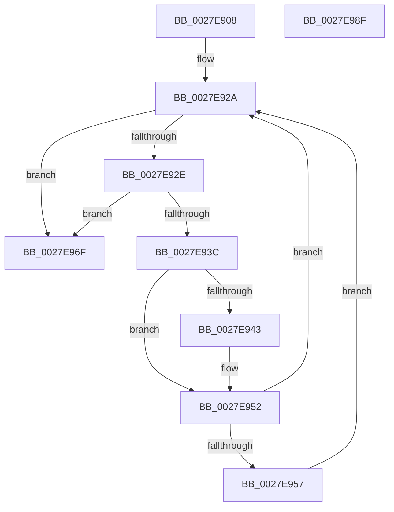

# MiReduceWs

- RVA: `0x0027E908`–`0x0027E990` (길이 `136` bytes)
- VA: `0x000000014027E908`
- 실행 섹션: `.text`
- PDB 이름 있음: `예`; PDB Function 태그: `아니요`
- unwind 정보 RVA: `0x00066400`
- 디코드: `40`개 명령, `136/136` bytes 표시
- 미해석 바이트: `0` (있으면 어셈블리에 `.byte`로 보존)

> 이 문서는 커널 이미지의 기계어와 PDB 기호를 분석해 생성했습니다. 4번과 5번은 함수 원형과 자료형을 바이너리 사용 방식에서 추정한 C 해석이며 원본 소스 복구 결과는 아닙니다.

## 1. Dependencies

- 직접 호출 지점: **2**; 고유 호출 대상: **2**
- 직접 호출자로 확인된 함수: **2**
- RIP 상대 이미지 참조: **0**

### Outgoing calls
- `0x0027E968` → [MiTrimWorkingSet](../2A/MiTrimWorkingSet_function_002AD134.md) (function, `0x002AD134`)
- `0x0027E975` → [MiSimpleAging](../49/MiSimpleAging_function_004930C8.md) (function, `0x004930C8`)

### Direct callers
- [sub_0027D718](Unknown_function_0027D718.md) at `0x0027D733`
- [MiSelfTrim](MiSelfTrim_function_0027E870.md) at `0x0027E8E3`

### Static image references
- 디코드된 RIP-relative 메모리 참조가 없습니다.

## 2. Other-region calls and transfers

- 다른 실행 섹션으로 향하는 call: **0**
- 별도 외부 분기/꼬리 이동을 확인하지 못했습니다.

## 3. Assembly (complete function range)

```asm
0027E908  48 89 5C 24 08                  mov qword ptr [rsp + 8], rbx
0027E90D  48 89 6C 24 10                  mov qword ptr [rsp + 0x10], rbp
0027E912  48 89 74 24 18                  mov qword ptr [rsp + 0x18], rsi
0027E917  57                              push rdi
0027E918  48 83 EC 30                     sub rsp, 0x30
0027E91C  49 8B E8                        mov rbp, r8
0027E91F  40 8A F2                        mov sil, dl
0027E922  48 8B F9                        mov rdi, rcx
0027E925  BB 08 00 00 00                  mov ebx, 8
0027E92A  85 DB                           test ebx, ebx
0027E92C  74 41                           je 0x14027e96f
0027E92E  48 8B 97 80 00 00 00            mov rdx, qword ptr [rdi + 0x80]
0027E935  FF CB                           dec ebx
0027E937  48 3B D5                        cmp rdx, rbp
0027E93A  76 33                           jbe 0x14027e96f
0027E93C  48 2B D5                        sub rdx, rbp
0027E93F  85 DB                           test ebx, ebx
0027E941  74 0F                           je 0x14027e952
0027E943  48 8B 4C DF 28                  mov rcx, qword ptr [rdi + rbx*8 + 0x28]
0027E948  48 3B CA                        cmp rcx, rdx
0027E94B  48 0F 47 CA                     cmova rcx, rdx
0027E94F  48 8B D1                        mov rdx, rcx
0027E952  48 85 D2                        test rdx, rdx
0027E955  74 D3                           je 0x14027e92a
0027E957  44 8B CB                        mov r9d, ebx
0027E95A  C7 44 24 20 10 00 00 00         mov dword ptr [rsp + 0x20], 0x10
0027E962  44 8A C6                        mov r8b, sil
0027E965  48 8B CF                        mov rcx, rdi
0027E968  E8 C7 E7 02 00                  call 0x1402ad134
0027E96D  EB BB                           jmp 0x14027e92a
0027E96F  40 8A D6                        mov dl, sil
0027E972  48 8B CF                        mov rcx, rdi
0027E975  E8 4E 47 21 00                  call 0x1404930c8
0027E97A  48 8B 5C 24 40                  mov rbx, qword ptr [rsp + 0x40]
0027E97F  48 8B 6C 24 48                  mov rbp, qword ptr [rsp + 0x48]
0027E984  48 8B 74 24 50                  mov rsi, qword ptr [rsp + 0x50]
0027E989  48 83 C4 30                     add rsp, 0x30
0027E98D  5F                              pop rdi
0027E98E  C3                              ret
0027E98F  CC                              int3
```

## 4. C-style interpretation (structured pseudocode)

```c
__int64 __fastcall MiReduceWs(__int64 a1, unsigned __int8 a2, __int64 a3)
{
    __int64 result;
    __int64 v_rbx;
    __int64 v_rsp;
    unsigned int v_stack_m18;
    unsigned __int64 v_stack_p10;
    unsigned __int64 v_stack_p18;
    unsigned __int64 v_stack_p8;

    v_stack_p8 = v_rbx;
    v_stack_p10 = v_rbp;
    v_stack_p18 = v_rsi;
    v_rsp = (v_rsp) - (48);
loc_0027E92A:
    if (8 == 0) goto loc_0027E96F;
    v_rbx = (unsigned int)((8) - 1);
    if ((*(unsigned __int64 *)(a1 + 128)) <= a3) goto loc_0027E96F;
    a2 = (*(unsigned __int64 *)(a1 + 128)) - (a3);
    if ((unsigned int)(v_rbx) != 0) {
        a1 = *(unsigned __int64 *)(a1 + v_rbx * 8 + 40);
        if (a1 > a2) { a1 = a2; }
        a2 = a1;
    }
    if (a2 == 0) goto loc_0027E92A;
    v_stack_m18 = 16;
    result = MiTrimWorkingSet(a1, a2, a2, (unsigned int)((unsigned int)(v_rbx)));
    goto loc_0027E92A;
loc_0027E96F:
    result = MiSimpleAging(a1, a2, a2, (unsigned int)((unsigned int)(v_rbx)));
    v_rsp = (v_rsp) + (48);
    return result;
}
```

## 5. (Beta) C Style

```c
int64_t MiReduceWs(void *Arg1, uint8_t Arg2, int64_t Arg3)
{
    uint8_t *arg1 = (uint8_t *)Arg1;

    int64_t result;
    int64_t local_rbx;
    int64_t local_rsp;
    uint32_t v_stack_m18;
    uint64_t v_stack_p10;
    uint64_t v_stack_p18;
    uint64_t v_stack_p8;

    v_stack_p8 = local_rbx;
    v_stack_p10 = local_rbp;
    v_stack_p18 = local_rsi;
    local_rsp = (local_rsp) - (48);
loc_0027E92A:
    if (8 == 0) goto loc_0027E96F;
    local_rbx = (uint32_t)((8) - 1);
    if ((*(uint64_t *)(arg1 + 0x80)) <= Arg3) goto loc_0027E96F;
    Arg2 = (*(uint64_t *)(arg1 + 0x80)) - (Arg3);
    if ((uint32_t)(local_rbx) != 0) {
        Arg1 = *(uint64_t *)(arg1 + local_rbx * 8 + 0x28);
        if (Arg1 > Arg2) { Arg1 = Arg2; }
        Arg2 = Arg1;
    }
    if (Arg2 == 0) goto loc_0027E92A;
    v_stack_m18 = 16;
    result = MiTrimWorkingSet(Arg1, Arg2, Arg2, (uint32_t)((uint32_t)(local_rbx)));
    goto loc_0027E92A;
loc_0027E96F:
    result = MiSimpleAging(Arg1, Arg2, Arg2, (uint32_t)((uint32_t)(local_rbx)));
    local_rsp = (local_rsp) + (48);
    return result;
}
```

### 관측된 메모리 오프셋

구조체 형식이 확인되지 않은 접근은 인자 기준의 오프셋으로만 기록했습니다.

| 기준 인자 | 오프셋 표현 | 폭 (bit) | 접근 |
|---|---:|---:|---|
| `Arg1` | `+ 0x28 + rbx*8` | `64` | `R` |
| `Arg1` | `+ 0x80` | `64` | `R` |

## 6. Execution-region graph

[열기: 2D/3D 그래프와 함수 탐색 컨트롤 패널](../../../control-panel.html?section=text&rva=0x0027E908&view=graph)

- 2D 그래프는 위에서 아래로 흐르고, 3D 그래프는 빈 공간을 드래그해 회전합니다. Shift+드래그는 이동, 휠은 확대·축소, 함수 노드 선택은 대상 보고서 이동입니다.

### Static fallback


