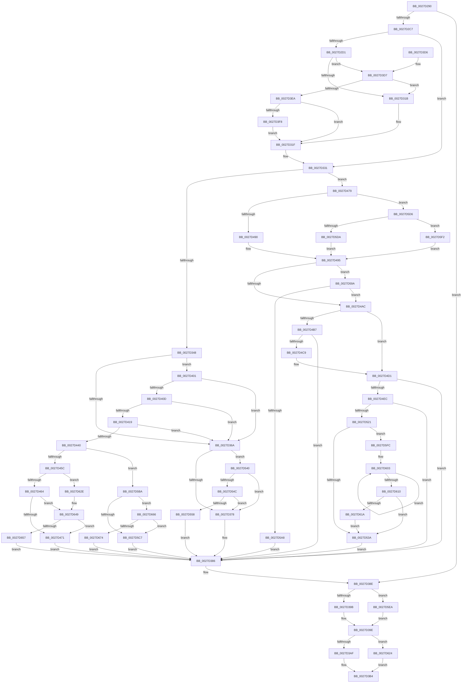

# MiReleaseFaultState

- RVA: `0x0027D290`–`0x0027D683` (길이 `1,011` bytes)
- VA: `0x000000014027D290`
- 실행 섹션: `.text`
- PDB 이름 있음: `예`; PDB Function 태그: `아니요`
- unwind 정보 RVA: `0x00066280`
- 디코드: `228`개 명령, `1,011/1,011` bytes 표시
- 미해석 바이트: `0` (있으면 어셈블리에 `.byte`로 보존)

> 이 문서는 커널 이미지의 기계어와 PDB 기호를 분석해 생성했습니다. 4번과 5번은 함수 원형과 자료형을 바이너리 사용 방식에서 추정한 C 해석이며 원본 소스 복구 결과는 아닙니다.

## 1. Dependencies

- 직접 호출 지점: **11**; 고유 호출 대상: **11**
- 직접 호출자로 확인된 함수: **11**
- RIP 상대 이미지 참조: **3**

### Outgoing calls
- `0x0027D327` → [MiAddWorkingSetEntries](MiAddWorkingSetEntries_function_0027DC00.md) (function, `0x0027DC00`)
- `0x0027D3AF` → [MiUnlockWorkingSetShared](MiUnlockWorkingSetShared_function_0027D690.md) (function, `0x0027D690`)
- `0x0027D4CC` → [KxWaitForLockChainValid](../21/KxWaitForLockChainValid_function_00217AA0.md) (function, `0x00217AA0`)
- `0x0027D500` → [KeDisableInterrupts](../21/KeDisableInterrupts_function_00217BE0.md) (function, `0x00217BE0`)
- `0x0027D513` → [KiHaltOnAddressWakeEntireList](../21/KiHaltOnAddressWakeEntireList_function_00217AF4.md) (function, `0x00217AF4`)
- `0x0027D5B0` → [KiReleaseQueuedSpinLockInstrumented](../21/KiReleaseQueuedSpinLockInstrumented_function_002179F0.md) (function, `0x002179F0`)
- `0x0027D61A` → [KiRemoveSystemWorkPriorityKick](../26/KiRemoveSystemWorkPriorityKick_function_002631D0.md) (function, `0x002631D0`)
- `0x0027D624` → [MiUnlockWorkingSetExclusive](MiUnlockWorkingSetExclusive_function_0027EC70.md) (function, `0x0027EC70`)
- `0x0027D643` → [KeBugCheckEx](../4F/KeBugCheckEx_function_004FD660.md) (function, `0x004FD660`)
- `0x0027D65C` → [ExpReleaseSpinLockExclusiveFromDpcLevelInstrumented](../2C/ExpReleaseSpinLockExclusiveFromDpcLevelInstrumented_function_002C0F44.md) (function, `0x002C0F44`)
- `0x0027D679` → [ExpReleaseSpinLockSharedFromDpcLevelInstrumented](../2F/ExpReleaseSpinLockSharedFromDpcLevelInstrumented_function_002F0F48.md) (function, `0x002F0F48`)

### Direct callers
- [sub_0027F36E](Unknown_function_0027F36E.md) at `0x0027F48A`
- [MiStealPage](../2B/MiStealPage_function_002B28D0.md) at `0x002B3D17`
- [MiFinishHardFault](../2B/MiFinishHardFault_function_002B6F10.md) at `0x002B742C`
- [MiUserFault](../32/MiUserFault_function_00329840.md) at `0x00329DF4`
- [MiUserFault](../32/MiUserFault_function_00329840.md) at `0x00329E62`
- [MiUserFault](../32/MiUserFault_function_00329840.md) at `0x0032A00A`
- [MiKernelWriteToExecutableMemory](../36/MiKernelWriteToExecutableMemory_function_00368F18.md) at `0x00368F78`
- [MiPrivateFixup](../36/MiPrivateFixup_function_003693E8.md) at `0x00369622`
- [MiPrivateFixup](../36/MiPrivateFixup_function_003693E8.md) at `0x003699BE`
- [MiWaitForCollidedFaultComplete](../36/MiWaitForCollidedFaultComplete_function_00369EDC.md) at `0x00369FC6`
- [MiIssueHardFault](../38/MiIssueHardFault_function_00380074.md) at `0x0038010C`
- [MiInPagePageTable](../3E/MiInPagePageTable_function_003EF8DC.md) at `0x003EFF69`
- [MiFaultGetFileExtents](../47/MiFaultGetFileExtents_function_00479758.md) at `0x004797F1`
- [MiIdealClusterPage](../4D/MiIdealClusterPage_function_004DB964.md) at `0x004DBD70`

### Static image references
- `0x0027D464` → RVA `0x00FC6B06` (`ALMOSTRO`; read)
- `0x0027D4F5` → RVA `0x00000000` (`image boundary/outside`; read)
- `0x0027D59A` → RVA `0x00F0DE58` (`.data`; read)

## 2. Other-region calls and transfers

- 다른 실행 섹션으로 향하는 call: **0**
- 별도 외부 분기/꼬리 이동을 확인하지 못했습니다.

## 3. Assembly (complete function range)

```asm
0027D290  48 89 5C 24 08                  mov qword ptr [rsp + 8], rbx
0027D295  48 89 6C 24 10                  mov qword ptr [rsp + 0x10], rbp
0027D29A  48 89 74 24 18                  mov qword ptr [rsp + 0x18], rsi
0027D29F  48 89 7C 24 20                  mov qword ptr [rsp + 0x20], rdi
0027D2A4  41 54                           push r12
0027D2A6  41 56                           push r14
0027D2A8  41 57                           push r15
0027D2AA  48 83 EC 30                     sub rsp, 0x30
0027D2AE  4C 8B 71 10                     mov r14, qword ptr [rcx + 0x10]
0027D2B2  4D 8B F8                        mov r15, r8
0027D2B5  48 8B 31                        mov rsi, qword ptr [rcx]
0027D2B8  0F B6 EA                        movzx ebp, dl
0027D2BB  48 8B D9                        mov rbx, rcx
0027D2BE  4D 85 F6                        test r14, r14
0027D2C1  0F 84 C7 00 00 00               je 0x14027d38e
0027D2C7  45 33 E4                        xor r12d, r12d
0027D2CA  66 44 39 61 0A                  cmp word ptr [rcx + 0xa], r12w
0027D2CF  74 60                           je 0x14027d331
0027D2D1  48 B9 00 00 00 00 80 F6 FF FF   movabs rcx, 0xfffff68000000000
0027D2DB  48 8B C1                        mov rax, rcx
0027D2DE  44 0F B6 4B 0D                  movzx r9d, byte ptr [rbx + 0xd]
0027D2E3  49 8B D6                        mov rdx, r14
0027D2E6  48 C1 E2 19                     shl rdx, 0x19
0027D2EA  41 83 E1 02                     and r9d, 2
0027D2EE  48 C1 E0 19                     shl rax, 0x19
0027D2F2  48 2B D0                        sub rdx, rax
0027D2F5  48 C1 FA 10                     sar rdx, 0x10
0027D2F9  48 C1 E2 19                     shl rdx, 0x19
0027D2FD  48 2B D0                        sub rdx, rax
0027D300  0F B7 43 08                     movzx eax, word ptr [rbx + 8]
0027D304  48 C1 E0 0C                     shl rax, 0xc
0027D308  48 C1 FA 10                     sar rdx, 0x10
0027D30C  48 03 D0                        add rdx, rax
0027D30F  48 8B C1                        mov rax, rcx
0027D312  48 3B D0                        cmp rdx, rax
0027D315  0F 83 BC 00 00 00               jae 0x14027d3d7
0027D31B  41 83 C9 05                     or r9d, 5
0027D31F  44 0F B7 43 0A                  movzx r8d, word ptr [rbx + 0xa]
0027D324  48 8B CE                        mov rcx, rsi
0027D327  E8 D4 08 00 00                  call 0x14027dc00
0027D32C  66 44 89 63 0A                  mov word ptr [rbx + 0xa], r12w
0027D331  48 8B 53 10                     mov rdx, qword ptr [rbx + 0x10]
0027D335  48 B8 68 DF BE 7D FB F6 FF FF   movabs rax, 0xfffff6fb7dbedf68
0027D33F  48 3B D0                        cmp rdx, rax
0027D342  0F 84 31 01 00 00               je 0x14027d479
0027D348  8B 86 B8 00 00 00               mov eax, dword ptr [rsi + 0xb8]
0027D34E  49 B8 00 D0 BE 7D FB F6 FF FF   movabs r8, 0xfffff6fb7dbed000
0027D358  49 B9 FF DF BE 7D FB F6 FF FF   movabs r9, 0xfffff6fb7dbedfff
0027D362  A8 0F                           test al, 0xf
0027D364  0F 84 97 00 00 00               je 0x14027d401
0027D36A  8B 86 B8 00 00 00               mov eax, dword ptr [rsi + 0xb8]
0027D370  A8 0F                           test al, 0xf
0027D372  0F 85 C8 01 00 00               jne 0x14027d540
0027D378  48 B8 FF FF FF FF FF FF FF CF   movabs rax, 0xcfffffffffffffff
0027D382  F0 48 21 02                     lock and qword ptr [rdx], rax
0027D386  80 4B 0D 04                     or byte ptr [rbx + 0xd], 4
0027D38A  4C 89 63 10                     mov qword ptr [rbx + 0x10], r12
0027D38E  0F B6 43 0C                     movzx eax, byte ptr [rbx + 0xc]
0027D392  4D 85 FF                        test r15, r15
0027D395  0F 85 4F 02 00 00               jne 0x14027d5ea
0027D39B  0F B6 E8                        movzx ebp, al
0027D39E  F6 43 0D 01                     test byte ptr [rbx + 0xd], 1
0027D3A2  40 0F B6 D5                     movzx edx, bpl
0027D3A6  48 8B CE                        mov rcx, rsi
0027D3A9  0F 85 75 02 00 00               jne 0x14027d624
0027D3AF  E8 DC 02 00 00                  call 0x14027d690
0027D3B4  48 8B 5C 24 50                  mov rbx, qword ptr [rsp + 0x50]
0027D3B9  49 8B C6                        mov rax, r14
0027D3BC  48 8B 6C 24 58                  mov rbp, qword ptr [rsp + 0x58]
0027D3C1  48 8B 74 24 60                  mov rsi, qword ptr [rsp + 0x60]
0027D3C6  48 8B 7C 24 68                  mov rdi, qword ptr [rsp + 0x68]
0027D3CB  48 83 C4 30                     add rsp, 0x30
0027D3CF  41 5F                           pop r15
0027D3D1  41 5E                           pop r14
0027D3D3  41 5C                           pop r12
0027D3D5  C3                              ret
0027D3D6  CC                              int3
0027D3D7  48 B8 FF FF FF FF FF F6 FF FF   movabs rax, 0xfffff6ffffffffff
0027D3E1  48 3B D0                        cmp rdx, rax
0027D3E4  0F 87 31 FF FF FF               ja 0x14027d31b
0027D3EA  8B 86 B8 00 00 00               mov eax, dword ptr [rsi + 0xb8]
0027D3F0  A8 0F                           test al, 0xf
0027D3F2  0F 85 27 FF FF FF               jne 0x14027d31f
0027D3F8  41 83 C9 04                     or r9d, 4
0027D3FC  E9 1E FF FF FF                  jmp 0x14027d31f
0027D401  49 8B C0                        mov rax, r8
0027D404  48 3B D0                        cmp rdx, rax
0027D407  0F 82 5D FF FF FF               jb 0x14027d36a
0027D40D  49 8B C1                        mov rax, r9
0027D410  48 3B D0                        cmp rdx, rax
0027D413  0F 87 51 FF FF FF               ja 0x14027d36a
0027D419  65 48 8B 04 25 88 01 00 00      mov rax, qword ptr gs:[0x188]
0027D422  48 8B 88 B8 00 00 00            mov rcx, qword ptr [rax + 0xb8]
0027D429  48 8B 81 10 04 00 00            mov rax, qword ptr [rcx + 0x410]
0027D430  48 8B 88 68 05 00 00            mov rcx, qword ptr [rax + 0x568]
0027D437  48 85 C9                        test rcx, rcx
0027D43A  0F 84 2A FF FF FF               je 0x14027d36a
0027D440  48 C1 EA 03                     shr rdx, 3
0027D444  81 E2 FF 01 00 00               and edx, 0x1ff
0027D44A  8B 04 91                        mov eax, dword ptr [rcx + rdx*4]
0027D44D  48 8D 0C 91                     lea rcx, [rcx + rdx*4]
0027D451  A9 FF FF FF 3F                  test eax, 0x3fffffff
0027D456  0F 85 5E 01 00 00               jne 0x14027d5ba
0027D45C  85 C0                           test eax, eax
0027D45E  0F 89 CA 01 00 00               jns 0x14027d62e
0027D464  F6 05 9B 96 D4 00 01            test byte ptr [rip + 0xd4969b], 1
0027D46B  0F 85 D8 01 00 00               jne 0x14027d649
0027D471  44 89 21                        mov dword ptr [rcx], r12d
0027D474  E9 0D FF FF FF                  jmp 0x14027d386
0027D479  65 48 8B 0C 25 20 00 00 00      mov rcx, qword ptr gs:[0x20]
0027D482  8B 86 B8 00 00 00               mov eax, dword ptr [rsi + 0xb8]
0027D488  24 0F                           and al, 0xf
0027D48A  0F 85 46 01 00 00               jne 0x14027d5d6
0027D490  BA 30 00 00 00                  mov edx, 0x30
0027D495  48 8D B9 40 9C 00 00            lea rdi, [rcx + 0x9c40]
0027D49C  48 03 FA                        add rdi, rdx
0027D49F  F6 05 60 96 D4 00 01            test byte ptr [rip + 0xd49660], 1
0027D4A6  0F 85 EE 00 00 00               jne 0x14027d59a
0027D4AC  0F 0D 0F                        prefetchw byte ptr [rdi]
0027D4AF  48 8B 07                        mov rax, qword ptr [rdi]
0027D4B2  48 85 C0                        test rax, rax
0027D4B5  75 1A                           jne 0x14027d4d1
0027D4B7  48 8B 4F 08                     mov rcx, qword ptr [rdi + 8]
0027D4BB  48 8B C7                        mov rax, rdi
0027D4BE  F0 4C 0F B1 21                  lock cmpxchg qword ptr [rcx], r12
0027D4C3  0F 84 BD FE FF FF               je 0x14027d386
0027D4C9  48 8B CF                        mov rcx, rdi
0027D4CC  E8 CF A5 F9 FF                  call 0x140217aa0
0027D4D1  4C 8D 40 08                     lea r8, [rax + 8]
0027D4D5  4C 89 27                        mov qword ptr [rdi], r12
0027D4D8  48 8B 4F 08                     mov rcx, qword ptr [rdi + 8]
0027D4DC  48 8B C1                        mov rax, rcx
0027D4DF  49 87 00                        xchg qword ptr [r8], rax
0027D4E2  32 C1                           xor al, cl
0027D4E4  A8 04                           test al, 4
0027D4E6  0F 84 9A FE FF FF               je 0x14027d386
0027D4EC  F0 44 09 24 24                  lock or dword ptr [rsp], r12d
0027D4F1  49 C1 E8 05                     shr r8, 5
0027D4F5  4C 8D 0D 04 2B D8 FF            lea r9, [rip - 0x27d4fc]
0027D4FC  41 83 E0 7F                     and r8d, 0x7f
0027D500  E8 DB A6 F9 FF                  call 0x140217be0
0027D505  49 8B D4                        mov rdx, r12
0027D508  0F B6 F8                        movzx edi, al
0027D50B  4B 87 94 C1 20 1B F2 00         xchg qword ptr [r9 + r8*8 + 0xf21b20], rdx
0027D513  E8 DC A5 F9 FF                  call 0x140217af4
0027D518  40 84 FF                        test dil, dil
0027D51B  0F 84 65 FE FF FF               je 0x14027d386
0027D521  65 48 8B 0C 25 20 00 00 00      mov rcx, qword ptr gs:[0x20]
0027D52A  4C 8B 81 B8 8E 00 00            mov r8, qword ptr [rcx + 0x8eb8]
0027D531  4D 85 C0                        test r8, r8
0027D534  0F 85 C2 00 00 00               jne 0x14027d5fc
0027D53A  FB                              sti
0027D53B  E9 46 FE FF FF                  jmp 0x14027d386
0027D540  49 8B C0                        mov rax, r8
0027D543  48 3B D0                        cmp rdx, rax
0027D546  0F 82 2C FE FF FF               jb 0x14027d378
0027D54C  49 8B C1                        mov rax, r9
0027D54F  48 3B D0                        cmp rdx, rax
0027D552  0F 87 20 FE FF FF               ja 0x14027d378
0027D558  49 8B C0                        mov rax, r8
0027D55B  48 2B D0                        sub rdx, rax
0027D55E  4C 8D 0D 9B 2A D8 FF            lea r9, [rip - 0x27d565]
0027D565  8B 86 B8 00 00 00               mov eax, dword ptr [rsi + 0xb8]
0027D56B  48 C1 FA 03                     sar rdx, 3
0027D56F  44 8D 04 12                     lea r8d, [rdx + rdx]
0027D573  BA 02 00 00 00                  mov edx, 2
0027D578  41 8B C8                        mov ecx, r8d
0027D57B  41 8B C0                        mov eax, r8d
0027D57E  83 E1 1F                        and ecx, 0x1f
0027D581  D3 E2                           shl edx, cl
0027D583  F7 D2                           not edx
0027D585  0F B3 CA                        btr edx, ecx
0027D588  48 C1 E8 05                     shr rax, 5
0027D58C  F0 41 21 94 81 AC F1 E2 00      lock and dword ptr [r9 + rax*4 + 0xe2f1ac], edx
0027D595  E9 EC FD FF FF                  jmp 0x14027d386
0027D59A  8B 05 B8 08 C9 00               mov eax, dword ptr [rip + 0xc908b8]
0027D5A0  85 C0                           test eax, eax
0027D5A2  0F 85 04 FF FF FF               jne 0x14027d4ac
0027D5A8  48 8B 54 24 48                  mov rdx, qword ptr [rsp + 0x48]
0027D5AD  48 8B CF                        mov rcx, rdi
0027D5B0  E8 3B A4 F9 FF                  call 0x1402179f0
0027D5B5  E9 CC FD FF FF                  jmp 0x14027d386
0027D5BA  F6 05 45 95 D4 00 01            test byte ptr [rip + 0xd49545], 1
0027D5C1  0F 85 9F 00 00 00               jne 0x14027d666
0027D5C7  F0 81 21 FF FF FF BF            lock and dword ptr [rcx], 0xbfffffff
0027D5CE  F0 FF 09                        lock dec dword ptr [rcx]
0027D5D1  E9 B0 FD FF FF                  jmp 0x14027d386
0027D5D6  3C 07                           cmp al, 7
0027D5D8  74 18                           je 0x14027d5f2
0027D5DA  3C 05                           cmp al, 5
0027D5DC  BA 48 00 00 00                  mov edx, 0x48
0027D5E1  49 0F 44 D4                     cmove rdx, r12
0027D5E5  E9 AB FE FF FF                  jmp 0x14027d495
0027D5EA  41 88 07                        mov byte ptr [r15], al
0027D5ED  E9 AC FD FF FF                  jmp 0x14027d39e
0027D5F2  BA 18 00 00 00                  mov edx, 0x18
0027D5F7  E9 99 FE FF FF                  jmp 0x14027d495
0027D5FC  41 0F 0D 08                     prefetchw byte ptr [r8]
0027D600  41 8B 00                        mov eax, dword ptr [r8]
0027D603  8B D0                           mov edx, eax
0027D605  0F BA F2 15                     btr edx, 0x15
0027D609  F0 41 0F B1 10                  lock cmpxchg dword ptr [r8], edx
0027D60E  75 F3                           jne 0x14027d603
0027D610  0F BA E0 15                     bt eax, 0x15
0027D614  0F 83 20 FF FF FF               jae 0x14027d53a
0027D61A  E8 B1 5B FE FF                  call 0x1402631d0
0027D61F  E9 16 FF FF FF                  jmp 0x14027d53a
0027D624  E8 47 16 00 00                  call 0x14027ec70
0027D629  E9 86 FD FF FF                  jmp 0x14027d3b4
0027D62E  45 33 C9                        xor r9d, r9d
0027D631  4C 89 64 24 20                  mov qword ptr [rsp + 0x20], r12
0027D636  48 8B D1                        mov rdx, rcx
0027D639  41 B8 00 01 00 00               mov r8d, 0x100
0027D63F  41 8D 49 10                     lea ecx, [r9 + 0x10]
0027D643  E8 18 00 28 00                  call 0x1404fd660
0027D648  CC                              int3
0027D649  8B 05 09 08 C9 00               mov eax, dword ptr [rip + 0xc90809]
0027D64F  85 C0                           test eax, eax
0027D651  0F 85 1A FE FF FF               jne 0x14027d471
0027D657  48 8B 54 24 48                  mov rdx, qword ptr [rsp + 0x48]
0027D65C  E8 E3 38 04 00                  call 0x1402c0f44
0027D661  E9 20 FD FF FF                  jmp 0x14027d386
0027D666  8B 05 EC 07 C9 00               mov eax, dword ptr [rip + 0xc907ec]
0027D66C  85 C0                           test eax, eax
0027D66E  0F 85 53 FF FF FF               jne 0x14027d5c7
0027D674  48 8B 54 24 48                  mov rdx, qword ptr [rsp + 0x48]
0027D679  E8 CA 38 07 00                  call 0x1402f0f48
0027D67E  E9 03 FD FF FF                  jmp 0x14027d386
```

## 4. C-style interpretation (structured pseudocode)

```c
__int64 __fastcall MiReleaseFaultState(__int64 a1, unsigned __int8 a2, __int64 a3)
{
    __int64 result;
    __int64 v_r12;
    __int64 v_rdi;
    __int64 v_rsp;
    unsigned int v_stack_p0;
    unsigned __int64 v_stack_p10;
    unsigned __int64 v_stack_p18;
    unsigned __int64 v_stack_p20;
    unsigned __int64 v_stack_p48;
    unsigned __int64 v_stack_p8;

    v_stack_p8 = v_rbx;
    v_stack_p10 = v_rbp;
    v_stack_p18 = v_rsi;
    v_stack_p20 = v_rdi;
    v_rsp = (v_rsp) - (48);
    if (*(unsigned __int64 *)(a1 + 16) == 0) goto loc_0027D38E;
    v_r12 = 0;
    if ((*(unsigned __int16 *)(a1 + 10)) == 0) goto loc_0027D331;
    a2 = (*(unsigned __int64 *)(a1 + 16)) << (25);
    a4 = (unsigned int)((*(unsigned __int8 *)(a1 + 13)) & (2));
    result = (a1) << (25);
    a2 = (a2) - (result);
    a2 = (a2) >> (16);
    a2 = (a2) << (25);
    a2 = (a2) - (result);
    result = (*(unsigned __int16 *)(a1 + 8)) << (12);
    a2 = (a2) >> (16);
    a2 = (a2) + (result);
    if (a2 >= a1) goto loc_0027D3D7;
loc_0027D31B:
    a4 = (unsigned int)((a4) | (5));
loc_0027D31F:
    result = MiAddWorkingSetEntries(*(unsigned __int64 *)(a1), a2, *(unsigned __int16 *)(a1 + 10), a4);
    *(unsigned __int16 *)(a1 + 10) = 0;
loc_0027D331:
    if ((*(unsigned __int64 *)(a1 + 16)) == result) goto loc_0027D479;
    if ((((unsigned __int8)((unsigned int)(*(unsigned int *)(*(unsigned __int64 *)(a1) + 184)))) & (15)) == 0) goto loc_0027D401;
loc_0027D36A:
    if ((((unsigned __int8)((unsigned int)(*(unsigned int *)(*(unsigned __int64 *)(a1) + 184)))) & (15)) != 0) goto loc_0027D540;
loc_0027D378:
loc_0027D386:
    *(unsigned __int64 *)(a1 + 16) = 0;
loc_0027D38E:
    if (a3 != 0) goto loc_0027D5EA;
loc_0027D39E:
    if (((*(unsigned __int8 *)(a1 + 13)) & (1)) != 0) goto loc_0027D624;
    result = MiUnlockWorkingSetShared(*(unsigned __int64 *)(a1), (unsigned __int8)((unsigned __int8)(*(unsigned __int8 *)(a1 + 12))), *(unsigned __int16 *)(a1 + 10), a4);
loc_0027D3B4:
    v_rsp = (v_rsp) + (48);
    return *(unsigned __int64 *)(a1 + 16);
loc_0027D3D7:
    if (((unsigned __int8)((unsigned __int8)(*(unsigned __int8 *)(a1 + 12)))) > (*(unsigned __int64 *)(a1 + 16))) goto loc_0027D31B;
    if ((((unsigned __int8)((unsigned int)(*(unsigned int *)(v_stack_p18 + 184)))) & (15)) != 0) goto loc_0027D31F;
    a4 = (unsigned int)((a4) | (4));
    goto loc_0027D31F;
loc_0027D401:
    if (((unsigned __int8)((unsigned __int8)(*(unsigned __int8 *)(a1 + 12)))) < (*(unsigned __int16 *)(a1 + 10))) goto loc_0027D36A;
    if (((unsigned __int8)((unsigned __int8)(*(unsigned __int8 *)(a1 + 12)))) > a4) goto loc_0027D36A;
    if (*(unsigned __int64 *)(*(unsigned __int64 *)(*(unsigned __int64 *)(*(unsigned __int64 *)(gs_base + (0 + 392)) + 184) + 1040) + 1384) == 0) goto loc_0027D36A;
    a2 = ((unsigned __int8)((unsigned __int8)(*(unsigned __int8 *)(a1 + 12)))) >> (3);
    a2 = (unsigned int)((a2) & (511));
    if ((((unsigned int)((unsigned int)(*(unsigned int *)(*(unsigned __int64 *)(*(unsigned __int64 *)(*(unsigned __int64 *)(*(unsigned __int64 *)(gs_base + (0 + 392)) + 184) + 1040) + 1384) + a2 * 4)))) & (0x3FFFFFFFULL)) != 0) goto loc_0027D5BA;
    if (!sign_flag) goto loc_0027D62E;
    if (((*(unsigned __int8 *)(v_rip + 13932187)) & (1)) != 0) goto loc_0027D649;
loc_0027D471:
    *(unsigned int *)(*(unsigned __int64 *)(*(unsigned __int64 *)(*(unsigned __int64 *)(*(unsigned __int64 *)(gs_base + (0 + 392)) + 184) + 1040) + 1384) + a2 * 4) = 0;
    goto loc_0027D386;
loc_0027D479:
    result = (unsigned __int8)(((unsigned int)(*(unsigned int *)(v_stack_p18 + 184))) & (15));
    if (condition_is_not_equal) goto loc_0027D5D6;
loc_0027D495:
    v_rdi = (*(unsigned __int64 *)(gs_base + (0 + 32)) + 40000) + (48);
    if (((*(unsigned __int8 *)(v_rip + 13932128)) & (1)) != 0) goto loc_0027D59A;
loc_0027D4AC:
    if (*(unsigned __int64 *)(v_rdi) != 0) goto loc_0027D4D1;
    if (*(unsigned __int64 *)(v_rdi) == 0) goto loc_0027D386;
    result = KxWaitForLockChainValid(v_rdi, 48, *(unsigned __int16 *)(a1 + 10), a4);
loc_0027D4D1:
    *(unsigned __int64 *)(v_rdi) = 0;
    result = (unsigned __int8)((*(unsigned __int64 *)(v_rdi + 8)) ^ ((unsigned __int8)(*(unsigned __int64 *)(v_rdi + 8))));
    if ((((unsigned __int8)(result)) & (4)) == 0) goto loc_0027D386;
    a3 = (result + 8) >> (5);
    a3 = (unsigned int)((a3) & (127));
    result = KeDisableInterrupts(*(unsigned __int64 *)(v_rdi + 8), 48, a3, v_rip - 2610428);
    result = KiHaltOnAddressWakeEntireList(*(unsigned __int64 *)(v_rdi + 8), 0, a3, v_rip - 2610428);
    if ((unsigned __int8)((unsigned __int8)(result)) == 0) goto loc_0027D386;
    if (*(unsigned __int64 *)(*(unsigned __int64 *)(gs_base + (0 + 32)) + 36536) != 0) goto loc_0027D5FC;
loc_0027D53A:
    goto loc_0027D386;
loc_0027D540:
    if (0 < (*(unsigned __int64 *)(*(unsigned __int64 *)(gs_base + (0 + 32)) + 36536))) goto loc_0027D378;
    if (0 > (v_rip - 2610428)) goto loc_0027D378;
    a2 = (0) - (*(unsigned __int64 *)(*(unsigned __int64 *)(gs_base + (0 + 32)) + 36536));
    a2 = (a2) >> (3);
    a1 = (unsigned int)(((unsigned int)((unsigned int)(a2 + a2 * 1))) & (31));
    a2 = (unsigned int)((2) << ((unsigned __int8)(a1)));
    a2 = (unsigned int)(~(a2));
    result = ((unsigned int)((unsigned int)(a2 + a2 * 1))) >> (5);
    goto loc_0027D386;
loc_0027D59A:
    if ((unsigned int)((unsigned int)(*(unsigned int *)(v_rip + 13174968))) != 0) goto loc_0027D4AC;
    result = KiReleaseQueuedSpinLockInstrumented((unsigned __int8)(result), v_stack_p48, a2 + a2 * 1, v_rip - 2610533);
    goto loc_0027D386;
loc_0027D5BA:
    if (((*(unsigned __int8 *)(v_rip + 13931845)) & (1)) != 0) goto loc_0027D666;
loc_0027D5C7:
    goto loc_0027D386;
loc_0027D5D6:
    if (((unsigned __int8)(result)) == 7) goto loc_0027D5F2;
    a2 = 72;
    if (((unsigned __int8)(result)) == 5) { a2 = 0; }
    goto loc_0027D495;
loc_0027D5EA:
    *(unsigned __int8 *)(a3) = (unsigned __int8)(result);
    goto loc_0027D39E;
loc_0027D5F2:
    goto loc_0027D495;
loc_0027D5FC:
loc_0027D603:
    if (((unsigned __int8)(result)) != 5) goto loc_0027D603;
    if (((unsigned __int8)(result)) >= 5) goto loc_0027D53A;
    result = KiRemoveSystemWorkPriorityKick((unsigned __int8)(result), (unsigned int)((unsigned int)((unsigned int)(*(unsigned int *)(a2 + a2 * 1)))), a2 + a2 * 1, v_rip - 2610533);
    goto loc_0027D53A;
loc_0027D624:
    result = MiUnlockWorkingSetExclusive((unsigned __int8)(result), (unsigned int)((unsigned int)((unsigned int)(*(unsigned int *)(a2 + a2 * 1)))), a2 + a2 * 1, v_rip - 2610533);
    goto loc_0027D3B4;
loc_0027D62E:
    a4 = 0;
    v_stack_p20 = 0;
    result = KeBugCheckEx(a4 + 16, (unsigned __int8)(result), 256, a4);
loc_0027D649:
    if ((unsigned int)((unsigned int)(*(unsigned int *)(v_rip + 13174793))) != 0) goto loc_0027D471;
    result = ExpReleaseSpinLockExclusiveFromDpcLevelInstrumented(a4 + 16, v_stack_p48, 256, a4);
    goto loc_0027D386;
loc_0027D666:
    if ((unsigned int)((unsigned int)(*(unsigned int *)(v_rip + 13174764))) != 0) goto loc_0027D5C7;
    result = ExpReleaseSpinLockSharedFromDpcLevelInstrumented(a4 + 16, v_stack_p48, 256, a4);
    goto loc_0027D386;
}
```

## 5. (Beta) C Style

```c
int64_t MiReleaseFaultState(void *Arg1, uint8_t Arg2, int64_t Arg3)
{
    uint8_t *arg1 = (uint8_t *)Arg1;

    int64_t result;
    int64_t local_r12;
    int64_t local_rdi;
    int64_t local_rsp;
    uint32_t v_stack_p0;
    uint64_t v_stack_p10;
    uint64_t v_stack_p18;
    uint64_t v_stack_p20;
    uint64_t v_stack_p48;
    uint64_t v_stack_p8;

    v_stack_p8 = local_rbx;
    v_stack_p10 = local_rbp;
    v_stack_p18 = local_rsi;
    v_stack_p20 = local_rdi;
    local_rsp = (local_rsp) - (48);
    if (*(uint64_t *)(arg1 + 0x10) == 0) goto loc_0027D38E;
    local_r12 = 0;
    if ((*(uint16_t *)(arg1 + 0xA)) == 0) goto loc_0027D331;
    Arg2 = (*(uint64_t *)(arg1 + 0x10)) << (25);
    a4 = (uint32_t)((*(uint8_t *)(arg1 + 0xD)) & (2));
    result = (Arg1) << (25);
    Arg2 = (Arg2) - (result);
    Arg2 = (Arg2) >> (16);
    Arg2 = (Arg2) << (25);
    Arg2 = (Arg2) - (result);
    result = (*(uint16_t *)(arg1 + 0x8)) << (12);
    Arg2 = (Arg2) >> (16);
    Arg2 = (Arg2) + (result);
    if (Arg2 >= Arg1) goto loc_0027D3D7;
loc_0027D31B:
    a4 = (uint32_t)((a4) | (5));
loc_0027D31F:
    result = MiAddWorkingSetEntries(*(uint64_t *)(arg1), Arg2, *(uint16_t *)(arg1 + 0xA), a4);
    *(uint16_t *)(arg1 + 0xA) = 0;
loc_0027D331:
    if ((*(uint64_t *)(arg1 + 0x10)) == result) goto loc_0027D479;
    if ((((uint8_t)((uint32_t)(*(uint32_t *)(*(uint64_t *)(arg1) + 0xB8)))) & (15)) == 0) goto loc_0027D401;
loc_0027D36A:
    if ((((uint8_t)((uint32_t)(*(uint32_t *)(*(uint64_t *)(arg1) + 0xB8)))) & (15)) != 0) goto loc_0027D540;
loc_0027D378:
loc_0027D386:
    *(uint64_t *)(arg1 + 0x10) = 0;
loc_0027D38E:
    if (Arg3 != 0) goto loc_0027D5EA;
loc_0027D39E:
    if (((*(uint8_t *)(arg1 + 0xD)) & (1)) != 0) goto loc_0027D624;
    result = MiUnlockWorkingSetShared(*(uint64_t *)(arg1), (uint8_t)((uint8_t)(*(uint8_t *)(arg1 + 0xC))), *(uint16_t *)(arg1 + 0xA), a4);
loc_0027D3B4:
    local_rsp = (local_rsp) + (48);
    return *(uint64_t *)(arg1 + 0x10);
loc_0027D3D7:
    if (((uint8_t)((uint8_t)(*(uint8_t *)(arg1 + 0xC)))) > (*(uint64_t *)(arg1 + 0x10))) goto loc_0027D31B;
    if ((((uint8_t)((uint32_t)(*(uint32_t *)(v_stack_p18 + 0xB8)))) & (15)) != 0) goto loc_0027D31F;
    a4 = (uint32_t)((a4) | (4));
    goto loc_0027D31F;
loc_0027D401:
    if (((uint8_t)((uint8_t)(*(uint8_t *)(arg1 + 0xC)))) < (*(uint16_t *)(arg1 + 0xA))) goto loc_0027D36A;
    if (((uint8_t)((uint8_t)(*(uint8_t *)(arg1 + 0xC)))) > a4) goto loc_0027D36A;
    if (*(uint64_t *)(*(uint64_t *)(*(uint64_t *)(*(uint64_t *)(gs_base + (0 + 0x188)) + 0xB8) + 0x410) + 0x568) == 0) goto loc_0027D36A;
    Arg2 = ((uint8_t)((uint8_t)(*(uint8_t *)(arg1 + 0xC)))) >> (3);
    Arg2 = (uint32_t)((Arg2) & (511));
    if ((((uint32_t)((uint32_t)(*(uint32_t *)(*(uint64_t *)(*(uint64_t *)(*(uint64_t *)(*(uint64_t *)(gs_base + (0 + 0x188)) + 0xB8) + 0x410) + 0x568) + Arg2 * 4)))) & (0x3FFFFFFFULL)) != 0) goto loc_0027D5BA;
    if (!sign_flag) goto loc_0027D62E;
    if (((*(uint8_t *)(v_rip + 0xD4969B)) & (1)) != 0) goto loc_0027D649;
loc_0027D471:
    *(uint32_t *)(*(uint64_t *)(*(uint64_t *)(*(uint64_t *)(*(uint64_t *)(gs_base + (0 + 0x188)) + 0xB8) + 0x410) + 0x568) + Arg2 * 4) = 0;
    goto loc_0027D386;
loc_0027D479:
    result = (uint8_t)(((uint32_t)(*(uint32_t *)(v_stack_p18 + 0xB8))) & (15));
    if (condition_is_not_equal) goto loc_0027D5D6;
loc_0027D495:
    local_rdi = (*(uint64_t *)(gs_base + (0 + 0x20)) + 40000) + (48);
    if (((*(uint8_t *)(v_rip + 0xD49660)) & (1)) != 0) goto loc_0027D59A;
loc_0027D4AC:
    if (*(uint64_t *)(local_rdi) != 0) goto loc_0027D4D1;
    if (*(uint64_t *)(local_rdi) == 0) goto loc_0027D386;
    result = KxWaitForLockChainValid(local_rdi, 48, *(uint16_t *)(arg1 + 0xA), a4);
loc_0027D4D1:
    *(uint64_t *)(local_rdi) = 0;
    result = (uint8_t)((*(uint64_t *)(local_rdi + 0x8)) ^ ((uint8_t)(*(uint64_t *)(local_rdi + 0x8))));
    if ((((uint8_t)(result)) & (4)) == 0) goto loc_0027D386;
    Arg3 = (result + 8) >> (5);
    Arg3 = (uint32_t)((Arg3) & (127));
    result = KeDisableInterrupts(*(uint64_t *)(local_rdi + 0x8), 48, Arg3, v_rip - 2610428);
    result = KiHaltOnAddressWakeEntireList(*(uint64_t *)(local_rdi + 0x8), 0, Arg3, v_rip - 2610428);
    if ((uint8_t)((uint8_t)(result)) == 0) goto loc_0027D386;
    if (*(uint64_t *)(*(uint64_t *)(gs_base + (0 + 0x20)) + 0x8EB8) != 0) goto loc_0027D5FC;
loc_0027D53A:
    goto loc_0027D386;
loc_0027D540:
    if (0 < (*(uint64_t *)(*(uint64_t *)(gs_base + (0 + 0x20)) + 0x8EB8))) goto loc_0027D378;
    if (0 > (v_rip - 2610428)) goto loc_0027D378;
    Arg2 = (0) - (*(uint64_t *)(*(uint64_t *)(gs_base + (0 + 0x20)) + 0x8EB8));
    Arg2 = (Arg2) >> (3);
    Arg1 = (uint32_t)(((uint32_t)((uint32_t)(Arg2 + Arg2 * 1))) & (31));
    Arg2 = (uint32_t)((2) << ((uint8_t)(Arg1)));
    Arg2 = (uint32_t)(~(Arg2));
    result = ((uint32_t)((uint32_t)(Arg2 + Arg2 * 1))) >> (5);
    goto loc_0027D386;
loc_0027D59A:
    if ((uint32_t)((uint32_t)(*(uint32_t *)(v_rip + 0xC908B8))) != 0) goto loc_0027D4AC;
    result = KiReleaseQueuedSpinLockInstrumented((uint8_t)(result), v_stack_p48, Arg2 + Arg2 * 1, v_rip - 2610533);
    goto loc_0027D386;
loc_0027D5BA:
    if (((*(uint8_t *)(v_rip + 0xD49545)) & (1)) != 0) goto loc_0027D666;
loc_0027D5C7:
    goto loc_0027D386;
loc_0027D5D6:
    if (((uint8_t)(result)) == 7) goto loc_0027D5F2;
    Arg2 = 72;
    if (((uint8_t)(result)) == 5) { Arg2 = 0; }
    goto loc_0027D495;
loc_0027D5EA:
    *(uint8_t *)(Arg3) = (uint8_t)(result);
    goto loc_0027D39E;
loc_0027D5F2:
    goto loc_0027D495;
loc_0027D5FC:
loc_0027D603:
    if (((uint8_t)(result)) != 5) goto loc_0027D603;
    if (((uint8_t)(result)) >= 5) goto loc_0027D53A;
    result = KiRemoveSystemWorkPriorityKick((uint8_t)(result), (uint32_t)((uint32_t)((uint32_t)(*(uint32_t *)(Arg2 + Arg2 * 1)))), Arg2 + Arg2 * 1, v_rip - 2610533);
    goto loc_0027D53A;
loc_0027D624:
    result = MiUnlockWorkingSetExclusive((uint8_t)(result), (uint32_t)((uint32_t)((uint32_t)(*(uint32_t *)(Arg2 + Arg2 * 1)))), Arg2 + Arg2 * 1, v_rip - 2610533);
    goto loc_0027D3B4;
loc_0027D62E:
    a4 = 0;
    v_stack_p20 = 0;
    result = KeBugCheckEx(a4 + 16, (uint8_t)(result), 256, a4);
loc_0027D649:
    if ((uint32_t)((uint32_t)(*(uint32_t *)(v_rip + 0xC90809))) != 0) goto loc_0027D471;
    result = ExpReleaseSpinLockExclusiveFromDpcLevelInstrumented(a4 + 16, v_stack_p48, 256, a4);
    goto loc_0027D386;
loc_0027D666:
    if ((uint32_t)((uint32_t)(*(uint32_t *)(v_rip + 0xC907EC))) != 0) goto loc_0027D5C7;
    result = ExpReleaseSpinLockSharedFromDpcLevelInstrumented(a4 + 16, v_stack_p48, 256, a4);
    goto loc_0027D386;
}
```

### 관측된 메모리 오프셋

구조체 형식이 확인되지 않은 접근은 인자 기준의 오프셋으로만 기록했습니다.

| 기준 인자 | 오프셋 표현 | 폭 (bit) | 접근 |
|---|---:|---:|---|
| `Arg1` | `+ 0x0` | `64` | `R` |
| `Arg1` | `+ 0x8` | `16` | `R` |
| `Arg1` | `+ 0xA` | `16` | `R` |
| `Arg1` | `+ 0xA` | `16` | `W` |
| `Arg1` | `+ 0xC` | `8` | `R` |
| `Arg1` | `+ 0xD` | `8` | `R` |
| `Arg1` | `+ 0xD` | `8` | `R/W` |
| `Arg1` | `+ 0x10` | `64` | `R` |
| `Arg1` | `+ 0x10` | `64` | `W` |

## 6. Execution-region graph

[열기: 2D/3D 그래프와 함수 탐색 컨트롤 패널](../../../control-panel.html?section=text&rva=0x0027D290&view=graph)

- 2D 그래프는 위에서 아래로 흐르고, 3D 그래프는 빈 공간을 드래그해 회전합니다. Shift+드래그는 이동, 휠은 확대·축소, 함수 노드 선택은 대상 보고서 이동입니다.

### Static fallback


