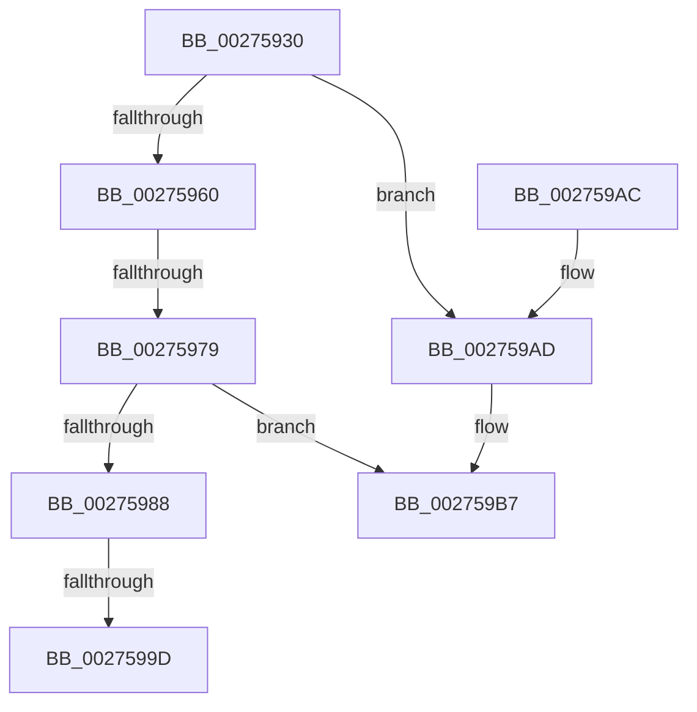

# MiResolvePageTablePage

- RVA: `0x00275930`–`0x002759BE` (길이 `142` bytes)
- VA: `0x0000000140275930`
- 실행 섹션: `.text`
- PDB 이름 있음: `예`; PDB Function 태그: `아니요`
- unwind 정보 RVA: `0x00065E74`
- 디코드: `41`개 명령, `142/142` bytes 표시
- 미해석 바이트: `0` (있으면 어셈블리에 `.byte`로 보존)

> 이 문서는 커널 이미지의 기계어와 PDB 기호를 분석해 생성했습니다. 4번과 5번은 함수 원형과 자료형을 바이너리 사용 방식에서 추정한 C 해석이며 원본 소스 복구 결과는 아닙니다.

## 1. Dependencies

- 직접 호출 지점: **1**; 고유 호출 대상: **1**
- 직접 호출자로 확인된 함수: **1**
- RIP 상대 이미지 참조: **0**

### Outgoing calls
- `0x0027597F` → [MiFastLockLeafPageTable](MiFastLockLeafPageTable_function_00276340.md) (function, `0x00276340`)

### Direct callers
- [MiUserFault](../32/MiUserFault_function_00329840.md) at `0x00329AC0`

### Static image references
- 디코드된 RIP-relative 메모리 참조가 없습니다.

## 2. Other-region calls and transfers

- 다른 실행 섹션으로 향하는 call: **0**
- call이 아닌 외부 분기/꼬리 이동: **2**
  - `0x00275973` → [sub_002760B0](Unknown_function_002760B0.md) (`tail-transfer`)
  - `0x00275997` → [sub_002762C2](Unknown_function_002762C2.md) (`tail-transfer`)

## 3. Assembly (complete function range)

```asm
00275930  48 89 4C 24 08                  mov qword ptr [rsp + 8], rcx
00275935  55                              push rbp
00275936  56                              push rsi
00275937  41 54                           push r12
00275939  41 56                           push r14
0027593B  41 57                           push r15
0027593D  48 83 EC 70                     sub rsp, 0x70
00275941  F6 41 45 01                     test byte ptr [rcx + 0x45], 1
00275945  48 8D 71 38                     lea rsi, [rcx + 0x38]
00275949  48 8B 2E                        mov rbp, qword ptr [rsi]
0027594C  4C 8B F1                        mov r14, rcx
0027594F  48 89 6C 24 48                  mov qword ptr [rsp + 0x48], rbp
00275954  49 BF 00 00 00 00 80 F6 FF FF   movabs r15, 0xfffff68000000000
0027595E  75 4D                           jne 0x1402759ad
00275960  48 8B 11                        mov rdx, qword ptr [rcx]
00275963  49 8B C7                        mov rax, r15
00275966  49 BC FF FF FF FF FF F6 FF FF   movabs r12, 0xfffff6ffffffffff
00275970  48 3B D0                        cmp rdx, rax
00275973  0F 83 37 07 00 00               jae 0x1402760b0
00275979  45 33 C0                        xor r8d, r8d
0027597C  48 8B CD                        mov rcx, rbp
0027597F  E8 BC 09 00 00                  call 0x140276340
00275984  85 C0                           test eax, eax
00275986  74 2F                           je 0x1402759b7
00275988  48 63 C8                        movsxd rcx, eax
0027598B  49 8B 54 CE 18                  mov rdx, qword ptr [r14 + rcx*8 + 0x18]
00275990  48 89 56 10                     mov qword ptr [rsi + 0x10], rdx
00275994  83 F8 01                        cmp eax, 1
00275997  0F 85 25 09 00 00               jne 0x1402762c2
0027599D  33 C0                           xor eax, eax
0027599F  48 83 C4 70                     add rsp, 0x70
002759A3  41 5F                           pop r15
002759A5  41 5E                           pop r14
002759A7  41 5C                           pop r12
002759A9  5E                              pop rsi
002759AA  5D                              pop rbp
002759AB  C3                              ret
002759AC  CC                              int3
002759AD  49 BC FF FF FF FF FF F6 FF FF   movabs r12, 0xfffff6ffffffffff
002759B7  45 33 C9                        xor r9d, r9d
002759BA  F6 46 0D 01                     test byte ptr [rsi + 0xd], 1
```

## 4. C-style interpretation (structured pseudocode)

```c
__int64 __fastcall MiResolvePageTablePage(__int64 a1, __int64 a2, int a3, int a4)
{
    __int64 result;
    __int64 v_rsp;
    unsigned __int64 v_stack_m50;
    unsigned __int64 v_stack_p8;

    v_stack_p8 = a1;
    v_rsp = (v_rsp) - (112);
    v_stack_m50 = *(unsigned __int64 *)(a1 + 56);
    if (((*(unsigned __int8 *)(a1 + 69)) & (1)) != 0) goto loc_002759AD;
    a3 = 0;
    result = MiFastLockLeafPageTable(*(unsigned __int64 *)(a1 + 56), *(unsigned __int64 *)(a1), a3, a4);
    if ((unsigned int)(result) == 0) goto loc_002759B7;
    *(unsigned __int64 *)(a1 + 56 + 16) = *(unsigned __int64 *)(a1 + (int)((unsigned int)(result)) * 8 + 24);
    result = 0;
    v_rsp = (v_rsp) + (112);
    return result;
loc_002759AD:
loc_002759B7:
    a4 = 0;
    return result;
}
```

## 5. (Beta) C Style

```c
int64_t MiResolvePageTablePage(void *Arg1, int64_t Arg2, int32_t Arg3, int32_t Arg4)
{
    uint8_t *arg1 = (uint8_t *)Arg1;

    int64_t result;
    int64_t local_rsp;
    uint64_t v_stack_m50;
    uint64_t v_stack_p8;

    v_stack_p8 = Arg1;
    local_rsp = (local_rsp) - (112);
    v_stack_m50 = *(uint64_t *)(arg1 + 0x38);
    if (((*(uint8_t *)(arg1 + 0x45)) & (1)) != 0) goto loc_002759AD;
    Arg3 = 0;
    result = MiFastLockLeafPageTable(*(uint64_t *)(arg1 + 0x38), *(uint64_t *)(arg1), Arg3, Arg4);
    if ((uint32_t)(result) == 0) goto loc_002759B7;
    *(uint64_t *)(arg1 + 0x38 + 0x10) = *(uint64_t *)(arg1 + (int32_t)((uint32_t)(result)) * 8 + 0x18);
    result = 0;
    local_rsp = (local_rsp) + (112);
    return result;
loc_002759AD:
loc_002759B7:
    Arg4 = 0;
    return result;
}
```

### 관측된 메모리 오프셋

구조체 형식이 확인되지 않은 접근은 인자 기준의 오프셋으로만 기록했습니다.

| 기준 인자 | 오프셋 표현 | 폭 (bit) | 접근 |
|---|---:|---:|---|
| `Arg1` | `+ 0x0` | `64` | `R` |
| `Arg1` | `+ 0xD` | `8` | `R` |
| `Arg1` | `+ 0x10` | `64` | `W` |
| `Arg1` | `+ 0x18 + rcx*8` | `64` | `R` |
| `Arg1` | `+ 0x38` | `64` | `R` |
| `Arg1` | `+ 0x45` | `8` | `R` |

## 6. Execution-region graph

[열기: 2D/3D 그래프와 함수 탐색 컨트롤 패널](../../../control-panel.html?section=text&rva=0x00275930&view=graph)

- 2D 그래프는 위에서 아래로 흐르고, 3D 그래프는 빈 공간을 드래그해 회전합니다. Shift+드래그는 이동, 휠은 확대·축소, 함수 노드 선택은 대상 보고서 이동입니다.

### Static fallback


