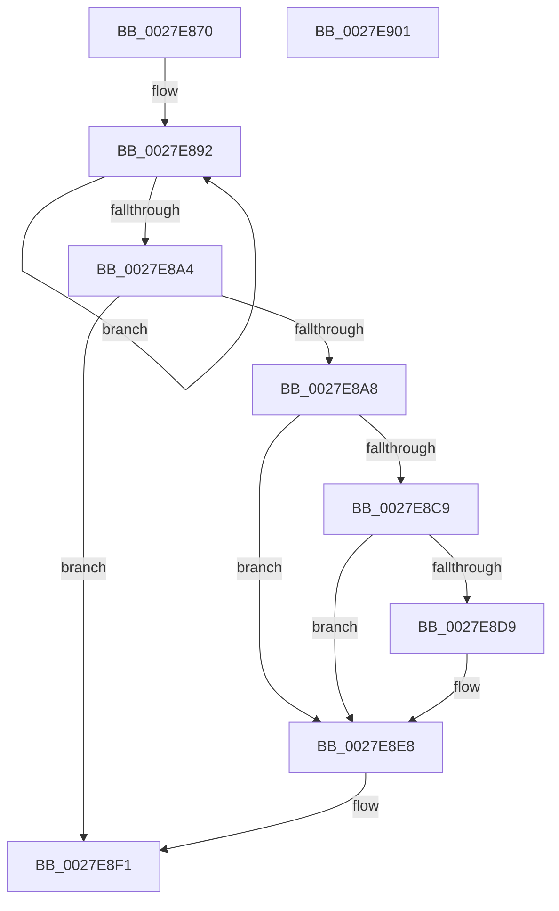

# MiSelfTrim

- RVA: `0x0027E870`–`0x0027E902` (길이 `146` bytes)
- VA: `0x000000014027E870`
- 실행 섹션: `.text`
- PDB 이름 있음: `예`; PDB Function 태그: `아니요`
- unwind 정보 RVA: `0x00060BC4`
- 디코드: `35`개 명령, `146/146` bytes 표시
- 미해석 바이트: `0` (있으면 어셈블리에 `.byte`로 보존)

> 이 문서는 커널 이미지의 기계어와 PDB 기호를 분석해 생성했습니다. 4번과 5번은 함수 원형과 자료형을 바이너리 사용 방식에서 추정한 C 해석이며 원본 소스 복구 결과는 아닙니다.

## 1. Dependencies

- 직접 호출 지점: **2**; 고유 호출 대상: **2**
- 직접 호출자로 확인된 함수: **1**
- RIP 상대 이미지 참조: **0**

### Outgoing calls
- `0x0027E8BA` → [MiForcedTrim](../34/MiForcedTrim_function_0034DC0C.md) (function, `0x0034DC0C`)
- `0x0027E8E3` → [MiReduceWs](MiReduceWs_function_0027E908.md) (function, `0x0027E908`)

### Direct callers
- [sub_0027D6EE](Unknown_function_0027D6EE.md) at `0x0027D702`

### Static image references
- 디코드된 RIP-relative 메모리 참조가 없습니다.

## 2. Other-region calls and transfers

- 다른 실행 섹션으로 향하는 call: **0**
- 별도 외부 분기/꼬리 이동을 확인하지 못했습니다.

## 3. Assembly (complete function range)

```asm
0027E870  48 89 5C 24 08                  mov qword ptr [rsp + 8], rbx
0027E875  48 89 74 24 10                  mov qword ptr [rsp + 0x10], rsi
0027E87A  57                              push rdi
0027E87B  48 83 EC 20                     sub rsp, 0x20
0027E87F  40 8A F2                        mov sil, dl
0027E882  48 8B D9                        mov rbx, rcx
0027E885  0F 0D 89 BC 00 00 00            prefetchw byte ptr [rcx + 0xbc]
0027E88C  8B 81 BC 00 00 00               mov eax, dword ptr [rcx + 0xbc]
0027E892  44 8B C0                        mov r8d, eax
0027E895  41 83 E0 FE                     and r8d, 0xfffffffe
0027E899  F0 44 0F B1 81 BC 00 00 00      lock cmpxchg dword ptr [rcx + 0xbc], r8d
0027E8A2  75 EE                           jne 0x14027e892
0027E8A4  A8 01                           test al, 1
0027E8A6  74 49                           je 0x14027e8f1
0027E8A8  65 48 8B 3C 25 88 01 00 00      mov rdi, qword ptr gs:[0x188]
0027E8B1  F0 0F BA AF A0 05 00 00 16      lock bts dword ptr [rdi + 0x5a0], 0x16
0027E8BA  E8 4D F3 0C 00                  call 0x14034dc0c
0027E8BF  8B 83 B8 00 00 00               mov eax, dword ptr [rbx + 0xb8]
0027E8C5  A8 40                           test al, 0x40
0027E8C7  74 1F                           je 0x14027e8e8
0027E8C9  48 8B 83 80 00 00 00            mov rax, qword ptr [rbx + 0x80]
0027E8D0  4C 8B 43 78                     mov r8, qword ptr [rbx + 0x78]
0027E8D4  49 3B C0                        cmp rax, r8
0027E8D7  76 0F                           jbe 0x14027e8e8
0027E8D9  49 83 C0 E8                     add r8, -0x18
0027E8DD  40 8A D6                        mov dl, sil
0027E8E0  48 8B CB                        mov rcx, rbx
0027E8E3  E8 20 00 00 00                  call 0x14027e908
0027E8E8  F0 0F BA B7 A0 05 00 00 16      lock btr dword ptr [rdi + 0x5a0], 0x16
0027E8F1  48 8B 5C 24 30                  mov rbx, qword ptr [rsp + 0x30]
0027E8F6  48 8B 74 24 38                  mov rsi, qword ptr [rsp + 0x38]
0027E8FB  48 83 C4 20                     add rsp, 0x20
0027E8FF  5F                              pop rdi
0027E900  C3                              ret
0027E901  CC                              int3
```

## 4. C-style interpretation (structured pseudocode)

```c
__int64 __fastcall MiSelfTrim(__int64 a1, unsigned __int8 a2)
{
    __int64 result;
    __int64 v_rsp;
    unsigned __int64 v_stack_p10;
    unsigned __int64 v_stack_p8;

    v_stack_p8 = v_rbx;
    v_stack_p10 = v_rsi;
    v_rsp = (v_rsp) - (32);
loc_0027E892:
    a3 = (unsigned int)(((unsigned int)((unsigned int)((unsigned int)(*(unsigned int *)(a1 + 188))))) & (0xFFFFFFFEULL));
    if (condition_is_not_equal) goto loc_0027E892;
    if ((((unsigned __int8)((unsigned int)(*(unsigned int *)(a1 + 188)))) & (1)) == 0) goto loc_0027E8F1;
    result = MiForcedTrim(a1, a2, a3, a4);
    if ((((unsigned __int8)((unsigned int)(*(unsigned int *)(a1 + 184)))) & (64)) == 0) goto loc_0027E8E8;
    result = *(unsigned __int64 *)(a1 + 128);
    if ((*(unsigned __int64 *)(a1 + 128)) >= = (*(unsigned __int64 *)(a1 + 120))) {
        a3 = (*(unsigned __int64 *)(a1 + 120)) + (-24);
        a2 = a2;
        a1 = a1;
        result = MiReduceWs(a1, a2, a3, a4);
    }
loc_0027E8F1:
    v_rsp = (v_rsp) + (32);
    return result;
}
```

## 5. (Beta) C Style

```c
int64_t MiSelfTrim(void *Arg1, uint8_t Arg2)
{
    uint8_t *arg1 = (uint8_t *)Arg1;

    int64_t result;
    int64_t local_rsp;
    uint64_t v_stack_p10;
    uint64_t v_stack_p8;

    v_stack_p8 = local_rbx;
    v_stack_p10 = local_rsi;
    local_rsp = (local_rsp) - (32);
loc_0027E892:
    a3 = (uint32_t)(((uint32_t)((uint32_t)((uint32_t)(*(uint32_t *)(arg1 + 0xBC))))) & (0xFFFFFFFEULL));
    if (condition_is_not_equal) goto loc_0027E892;
    if ((((uint8_t)((uint32_t)(*(uint32_t *)(arg1 + 0xBC)))) & (1)) == 0) goto loc_0027E8F1;
    result = MiForcedTrim(Arg1, Arg2, a3, a4);
    if ((((uint8_t)((uint32_t)(*(uint32_t *)(arg1 + 0xB8)))) & (64)) == 0) goto loc_0027E8E8;
    result = *(uint64_t *)(arg1 + 0x80);
    if ((*(uint64_t *)(arg1 + 0x80)) >= = (*(uint64_t *)(arg1 + 0x78))) {
        a3 = (*(uint64_t *)(arg1 + 0x78)) + (-24);
        Arg2 = Arg2;
        Arg1 = Arg1;
        result = MiReduceWs(Arg1, Arg2, a3, a4);
    }
loc_0027E8F1:
    local_rsp = (local_rsp) + (32);
    return result;
}
```

### 관측된 메모리 오프셋

구조체 형식이 확인되지 않은 접근은 인자 기준의 오프셋으로만 기록했습니다.

| 기준 인자 | 오프셋 표현 | 폭 (bit) | 접근 |
|---|---:|---:|---|
| `Arg1` | `+ 0x78` | `64` | `R` |
| `Arg1` | `+ 0x80` | `64` | `R` |
| `Arg1` | `+ 0xB8` | `32` | `R` |
| `Arg1` | `+ 0xBC` | `8` | `R` |
| `Arg1` | `+ 0xBC` | `32` | `R` |

## 6. Execution-region graph

[열기: 2D/3D 그래프와 함수 탐색 컨트롤 패널](../../../control-panel.html?section=text&rva=0x0027E870&view=graph)

- 2D 그래프는 위에서 아래로 흐르고, 3D 그래프는 빈 공간을 드래그해 회전합니다. Shift+드래그는 이동, 휠은 확대·축소, 함수 노드 선택은 대상 보고서 이동입니다.

### Static fallback


