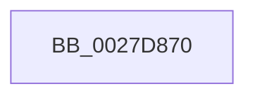

# MiUnlockFaultPageTable

- RVA: `0x0027D870`–`0x0027D88D` (길이 `29` bytes)
- VA: `0x000000014027D870`
- 실행 섹션: `.text`
- PDB 이름 있음: `예`; PDB Function 태그: `아니요`
- unwind 정보 RVA: `0x00066324`
- 디코드: `8`개 명령, `29/29` bytes 표시
- 미해석 바이트: `0` (있으면 어셈블리에 `.byte`로 보존)

> 이 문서는 커널 이미지의 기계어와 PDB 기호를 분석해 생성했습니다. 4번과 5번은 함수 원형과 자료형을 바이너리 사용 방식에서 추정한 C 해석이며 원본 소스 복구 결과는 아닙니다.

## 1. Dependencies

- 직접 호출 지점: **0**; 고유 호출 대상: **0**
- 직접 호출자로 확인된 함수: **6**
- RIP 상대 이미지 참조: **0**

### Outgoing calls
- 직접 디코드된 call 명령이 없습니다.

### Direct callers
- [sub_002759BE](Unknown_function_002759BE.md) at `0x00275BD4`
- [sub_0027F063](Unknown_function_0027F063.md) at `0x0027F0CF`
- [MiUnlockStealVm](../28/MiUnlockStealVm_function_0028EF40.md) at `0x0028EF6F`
- [MiUserFault](../32/MiUserFault_function_00329840.md) at `0x00329D6F`
- [sub_00347472](../34/Unknown_function_00347472.md) at `0x0034751C`
- [MiUnlockSystemVa](../34/MiUnlockSystemVa_function_0034B800.md) at `0x0034B81A`

### Static image references
- 디코드된 RIP-relative 메모리 참조가 없습니다.

## 2. Other-region calls and transfers

- 다른 실행 섹션으로 향하는 call: **0**
- call이 아닌 외부 분기/꼬리 이동: **1**
  - `0x0027D887` → [sub_0027D950](Unknown_function_0027D950.md) (`tail-transfer`)

## 3. Assembly (complete function range)

```asm
0027D870  48 89 5C 24 10                  mov qword ptr [rsp + 0x10], rbx
0027D875  57                              push rdi
0027D876  48 83 EC 30                     sub rsp, 0x30
0027D87A  48 8B 51 10                     mov rdx, qword ptr [rcx + 0x10]
0027D87E  48 8B D9                        mov rbx, rcx
0027D881  48 8B 39                        mov rdi, qword ptr [rcx]
0027D884  48 85 D2                        test rdx, rdx
0027D887  0F 84 C3 00 00 00               je 0x14027d950
```

## 4. C-style interpretation (structured pseudocode)

```c
void __fastcall MiUnlockFaultPageTable(__int64 a1)
{
    __int64 v_rsp;
    unsigned __int64 v_stack_p10;

    v_stack_p10 = v_rbx;
    v_rsp = (v_rsp) - (48);
}
```

## 5. (Beta) C Style

```c
void MiUnlockFaultPageTable(void *Arg1)
{
    uint8_t *arg1 = (uint8_t *)Arg1;

    int64_t local_rsp;
    uint64_t v_stack_p10;

    v_stack_p10 = local_rbx;
    local_rsp = (local_rsp) - (48);
}
```

### 관측된 메모리 오프셋

구조체 형식이 확인되지 않은 접근은 인자 기준의 오프셋으로만 기록했습니다.

| 기준 인자 | 오프셋 표현 | 폭 (bit) | 접근 |
|---|---:|---:|---|
| `Arg1` | `+ 0x0` | `64` | `R` |
| `Arg1` | `+ 0x10` | `64` | `R` |

## 6. Execution-region graph

[열기: 2D/3D 그래프와 함수 탐색 컨트롤 패널](../../../control-panel.html?section=text&rva=0x0027D870&view=graph)

- 2D 그래프는 위에서 아래로 흐르고, 3D 그래프는 빈 공간을 드래그해 회전합니다. Shift+드래그는 이동, 휠은 확대·축소, 함수 노드 선택은 대상 보고서 이동입니다.

### Static fallback


