# MiUnlockWorkingSetExclusive

- RVA: `0x0027EC70`–`0x0027EE75` (길이 `517` bytes)
- VA: `0x000000014027EC70`
- 실행 섹션: `.text`
- PDB 이름 있음: `예`; PDB Function 태그: `예`
- unwind 정보 RVA: `0x000664BC`
- 디코드: `127`개 명령, `517/517` bytes 표시
- 미해석 바이트: `0` (있으면 어셈블리에 `.byte`로 보존)

> 이 문서는 커널 이미지의 기계어와 PDB 기호를 분석해 생성했습니다. 4번과 5번은 함수 원형과 자료형을 바이너리 사용 방식에서 추정한 C 해석이며 원본 소스 복구 결과는 아닙니다.

## 1. Dependencies

- 직접 호출 지점: **11**; 고유 호출 대상: **8**
- 직접 호출자로 확인된 함수: **49**
- RIP 상대 이미지 참조: **4**

### Outgoing calls
- `0x0027ECE5` → [ExpInterlockedFlushSList](../6B/ExpInterlockedFlushSList_function_006BA5F0.md) (function, `0x006BA5F0`)
- `0x0027ED13` → [MiCheckProcessShadow](MiCheckProcessShadow_function_0027E4C0.md) (function, `0x0027E4C0`)
- `0x0027ED65` → [KiLowerIrqlProcessIrqlFlags](../4F/KiLowerIrqlProcessIrqlFlags_function_004F5698.md) (function, `0x004F5698`)
- `0x0027EDB9` → [ExFreePoolWithTag](../../poolcode/B8/ExFreePoolWithTag_function_00B82870.md) (function, `0x00B82870`)
- `0x0027EDDE` → [ExpReleaseSpinLockExclusiveFromDpcLevelInstrumented](../2C/ExpReleaseSpinLockExclusiveFromDpcLevelInstrumented_function_002C0F44.md) (function, `0x002C0F44`)
- `0x0027EDF1` → [MiLockWorkingSetShared](MiLockWorkingSetShared_function_0027CBF0.md) (function, `0x0027CBF0`)
- `0x0027EDFD` → [MiUnlockWorkingSetShared](MiUnlockWorkingSetShared_function_0027D690.md) (function, `0x0027D690`)
- `0x0027EE1D` → [ExpReleaseSpinLockExclusiveFromDpcLevelInstrumented](../2C/ExpReleaseSpinLockExclusiveFromDpcLevelInstrumented_function_002C0F44.md) (function, `0x002C0F44`)
- `0x0027EE49` → [ExpReleaseSpinLockExclusiveFromDpcLevelInstrumented](../2C/ExpReleaseSpinLockExclusiveFromDpcLevelInstrumented_function_002C0F44.md) (function, `0x002C0F44`)
- `0x0027EE53` → [MiLockWorkingSetSharedAtDpc](../23/MiLockWorkingSetSharedAtDpc_function_00239574.md) (function, `0x00239574`)
- `0x0027EE5F` → [MiUnlockWorkingSetShared](MiUnlockWorkingSetShared_function_0027D690.md) (function, `0x0027D690`)

### Direct callers
- [MmStealTopLevelPage](../22/MmStealTopLevelPage_function_002281E0.md) at `0x00228242`
- [MiHandleForkTransitionPte](../22/MiHandleForkTransitionPte_function_0022D34C.md) at `0x0022D9ED`
- [MiCloneVads](../22/MiCloneVads_function_0022DC1C.md) at `0x0022DD95`
- [MiCloneVads](../22/MiCloneVads_function_0022DC1C.md) at `0x0022DF28`
- [MiCloneVads](../22/MiCloneVads_function_0022DC1C.md) at `0x0022E172`
- [MiCloneVads](../22/MiCloneVads_function_0022DC1C.md) at `0x0022E1A0`
- [MiCloneVads](../22/MiCloneVads_function_0022DC1C.md) at `0x0022E220`
- [MiBuildForkPte](../22/MiBuildForkPte_function_0022E32C.md) at `0x0022EB9C`
- [sub_0023A18A](../23/Unknown_function_0023A18A.md) at `0x0023A18A`
- [sub_0027BF19](Unknown_function_0027BF19.md) at `0x0027BF37`
- [MiReleaseFaultState](MiReleaseFaultState_function_0027D290.md) at `0x0027D624`
- [sub_0027F36E](Unknown_function_0027F36E.md) at `0x0027F36E`
- [MiMakeSystemAddressValid](MiMakeSystemAddressValid_function_0027FF70.md) at `0x002800C6`
- [sub_0028F35E](../28/Unknown_function_0028F35E.md) at `0x0028F35E`
- [MiRemoveFromSystemSpace](../29/MiRemoveFromSystemSpace_function_002962FC.md) at `0x00296419`
- [MiBeginProcessClean](../2A/MiBeginProcessClean_function_002A473C.md) at `0x002A47DC`
- [MiPerformVadSplitting](../2A/MiPerformVadSplitting_function_002A5A80.md) at `0x002A5C3B`
- [MiCreateCloneChain](../2A/MiCreateCloneChain_function_002A8EE0.md) at `0x002A8FBD`
- [MiDeleteRotateAndStopFaults](../2A/MiDeleteRotateAndStopFaults_function_002A9540.md) at `0x002A95B2`
- [MiFastTrimWorkingSet](../2A/MiFastTrimWorkingSet_function_002AD420.md) at `0x002AD84D`
- [MiOutSwapWorkingSet](../2C/MiOutSwapWorkingSet_function_002C1464.md) at `0x002C1502`
- [MiUserFault](../32/MiUserFault_function_00329840.md) at `0x0032A034`
- [MiCommitExistingVad](../32/MiCommitExistingVad_function_0032A860.md) at `0x0032AF60`
- [MiCommitExistingVad](../32/MiCommitExistingVad_function_0032A860.md) at `0x0032AFC6`
- [MiUnlockSystemVa](../34/MiUnlockSystemVa_function_0034B800.md) at `0x0034B844`
- [MiSoftFaultMappedView](../36/MiSoftFaultMappedView_function_00365364.md) at `0x00365887`
- [MiSoftFaultMappedView](../36/MiSoftFaultMappedView_function_00365364.md) at `0x00365895`
- [MiInsertInSystemSpace](../3B/MiInsertInSystemSpace_function_003B2F5C.md) at `0x003B3276`
- [MiMapWithLargePages](../3B/MiMapWithLargePages_function_003B6624.md) at `0x003B6908`
- [MiReleaseOutSwappedProcessCommit](../3C/MiReleaseOutSwappedProcessCommit_function_003C8320.md) at `0x003C840E`
- [MiReleaseOutSwappedProcessCommit](../3C/MiReleaseOutSwappedProcessCommit_function_003C8320.md) at `0x003C859D`
- [MiMapUserLargePages](../3D/MiMapUserLargePages_function_003D26F4.md) at `0x003D2CBF`
- [MiMapUserLargePages](../3D/MiMapUserLargePages_function_003D26F4.md) at `0x003D2D76`
- [MiDeleteProcessShadow](../46/MiDeleteProcessShadow_function_00465BF8.md) at `0x00465D1C`
- [MiDeleteProcessShadow](../46/MiDeleteProcessShadow_function_00465BF8.md) at `0x00465E6C`
- [MiCleanWorkingSet](../47/MiCleanWorkingSet_function_004740C4.md) at `0x00474122`
- [MmAdjustWorkingSetSizeEx](../47/MmAdjustWorkingSetSizeEx_function_0047D8D4.md) at `0x0047DA4A`
- [MmEnforceWorkingSetLimit](../48/MmEnforceWorkingSetLimit_function_004881E0.md) at `0x004882FC`
- [MiUnlockFaultWorkingSet](../49/MiUnlockFaultWorkingSet_function_00498664.md) at `0x00498685`
- [MiRotateComplete](../4B/MiRotateComplete_function_004B0588.md) at `0x004B05DB`
- [MiCloneCaptureVadCommit](../4B/MiCloneCaptureVadCommit_function_004B4554.md) at `0x004B4612`
- [MiCloneCaptureVadCommit](../4B/MiCloneCaptureVadCommit_function_004B4554.md) at `0x004B46BD`
- [MiLockDownWorkingSet](../4D/MiLockDownWorkingSet_function_004D4950.md) at `0x004D4A41`
- [MiLockWorkingSetForLargeMapping](../4E/MiLockWorkingSetForLargeMapping_function_004E3110.md) at `0x004E31B1`
- [ExpShareAddressSpaceWithDevice](../65/ExpShareAddressSpaceWithDevice_function_0065B528.md) at `0x0065B9B5`
- [MiClearCommitReleaseState](../66/MiClearCommitReleaseState_function_0066EF4C.md) at `0x0066EF80`
- [MiReAcquireOutSwappedProcessCommit](../66/MiReAcquireOutSwappedProcessCommit_function_0066F598.md) at `0x0066F6A9`
- [MiReAcquireOutSwappedProcessCommit](../66/MiReAcquireOutSwappedProcessCommit_function_0066F598.md) at `0x0066F72B`
- [MiReleaseCommitForResetPages](../66/MiReleaseCommitForResetPages_function_0066FAF8.md) at `0x0066FC11`
- [MmReleaseCommitForMemResetPages](../66/MmReleaseCommitForMemResetPages_function_0066FDCC.md) at `0x0066FEDF`
- [MmReleaseCommitForMemResetPages](../66/MmReleaseCommitForMemResetPages_function_0066FDCC.md) at `0x0066FF1B`
- [MmSetCommitReleaseEligibility](../66/MmSetCommitReleaseEligibility_function_0066FF84.md) at `0x0067003D`
- [MiFreedUnusedPfnPagesDpc](../67/MiFreedUnusedPfnPagesDpc_function_00672378.md) at `0x00672666`
- [MiSetTrimWhileAgingState](../67/MiSetTrimWhileAgingState_function_0067ED14.md) at `0x0067EDD3`
- [MiBeginHoldingDirtyFaults](../68/MiBeginHoldingDirtyFaults_function_00682F90.md) at `0x00682FF4`
- [MiFinishHoldingDirtyFaults](../68/MiFinishHoldingDirtyFaults_function_006835F8.md) at `0x00683648`
- [sub_006D715C](../6D/Unknown_function_006D715C.md) at `0x006D71B7`
- [sub_006D7206](../6D/Unknown_function_006D7206.md) at `0x006D722E`
- [sub_006E4786](../6E/Unknown_function_006E4786.md) at `0x006E47BE`
- [sub_006F79AC](../6F/Unknown_function_006F79AC.md) at `0x006F79CB`
- [sub_006F9816](../6F/Unknown_function_006F9816.md) at `0x006F9824`

### Static image references
- `0x0027ECAF` → RVA `0x00E38840` (`.data`; read)
- `0x0027ED24` → RVA `0x00FC6B06` (`ALMOSTRO`; read)
- `0x0027ED54` → RVA `0x00FC6D20` (`ALMOSTRO`; read)
- `0x0027EDC8` → RVA `0x00F0DE58` (`.data`; read)

## 2. Other-region calls and transfers

- 다른 실행 섹션으로 향하는 call: **1**
  - `0x0027EDB9` → [ExFreePoolWithTag](../../poolcode/B8/ExFreePoolWithTag_function_00B82870.md) (`.text` → `POOLCODE`)
- call이 아닌 외부 분기/꼬리 이동: **1**
  - `0x0027EE70` → [sub_006DA0EA](../6D/Unknown_function_006DA0EA.md) (`tail-transfer`)

## 3. Assembly (complete function range)

```asm
0027EC70  48 89 5C 24 08                  mov qword ptr [rsp + 8], rbx
0027EC75  48 89 6C 24 10                  mov qword ptr [rsp + 0x10], rbp
0027EC7A  48 89 74 24 18                  mov qword ptr [rsp + 0x18], rsi
0027EC7F  57                              push rdi
0027EC80  41 54                           push r12
0027EC82  41 55                           push r13
0027EC84  41 56                           push r14
0027EC86  41 57                           push r15
0027EC88  48 83 EC 20                     sub rsp, 0x20
0027EC8C  48 8B F1                        mov rsi, rcx
0027EC8F  44 0F B6 E2                     movzx r12d, dl
0027EC93  8B 89 B8 00 00 00               mov ecx, dword ptr [rcx + 0xb8]
0027EC99  45 33 ED                        xor r13d, r13d
0027EC9C  45 8B FD                        mov r15d, r13d
0027EC9F  8B 86 B8 00 00 00               mov eax, dword ptr [rsi + 0xb8]
0027ECA5  24 0F                           and al, 0xf
0027ECA7  3C 01                           cmp al, 1
0027ECA9  0F 85 78 01 00 00               jne 0x14027ee27
0027ECAF  4C 8D 35 8A 9B BB 00            lea r14, [rip + 0xbb9b8a]
0027ECB6  F6 C1 0F                        test cl, 0xf
0027ECB9  75 3B                           jne 0x14027ecf6
0027ECBB  4C 39 6E 10                     cmp qword ptr [rsi + 0x10], r13
0027ECBF  74 35                           je 0x14027ecf6
0027ECC1  65 48 8B 04 25 88 01 00 00      mov rax, qword ptr gs:[0x188]
0027ECCA  48 8B 98 B8 00 00 00            mov rbx, qword ptr [rax + 0xb8]
0027ECD1  48 8B 8B 10 04 00 00            mov rcx, qword ptr [rbx + 0x410]
0027ECD8  48 81 C1 30 04 00 00            add rcx, 0x430
0027ECDF  66 44 39 29                     cmp word ptr [rcx], r13w
0027ECE3  74 11                           je 0x14027ecf6
0027ECE5  E8 06 B9 43 00                  call 0x1406ba5f0
0027ECEA  48 8B F8                        mov rdi, rax
0027ECED  48 85 C0                        test rax, rax
0027ECF0  0F 85 73 01 00 00               jne 0x14027ee69
0027ECF6  65 48 8B 04 25 88 01 00 00      mov rax, qword ptr gs:[0x188]
0027ECFF  BA 02 00 00 00                  mov edx, 2
0027ED04  48 8B CE                        mov rcx, rsi
0027ED07  8B A8 A0 05 00 00               mov ebp, dword ptr [rax + 0x5a0]
0027ED0D  81 E5 00 00 40 00               and ebp, 0x400000
0027ED13  E8 A8 F7 FF FF                  call 0x14027e4c0
0027ED18  4D 8B 36                        mov r14, qword ptr [r14]
0027ED1B  BF 03 00 00 00                  mov edi, 3
0027ED20  49 8D 5E 40                     lea rbx, [r14 + 0x40]
0027ED24  F6 05 DB 7D D4 00 01            test byte ptr [rip + 0xd47ddb], 1
0027ED2B  0F 85 97 00 00 00               jne 0x14027edc8
0027ED31  44 89 2B                        mov dword ptr [rbx], r13d
0027ED34  48 83 C3 40                     add rbx, 0x40
0027ED38  48 83 EF 01                     sub rdi, 1
0027ED3C  75 E6                           jne 0x14027ed24
0027ED3E  41 80 FC 11                     cmp r12b, 0x11
0027ED42  74 5B                           je 0x14027ed9f
0027ED44  F6 05 BB 7D D4 00 01            test byte ptr [rip + 0xd47dbb], 1
0027ED4B  0F 85 B6 00 00 00               jne 0x14027ee07
0027ED51  45 89 2E                        mov dword ptr [r14], r13d
0027ED54  44 39 2D C5 7F D4 00            cmp dword ptr [rip + 0xd47fc5], r13d
0027ED5B  74 0D                           je 0x14027ed6a
0027ED5D  44 0F 20 C1                     mov rcx, cr8
0027ED61  41 0F B6 D4                     movzx edx, r12b
0027ED65  E8 2E 69 27 00                  call 0x1404f5698
0027ED6A  45 0F 22 C4                     mov cr8, r12
0027ED6E  4D 85 FF                        test r15, r15
0027ED71  75 3E                           jne 0x14027edb1
0027ED73  85 ED                           test ebp, ebp
0027ED75  75 0A                           jne 0x14027ed81
0027ED77  8B 86 BC 00 00 00               mov eax, dword ptr [rsi + 0xbc]
0027ED7D  A8 03                           test al, 3
0027ED7F  75 67                           jne 0x14027ede8
0027ED81  48 8B 5C 24 50                  mov rbx, qword ptr [rsp + 0x50]
0027ED86  48 8B 6C 24 58                  mov rbp, qword ptr [rsp + 0x58]
0027ED8B  48 8B 74 24 60                  mov rsi, qword ptr [rsp + 0x60]
0027ED90  48 83 C4 20                     add rsp, 0x20
0027ED94  41 5F                           pop r15
0027ED96  41 5E                           pop r14
0027ED98  41 5D                           pop r13
0027ED9A  41 5C                           pop r12
0027ED9C  5F                              pop rdi
0027ED9D  C3                              ret
0027ED9E  CC                              int3
0027ED9F  F6 05 60 7D D4 00 01            test byte ptr [rip + 0xd47d60], 1
0027EDA6  0F 85 87 00 00 00               jne 0x14027ee33
0027EDAC  45 89 2E                        mov dword ptr [r14], r13d
0027EDAF  EB BD                           jmp 0x14027ed6e
0027EDB1  49 8B 1F                        mov rbx, qword ptr [r15]
0027EDB4  33 D2                           xor edx, edx
0027EDB6  49 8B CF                        mov rcx, r15
0027EDB9  E8 B2 3A 90 00                  call 0x140b82870
0027EDBE  4C 8B FB                        mov r15, rbx
0027EDC1  48 85 DB                        test rbx, rbx
0027EDC4  74 AD                           je 0x14027ed73
0027EDC6  EB E9                           jmp 0x14027edb1
0027EDC8  8B 05 8A F0 C8 00               mov eax, dword ptr [rip + 0xc8f08a]
0027EDCE  85 C0                           test eax, eax
0027EDD0  0F 85 5B FF FF FF               jne 0x14027ed31
0027EDD6  48 8B 54 24 48                  mov rdx, qword ptr [rsp + 0x48]
0027EDDB  48 8B CB                        mov rcx, rbx
0027EDDE  E8 61 21 04 00                  call 0x1402c0f44
0027EDE3  E9 4C FF FF FF                  jmp 0x14027ed34
0027EDE8  48 8B CE                        mov rcx, rsi
0027EDEB  41 80 FC 11                     cmp r12b, 0x11
0027EDEF  74 62                           je 0x14027ee53
0027EDF1  E8 FA DD FF FF                  call 0x14027cbf0
0027EDF6  41 0F B6 D4                     movzx edx, r12b
0027EDFA  48 8B CE                        mov rcx, rsi
0027EDFD  E8 8E E8 FF FF                  call 0x14027d690
0027EE02  E9 7A FF FF FF                  jmp 0x14027ed81
0027EE07  8B 05 4B F0 C8 00               mov eax, dword ptr [rip + 0xc8f04b]
0027EE0D  85 C0                           test eax, eax
0027EE0F  0F 85 3C FF FF FF               jne 0x14027ed51
0027EE15  48 8B 54 24 48                  mov rdx, qword ptr [rsp + 0x48]
0027EE1A  49 8B CE                        mov rcx, r14
0027EE1D  E8 22 21 04 00                  call 0x1402c0f44
0027EE22  E9 2D FF FF FF                  jmp 0x14027ed54
0027EE27  4C 8D B6 C0 00 00 00            lea r14, [rsi + 0xc0]
0027EE2E  E9 83 FE FF FF                  jmp 0x14027ecb6
0027EE33  8B 05 1F F0 C8 00               mov eax, dword ptr [rip + 0xc8f01f]
0027EE39  85 C0                           test eax, eax
0027EE3B  0F 85 6B FF FF FF               jne 0x14027edac
0027EE41  48 8B 54 24 48                  mov rdx, qword ptr [rsp + 0x48]
0027EE46  49 8B CE                        mov rcx, r14
0027EE49  E8 F6 20 04 00                  call 0x1402c0f44
0027EE4E  E9 1B FF FF FF                  jmp 0x14027ed6e
0027EE53  E8 1C A7 FB FF                  call 0x140239574
0027EE58  41 0F B6 D4                     movzx edx, r12b
0027EE5C  48 8B CE                        mov rcx, rsi
0027EE5F  E8 2C E8 FF FF                  call 0x14027d690
0027EE64  E9 18 FF FF FF                  jmp 0x14027ed81
0027EE69  48 8D AB 80 02 00 00            lea rbp, [rbx + 0x280]
0027EE70  E9 75 B2 45 00                  jmp 0x1406da0ea
```

## 4. C-style interpretation (structured pseudocode)

```c
__int64 __fastcall MiUnlockWorkingSetExclusive(__int64 a1, unsigned __int8 a2)
{
    __int64 result;
    __int64 v_r13;
    __int64 v_rbp;
    __int64 v_rbx;
    __int64 v_rdi;
    __int64 v_rsp;
    unsigned __int64 v_stack_p10;
    unsigned __int64 v_stack_p18;
    unsigned __int64 v_stack_p48;
    unsigned __int64 v_stack_p8;

    v_stack_p8 = v_rbx;
    v_stack_p10 = v_rbp;
    v_stack_p18 = v_rsi;
    v_rsp = (v_rsp) - (32);
    v_r13 = 0;
    result = (unsigned __int8)(((unsigned int)(*(unsigned int *)(a1 + 184))) & (15));
    if (((unsigned __int8)(result)) != 1) goto loc_0027EE27;
loc_0027ECB6:
    if ((((unsigned __int8)((unsigned int)(*(unsigned int *)(a1 + 184)))) & (15)) != 0) goto loc_0027ECF6;
    if ((*(unsigned __int64 *)(a1 + 16)) == 0) goto loc_0027ECF6;
    a1 = (*(unsigned __int64 *)(*(unsigned __int64 *)(*(unsigned __int64 *)(gs_base + (0 + 392)) + 184) + 1040)) + (0x430ULL);
    if ((*(unsigned __int16 *)(a1)) == 0) goto loc_0027ECF6;
    result = ExpInterlockedFlushSList(a1, a2, a3, a4);
    if (result != 0) goto loc_0027EE69;
loc_0027ECF6:
    v_rbp = (unsigned int)(((unsigned int)(*(unsigned int *)(*(unsigned __int64 *)(gs_base + (0 + 392)) + 1440))) & (0x400000ULL));
    result = MiCheckProcessShadow(a1, 2, a3, a4);
loc_0027ED24:
    if (((*(unsigned __int8 *)(v_rip + 13925851)) & (1)) != 0) goto loc_0027EDC8;
loc_0027ED31:
    *(unsigned int *)(*(unsigned __int64 *)(v_rip + 12295050) + 64) = 0;
loc_0027ED34:
    v_rbx = (*(unsigned __int64 *)(v_rip + 12295050) + 64) + (64);
    v_rdi = (3) - (1);
    if (condition_is_not_equal) goto loc_0027ED24;
    if (a2 == 17) goto loc_0027ED9F;
    if (((*(unsigned __int8 *)(v_rip + 13925819)) & (1)) != 0) goto loc_0027EE07;
loc_0027ED51:
    *(unsigned int *)(*(unsigned __int64 *)(v_rip + 12295050)) = 0;
loc_0027ED54:
    if ((*(unsigned int *)(v_rip + 13926341)) != 0) {
        a1 = v_cr8;
        a2 = a2;
        result = KiLowerIrqlProcessIrqlFlags(a1, a2, a3, a4);
    }
loc_0027ED6E:
    if (0 != 0) goto loc_0027EDB1;
loc_0027ED73:
    if ((unsigned int)(v_rbp) != 0) goto loc_0027ED81;
    if ((((unsigned __int8)((unsigned int)(*(unsigned int *)(a1 + 188)))) & (3)) != 0) goto loc_0027EDE8;
loc_0027ED81:
    v_rsp = (v_rsp) + (32);
    return (unsigned int)(*(unsigned int *)(a1 + 188));
loc_0027ED9F:
    if (((*(unsigned __int8 *)(v_rip + 13925728)) & (1)) != 0) goto loc_0027EE33;
loc_0027EDAC:
    *(unsigned int *)(*(unsigned __int64 *)(v_rip + 12295050)) = 0;
    goto loc_0027ED6E;
loc_0027EDB1:
    a2 = 0;
    result = ExFreePoolWithTag(0, a2, a3, a4);
    if (*(unsigned __int64 *)(0) == 0) goto loc_0027ED73;
    goto loc_0027EDB1;
loc_0027EDC8:
    if ((unsigned int)((unsigned int)(*(unsigned int *)(v_rip + 13168778))) != 0) goto loc_0027ED31;
    result = ExpReleaseSpinLockExclusiveFromDpcLevelInstrumented(*(unsigned __int64 *)(0), v_stack_p48, a3, a4);
    goto loc_0027ED34;
loc_0027EDE8:
    if (0 == 17) goto loc_0027EE53;
    result = MiLockWorkingSetShared(v_stack_p18, v_stack_p48, a3, a4);
    result = MiUnlockWorkingSetShared(v_stack_p18, 0, a3, a4);
    goto loc_0027ED81;
loc_0027EE07:
    if ((unsigned int)((unsigned int)(*(unsigned int *)(v_rip + 13168715))) != 0) goto loc_0027ED51;
    result = ExpReleaseSpinLockExclusiveFromDpcLevelInstrumented(*(unsigned __int64 *)(v_rip + 12295050), v_stack_p48, a3, a4);
    goto loc_0027ED54;
loc_0027EE27:
    goto loc_0027ECB6;
loc_0027EE33:
    if ((unsigned int)((unsigned int)(*(unsigned int *)(v_rip + 13168671))) != 0) goto loc_0027EDAC;
    result = ExpReleaseSpinLockExclusiveFromDpcLevelInstrumented(v_stack_p18 + 192, v_stack_p48, a3, a4);
    goto loc_0027ED6E;
loc_0027EE53:
    result = MiLockWorkingSetSharedAtDpc(v_stack_p18 + 192, v_stack_p48, a3, a4);
    result = MiUnlockWorkingSetShared(v_stack_p18, 0, a3, a4);
    goto loc_0027ED81;
loc_0027EE69:
}
```

## 5. (Beta) C Style

```c
int64_t MiUnlockWorkingSetExclusive(void *Arg1, uint8_t Arg2)
{
    uint8_t *arg1 = (uint8_t *)Arg1;

    int64_t result;
    int64_t local_r13;
    int64_t local_rbp;
    int64_t local_rbx;
    int64_t local_rdi;
    int64_t local_rsp;
    uint64_t v_stack_p10;
    uint64_t v_stack_p18;
    uint64_t v_stack_p48;
    uint64_t v_stack_p8;

    v_stack_p8 = local_rbx;
    v_stack_p10 = local_rbp;
    v_stack_p18 = local_rsi;
    local_rsp = (local_rsp) - (32);
    local_r13 = 0;
    result = (uint8_t)(((uint32_t)(*(uint32_t *)(arg1 + 0xB8))) & (15));
    if (((uint8_t)(result)) != 1) goto loc_0027EE27;
loc_0027ECB6:
    if ((((uint8_t)((uint32_t)(*(uint32_t *)(arg1 + 0xB8)))) & (15)) != 0) goto loc_0027ECF6;
    if ((*(uint64_t *)(arg1 + 0x10)) == 0) goto loc_0027ECF6;
    Arg1 = (*(uint64_t *)(*(uint64_t *)(*(uint64_t *)(gs_base + (0 + 0x188)) + 0xB8) + 0x410)) + (0x430ULL);
    if ((*(uint16_t *)(arg1)) == 0) goto loc_0027ECF6;
    result = ExpInterlockedFlushSList(Arg1, Arg2, a3, a4);
    if (result != 0) goto loc_0027EE69;
loc_0027ECF6:
    local_rbp = (uint32_t)(((uint32_t)(*(uint32_t *)(*(uint64_t *)(gs_base + (0 + 0x188)) + 0x5A0))) & (0x400000ULL));
    result = MiCheckProcessShadow(Arg1, 2, a3, a4);
loc_0027ED24:
    if (((*(uint8_t *)(v_rip + 0xD47DDB)) & (1)) != 0) goto loc_0027EDC8;
loc_0027ED31:
    *(uint32_t *)(*(uint64_t *)(v_rip + 0xBB9B8A) + 0x40) = 0;
loc_0027ED34:
    local_rbx = (*(uint64_t *)(v_rip + 0xBB9B8A) + 64) + (64);
    local_rdi = (3) - (1);
    if (condition_is_not_equal) goto loc_0027ED24;
    if (Arg2 == 17) goto loc_0027ED9F;
    if (((*(uint8_t *)(v_rip + 0xD47DBB)) & (1)) != 0) goto loc_0027EE07;
loc_0027ED51:
    *(uint32_t *)(*(uint64_t *)(v_rip + 0xBB9B8A)) = 0;
loc_0027ED54:
    if ((*(uint32_t *)(v_rip + 0xD47FC5)) != 0) {
        Arg1 = v_cr8;
        Arg2 = Arg2;
        result = KiLowerIrqlProcessIrqlFlags(Arg1, Arg2, a3, a4);
    }
loc_0027ED6E:
    if (0 != 0) goto loc_0027EDB1;
loc_0027ED73:
    if ((uint32_t)(local_rbp) != 0) goto loc_0027ED81;
    if ((((uint8_t)((uint32_t)(*(uint32_t *)(arg1 + 0xBC)))) & (3)) != 0) goto loc_0027EDE8;
loc_0027ED81:
    local_rsp = (local_rsp) + (32);
    return (uint32_t)(*(uint32_t *)(arg1 + 0xBC));
loc_0027ED9F:
    if (((*(uint8_t *)(v_rip + 0xD47D60)) & (1)) != 0) goto loc_0027EE33;
loc_0027EDAC:
    *(uint32_t *)(*(uint64_t *)(v_rip + 0xBB9B8A)) = 0;
    goto loc_0027ED6E;
loc_0027EDB1:
    Arg2 = 0;
    result = ExFreePoolWithTag(0, Arg2, a3, a4);
    if (*(uint64_t *)(0) == 0) goto loc_0027ED73;
    goto loc_0027EDB1;
loc_0027EDC8:
    if ((uint32_t)((uint32_t)(*(uint32_t *)(v_rip + 0xC8F08A))) != 0) goto loc_0027ED31;
    result = ExpReleaseSpinLockExclusiveFromDpcLevelInstrumented(*(uint64_t *)(0), v_stack_p48, a3, a4);
    goto loc_0027ED34;
loc_0027EDE8:
    if (0 == 17) goto loc_0027EE53;
    result = MiLockWorkingSetShared(v_stack_p18, v_stack_p48, a3, a4);
    result = MiUnlockWorkingSetShared(v_stack_p18, 0, a3, a4);
    goto loc_0027ED81;
loc_0027EE07:
    if ((uint32_t)((uint32_t)(*(uint32_t *)(v_rip + 0xC8F04B))) != 0) goto loc_0027ED51;
    result = ExpReleaseSpinLockExclusiveFromDpcLevelInstrumented(*(uint64_t *)(v_rip + 0xBB9B8A), v_stack_p48, a3, a4);
    goto loc_0027ED54;
loc_0027EE27:
    goto loc_0027ECB6;
loc_0027EE33:
    if ((uint32_t)((uint32_t)(*(uint32_t *)(v_rip + 0xC8F01F))) != 0) goto loc_0027EDAC;
    result = ExpReleaseSpinLockExclusiveFromDpcLevelInstrumented(v_stack_p18 + 192, v_stack_p48, a3, a4);
    goto loc_0027ED6E;
loc_0027EE53:
    result = MiLockWorkingSetSharedAtDpc(v_stack_p18 + 192, v_stack_p48, a3, a4);
    result = MiUnlockWorkingSetShared(v_stack_p18, 0, a3, a4);
    goto loc_0027ED81;
loc_0027EE69:
}
```

### 관측된 메모리 오프셋

구조체 형식이 확인되지 않은 접근은 인자 기준의 오프셋으로만 기록했습니다.

| 기준 인자 | 오프셋 표현 | 폭 (bit) | 접근 |
|---|---:|---:|---|
| `Arg1` | `+ 0x10` | `64` | `R` |
| `Arg1` | `+ 0xB8` | `32` | `R` |
| `Arg1` | `+ 0xBC` | `32` | `R` |
| `Arg1` | `+ 0xC0` | `64` | `R` |

## 6. Execution-region graph

[열기: 2D/3D 그래프와 함수 탐색 컨트롤 패널](../../../control-panel.html?section=text&rva=0x0027EC70&view=graph)

- 2D 그래프는 위에서 아래로 흐르고, 3D 그래프는 빈 공간을 드래그해 회전합니다. Shift+드래그는 이동, 휠은 확대·축소, 함수 노드 선택은 대상 보고서 이동입니다.

### Static fallback

```mermaid
flowchart TD
  bb_0027EC70[BB_0027EC70]
  bb_0027ECAF[BB_0027ECAF]
  bb_0027ECB6[BB_0027ECB6]
  bb_0027ECBB[BB_0027ECBB]
  bb_0027ECC1[BB_0027ECC1]
  bb_0027ECE5[BB_0027ECE5]
  bb_0027ECF6[BB_0027ECF6]
  bb_0027ED24[BB_0027ED24]
  bb_0027ED31[BB_0027ED31]
  bb_0027ED34[BB_0027ED34]
  bb_0027ED3E[BB_0027ED3E]
  bb_0027ED44[BB_0027ED44]
  bb_0027ED51[BB_0027ED51]
  bb_0027ED54[BB_0027ED54]
  bb_0027ED5D[BB_0027ED5D]
  bb_0027ED6A[BB_0027ED6A]
  bb_0027ED6E[BB_0027ED6E]
  bb_0027ED73[BB_0027ED73]
  bb_0027ED77[BB_0027ED77]
  bb_0027ED81[BB_0027ED81]
  bb_0027ED9E[BB_0027ED9E]
  bb_0027ED9F[BB_0027ED9F]
  bb_0027EDAC[BB_0027EDAC]
  bb_0027EDB1[BB_0027EDB1]
  bb_0027EDC6[BB_0027EDC6]
  bb_0027EDC8[BB_0027EDC8]
  bb_0027EDD6[BB_0027EDD6]
  bb_0027EDE8[BB_0027EDE8]
  bb_0027EDF1[BB_0027EDF1]
  bb_0027EE07[BB_0027EE07]
  bb_0027EE15[BB_0027EE15]
  bb_0027EE27[BB_0027EE27]
  bb_0027EE33[BB_0027EE33]
  bb_0027EE41[BB_0027EE41]
  bb_0027EE53[BB_0027EE53]
  bb_0027EE69[BB_0027EE69]
  bb_0027EC70 -->|branch| bb_0027EE27
  bb_0027EC70 -->|fallthrough| bb_0027ECAF
  bb_0027ECAF -->|flow| bb_0027ECB6
  bb_0027ECB6 -->|branch| bb_0027ECF6
  bb_0027ECB6 -->|fallthrough| bb_0027ECBB
  bb_0027ECBB -->|branch| bb_0027ECF6
  bb_0027ECBB -->|fallthrough| bb_0027ECC1
  bb_0027ECC1 -->|branch| bb_0027ECF6
  bb_0027ECC1 -->|fallthrough| bb_0027ECE5
  bb_0027ECE5 -->|branch| bb_0027EE69
  bb_0027ECE5 -->|fallthrough| bb_0027ECF6
  bb_0027ECF6 -->|flow| bb_0027ED24
  bb_0027ED24 -->|branch| bb_0027EDC8
  bb_0027ED24 -->|fallthrough| bb_0027ED31
  bb_0027ED31 -->|flow| bb_0027ED34
  bb_0027ED34 -->|branch| bb_0027ED24
  bb_0027ED34 -->|fallthrough| bb_0027ED3E
  bb_0027ED3E -->|branch| bb_0027ED9F
  bb_0027ED3E -->|fallthrough| bb_0027ED44
  bb_0027ED44 -->|branch| bb_0027EE07
  bb_0027ED44 -->|fallthrough| bb_0027ED51
  bb_0027ED51 -->|flow| bb_0027ED54
  bb_0027ED54 -->|branch| bb_0027ED6A
  bb_0027ED54 -->|fallthrough| bb_0027ED5D
  bb_0027ED5D -->|flow| bb_0027ED6A
  bb_0027ED6A -->|flow| bb_0027ED6E
  bb_0027ED6E -->|branch| bb_0027EDB1
  bb_0027ED6E -->|fallthrough| bb_0027ED73
  bb_0027ED73 -->|branch| bb_0027ED81
  bb_0027ED73 -->|fallthrough| bb_0027ED77
  bb_0027ED77 -->|branch| bb_0027EDE8
  bb_0027ED77 -->|fallthrough| bb_0027ED81
  bb_0027ED9E -->|flow| bb_0027ED9F
  bb_0027ED9F -->|branch| bb_0027EE33
  bb_0027ED9F -->|fallthrough| bb_0027EDAC
  bb_0027EDAC -->|branch| bb_0027ED6E
  bb_0027EDB1 -->|branch| bb_0027ED73
  bb_0027EDB1 -->|fallthrough| bb_0027EDC6
  bb_0027EDC6 -->|branch| bb_0027EDB1
  bb_0027EDC8 -->|branch| bb_0027ED31
  bb_0027EDC8 -->|fallthrough| bb_0027EDD6
  bb_0027EDD6 -->|branch| bb_0027ED34
  bb_0027EDE8 -->|branch| bb_0027EE53
  bb_0027EDE8 -->|fallthrough| bb_0027EDF1
  bb_0027EDF1 -->|branch| bb_0027ED81
  bb_0027EE07 -->|branch| bb_0027ED51
  bb_0027EE07 -->|fallthrough| bb_0027EE15
  bb_0027EE15 -->|branch| bb_0027ED54
  bb_0027EE27 -->|branch| bb_0027ECB6
  bb_0027EE33 -->|branch| bb_0027EDAC
  bb_0027EE33 -->|fallthrough| bb_0027EE41
  bb_0027EE41 -->|branch| bb_0027ED6E
  bb_0027EE53 -->|branch| bb_0027ED81
```


