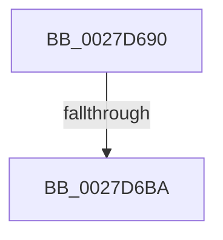

# MiUnlockWorkingSetShared

- RVA: `0x0027D690`–`0x0027D6C0` (길이 `48` bytes)
- VA: `0x000000014027D690`
- 실행 섹션: `.text`
- PDB 이름 있음: `예`; PDB Function 태그: `아니요`
- unwind 정보 RVA: `0x000662A0`
- 디코드: `13`개 명령, `48/48` bytes 표시
- 미해석 바이트: `0` (있으면 어셈블리에 `.byte`로 보존)

> 이 문서는 커널 이미지의 기계어와 PDB 기호를 분석해 생성했습니다. 4번과 5번은 함수 원형과 자료형을 바이너리 사용 방식에서 추정한 C 해석이며 원본 소스 복구 결과는 아닙니다.

## 1. Dependencies

- 직접 호출 지점: **0**; 고유 호출 대상: **0**
- 직접 호출자로 확인된 함수: **157**
- RIP 상대 이미지 참조: **0**

### Outgoing calls
- 직접 디코드된 call 명령이 없습니다.

### Direct callers
- [MiEncodeProtoFill](../22/MiEncodeProtoFill_function_0022F3B0.md) at `0x0022F475`
- [MiUnlockWorkingSetOptimal](../23/MiUnlockWorkingSetOptimal_function_00238DFC.md) at `0x00238E5F`
- [MiReleaseWalkLocks](../23/MiReleaseWalkLocks_function_00239FD0.md) at `0x00239FFB`
- [MiProbeAndLockPages](../23/MiProbeAndLockPages_function_0023B4F0.md) at `0x0023B5D8`
- [sub_0023B87B](../23/Unknown_function_0023B87B.md) at `0x0023B883`
- [MiWalkVaRange](../24/MiWalkVaRange_function_00243BF0.md) at `0x00244287`
- [MiWalkVaRange](../24/MiWalkVaRange_function_00243BF0.md) at `0x00244459`
- [MiWalkVaRange](../24/MiWalkVaRange_function_00243BF0.md) at `0x00244A3D`
- [MmProtectPool](../26/MmProtectPool_function_002697AC.md) at `0x002698E6`
- [MmProtectPool](../26/MmProtectPool_function_002697AC.md) at `0x00269E27`
- [MmProtectPool](../26/MmProtectPool_function_002697AC.md) at `0x00269EF3`
- [MiDecommitPagesTail](MiDecommitPagesTail_function_002790FC.md) at `0x002791DC`
- [sub_0027BB85](Unknown_function_0027BB85.md) at `0x0027BC18`
- [MiMakeHyperRangeAccessible](MiMakeHyperRangeAccessible_function_0027CE10.md) at `0x0027D049`
- [MiMakeHyperRangeAccessible](MiMakeHyperRangeAccessible_function_0027CE10.md) at `0x0027D0CA`
- [MiReleaseFaultState](MiReleaseFaultState_function_0027D290.md) at `0x0027D3AF`
- [MiUnlockWorkingSetExclusive](MiUnlockWorkingSetExclusive_function_0027EC70.md) at `0x0027EDFD`
- [MiUnlockWorkingSetExclusive](MiUnlockWorkingSetExclusive_function_0027EC70.md) at `0x0027EE5F`
- [sub_0027F063](Unknown_function_0027F063.md) at `0x0027F0E5`
- [MiMakeSystemAddressValid](MiMakeSystemAddressValid_function_0027FF70.md) at `0x00280A65`
- [sub_00281A81](../28/Unknown_function_00281A81.md) at `0x00281D6E`
- [MiUnlockStealVm](../28/MiUnlockStealVm_function_0028EF40.md) at `0x0028EF85`
- [MiSetReadOnlyOnSectionView](../29/MiSetReadOnlyOnSectionView_function_00294538.md) at `0x0029476F`
- [MiRemoveVad](../29/MiRemoveVad_function_00295C78.md) at `0x00295DF8`
- [MiGetWorkingSetInfoEx](../29/MiGetWorkingSetInfoEx_function_0029E640.md) at `0x0029E7D5`
- [MiSwapStackPage](../29/MiSwapStackPage_function_0029FDE0.md) at `0x002A00A9`
- [MiSwapStackPage](../29/MiSwapStackPage_function_0029FDE0.md) at `0x002A0187`
- [MiSwapStackPage](../29/MiSwapStackPage_function_0029FDE0.md) at `0x002A0220`
- [MiOutPageSingleKernelStack](../2A/MiOutPageSingleKernelStack_function_002A1790.md) at `0x002A1AE2`
- [MiAllocateKernelStackPages](../2A/MiAllocateKernelStackPages_function_002A1BEC.md) at `0x002A1F3A`
- [MiUnlockCodePage](../2A/MiUnlockCodePage_function_002A2AB8.md) at `0x002A2BED`
- [MiUnlockCodePage](../2A/MiUnlockCodePage_function_002A2AB8.md) at `0x002A2C93`
- [MiDeleteEmptyPageTables](../2A/MiDeleteEmptyPageTables_function_002A5220.md) at `0x002A548E`
- [MiInsertViewOfPhysicalSection](../2A/MiInsertViewOfPhysicalSection_function_002A57E0.md) at `0x002A5929`
- [MiInsertViewOfPhysicalSection](../2A/MiInsertViewOfPhysicalSection_function_002A57E0.md) at `0x002A59AB`
- [MiSplitPrivatePage](../2A/MiSplitPrivatePage_function_002A6210.md) at `0x002A639F`
- [MiSplitPrivatePage](../2A/MiSplitPrivatePage_function_002A6210.md) at `0x002A6420`
- [MiSplitPrivatePage](../2A/MiSplitPrivatePage_function_002A6210.md) at `0x002A64F9`
- [MiSplitPrivatePage](../2A/MiSplitPrivatePage_function_002A6210.md) at `0x002A668A`
- [MiMakeProtoLeafValid](../2A/MiMakeProtoLeafValid_function_002A6710.md) at `0x002A67AF`
- [MiEmptyWorkingSetInitiate](../2A/MiEmptyWorkingSetInitiate_function_002A7128.md) at `0x002A7212`
- [NtGetWriteWatch](../2A/NtGetWriteWatch_function_002A7CE0.md) at `0x002A804E`
- [NtGetWriteWatch](../2A/NtGetWriteWatch_function_002A7CE0.md) at `0x002A8441`
- [MiMoveDirtyBitsToPfns](../2A/MiMoveDirtyBitsToPfns_function_002A8624.md) at `0x002A8833`
- [MiMoveDirtyBitsToPfns](../2A/MiMoveDirtyBitsToPfns_function_002A8624.md) at `0x002A8937`
- [MiDeletePagablePteRange](../2A/MiDeletePagablePteRange_function_002A96B4.md) at `0x002A9879`
- [MiUnlockOpportunisticPagesInPageTable](../2A/MiUnlockOpportunisticPagesInPageTable_function_002AA88C.md) at `0x002AAAD5`
- [MiReplaceRotateWithDemandZeroNoCopy](../2A/MiReplaceRotateWithDemandZeroNoCopy_function_002AAB04.md) at `0x002AADA8`
- [MiFastTrimWorkingSet](../2A/MiFastTrimWorkingSet_function_002AD420.md) at `0x002AD79D`
- [MiMapLockedPagesInUserSpaceHelper](../2A/MiMapLockedPagesInUserSpaceHelper_function_002ADFE0.md) at `0x002AE139`
- [MiMapLockedPagesInUserSpaceHelper](../2A/MiMapLockedPagesInUserSpaceHelper_function_002ADFE0.md) at `0x002AE194`
- [MiGetWorkingSetInfoList](../2A/MiGetWorkingSetInfoList_function_002AF770.md) at `0x002AFF56`
- [MiGetWorkingSetInfoList](../2A/MiGetWorkingSetInfoList_function_002AF770.md) at `0x002B04B5`
- [MiGetWorkingSetInfoList](../2A/MiGetWorkingSetInfoList_function_002AF770.md) at `0x002B083C`
- [MiGetWorkingSetInfoList](../2A/MiGetWorkingSetInfoList_function_002AF770.md) at `0x002B09F0`
- [MiGetWorkingSetInfoList](../2A/MiGetWorkingSetInfoList_function_002AF770.md) at `0x002B0B45`
- [MmQuerySystemWorkingSetInformation](../2C/MmQuerySystemWorkingSetInformation_function_002C0710.md) at `0x002C0824`
- [MiDeleteSystemPageTables](../2C/MiDeleteSystemPageTables_function_002C1110.md) at `0x002C11CB`
- [MiIsCfgBitMapPageShared](../2C/MiIsCfgBitMapPageShared_function_002C1200.md) at `0x002C12C1`
- [MiClearNonPagedPtes](../2C/MiClearNonPagedPtes_function_002C17A0.md) at `0x002C186B`
- [MiCountSharedPages](../2C/MiCountSharedPages_function_002C30A4.md) at `0x002C3229`
- [sub_002C37D9](../2C/Unknown_function_002C37D9.md) at `0x002C3992`
- [sub_002C3A7C](../2C/Unknown_function_002C3A7C.md) at `0x002C3BE2`
- [sub_002C3A7C](../2C/Unknown_function_002C3A7C.md) at `0x002C3FB1`
- [sub_002C3A7C](../2C/Unknown_function_002C3A7C.md) at `0x002C42A8`
- [MiProtectPrivateMemory](../2C/MiProtectPrivateMemory_function_002C45B0.md) at `0x002C4AFD`
- [MiProtectPrivateMemory](../2C/MiProtectPrivateMemory_function_002C45B0.md) at `0x002C4C03`
- [MiProtectPrivateMemory](../2C/MiProtectPrivateMemory_function_002C45B0.md) at `0x002C4D57`
- [MiProtectPrivateMemory](../2C/MiProtectPrivateMemory_function_002C45B0.md) at `0x002C4E31`
- [MiProtectPrivateMemory](../2C/MiProtectPrivateMemory_function_002C45B0.md) at `0x002C509D`
- [MiMakeProtoPrivate](../2C/MiMakeProtoPrivate_function_002C64A4.md) at `0x002C65DB`
- [MiCountCommittedPages](../2C/MiCountCommittedPages_function_002C7950.md) at `0x002C79AA`
- [MiTrimSharedPageFromViews](../2E/MiTrimSharedPageFromViews_function_002E16F8.md) at `0x002E1AC4`
- [MiTrimSharedPageFromViews](../2E/MiTrimSharedPageFromViews_function_002E16F8.md) at `0x002E21A1`
- [MiSharePages](../31/MiSharePages_function_00315110.md) at `0x00315736`
- [MiSharePages](../31/MiSharePages_function_00315110.md) at `0x00315CE8`
- [MiUnlockPoolCommitWs](../32/MiUnlockPoolCommitWs_function_003297DC.md) at `0x00329806`
- [MiUserFault](../32/MiUserFault_function_00329840.md) at `0x00329D87`
- [MiCommitExistingVad](../32/MiCommitExistingVad_function_0032A860.md) at `0x0032AE13`
- [MiCommitExistingVad](../32/MiCommitExistingVad_function_0032A860.md) at `0x0032B03D`
- [MiCommitExistingVad](../32/MiCommitExistingVad_function_0032A860.md) at `0x0032B0D7`
- [MiQueryAddressState](../32/MiQueryAddressState_function_0032C380.md) at `0x0032CBF7`
- [MiQueryAddressState](../32/MiQueryAddressState_function_0032C380.md) at `0x0032CFB9`
- [sub_00347472](../34/Unknown_function_00347472.md) at `0x0034752B`
- [MiUnlockSystemVa](../34/MiUnlockSystemVa_function_0034B800.md) at `0x0034B82C`
- [MiTrimOrAgeWorkingSet](../34/MiTrimOrAgeWorkingSet_function_0034EFC0.md) at `0x0034F231`
- [MiSoftFaultMappedView](../36/MiSoftFaultMappedView_function_00365364.md) at `0x0036578E`
- [MiSoftFaultMappedView](../36/MiSoftFaultMappedView_function_00365364.md) at `0x00365811`
- [MiCommitEnclavePages](../36/MiCommitEnclavePages_function_00367CCC.md) at `0x00367D95`
- [MiAddPagesToEnclave](../36/MiAddPagesToEnclave_function_00367EEC.md) at `0x0036803A`
- [MiWriteEnclavePte](../36/MiWriteEnclavePte_function_00368570.md) at `0x0036867D`
- [MiDecommitHardwareEnclavePages](../36/MiDecommitHardwareEnclavePages_function_003688D4.md) at `0x00368AEB`
- [MiRelockFaultState](../36/MiRelockFaultState_function_0036A230.md) at `0x0036A2D3`
- [MiLockCode](../36/MiLockCode_function_0036F91C.md) at `0x0036FC5C`
- [MiLockCode](../36/MiLockCode_function_0036F91C.md) at `0x0036FCFE`
- [MiLockCode](../36/MiLockCode_function_0036F91C.md) at `0x00370021`
- [MiLockCode](../36/MiLockCode_function_0036F91C.md) at `0x003700BA`
- [MiSetSystemCodeProtection](../38/MiSetSystemCodeProtection_function_00384420.md) at `0x00384713`
- [MiSetSystemCodeProtection](../38/MiSetSystemCodeProtection_function_00384420.md) at `0x00384815`
- [MiMakeDriverPagesPrivate](../38/MiMakeDriverPagesPrivate_function_00384C60.md) at `0x00384D9F`
- [MiMakeDriverPagesPrivate](../38/MiMakeDriverPagesPrivate_function_00384C60.md) at `0x00384E2D`
- [MiMakeDriverPagesPrivate](../38/MiMakeDriverPagesPrivate_function_00384C60.md) at `0x00384F0E`
- [MiMakeZeroedPageTablesEx](../3B/MiMakeZeroedPageTablesEx_function_003B59FC.md) at `0x003B5C61`
- [MiMapWithLargePages](../3B/MiMapWithLargePages_function_003B6624.md) at `0x003B690F`
- [MiCopyToUserVa](../3D/MiCopyToUserVa_function_003D1E68.md) at `0x003D201A`
- [MiCopyToUserVa](../3D/MiCopyToUserVa_function_003D1E68.md) at `0x003D204F`
- [MiCopyToUserVa](../3D/MiCopyToUserVa_function_003D1E68.md) at `0x003D20EA`
- [MiUnmapMdlCommon](../3E/MiUnmapMdlCommon_function_003E7DF0.md) at `0x003E81EF`
- [MiUnmapMdlCommon](../3E/MiUnmapMdlCommon_function_003E7DF0.md) at `0x003E8441`
- [MiUnlockPageTableRange](../40/MiUnlockPageTableRange_function_00407E44.md) at `0x00407EB4`
- [NtLockVirtualMemory](../40/NtLockVirtualMemory_function_004088A0.md) at `0x00408B3B`
- [NtLockVirtualMemory](../40/NtLockVirtualMemory_function_004088A0.md) at `0x00408D57`
- [NtLockVirtualMemory](../40/NtLockVirtualMemory_function_004088A0.md) at `0x00408E4E`
- [NtLockVirtualMemory](../40/NtLockVirtualMemory_function_004088A0.md) at `0x0040904B`
- [NtLockVirtualMemory](../40/NtLockVirtualMemory_function_004088A0.md) at `0x0040933C`
- [sub_0041CC0F](../41/Unknown_function_0041CC0F.md) at `0x0041CC6E`
- [MiDeprioritizeVirtualAddresses](../42/MiDeprioritizeVirtualAddresses_function_0042AD1C.md) at `0x0042AEF0`
- [sub_00445820](../44/Unknown_function_00445820.md) at `0x00445827`
- [MiAllowProtectionChange](../44/MiAllowProtectionChange_function_00448834.md) at `0x00448946`
- [MiUpdateImportRelocationsOnDriverPrivatePages](../44/MiUpdateImportRelocationsOnDriverPrivatePages_function_00449BCC.md) at `0x00449CF3`
- [MiUpdateImportRelocationsOnDriverPrivatePages](../44/MiUpdateImportRelocationsOnDriverPrivatePages_function_00449BCC.md) at `0x00449DBE`
- [MiComparePteProtections](../44/MiComparePteProtections_function_0044F4FC.md) at `0x0044F5CF`
- [MiQueryAddressSpan](../45/MiQueryAddressSpan_function_0045CF14.md) at `0x0045D011`
- [MiQueryAddressSpan](../45/MiQueryAddressSpan_function_0045CF14.md) at `0x0045D0BD`
- [MmAdjustWorkingSetSizeEx](../47/MmAdjustWorkingSetSizeEx_function_0047D8D4.md) at `0x0047DBB4`
- [MiDeleteEmptyPageTableCommit](../48/MiDeleteEmptyPageTableCommit_function_004834F4.md) at `0x004836A4`
- [MiLockPagedAddress](../48/MiLockPagedAddress_function_00484CDC.md) at `0x00484E2D`
- [MiLockPagedAddress](../48/MiLockPagedAddress_function_00484CDC.md) at `0x00484E63`
- [MiConvertAndFlushWsleVas](../49/MiConvertAndFlushWsleVas_function_00492CB4.md) at `0x00492E62`
- [MmCheckProcessShadow](../49/MmCheckProcessShadow_function_004931C0.md) at `0x00493258`
- [MmUpdateUserShadowStackValue](../49/MmUpdateUserShadowStackValue_function_004935D8.md) at `0x00493720`
- [MmUpdateUserShadowStackValue](../49/MmUpdateUserShadowStackValue_function_004935D8.md) at `0x00493866`
- [MiDeleteShadowStackPtes](../49/MiDeleteShadowStackPtes_function_00493AE4.md) at `0x00493C32`
- [MiGetWsAndMakePageTablesNx](../49/MiGetWsAndMakePageTablesNx_function_00494240.md) at `0x004942D2`
- [MiUnlockFaultWorkingSet](../49/MiUnlockFaultWorkingSet_function_00498664.md) at `0x00498679`
- [MiLockPageTableRange](../49/MiLockPageTableRange_function_0049A850.md) at `0x0049A8D3`
- [MiLockPageTableRange](../49/MiLockPageTableRange_function_0049A850.md) at `0x0049A989`
- [MiReleaseLargePdeMappings](../49/MiReleaseLargePdeMappings_function_0049D0B0.md) at `0x0049D2B3`
- [MiSetPagesModified](../49/MiSetPagesModified_function_0049DC2C.md) at `0x0049DF3D`
- [MiSetPagesModified](../49/MiSetPagesModified_function_0049DC2C.md) at `0x0049DFEE`
- [MiObtainRotateProtectionRanges](../4A/MiObtainRotateProtectionRanges_function_004A4768.md) at `0x004A4855`
- [MiSetPagingOfDriver](../4A/MiSetPagingOfDriver_function_004A76C4.md) at `0x004A77E1`
- [MiUnmapKernelScp](../4A/MiUnmapKernelScp_function_004A82E8.md) at `0x004A8391`
- [MmRemoveExecuteGrants](../4A/MmRemoveExecuteGrants_function_004A8B60.md) at `0x004A8BE9`
- [MiBuildForkPageTable](../4A/MiBuildForkPageTable_function_004ACF5C.md) at `0x004AD189`
- [MiInitializeWorkingSetList](../4A/MiInitializeWorkingSetList_function_004AE640.md) at `0x004AE77D`
- [MiFaultInPagedPool](../4B/MiFaultInPagedPool_function_004B3BC0.md) at `0x004B3C51`
- [MiAdjustSecureDriverStateForIatCapture](../4B/MiAdjustSecureDriverStateForIatCapture_function_004BE864.md) at `0x004BEAA7`
- [MiSwitchToTransition](../4C/MiSwitchToTransition_function_004C0F5C.md) at `0x004C1601`
- [MiWriteAwePtes](../4C/MiWriteAwePtes_function_004C51E0.md) at `0x004C5640`
- [MiUpdatePrivateDemandZeroView](../4C/MiUpdatePrivateDemandZeroView_function_004CCC2C.md) at `0x004CCE81`
- [MiUpdatePrivateDemandZeroView](../4C/MiUpdatePrivateDemandZeroView_function_004CCC2C.md) at `0x004CCF25`
- [MiProtectAweRegion](../4C/MiProtectAweRegion_function_004CE62C.md) at `0x004CE9E4`
- [MiProtectAweRegion](../4C/MiProtectAweRegion_function_004CE62C.md) at `0x004CEE02`
- [MiZeroAndFlushGoodCitizen](../4D/MiZeroAndFlushGoodCitizen_function_004D0828.md) at `0x004D08E7`
- [MiMapMdlWithLargePages](../4D/MiMapMdlWithLargePages_function_004D10B8.md) at `0x004D14CD`
- [MiProtectEnclavePages](../4D/MiProtectEnclavePages_function_004D5528.md) at `0x004D57FC`
- [MiProtectEnclavePages](../4D/MiProtectEnclavePages_function_004D5528.md) at `0x004D5A44`
- [MiVadRangeIsIoSpace](../4D/MiVadRangeIsIoSpace_function_004D5CD4.md) at `0x004D5E28`
- [MiVadRangeIsIoSpace](../4D/MiVadRangeIsIoSpace_function_004D5CD4.md) at `0x004D5E61`
- [MiMapKernelScp](../4D/MiMapKernelScp_function_004DCAD4.md) at `0x004DCD72`
- [MmUpdateOldWorkingSetPages](../4E/MmUpdateOldWorkingSetPages_function_004EDF18.md) at `0x004EE0F9`
- [MiQueryImageExtensionInformation](../4E/MiQueryImageExtensionInformation_function_004EE3C8.md) at `0x004EE5CA`
- [MiFinishPteChangesInPageTable](../4E/MiFinishPteChangesInPageTable_function_004EE660.md) at `0x004EE842`
- [NtUnlockVirtualMemory](../4E/NtUnlockVirtualMemory_function_004EE890.md) at `0x004EEA54`
- [NtUnlockVirtualMemory](../4E/NtUnlockVirtualMemory_function_004EE890.md) at `0x004EED50`
- [NtUnlockVirtualMemory](../4E/NtUnlockVirtualMemory_function_004EE890.md) at `0x004EEE91`
- [NtUnlockVirtualMemory](../4E/NtUnlockVirtualMemory_function_004EE890.md) at `0x004EEECA`
- [MiDeleteBootRange](../66/MiDeleteBootRange_function_0066E450.md) at `0x0066E628`
- [MiDeleteBootRange](../66/MiDeleteBootRange_function_0066E450.md) at `0x0066E699`
- [MiPageBootRegistry](../66/MiPageBootRegistry_function_0066E82C.md) at `0x0066EB36`
- [MiCheckCommitReleaseFromVad](../66/MiCheckCommitReleaseFromVad_function_0066EB90.md) at `0x0066EF24`
- [MiCopyWorkingSetFields](../66/MiCopyWorkingSetFields_function_0066F0F4.md) at `0x0066F1FA`
- [MiWalkResetCommitPages](../66/MiWalkResetCommitPages_function_0066FC58.md) at `0x0066FD0A`
- [MiLockDriverPageRange](../67/MiLockDriverPageRange_function_00670160.md) at `0x006704DB`
- [MiLockDriverPageRange](../67/MiLockDriverPageRange_function_00670160.md) at `0x0067051A`
- [MiLockDriverPageRange](../67/MiLockDriverPageRange_function_00670160.md) at `0x00670586`
- [MiLockDriverPageRange](../67/MiLockDriverPageRange_function_00670160.md) at `0x00670691`
- [MmProtectDriverSection](../67/MmProtectDriverSection_function_00670A80.md) at `0x00670CB9`
- [MmProtectDriverSection](../67/MmProtectDriverSection_function_00670A80.md) at `0x00670D9A`
- [MmProtectDriverSection](../67/MmProtectDriverSection_function_00670A80.md) at `0x00670DFD`
- [MmProtectDriverSection](../67/MmProtectDriverSection_function_00670A80.md) at `0x00670E39`
- [MiReplaceImportEntry](../67/MiReplaceImportEntry_function_00671440.md) at `0x006715CD`
- [MiReplaceImportEntry](../67/MiReplaceImportEntry_function_00671440.md) at `0x00671608`
- [MiReplaceImportEntry](../67/MiReplaceImportEntry_function_00671440.md) at `0x006716E0`
- [MiGetFileOnlyRanges](../67/MiGetFileOnlyRanges_function_00672684.md) at `0x00672712`
- [MiMapMdlCommon](../67/MiMapMdlCommon_function_00674524.md) at `0x00674B2E`
- [MiSetPageProtection](../67/MiSetPageProtection_function_00674BDC.md) at `0x00674E1E`
- [MiSetGraphicsPtes](../67/MiSetGraphicsPtes_function_00678554.md) at `0x006786DC`
- [MiSetGraphicsPtes](../67/MiSetGraphicsPtes_function_00678554.md) at `0x00678714`
- [MmAddRangeToCrashDump](../67/MmAddRangeToCrashDump_function_0067D8B0.md) at `0x0067D9B0`
- [MmRemoveSystemCacheFromDump](../67/MmRemoveSystemCacheFromDump_function_0067DD58.md) at `0x0067DE0B`
- [MiExceptionForMappedVa](../67/MiExceptionForMappedVa_function_0067E164.md) at `0x0067E1D8`
- [MiClearDriverTablePtes](../68/MiClearDriverTablePtes_function_00683024.md) at `0x00683403`
- [MiCommitHotPatchTable](../68/MiCommitHotPatchTable_function_00683420.md) at `0x006835D2`
- [MiPrepareImagePagesForHotPatch](../68/MiPrepareImagePagesForHotPatch_function_00683800.md) at `0x0068398F`
- [MiPrepareImagePagesForHotPatch](../68/MiPrepareImagePagesForHotPatch_function_00683800.md) at `0x00683A7C`
- [MiPrepareImagePagesForHotPatch](../68/MiPrepareImagePagesForHotPatch_function_00683800.md) at `0x00683AD3`
- [MiPrepareImagePagesForHotPatch](../68/MiPrepareImagePagesForHotPatch_function_00683800.md) at `0x00683B5A`
- [MmMapDriverTablePage](../68/MmMapDriverTablePage_function_00683EAC.md) at `0x0068410F`
- [MiQueryImageExtensionInformationOld](../68/MiQueryImageExtensionInformationOld_function_00687384.md) at `0x00687541`
- [MiQueryVaPhysicalContiguity](../68/MiQueryVaPhysicalContiguity_function_006875B8.md) at `0x006878F0`
- [MiQueryVaPhysicalContiguity](../68/MiQueryVaPhysicalContiguity_function_006875B8.md) at `0x00687930`
- [MiUnmapLegacyAwePage](../68/MiUnmapLegacyAwePage_function_0068993C.md) at `0x00689A18`
- [MiCombineWorkingSet](../68/MiCombineWorkingSet_function_0068BB18.md) at `0x0068BC77`
- [MiStoreDiscardPoisonedPage](../69/MiStoreDiscardPoisonedPage_function_00692858.md) at `0x00692CF0`
- [MmStoreIsVirtualAddressPoisoned](../69/MmStoreIsVirtualAddressPoisoned_function_00693120.md) at `0x006931DF`
- [MiMakeVaRangePhysicallyContiguous](../69/MiMakeVaRangePhysicallyContiguous_function_006936E0.md) at `0x0069392A`
- [MiMakeVaRangePhysicallyContiguous](../69/MiMakeVaRangePhysicallyContiguous_function_006936E0.md) at `0x00693981`
- [MiScrubLargeMappedPage](../69/MiScrubLargeMappedPage_function_00693E2C.md) at `0x0069429F`
- [MiScrubLargeMappedPage](../69/MiScrubLargeMappedPage_function_00693E2C.md) at `0x006942C5`
- [MiComputeIdealLargePage](../69/MiComputeIdealLargePage_function_006987C0.md) at `0x00698A05`
- [sub_006D9212](../6D/Unknown_function_006D9212.md) at `0x006D94CB`
- [sub_006DAAE6](../6D/Unknown_function_006DAAE6.md) at `0x006DAC21`
- [sub_006DAAE6](../6D/Unknown_function_006DAAE6.md) at `0x006DAC70`
- [sub_006DB1E0](../6D/Unknown_function_006DB1E0.md) at `0x006DB267`
- [sub_006E35D2](../6E/Unknown_function_006E35D2.md) at `0x006E35E8`
- [sub_006E35FC](../6E/Unknown_function_006E35FC.md) at `0x006E3612`
- [sub_006E362E](../6E/Unknown_function_006E362E.md) at `0x006E36D6`
- [sub_006E362E](../6E/Unknown_function_006E362E.md) at `0x006E3800`
- [sub_006E3CBA](../6E/Unknown_function_006E3CBA.md) at `0x006E3CDA`
- [sub_006E3CBA](../6E/Unknown_function_006E3CBA.md) at `0x006E3D1C`
- [sub_006E94B4](../6E/Unknown_function_006E94B4.md) at `0x006E9531`
- [sub_006E9556](../6E/Unknown_function_006E9556.md) at `0x006E9576`
- [sub_006E9556](../6E/Unknown_function_006E9556.md) at `0x006E9620`
- [sub_006F0B5A](../6F/Unknown_function_006F0B5A.md) at `0x006F0B6D`
- [sub_006F541A](../6F/Unknown_function_006F541A.md) at `0x006F545E`
- [sub_006F5914](../6F/Unknown_function_006F5914.md) at `0x006F5981`
- [sub_006F60F8](../6F/Unknown_function_006F60F8.md) at `0x006F626A`
- [MiProtectLargeKernelHalRange](../../page/7F/MiProtectLargeKernelHalRange_function_007F8D20.md) at `0x007F8E8C`
- [MmUnlockPhysicalPagesByVa](../../page/7F/MmUnlockPhysicalPagesByVa_function_007FBA3C.md) at `0x007FBB10`
- [MiAddLoaderHalIoMappings](../../init/C5/MiAddLoaderHalIoMappings_function_00C5E568.md) at `0x00C5E5E2`
- [MiMarkLargePageMappings](../../init/C6/MiMarkLargePageMappings_function_00C60BC8.md) at `0x00C60C4F`
- [MiCreateInitialSystemWsles](../../init/C6/MiCreateInitialSystemWsles_function_00C642C8.md) at `0x00C64355`
- [MiMarkBootKernelStack](../../init/C6/MiMarkBootKernelStack_function_00C68244.md) at `0x00C683FD`

### Static image references
- 디코드된 RIP-relative 메모리 참조가 없습니다.

## 2. Other-region calls and transfers

- 다른 실행 섹션으로 향하는 call: **0**
- call이 아닌 외부 분기/꼬리 이동: **1**
  - `0x0027D6B4` → [sub_0027D792 + 0x4D](Unknown_function_0027D792.md) (`tail-transfer`)

## 3. Assembly (complete function range)

```asm
0027D690  48 89 5C 24 18                  mov qword ptr [rsp + 0x18], rbx
0027D695  57                              push rdi
0027D696  48 83 EC 20                     sub rsp, 0x20
0027D69A  0F B6 C2                        movzx eax, dl
0027D69D  BB 11 00 00 00                  mov ebx, 0x11
0027D6A2  3C 02                           cmp al, 2
0027D6A4  48 8B F9                        mov rdi, rcx
0027D6A7  0F 45 D8                        cmovne ebx, eax
0027D6AA  8B 81 B8 00 00 00               mov eax, dword ptr [rcx + 0xb8]
0027D6B0  24 0F                           and al, 0xf
0027D6B2  3C 06                           cmp al, 6
0027D6B4  0F 83 25 01 00 00               jae 0x14027d7df
0027D6BA  8B 81 BC 00 00 00               mov eax, dword ptr [rcx + 0xbc]
```

## 4. C-style interpretation (structured pseudocode)

```c
__int64 __fastcall MiUnlockWorkingSetShared(__int64 a1, unsigned __int8 a2)
{
    __int64 result;
    __int64 v_rbx;
    __int64 v_rsp;
    unsigned __int64 v_stack_p18;

    v_stack_p18 = v_rbx;
    v_rsp = (v_rsp) - (32);
    v_rbx = 17;
    if (a2 != 2) { v_rbx = a2; }
    result = (unsigned __int8)(((unsigned int)(*(unsigned int *)(a1 + 184))) & (15));
    return (unsigned int)(*(unsigned int *)(a1 + 188));
}
```

## 5. (Beta) C Style

```c
int64_t MiUnlockWorkingSetShared(void *Arg1, uint8_t Arg2)
{
    uint8_t *arg1 = (uint8_t *)Arg1;

    int64_t result;
    int64_t local_rbx;
    int64_t local_rsp;
    uint64_t v_stack_p18;

    v_stack_p18 = local_rbx;
    local_rsp = (local_rsp) - (32);
    local_rbx = 17;
    if (Arg2 != 2) { local_rbx = Arg2; }
    result = (uint8_t)(((uint32_t)(*(uint32_t *)(arg1 + 0xB8))) & (15));
    return (uint32_t)(*(uint32_t *)(arg1 + 0xBC));
}
```

### 관측된 메모리 오프셋

구조체 형식이 확인되지 않은 접근은 인자 기준의 오프셋으로만 기록했습니다.

| 기준 인자 | 오프셋 표현 | 폭 (bit) | 접근 |
|---|---:|---:|---|
| `Arg1` | `+ 0xB8` | `32` | `R` |
| `Arg1` | `+ 0xBC` | `32` | `R` |

## 6. Execution-region graph

[열기: 2D/3D 그래프와 함수 탐색 컨트롤 패널](../../../control-panel.html?section=text&rva=0x0027D690&view=graph)

- 2D 그래프는 위에서 아래로 흐르고, 3D 그래프는 빈 공간을 드래그해 회전합니다. Shift+드래그는 이동, 휠은 확대·축소, 함수 노드 선택은 대상 보고서 이동입니다.

### Static fallback


