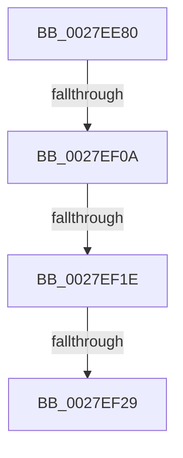

# MmAccessFault

- RVA: `0x0027EE80`–`0x0027EF35` (길이 `181` bytes)
- VA: `0x000000014027EE80`
- 실행 섹션: `.text`
- PDB 이름 있음: `예`; PDB Function 태그: `예`
- unwind 정보 RVA: `0x000664EC`
- 디코드: `47`개 명령, `181/181` bytes 표시
- 미해석 바이트: `0` (있으면 어셈블리에 `.byte`로 보존)

> 이 문서는 커널 이미지의 기계어와 PDB 기호를 분석해 생성했습니다. 4번과 5번은 함수 원형과 자료형을 바이너리 사용 방식에서 추정한 C 해석이며 원본 소스 복구 결과는 아닙니다.

## 1. Dependencies

- 직접 호출 지점: **0**; 고유 호출 대상: **0**
- 직접 호출자로 확인된 함수: **26**
- RIP 상대 이미지 참조: **2**

### Outgoing calls
- 직접 디코드된 call 명령이 없습니다.

### Direct callers
- [sub_0023D89B](../23/Unknown_function_0023D89B.md) at `0x0023D8CC`
- [MiWalkVaRange](../24/MiWalkVaRange_function_00243BF0.md) at `0x00244A4F`
- [MmProtectPool](../26/MmProtectPool_function_002697AC.md) at `0x00269E53`
- [sub_0027BB85](Unknown_function_0027BB85.md) at `0x0027BC9D`
- [MiMakeSystemAddressValid](MiMakeSystemAddressValid_function_0027FF70.md) at `0x002800D8`
- [MiGetWorkingSetInfoList](../2A/MiGetWorkingSetInfoList_function_002AF770.md) at `0x002B061E`
- [sub_002F6E32](../2F/Unknown_function_002F6E32.md) at `0x002F756B`
- [MiCheckProtoPtePageState](../31/MiCheckProtoPtePageState_function_003183E0.md) at `0x00318602`
- [MiLockProtoPoolPageForce](../32/MiLockProtoPoolPageForce_function_00320E10.md) at `0x00320F43`
- [MmCopyToCachedPage](../34/MmCopyToCachedPage_function_00347B44.md) at `0x00347F9E`
- [MmCopyToCachedPage](../34/MmCopyToCachedPage_function_00347B44.md) at `0x0034818B`
- [MiWalkEntireImage](../36/MiWalkEntireImage_function_00365D70.md) at `0x00366919`
- [MiInPageSingleKernelStack](../36/MiInPageSingleKernelStack_function_0036A3E8.md) at `0x0036A5FD`
- [sub_0036C6B5](../36/Unknown_function_0036C6B5.md) at `0x0036C81F`
- [MiLockCode](../36/MiLockCode_function_0036F91C.md) at `0x0036FC6C`
- [MiMakeDriverPagesPrivate](../38/MiMakeDriverPagesPrivate_function_00384C60.md) at `0x00384DCE`
- [MiInPagePageTable](../3E/MiInPagePageTable_function_003EF8DC.md) at `0x003EFF79`
- [MiFaultInProbeAddress](../40/MiFaultInProbeAddress_function_0040E108.md) at `0x0040E1BC`
- [MiReleaseOutSwapReservations](../45/MiReleaseOutSwapReservations_function_0045BAF4.md) at `0x0045BBA1`
- [MiLockPagedAddress](../48/MiLockPagedAddress_function_00484CDC.md) at `0x00484E73`
- [ExpSvmServicePageFault](../65/ExpSvmServicePageFault_function_0065BEC0.md) at `0x0065BF83`
- [MiLockDriverPageRange](../67/MiLockDriverPageRange_function_00670160.md) at `0x006705BC`
- [MiProtectDriverSectionPte](../67/MiProtectDriverSectionPte_function_006706C0.md) at `0x006707B4`
- [KiPageFault](../6C/KiPageFault_function_006C0740.md) at `0x006C0AC6`
- [sub_006F0B5A](../6F/Unknown_function_006F0B5A.md) at `0x006F0B9C`
- [MiInitializePrototypePtes](../../page/98/MiInitializePrototypePtes_function_009829AC.md) at `0x00982AF4`
- [MmVirtualAccessFault](../../page/9F/MmVirtualAccessFault_function_009FF98C.md) at `0x009FFA4C`

### Static image references
- `0x0027EE96` → RVA `0x00E0A740` (`.data`; read)
- `0x0027EF29` → RVA `0x00FC5000` (`ALMOSTRO`; read)

## 2. Other-region calls and transfers

- 다른 실행 섹션으로 향하는 call: **0**
- call이 아닌 외부 분기/꼬리 이동: **3**
  - `0x0027EF04` → [sub_0027F353](Unknown_function_0027F353.md) (`tail-transfer`)
  - `0x0027EF18` → [sub_0027F19F + 0x1E](Unknown_function_0027F19F.md) (`tail-transfer`)
  - `0x0027EF23` → [sub_0027F233](Unknown_function_0027F233.md) (`tail-transfer`)

## 3. Assembly (complete function range)

```asm
0027EE80  40 55                           push rbp
0027EE82  53                              push rbx
0027EE83  56                              push rsi
0027EE84  41 55                           push r13
0027EE86  41 56                           push r14
0027EE88  41 57                           push r15
0027EE8A  48 8D 6C 24 C8                  lea rbp, [rsp - 0x38]
0027EE8F  48 81 EC 38 01 00 00            sub rsp, 0x138
0027EE96  48 8B 05 A3 B8 B8 00            mov rax, qword ptr [rip + 0xb8b8a3]
0027EE9D  48 33 C4                        xor rax, rsp
0027EEA0  48 89 45 20                     mov qword ptr [rbp + 0x20], rax
0027EEA4  0F 57 C0                        xorps xmm0, xmm0
0027EEA7  33 C0                           xor eax, eax
0027EEA9  48 89 45 D0                     mov qword ptr [rbp - 0x30], rax
0027EEAD  45 33 ED                        xor r13d, r13d
0027EEB0  48 89 45 10                     mov qword ptr [rbp + 0x10], rax
0027EEB4  4D 8B F9                        mov r15, r9
0027EEB7  89 45 18                        mov dword ptr [rbp + 0x18], eax
0027EEBA  45 0F B6 F0                     movzx r14d, r8b
0027EEBE  0F B6 C1                        movzx eax, cl
0027EEC1  4C 89 6C 24 30                  mov qword ptr [rsp + 0x30], r13
0027EEC6  24 09                           and al, 9
0027EEC8  48 8B F2                        mov rsi, rdx
0027EECB  48 8B D9                        mov rbx, rcx
0027EECE  0F 11 44 24 40                  movups xmmword ptr [rsp + 0x40], xmm0
0027EED3  0F 11 44 24 50                  movups xmmword ptr [rsp + 0x50], xmm0
0027EED8  0F 11 44 24 60                  movups xmmword ptr [rsp + 0x60], xmm0
0027EEDD  0F 11 44 24 70                  movups xmmword ptr [rsp + 0x70], xmm0
0027EEE2  0F 11 45 80                     movups xmmword ptr [rbp - 0x80], xmm0
0027EEE6  0F 11 45 90                     movups xmmword ptr [rbp - 0x70], xmm0
0027EEEA  0F 11 45 A0                     movups xmmword ptr [rbp - 0x60], xmm0
0027EEEE  0F 11 45 B0                     movups xmmword ptr [rbp - 0x50], xmm0
0027EEF2  0F 11 45 C0                     movups xmmword ptr [rbp - 0x40], xmm0
0027EEF6  0F 11 45 E0                     movups xmmword ptr [rbp - 0x20], xmm0
0027EEFA  0F 11 45 F0                     movups xmmword ptr [rbp - 0x10], xmm0
0027EEFE  0F 11 45 00                     movups xmmword ptr [rbp], xmm0
0027EF02  3C 09                           cmp al, 9
0027EF04  0F 84 49 04 00 00               je 0x14027f353
0027EF0A  48 8B C2                        mov rax, rdx
0027EF0D  48 C1 F8 2F                     sar rax, 0x2f
0027EF11  48 FF C0                        inc rax
0027EF14  48 83 F8 01                     cmp rax, 1
0027EF18  0F 87 9F 02 00 00               ja 0x14027f1bd
0027EF1E  48 0F BA E1 0F                  bt rcx, 0xf
0027EF23  0F 82 0A 03 00 00               jb 0x14027f233
0027EF29  44 0F B7 0D CF 60 D4 00         movzx r9d, word ptr [rip + 0xd460cf]
0027EF31  48 8D 55 E0                     lea rdx, [rbp - 0x20]
```

## 4. C-style interpretation (structured pseudocode)

```c
__int64 __fastcall MmAccessFault(__int64 a1, __int64 a2, unsigned __int8 a3, __int64 a4)
{
    __int64 result;
    __int64 v_r13;
    __int64 v_rsp;
    unsigned __int64 v_stack_m108;
    unsigned __int64 v_stack_m118;
    unsigned __int64 v_stack_m128;
    unsigned __int64 v_stack_m138;
    unsigned __int64 v_stack_m48;
    unsigned int v_stack_m50;
    unsigned __int64 v_stack_m58;
    unsigned __int64 v_stack_m68;
    unsigned __int64 v_stack_m78;
    unsigned __int64 v_stack_m88;
    unsigned __int64 v_stack_m98;
    unsigned __int64 v_stack_mA8;
    unsigned __int64 v_stack_mB8;
    unsigned __int64 v_stack_mC8;
    unsigned __int64 v_stack_mD8;
    unsigned __int64 v_stack_mE8;
    unsigned __int64 v_stack_mF8;

    v_rsp = (v_rsp) - (312);
    result = (*(unsigned __int64 *)(v_rip + 12105891)) ^ (v_rsp);
    v_stack_m48 = result;
    result = 0;
    v_stack_m98 = 0;
    v_r13 = 0;
    v_stack_m58 = 0;
    v_stack_m50 = 0;
    v_stack_m138 = 0;
    result = (unsigned __int8)(((unsigned __int8)(a1)) & (9));
    v_stack_m128 = v_xmm0;
    v_stack_m118 = v_xmm0;
    v_stack_m108 = v_xmm0;
    v_stack_mF8 = v_xmm0;
    v_stack_mE8 = v_xmm0;
    v_stack_mD8 = v_xmm0;
    v_stack_mC8 = v_xmm0;
    v_stack_mB8 = v_xmm0;
    v_stack_mA8 = v_xmm0;
    v_stack_m88 = v_xmm0;
    v_stack_m78 = v_xmm0;
    v_stack_m68 = v_xmm0;
    result = (a2) >> (47);
    result = (result) + 1;
    return result;
}
```

## 5. (Beta) C Style

```c
int64_t MmAccessFault(int64_t Arg1, int64_t Arg2, uint8_t Arg3, int64_t Arg4)
{
    int64_t result;
    int64_t local_r13;
    int64_t local_rsp;
    uint64_t v_stack_m108;
    uint64_t v_stack_m118;
    uint64_t v_stack_m128;
    uint64_t v_stack_m138;
    uint64_t v_stack_m48;
    uint32_t v_stack_m50;
    uint64_t v_stack_m58;
    uint64_t v_stack_m68;
    uint64_t v_stack_m78;
    uint64_t v_stack_m88;
    uint64_t v_stack_m98;
    uint64_t v_stack_mA8;
    uint64_t v_stack_mB8;
    uint64_t v_stack_mC8;
    uint64_t v_stack_mD8;
    uint64_t v_stack_mE8;
    uint64_t v_stack_mF8;

    local_rsp = (local_rsp) - (312);
    result = (*(uint64_t *)(v_rip + 0xB8B8A3)) ^ (local_rsp);
    v_stack_m48 = result;
    result = 0;
    v_stack_m98 = 0;
    local_r13 = 0;
    v_stack_m58 = 0;
    v_stack_m50 = 0;
    v_stack_m138 = 0;
    result = (uint8_t)(((uint8_t)(Arg1)) & (9));
    v_stack_m128 = v_xmm0;
    v_stack_m118 = v_xmm0;
    v_stack_m108 = v_xmm0;
    v_stack_mF8 = v_xmm0;
    v_stack_mE8 = v_xmm0;
    v_stack_mD8 = v_xmm0;
    v_stack_mC8 = v_xmm0;
    v_stack_mB8 = v_xmm0;
    v_stack_mA8 = v_xmm0;
    v_stack_m88 = v_xmm0;
    v_stack_m78 = v_xmm0;
    v_stack_m68 = v_xmm0;
    result = (Arg2) >> (47);
    result = (result) + 1;
    return result;
}
```

## 6. Execution-region graph

[열기: 2D/3D 그래프와 함수 탐색 컨트롤 패널](../../../control-panel.html?section=text&rva=0x0027EE80&view=graph)

- 2D 그래프는 위에서 아래로 흐르고, 3D 그래프는 빈 공간을 드래그해 회전합니다. Shift+드래그는 이동, 휠은 확대·축소, 함수 노드 선택은 대상 보고서 이동입니다.

### Static fallback


