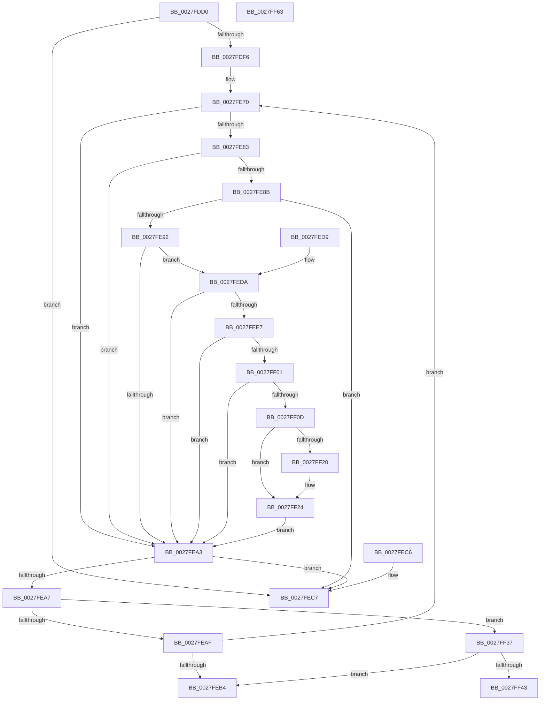

# MmIsAddressValidEx

- RVA: `0x0027FDD0`–`0x0027FF64` (길이 `404` bytes)
- VA: `0x000000014027FDD0`
- 실행 섹션: `.text`
- PDB 이름 있음: `예`; PDB Function 태그: `아니요`
- unwind 정보 RVA: `0x000666AC`
- 디코드: `107`개 명령, `404/404` bytes 표시
- 미해석 바이트: `0` (있으면 어셈블리에 `.byte`로 보존)

> 이 문서는 커널 이미지의 기계어와 PDB 기호를 분석해 생성했습니다. 4번과 5번은 함수 원형과 자료형을 바이너리 사용 방식에서 추정한 C 해석이며 원본 소스 복구 결과는 아닙니다.

## 1. Dependencies

- 직접 호출 지점: **0**; 고유 호출 대상: **0**
- 직접 호출자로 확인된 함수: **36**
- RIP 상대 이미지 참조: **1**

### Outgoing calls
- 직접 디코드된 call 명령이 없습니다.

### Direct callers
- [MmIsAddressValid](MmIsAddressValid_function_0027EC50.md) at `0x0027EC56`
- [MiMakeSystemAddressValid](MiMakeSystemAddressValid_function_0027FF70.md) at `0x002800B2`
- [IopLiveDumpDiscardVirtualAddressRange](../29/IopLiveDumpDiscardVirtualAddressRange_function_002977F4.md) at `0x00297835`
- [MiKernelWriteToExecutableMemory](../36/MiKernelWriteToExecutableMemory_function_00368F18.md) at `0x00368FCB`
- [KeCapturePersistentThreadState](../43/KeCapturePersistentThreadState_function_00435D90.md) at `0x00436158`
- [KiIsAddressRangeValid](../4B/KiIsAddressRangeValid_function_004B0278.md) at `0x004B02B3`
- [IopIsAddressRangeValid](../4B/IopIsAddressRangeValid_function_004B6CBC.md) at `0x004B6CF7`
- [IoFreeDumpRange](../59/IoFreeDumpRange_function_005927B0.md) at `0x00592831`
- [IoSetDumpRange](../59/IoSetDumpRange_function_005931F0.md) at `0x00593348`
- [IopGetMaxValidMemorySize](../59/IopGetMaxValidMemorySize_function_0059559C.md) at `0x005955D5`
- [IopGetMaxValidMemorySizeDown](../59/IopGetMaxValidMemorySizeDown_function_00595618.md) at `0x0059564B`
- [IopRemovePageDumpRange](../59/IopRemovePageDumpRange_function_00595EAC.md) at `0x00595FD6`
- [IopLiveDumpCallRemovePagesCallbacks](../59/IopLiveDumpCallRemovePagesCallbacks_function_0059AC28.md) at `0x0059AD17`
- [IoAddPagesForPartialKernelDump](../5A/IoAddPagesForPartialKernelDump_function_005A0F3C.md) at `0x005A0F91`
- [IopMarkPagesForDpcData](../5A/IopMarkPagesForDpcData_function_005A1C90.md) at `0x005A1D5D`
- [IopMarkPagesForDpcData](../5A/IopMarkPagesForDpcData_function_005A1C90.md) at `0x005A1D8C`
- [IopMarkPagesForDpcData](../5A/IopMarkPagesForDpcData_function_005A1C90.md) at `0x005A1F40`
- [IopMarkPagesForDpcData](../5A/IopMarkPagesForDpcData_function_005A1C90.md) at `0x005A1F8E`
- [IopMarkPagesForDpcData](../5A/IopMarkPagesForDpcData_function_005A1C90.md) at `0x005A2026`
- [IopMarkPagesForProcessorData](../5A/IopMarkPagesForProcessorData_function_005A21C8.md) at `0x005A2215`
- [KeBugCheck2](../5B/KeBugCheck2_function_005B27D0.md) at `0x005B2A1A`
- [KeValidateBugCheckCallbackRecord](../5B/KeValidateBugCheckCallbackRecord_function_005B39C0.md) at `0x005B3A1F`
- [KeValidateBugCheckCallbackRecord](../5B/KeValidateBugCheckCallbackRecord_function_005B39C0.md) at `0x005B3A7C`
- [KiCollectFullProcessName](../5B/KiCollectFullProcessName_function_005B43B0.md) at `0x005B43CE`
- [KiCollectTriageDumpDataBlocks](../5B/KiCollectTriageDumpDataBlocks_function_005B43F8.md) at `0x005B45CC`
- [KiDumpParameterImages](../5B/KiDumpParameterImages_function_005B4CE0.md) at `0x005B4D86`
- [KiDumpParameterImages](../5B/KiDumpParameterImages_function_005B4CE0.md) at `0x005B4E81`
- [KiPcToFileHeader](../5B/KiPcToFileHeader_function_005B5268.md) at `0x005B52C6`
- [KiScanBugCheckCallbackList](../5B/KiScanBugCheckCallbackList_function_005B5464.md) at `0x005B54C2`
- [KiValidateComponentName](../5B/KiValidateComponentName_function_005B553C.md) at `0x005B555E`
- [KiValidateComponentName](../5B/KiValidateComponentName_function_005B553C.md) at `0x005B5597`
- [KiSchedulerAssistBugCheckAddPagesCallback](../5B/KiSchedulerAssistBugCheckAddPagesCallback_function_005B8B40.md) at `0x005B8BC3`
- [KiSchedulerAssistBugCheckAddPagesCallback](../5B/KiSchedulerAssistBugCheckAddPagesCallback_function_005B8B40.md) at `0x005B8C10`
- [KiSchedulerAssistBugCheckAddPagesCallback](../5B/KiSchedulerAssistBugCheckAddPagesCallback_function_005B8B40.md) at `0x005B8C2A`
- [KiGetCurrentKernelShadowStackBounds](../5C/KiGetCurrentKernelShadowStackBounds_function_005C816C.md) at `0x005C81DC`
- [KiGetCurrentKernelShadowStackBounds](../5C/KiGetCurrentKernelShadowStackBounds_function_005C816C.md) at `0x005C81F5`
- [ExpHeapDumpEnumLargeAllocs](../65/ExpHeapDumpEnumLargeAllocs_function_0065C6CC.md) at `0x0065C6E5`
- [ExpHeapDumpNodeLinksValid](../65/ExpHeapDumpNodeLinksValid_function_0065C7C4.md) at `0x0065C7D3`
- [ExpHeapDumpNodeLinksValid](../65/ExpHeapDumpNodeLinksValid_function_0065C7C4.md) at `0x0065C7E8`
- [ExpHeapDumpNodeLinksValid](../65/ExpHeapDumpNodeLinksValid_function_0065C7C4.md) at `0x0065C80C`
- [CmFcpIsValidMemoryRange](../66/CmFcpIsValidMemoryRange_function_0066B924.md) at `0x0066B94B`
- [CmFcpIsValidMemoryRange](../66/CmFcpIsValidMemoryRange_function_0066B924.md) at `0x0066B95D`
- [MiFreedUnusedPfnPagesDpc](../67/MiFreedUnusedPfnPagesDpc_function_00672378.md) at `0x00672577`
- [MiFreedUnusedPfnPagesDpc](../67/MiFreedUnusedPfnPagesDpc_function_00672378.md) at `0x006725D1`
- [MiAddPartitionToCrashDump](../67/MiAddPartitionToCrashDump_function_0067D0B0.md) at `0x0067D142`
- [MiAddUnicodeStringToCrashDump](../67/MiAddUnicodeStringToCrashDump_function_0067D378.md) at `0x0067D3D6`
- [MiDbgCopyMemory](../68/MiDbgCopyMemory_function_00684A18.md) at `0x00684BE3`
- [MiDbgWriteCheck](../68/MiDbgWriteCheck_function_00685BE4.md) at `0x00685C21`
- [sub_006E4582](../6E/Unknown_function_006E4582.md) at `0x006E469D`
- [ViFreeTrackedPool](../../pagevrfy/BB/ViFreeTrackedPool_function_00BB8FC0.md) at `0x00BB9048`
- [ViFreeTrackedPool](../../pagevrfy/BB/ViFreeTrackedPool_function_00BB8FC0.md) at `0x00BB90B6`

### Static image references
- `0x0027FEDA` → RVA `0x00FC6A88` (`ALMOSTRO`; read)

## 2. Other-region calls and transfers

- 다른 실행 섹션으로 향하는 call: **0**
- 별도 외부 분기/꼬리 이동을 확인하지 못했습니다.

## 3. Assembly (complete function range)

```asm
0027FDD0  48 89 5C 24 08                  mov qword ptr [rsp + 8], rbx
0027FDD5  48 89 74 24 10                  mov qword ptr [rsp + 0x10], rsi
0027FDDA  57                              push rdi
0027FDDB  48 83 EC 20                     sub rsp, 0x20
0027FDDF  48 8B C1                        mov rax, rcx
0027FDE2  4C 8B D9                        mov r11, rcx
0027FDE5  48 C1 F8 2F                     sar rax, 0x2f
0027FDE9  48 FF C0                        inc rax
0027FDEC  48 83 F8 01                     cmp rax, 1
0027FDF0  0F 87 D1 00 00 00               ja 0x14027fec7
0027FDF6  48 8B D1                        mov rdx, rcx
0027FDF9  48 BE 00 00 00 00 80 F6 FF FF   movabs rsi, 0xfffff68000000000
0027FE03  48 C1 EA 09                     shr rdx, 9
0027FE07  48 B9 F8 FF FF FF 7F 00 00 00   movabs rcx, 0x7ffffffff8
0027FE11  48 23 D1                        and rdx, rcx
0027FE14  48 8B C6                        mov rax, rsi
0027FE17  48 03 D0                        add rdx, rax
0027FE1A  48 89 14 24                     mov qword ptr [rsp], rdx
0027FE1E  48 C1 EA 09                     shr rdx, 9
0027FE22  48 23 D1                        and rdx, rcx
0027FE25  48 8B C6                        mov rax, rsi
0027FE28  48 03 D0                        add rdx, rax
0027FE2B  48 89 54 24 08                  mov qword ptr [rsp + 8], rdx
0027FE30  48 C1 EA 09                     shr rdx, 9
0027FE34  48 23 D1                        and rdx, rcx
0027FE37  48 8B C6                        mov rax, rsi
0027FE3A  48 03 D0                        add rdx, rax
0027FE3D  48 89 54 24 10                  mov qword ptr [rsp + 0x10], rdx
0027FE42  48 C1 EA 09                     shr rdx, 9
0027FE46  48 23 D1                        and rdx, rcx
0027FE49  48 8B C6                        mov rax, rsi
0027FE4C  48 03 D0                        add rdx, rax
0027FE4F  48 BF 00 D0 BE 7D FB F6 FF FF   movabs rdi, 0xfffff6fb7dbed000
0027FE59  48 89 54 24 18                  mov qword ptr [rsp + 0x18], rdx
0027FE5E  41 BA 04 00 00 00               mov r10d, 4
0027FE64  48 BB F8 D7 BE 7D FB F6 FF FF   movabs rbx, 0xfffff6fb7dbed7f8
0027FE6E  66 90                           nop
0027FE70  4A 8B 54 D4 F8                  mov rdx, qword ptr [rsp + r10*8 - 8]
0027FE75  49 FF CA                        dec r10
0027FE78  48 8B 02                        mov rax, qword ptr [rdx]
0027FE7B  48 8B CF                        mov rcx, rdi
0027FE7E  48 3B D1                        cmp rdx, rcx
0027FE81  72 20                           jb 0x14027fea3
0027FE83  48 8B CB                        mov rcx, rbx
0027FE86  48 3B D1                        cmp rdx, rcx
0027FE89  77 18                           ja 0x14027fea3
0027FE8B  48 8B C8                        mov rcx, rax
0027FE8E  A8 01                           test al, 1
0027FE90  74 35                           je 0x14027fec7
0027FE92  A8 42                           test al, 0x42
0027FE94  41 0F 95 C1                     setne r9b
0027FE98  A8 20                           test al, 0x20
0027FE9A  41 0F 95 C0                     setne r8b
0027FE9E  45 84 C8                        test r8b, r9b
0027FEA1  74 37                           je 0x14027feda
0027FEA3  A8 01                           test al, 1
0027FEA5  74 20                           je 0x14027fec7
0027FEA7  84 C0                           test al, al
0027FEA9  0F 88 88 00 00 00               js 0x14027ff37
0027FEAF  4D 85 D2                        test r10, r10
0027FEB2  75 BC                           jne 0x14027fe70
0027FEB4  B0 01                           mov al, 1
0027FEB6  48 8B 5C 24 30                  mov rbx, qword ptr [rsp + 0x30]
0027FEBB  48 8B 74 24 38                  mov rsi, qword ptr [rsp + 0x38]
0027FEC0  48 83 C4 20                     add rsp, 0x20
0027FEC4  5F                              pop rdi
0027FEC5  C3                              ret
0027FEC6  CC                              int3
0027FEC7  32 C0                           xor al, al
0027FEC9  48 8B 5C 24 30                  mov rbx, qword ptr [rsp + 0x30]
0027FECE  48 8B 74 24 38                  mov rsi, qword ptr [rsp + 0x38]
0027FED3  48 83 C4 20                     add rsp, 0x20
0027FED7  5F                              pop rdi
0027FED8  C3                              ret
0027FED9  CC                              int3
0027FEDA  48 F7 05 A3 6B D4 00 00 00 60 00  test qword ptr [rip + 0xd46ba3], 0x600000
0027FEE5  74 BC                           je 0x14027fea3
0027FEE7  65 4C 8B 04 25 88 01 00 00      mov r8, qword ptr gs:[0x188]
0027FEF0  4D 8B 88 B8 00 00 00            mov r9, qword ptr [r8 + 0xb8]
0027FEF7  41 80 B9 60 01 00 00 01         cmp byte ptr [r9 + 0x160], 1
0027FEFF  74 A2                           je 0x14027fea3
0027FF01  4D 8B 81 08 05 00 00            mov r8, qword ptr [r9 + 0x508]
0027FF08  4D 85 C0                        test r8, r8
0027FF0B  74 96                           je 0x14027fea3
0027FF0D  48 C1 EA 03                     shr rdx, 3
0027FF11  81 E2 FF 01 00 00               and edx, 0x1ff
0027FF17  49 8B 14 D0                     mov rdx, qword ptr [r8 + rdx*8]
0027FF1B  F6 C2 20                        test dl, 0x20
0027FF1E  74 04                           je 0x14027ff24
0027FF20  48 83 C9 20                     or rcx, 0x20
0027FF24  48 8B C1                        mov rax, rcx
0027FF27  48 83 C8 42                     or rax, 0x42
0027FF2B  F6 C2 42                        test dl, 0x42
0027FF2E  48 0F 44 C1                     cmove rax, rcx
0027FF32  E9 6C FF FF FF                  jmp 0x14027fea3
0027FF37  48 8B C6                        mov rax, rsi
0027FF3A  4C 3B D8                        cmp r11, rax
0027FF3D  0F 82 71 FF FF FF               jb 0x14027feb4
0027FF43  48 B8 FF FF FF FF FF F6 FF FF   movabs rax, 0xfffff6ffffffffff
0027FF4D  48 8B 5C 24 30                  mov rbx, qword ptr [rsp + 0x30]
0027FF52  4C 3B D8                        cmp r11, rax
0027FF55  48 8B 74 24 38                  mov rsi, qword ptr [rsp + 0x38]
0027FF5A  0F 97 C0                        seta al
0027FF5D  48 83 C4 20                     add rsp, 0x20
0027FF61  5F                              pop rdi
0027FF62  C3                              ret
0027FF63  CC                              int3
```

## 4. C-style interpretation (structured pseudocode)

```c
__int64 __fastcall MmIsAddressValidEx(__int64 a1)
{
    __int64 result;
    __int64 v_r10;
    __int64 v_rsp;
    unsigned __int64 v_stack_m10;
    unsigned __int64 v_stack_m18;
    unsigned __int64 v_stack_m20;
    unsigned __int64 v_stack_m28;
    unsigned __int64 v_stack_p10;
    unsigned __int64 v_stack_p30;
    unsigned __int64 v_stack_p38;
    unsigned __int64 v_stack_p58;
    unsigned __int64 v_stack_p60;
    unsigned __int64 v_stack_p8;

    v_stack_p8 = v_rbx;
    v_stack_p10 = v_rsi;
    v_rsp = (v_rsp) - (32);
    result = (a1) >> (47);
    result = (result) + 1;
    if (result > 1) goto loc_0027FEC7;
    a2 = (a1) >> (9);
    a2 = (a2) & (a1);
    a2 = (a2) + (v_rsi);
    v_stack_m28 = a2;
    a2 = (a2) >> (9);
    a2 = (a2) & (a1);
    a2 = (a2) + (v_rsi);
    v_stack_m20 = a2;
    a2 = (a2) >> (9);
    a2 = (a2) & (a1);
    a2 = (a2) + (v_rsi);
    v_stack_m18 = a2;
    a2 = (a2) >> (9);
    a2 = (a2) & (a1);
    a2 = (a2) + (v_rsi);
    v_stack_m10 = a2;
loc_0027FE70:
    v_r10 = (4) - 1;
    if ((*(unsigned __int64 *)(v_rsp + 4 * 8 - 8)) < v_rdi) goto loc_0027FEA3;
    if ((*(unsigned __int64 *)(v_rsp + 4 * 8 - 8)) > v_rbx) goto loc_0027FEA3;
    if ((((unsigned __int8)(*(unsigned __int64 *)(*(unsigned __int64 *)(v_rsp + 4 * 8 - 8)))) & (1)) == 0) goto loc_0027FEC7;
    a4 = ((((unsigned __int8)(*(unsigned __int64 *)(*(unsigned __int64 *)(v_rsp + 4 * 8 - 8)))) & (66)) != 0) ? 1 : 0;
    a3 = ((((unsigned __int8)(*(unsigned __int64 *)(*(unsigned __int64 *)(v_rsp + 4 * 8 - 8)))) & (32)) != 0) ? 1 : 0;
    if ((((unsigned __int8)(a3)) & ((unsigned __int8)(a4))) == 0) goto loc_0027FEDA;
loc_0027FEA3:
    if ((((unsigned __int8)(*(unsigned __int64 *)(*(unsigned __int64 *)(v_rsp + 4 * 8 - 8)))) & (1)) == 0) goto loc_0027FEC7;
    if (sign_flag) goto loc_0027FF37;
    if (v_r10 != 0) goto loc_0027FE70;
loc_0027FEB4:
    v_rsp = (v_rsp) + (32);
    return 1;
loc_0027FEC7:
    result = 0;
    v_rsp = (v_rsp) + (32);
    return result;
loc_0027FEDA:
    if (((*(unsigned __int64 *)(v_rip + 13921187)) & (0x600000ULL)) == 0) goto loc_0027FEA3;
    if ((*(unsigned __int8 *)(*(unsigned __int64 *)(*(unsigned __int64 *)(gs_base + (0 + 392)) + 184) + 352)) == 1) goto loc_0027FEA3;
    if (*(unsigned __int64 *)(*(unsigned __int64 *)(*(unsigned __int64 *)(gs_base + (0 + 392)) + 184) + 1288) == 0) goto loc_0027FEA3;
    a2 = (*(unsigned __int64 *)(v_rsp + 4 * 8 - 8)) >> (3);
    a2 = (unsigned int)((a2) & (511));
    if ((((unsigned __int8)(*(unsigned __int64 *)(*(unsigned __int64 *)(*(unsigned __int64 *)(*(unsigned __int64 *)(gs_base + (0 + 392)) + 184) + 1288) + a2 * 8))) & (32)) != 0) {
        a1 = (*(unsigned __int64 *)(*(unsigned __int64 *)(v_rsp + 4 * 8 - 8))) | (32);
    }
    result = (a1) | (66);
    if ((((unsigned __int8)(*(unsigned __int64 *)(*(unsigned __int64 *)(*(unsigned __int64 *)(*(unsigned __int64 *)(gs_base + (0 + 392)) + 184) + 1288) + a2 * 8))) & (66)) == 0) { result = a1; }
    goto loc_0027FEA3;
loc_0027FF37:
    if (a1 < v_stack_p38) goto loc_0027FEB4;
    result = (a1 > v_stack_p38) ? 1 : 0;
    v_rsp = (v_rsp) + (32);
    return result;
}
```

## 5. (Beta) C Style

```c
int64_t MmIsAddressValidEx(int64_t Arg1)
{
    int64_t result;
    int64_t local_r10;
    int64_t local_rsp;
    uint64_t v_stack_m10;
    uint64_t v_stack_m18;
    uint64_t v_stack_m20;
    uint64_t v_stack_m28;
    uint64_t v_stack_p10;
    uint64_t v_stack_p30;
    uint64_t v_stack_p38;
    uint64_t v_stack_p58;
    uint64_t v_stack_p60;
    uint64_t v_stack_p8;

    v_stack_p8 = local_rbx;
    v_stack_p10 = local_rsi;
    local_rsp = (local_rsp) - (32);
    result = (Arg1) >> (47);
    result = (result) + 1;
    if (result > 1) goto loc_0027FEC7;
    a2 = (Arg1) >> (9);
    a2 = (a2) & (Arg1);
    a2 = (a2) + (local_rsi);
    v_stack_m28 = a2;
    a2 = (a2) >> (9);
    a2 = (a2) & (Arg1);
    a2 = (a2) + (local_rsi);
    v_stack_m20 = a2;
    a2 = (a2) >> (9);
    a2 = (a2) & (Arg1);
    a2 = (a2) + (local_rsi);
    v_stack_m18 = a2;
    a2 = (a2) >> (9);
    a2 = (a2) & (Arg1);
    a2 = (a2) + (local_rsi);
    v_stack_m10 = a2;
loc_0027FE70:
    local_r10 = (4) - 1;
    if ((*(uint64_t *)(local_rsp + 0x4 * 8 - 0x8)) < local_rdi) goto loc_0027FEA3;
    if ((*(uint64_t *)(local_rsp + 0x4 * 8 - 0x8)) > local_rbx) goto loc_0027FEA3;
    if ((((uint8_t)(*(uint64_t *)(*(uint64_t *)(local_rsp + 0x4 * 8 - 0x8)))) & (1)) == 0) goto loc_0027FEC7;
    a4 = ((((uint8_t)(*(uint64_t *)(*(uint64_t *)(local_rsp + 0x4 * 8 - 0x8)))) & (66)) != 0) ? 1 : 0;
    a3 = ((((uint8_t)(*(uint64_t *)(*(uint64_t *)(local_rsp + 0x4 * 8 - 0x8)))) & (32)) != 0) ? 1 : 0;
    if ((((uint8_t)(a3)) & ((uint8_t)(a4))) == 0) goto loc_0027FEDA;
loc_0027FEA3:
    if ((((uint8_t)(*(uint64_t *)(*(uint64_t *)(local_rsp + 0x4 * 8 - 0x8)))) & (1)) == 0) goto loc_0027FEC7;
    if (sign_flag) goto loc_0027FF37;
    if (local_r10 != 0) goto loc_0027FE70;
loc_0027FEB4:
    local_rsp = (local_rsp) + (32);
    return 1;
loc_0027FEC7:
    result = 0;
    local_rsp = (local_rsp) + (32);
    return result;
loc_0027FEDA:
    if (((*(uint64_t *)(v_rip + 0xD46BA3)) & (0x600000ULL)) == 0) goto loc_0027FEA3;
    if ((*(uint8_t *)(*(uint64_t *)(*(uint64_t *)(gs_base + (0 + 0x188)) + 0xB8) + 0x160)) == 1) goto loc_0027FEA3;
    if (*(uint64_t *)(*(uint64_t *)(*(uint64_t *)(gs_base + (0 + 0x188)) + 0xB8) + 0x508) == 0) goto loc_0027FEA3;
    a2 = (*(uint64_t *)(local_rsp + 0x4 * 8 - 0x8)) >> (3);
    a2 = (uint32_t)((a2) & (511));
    if ((((uint8_t)(*(uint64_t *)(*(uint64_t *)(*(uint64_t *)(*(uint64_t *)(gs_base + (0 + 0x188)) + 0xB8) + 0x508) + a2 * 8))) & (32)) != 0) {
        Arg1 = (*(uint64_t *)(*(uint64_t *)(local_rsp + 0x4 * 8 - 0x8))) | (32);
    }
    result = (Arg1) | (66);
    if ((((uint8_t)(*(uint64_t *)(*(uint64_t *)(*(uint64_t *)(*(uint64_t *)(gs_base + (0 + 0x188)) + 0xB8) + 0x508) + a2 * 8))) & (66)) == 0) { result = Arg1; }
    goto loc_0027FEA3;
loc_0027FF37:
    if (Arg1 < v_stack_p38) goto loc_0027FEB4;
    result = (Arg1 > v_stack_p38) ? 1 : 0;
    local_rsp = (local_rsp) + (32);
    return result;
}
```

## 6. Execution-region graph

[열기: 2D/3D 그래프와 함수 탐색 컨트롤 패널](../../../control-panel.html?section=text&rva=0x0027FDD0&view=graph)

- 2D 그래프는 위에서 아래로 흐르고, 3D 그래프는 빈 공간을 드래그해 회전합니다. Shift+드래그는 이동, 휠은 확대·축소, 함수 노드 선택은 대상 보고서 이동입니다.

### Static fallback


