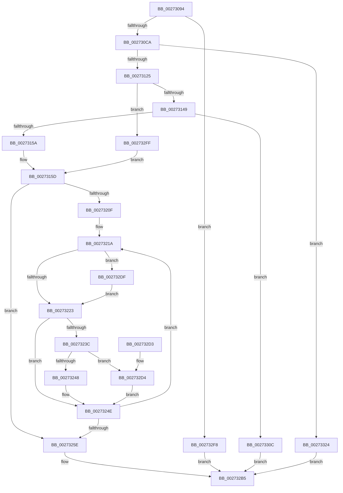

# MmMapViewInSystemCache

- RVA: `0x00273094`–`0x0027332C` (길이 `664` bytes)
- VA: `0x0000000140273094`
- 실행 섹션: `.text`
- PDB 이름 있음: `예`; PDB Function 태그: `아니요`
- unwind 정보 RVA: `0x00065CAC`
- 디코드: `166`개 명령, `664/664` bytes 표시
- 미해석 바이트: `0` (있으면 어셈블리에 `.byte`로 보존)

> 이 문서는 커널 이미지의 기계어와 PDB 기호를 분석해 생성했습니다. 4번과 5번은 함수 원형과 자료형을 바이너리 사용 방식에서 추정한 C 해석이며 원본 소스 복구 결과는 아닙니다.

## 1. Dependencies

- 직접 호출 지점: **11**; 고유 호출 대상: **11**
- 직접 호출자로 확인된 함수: **1**
- RIP 상대 이미지 참조: **3**

### Outgoing calls
- `0x002730CA` → [MiSectionControlArea](../29/MiSectionControlArea_function_00294CB0.md) (function, `0x00294CB0`)
- `0x002730FC` → [MiOffsetToProtos](../24/MiOffsetToProtos_function_0024D880.md) (function, `0x0024D880`)
- `0x00273118` → [MiAddViewsForSection](../32/MiAddViewsForSection_function_00324990.md) (function, `0x00324990`)
- `0x00273149` → [MiObtainSystemCacheView](../23/MiObtainSystemCacheView_function_00238870.md) (function, `0x00238870`)
- `0x002731A3` → [MiGetSystemCacheReverseMap](../29/MiGetSystemCacheReverseMap_function_00294BF0.md) (function, `0x00294BF0`)
- `0x002731F0` → [MiLockWorkingSetOptimal](../23/MiLockWorkingSetOptimal_function_00238FC0.md) (function, `0x00238FC0`)
- `0x00273281` → [MiIncreaseUsedPtes](../24/MiIncreaseUsedPtes_function_00243630.md) (function, `0x00243630`)
- `0x00273294` → [MiUnlockWorkingSetOptimal](../23/MiUnlockWorkingSetOptimal_function_00238DFC.md) (function, `0x00238DFC`)
- `0x002732AE` → [MiManageSubsectionView](../2E/MiManageSubsectionView_function_002E2570.md) (function, `0x002E2570`)
- `0x00273302` → [MiReadyReservedView](../4C/MiReadyReservedView_function_004CC0D8.md) (function, `0x004CC0D8`)
- `0x00273318` → [MiRemoveSystemCacheReferences](../4C/MiRemoveSystemCacheReferences_function_004CFE50.md) (function, `0x004CFE50`)

### Direct callers
- [CcGetVacbMiss](CcGetVacbMiss_function_00272900.md) at `0x00272AEA`

### Static image references
- `0x00273129` → RVA `0x00E30088` (`.data`; read)
- `0x00273223` → RVA `0x00E2DC80` (`.data`; read)
- `0x0027330C` → RVA `0x00E388E0` (`.data`; read/write)

## 2. Other-region calls and transfers

- 다른 실행 섹션으로 향하는 call: **0**
- 별도 외부 분기/꼬리 이동을 확인하지 못했습니다.

## 3. Assembly (complete function range)

```asm
00273094  48 8B C4                        mov rax, rsp
00273097  48 89 58 10                     mov qword ptr [rax + 0x10], rbx
0027309B  48 89 68 18                     mov qword ptr [rax + 0x18], rbp
0027309F  48 89 70 20                     mov qword ptr [rax + 0x20], rsi
002730A3  57                              push rdi
002730A4  41 54                           push r12
002730A6  41 55                           push r13
002730A8  41 56                           push r14
002730AA  41 57                           push r15
002730AC  48 83 EC 40                     sub rsp, 0x40
002730B0  48 83 60 B8 00                  and qword ptr [rax - 0x48], 0
002730B5  4D 8B E0                        mov r12, r8
002730B8  C6 40 28 00                     mov byte ptr [rax + 0x28], 0
002730BC  48 8B F2                        mov rsi, rdx
002730BF  8B 41 38                        mov eax, dword ptr [rcx + 0x38]
002730C2  A8 20                           test al, 0x20
002730C4  0F 85 2E 02 00 00               jne 0x1402732f8
002730CA  E8 E1 1B 02 00                  call 0x140294cb0
002730CF  41 8B 11                        mov edx, dword ptr [r9]
002730D2  4C 8D 44 24 20                  lea r8, [rsp + 0x20]
002730D7  F7 C2 FF 0F 00 00               test edx, 0xfff
002730DD  B9 00 00 00 00                  mov ecx, 0
002730E2  48 8B D8                        mov rbx, rax
002730E5  0F 95 C1                        setne cl
002730E8  C1 EA 0C                        shr edx, 0xc
002730EB  8D 04 11                        lea eax, [rcx + rdx]
002730EE  49 8B 14 24                     mov rdx, qword ptr [r12]
002730F2  48 8B CB                        mov rcx, rbx
002730F5  89 44 24 70                     mov dword ptr [rsp + 0x70], eax
002730F9  44 8B E8                        mov r13d, eax
002730FC  E8 7F A7 FD FF                  call 0x14024d880
00273101  48 8B 6C 24 20                  mov rbp, qword ptr [rsp + 0x20]
00273106  41 B8 05 00 00 00               mov r8d, 5
0027310C  49 03 ED                        add rbp, r13
0027310F  48 8B C8                        mov rcx, rax
00273112  48 8B D5                        mov rdx, rbp
00273115  48 8B F8                        mov rdi, rax
00273118  E8 73 18 0B 00                  call 0x140324990
0027311D  85 C0                           test eax, eax
0027311F  0F 88 FF 01 00 00               js 0x140273324
00273125  0F B7 4B 3C                     movzx ecx, word ptr [rbx + 0x3c]
00273129  48 8B 05 58 CF BB 00            mov rax, qword ptr [rip + 0xbbcf58]
00273130  81 E1 FF 03 00 00               and ecx, 0x3ff
00273136  48 8B 1E                        mov rbx, qword ptr [rsi]
00273139  4C 8B 3C C8                     mov r15, qword ptr [rax + rcx*8]
0027313D  49 8B CF                        mov rcx, r15
00273140  48 85 DB                        test rbx, rbx
00273143  0F 85 B6 01 00 00               jne 0x1402732ff
00273149  E8 22 57 FC FF                  call 0x140238870
0027314E  48 8B D8                        mov rbx, rax
00273151  48 85 C0                        test rax, rax
00273154  0F 84 B2 01 00 00               je 0x14027330c
0027315A  48 89 06                        mov qword ptr [rsi], rax
0027315D  4C 8B F3                        mov r14, rbx
00273160  48 B8 F8 FF FF FF 7F 00 00 00   movabs rax, 0x7ffffffff8
0027316A  49 C1 EE 09                     shr r14, 9
0027316E  4C 23 F0                        and r14, rax
00273171  48 B8 00 00 00 00 80 F6 FF FF   movabs rax, 0xfffff68000000000
0027317B  48 8B 4F 08                     mov rcx, qword ptr [rdi + 8]
0027317F  4C 03 F0                        add r14, rax
00273182  48 8B 44 24 20                  mov rax, qword ptr [rsp + 0x20]
00273187  48 8D 34 C1                     lea rsi, [rcx + rax*8]
0027318B  8B 47 2C                        mov eax, dword ptr [rdi + 0x2c]
0027318E  48 8D 04 C1                     lea rax, [rcx + rax*8]
00273192  48 8B CB                        mov rcx, rbx
00273195  48 89 44 24 28                  mov qword ptr [rsp + 0x28], rax
0027319A  4B 8D 04 EE                     lea rax, [r14 + r13*8]
0027319E  48 89 44 24 30                  mov qword ptr [rsp + 0x30], rax
002731A3  E8 48 1A 02 00                  call 0x140294bf0
002731A8  49 8B 1C 24                     mov rbx, qword ptr [r12]
002731AC  4C 8D 84 24 90 00 00 00         lea r8, [rsp + 0x90]
002731B4  48 8B E8                        mov rbp, rax
002731B7  48 C1 EB 02                     shr rbx, 2
002731BB  4D 8D A7 80 49 00 00            lea r12, [r15 + 0x4980]
002731C2  41 83 E5 3F                     and r13d, 0x3f
002731C6  48 8B 48 20                     mov rcx, qword ptr [rax + 0x20]
002731CA  49 8B D6                        mov rdx, r14
002731CD  48 B8 00 00 FF FF FF FF FF 3F   movabs rax, 0x3fffffffffff0000
002731D7  48 23 D8                        and rbx, rax
002731DA  48 B8 C0 FF 00 00 00 00 00 C0   movabs rax, 0xc00000000000ffc0
002731E4  48 23 C8                        and rcx, rax
002731E7  48 0B D9                        or rbx, rcx
002731EA  49 8B CC                        mov rcx, r12
002731ED  49 0B DD                        or rbx, r13
002731F0  E8 CB 5D FC FF                  call 0x140238fc0
002731F5  4C 8B 4C 24 30                  mov r9, qword ptr [rsp + 0x30]
002731FA  4C 8B F8                        mov r15, rax
002731FD  48 89 5D 20                     mov qword ptr [rbp + 0x20], rbx
00273201  48 83 65 10 FC                  and qword ptr [rbp + 0x10], 0xfffffffffffffffc
00273206  48 89 7D 18                     mov qword ptr [rbp + 0x18], rdi
0027320A  4D 3B F1                        cmp r14, r9
0027320D  73 4F                           jae 0x14027325e
0027320F  4C 8B 44 24 28                  mov r8, qword ptr [rsp + 0x28]
00273214  41 BA 00 04 00 00               mov r10d, 0x400
0027321A  49 3B F0                        cmp rsi, r8
0027321D  0F 83 BC 00 00 00               jae 0x1402732df
00273223  48 8B 15 56 AA BB 00            mov rdx, qword ptr [rip + 0xbbaa56]
0027322A  48 8B CE                        mov rcx, rsi
0027322D  48 C1 E1 10                     shl rcx, 0x10
00273231  48 8B C1                        mov rax, rcx
00273234  49 0B C2                        or rax, r10
00273237  48 85 D2                        test rdx, rdx
0027323A  74 12                           je 0x14027324e
0027323C  48 85 D0                        test rax, rdx
0027323F  48 8B C1                        mov rax, rcx
00273242  0F 84 8C 00 00 00               je 0x1402732d4
00273248  48 0D 10 04 00 00               or rax, 0x410
0027324E  49 89 06                        mov qword ptr [r14], rax
00273251  48 83 C6 08                     add rsi, 8
00273255  49 83 C6 08                     add r14, 8
00273259  4D 3B F1                        cmp r14, r9
0027325C  72 BC                           jb 0x14027321a
0027325E  48 8B 45 20                     mov rax, qword ptr [rbp + 0x20]
00273262  48 B9 00 00 00 00 00 00 00 C0   movabs rcx, 0xc000000000000000
0027326C  44 8B 44 24 70                  mov r8d, dword ptr [rsp + 0x70]
00273271  48 0B C1                        or rax, rcx
00273274  41 B9 02 00 00 00               mov r9d, 2
0027327A  48 89 45 20                     mov qword ptr [rbp + 0x20], rax
0027327E  49 8B D7                        mov rdx, r15
00273281  E8 AA 03 FD FF                  call 0x140243630
00273286  44 8A 84 24 90 00 00 00         mov r8b, byte ptr [rsp + 0x90]
0027328E  49 8B D7                        mov rdx, r15
00273291  49 8B CC                        mov rcx, r12
00273294  E8 63 5B FC FF                  call 0x140238dfc
00273299  4C 8B 45 18                     mov r8, qword ptr [rbp + 0x18]
0027329D  48 8B D5                        mov rdx, rbp
002732A0  4D 03 C0                        add r8, r8
002732A3  48 8B CF                        mov rcx, rdi
002732A6  41 83 E0 02                     and r8d, 2
002732AA  41 83 C8 01                     or r8d, 1
002732AE  E8 BD F2 06 00                  call 0x1402e2570
002732B3  33 C0                           xor eax, eax
002732B5  4C 8D 5C 24 40                  lea r11, [rsp + 0x40]
002732BA  49 8B 5B 38                     mov rbx, qword ptr [r11 + 0x38]
002732BE  49 8B 6B 40                     mov rbp, qword ptr [r11 + 0x40]
002732C2  49 8B 73 48                     mov rsi, qword ptr [r11 + 0x48]
002732C6  49 8B E3                        mov rsp, r11
002732C9  41 5F                           pop r15
002732CB  41 5E                           pop r14
002732CD  41 5D                           pop r13
002732CF  41 5C                           pop r12
002732D1  5F                              pop rdi
002732D2  C3                              ret
002732D3  CC                              int3
002732D4  48 0B C2                        or rax, rdx
002732D7  49 0B C2                        or rax, r10
002732DA  E9 6F FF FF FF                  jmp 0x14027324e
002732DF  48 8B 7F 10                     mov rdi, qword ptr [rdi + 0x10]
002732E3  48 8B 77 08                     mov rsi, qword ptr [rdi + 8]
002732E7  8B 47 2C                        mov eax, dword ptr [rdi + 0x2c]
002732EA  48 83 4D 18 01                  or qword ptr [rbp + 0x18], 1
002732EF  4C 8D 04 C6                     lea r8, [rsi + rax*8]
002732F3  E9 2B FF FF FF                  jmp 0x140273223
002732F8  B8 88 00 00 C0                  mov eax, 0xc0000088
002732FD  EB B6                           jmp 0x1402732b5
002732FF  48 8B D3                        mov rdx, rbx
00273302  E8 D1 8D 25 00                  call 0x1404cc0d8
00273307  E9 51 FE FF FF                  jmp 0x14027315d
0027330C  FF 05 CE 55 BC 00               inc dword ptr [rip + 0xbc55ce]
00273312  48 8B D5                        mov rdx, rbp
00273315  48 8B CF                        mov rcx, rdi
00273318  E8 33 CB 25 00                  call 0x1404cfe50
0027331D  B8 17 00 00 C0                  mov eax, 0xc0000017
00273322  EB 91                           jmp 0x1402732b5
00273324  FF 05 B6 55 BC 00               inc dword ptr [rip + 0xbc55b6]
0027332A  EB 89                           jmp 0x1402732b5
```

## 4. C-style interpretation (structured pseudocode)

```c
__int64 __fastcall MmMapViewInSystemCache(__int64 a1, __int64 a2, __int64 a3, __int64 a4, unsigned __int8 a5)
{
    __int64 result;
    __int64 v_r13;
    __int64 v_r14;
    __int64 v_rbp;
    __int64 v_rbx;
    __int64 v_rsi;
    __int64 v_rsp;
    unsigned __int64 v_stack_m28;
    unsigned __int64 v_stack_m38;
    unsigned __int64 v_stack_m40;
    unsigned __int64 v_stack_m48;
    unsigned int v_stack_p8;

    *(unsigned __int64 *)(v_rsp + 16) = v_rbx;
    *(unsigned __int64 *)(v_rsp + 24) = v_rbp;
    *(unsigned __int64 *)(v_rsp + 32) = v_rsi;
    v_rsp = (v_rsp) - (64);
    *(unsigned __int8 *)(v_rsp + 40) = 0;
    if ((((unsigned __int8)((unsigned int)(*(unsigned int *)(a1 + 56)))) & (32)) != 0) goto loc_002732F8;
    result = MiSectionControlArea(a1, a2, a3, a4);
    a1 = ((((unsigned int)((unsigned int)(*(unsigned int *)(a4)))) & (0xFFFULL)) != 0) ? 1 : 0;
    a2 = (unsigned int)(((unsigned int)(*(unsigned int *)(a4))) >> (12));
    v_stack_p8 = (unsigned int)(a1 + a2 * 1);
    result = MiOffsetToProtos(result, *(unsigned __int64 *)(a3), v_stack_m48, a4);
    v_rbp = (v_stack_m48) + ((unsigned int)((unsigned int)(a1 + a2 * 1)));
    result = MiAddViewsForSection(result, v_rbp, 5, a4);
    if (sign_flag) goto loc_00273324;
    a1 = (unsigned int)((*(unsigned __int16 *)(result + 60)) & (0x3FFULL));
    if (*(unsigned __int64 *)(a2) != 0) goto loc_002732FF;
    result = MiObtainSystemCacheView(*(unsigned __int64 *)(*(unsigned __int64 *)(v_rip + 12308312) + a1 * 8), v_rbp, 5, a4);
    if (result == 0) goto loc_0027330C;
    *(unsigned __int64 *)(a2) = result;
loc_0027315D:
    v_r14 = (result) >> (9);
    v_r14 = (v_r14) & (result);
    v_r14 = (v_r14) + (result);
    v_stack_m40 = *(unsigned __int64 *)(result + 8) + (unsigned int)(*(unsigned int *)(result + 44)) * 8;
    v_stack_m38 = v_r14 + (unsigned int)((unsigned int)(a1 + a2 * 1)) * 8;
    result = MiGetSystemCacheReverseMap(result, v_rbp, 5, a4);
    v_rbx = (*(unsigned __int64 *)(a3)) >> (2);
    v_r13 = (unsigned int)(((unsigned int)((unsigned int)(a1 + a2 * 1))) & (63));
    v_rbx = (v_rbx) & (result);
    a1 = (*(unsigned __int64 *)(result + 32)) & (result);
    v_rbx = (v_rbx) | (a1);
    v_rbx = (v_rbx) | (v_r13);
    result = MiLockWorkingSetOptimal(*(unsigned __int64 *)(*(unsigned __int64 *)(v_rip + 12308312) + a1 * 8) + 18816, v_r14, a5, a4);
    *(unsigned __int64 *)(result + 32) = v_rbx;
    *(unsigned __int64 *)(result + 24) = result;
    if (v_r14 >= v_stack_m38) goto loc_0027325E;
loc_0027321A:
    if ((*(unsigned __int64 *)(result + 8) + v_stack_m48 * 8) >= v_stack_m40) goto loc_002732DF;
loc_00273223:
    a1 = (*(unsigned __int64 *)(result + 8) + v_stack_m48 * 8) << (16);
    result = (a1) | ((unsigned int)(0x400ULL));
    if (*(unsigned __int64 *)(v_rip + 12298838) == 0) goto loc_0027324E;
    if (((result) & (*(unsigned __int64 *)(v_rip + 12298838))) == 0) goto loc_002732D4;
    result = (a1) | (0x410ULL);
loc_0027324E:
    *(unsigned __int64 *)(v_r14) = result;
    v_rsi = (*(unsigned __int64 *)(result + 8) + v_stack_m48 * 8) + (8);
    v_r14 = (v_r14) + (8);
    if (v_r14 < v_stack_m38) goto loc_0027321A;
loc_0027325E:
    result = (*(unsigned __int64 *)(result + 32)) | (a1);
    *(unsigned __int64 *)(result + 32) = result;
    result = MiIncreaseUsedPtes(a1, result, (unsigned int)(v_stack_p8), 2);
    result = MiUnlockWorkingSetOptimal(*(unsigned __int64 *)(*(unsigned __int64 *)(v_rip + 12308312) + a1 * 8) + 18816, result, a5, 2);
    a3 = (*(unsigned __int64 *)(result + 24)) + (*(unsigned __int64 *)(result + 24));
    a3 = (unsigned int)((a3) & (2));
    a3 = (unsigned int)((a3) | (1));
    result = MiManageSubsectionView(result, result, a3, 2);
    result = 0;
loc_002732B5:
    return result;
loc_002732D4:
    result = (result) | (0);
    result = (result) | ((unsigned int)(0x400ULL));
    goto loc_0027324E;
loc_002732DF:
    goto loc_00273223;
loc_002732F8:
    goto loc_002732B5;
loc_002732FF:
    result = MiReadyReservedView(result, *(unsigned __int64 *)(v_stack_m28 + 56), *(unsigned __int64 *)(*(unsigned __int64 *)(result + 16) + 8) + (unsigned int)(*(unsigned int *)(*(unsigned __int64 *)(result + 16) + 44)) * 8, 2);
    goto loc_0027315D;
loc_0027330C:
    result = MiRemoveSystemCacheReferences(*(unsigned __int64 *)(result + 16), *(unsigned __int64 *)(v_stack_m28 + 64), *(unsigned __int64 *)(*(unsigned __int64 *)(result + 16) + 8) + (unsigned int)(*(unsigned int *)(*(unsigned __int64 *)(result + 16) + 44)) * 8, 2);
    goto loc_002732B5;
loc_00273324:
    goto loc_002732B5;
}
```

## 5. (Beta) C Style

```c
int64_t MmMapViewInSystemCache(void *Arg1, void *Arg2, void *Arg3, int64_t Arg4, uint8_t Arg5)
{
    uint8_t *arg1 = (uint8_t *)Arg1;
    uint8_t *arg2 = (uint8_t *)Arg2;
    uint8_t *arg3 = (uint8_t *)Arg3;

    int64_t result;
    int64_t local_r13;
    int64_t local_r14;
    int64_t local_rbp;
    int64_t local_rbx;
    int64_t local_rsi;
    int64_t local_rsp;
    uint64_t v_stack_m28;
    uint64_t v_stack_m38;
    uint64_t v_stack_m40;
    uint64_t v_stack_m48;
    uint32_t v_stack_p8;

    *(uint64_t *)(local_rsp + 0x10) = local_rbx;
    *(uint64_t *)(local_rsp + 0x18) = local_rbp;
    *(uint64_t *)(local_rsp + 0x20) = local_rsi;
    local_rsp = (local_rsp) - (64);
    *(uint8_t *)(local_rsp + 0x28) = 0;
    if ((((uint8_t)((uint32_t)(*(uint32_t *)(arg1 + 0x38)))) & (32)) != 0) goto loc_002732F8;
    result = MiSectionControlArea(Arg1, Arg2, Arg3, Arg4);
    Arg1 = ((((uint32_t)((uint32_t)(*(uint32_t *)(Arg4)))) & (0xFFFULL)) != 0) ? 1 : 0;
    Arg2 = (uint32_t)(((uint32_t)(*(uint32_t *)(Arg4))) >> (12));
    v_stack_p8 = (uint32_t)(Arg1 + Arg2 * 1);
    result = MiOffsetToProtos(result, *(uint64_t *)(arg3), v_stack_m48, Arg4);
    local_rbp = (v_stack_m48) + ((uint32_t)((uint32_t)(Arg1 + Arg2 * 1)));
    result = MiAddViewsForSection(result, local_rbp, 5, Arg4);
    if (sign_flag) goto loc_00273324;
    Arg1 = (uint32_t)((*(uint16_t *)(result + 0x3C)) & (0x3FFULL));
    if (*(uint64_t *)(arg2) != 0) goto loc_002732FF;
    result = MiObtainSystemCacheView(*(uint64_t *)(*(uint64_t *)(v_rip + 0xBBCF58) + arg1 * 8), local_rbp, 5, Arg4);
    if (result == 0) goto loc_0027330C;
    *(uint64_t *)(arg2) = result;
loc_0027315D:
    local_r14 = (result) >> (9);
    local_r14 = (local_r14) & (result);
    local_r14 = (local_r14) + (result);
    v_stack_m40 = *(uint64_t *)(result + 0x8) + (uint32_t)(*(uint32_t *)(result + 0x2C)) * 8;
    v_stack_m38 = local_r14 + (uint32_t)((uint32_t)(Arg1 + Arg2 * 1)) * 8;
    result = MiGetSystemCacheReverseMap(result, local_rbp, 5, Arg4);
    local_rbx = (*(uint64_t *)(arg3)) >> (2);
    local_r13 = (uint32_t)(((uint32_t)((uint32_t)(Arg1 + Arg2 * 1))) & (63));
    local_rbx = (local_rbx) & (result);
    Arg1 = (*(uint64_t *)(result + 0x20)) & (result);
    local_rbx = (local_rbx) | (Arg1);
    local_rbx = (local_rbx) | (local_r13);
    result = MiLockWorkingSetOptimal(*(uint64_t *)(*(uint64_t *)(v_rip + 0xBBCF58) + arg1 * 8) + 18816, local_r14, Arg5, Arg4);
    *(uint64_t *)(result + 0x20) = local_rbx;
    *(uint64_t *)(result + 0x18) = result;
    if (local_r14 >= v_stack_m38) goto loc_0027325E;
loc_0027321A:
    if ((*(uint64_t *)(result + 0x8) + v_stack_m48 * 8) >= v_stack_m40) goto loc_002732DF;
loc_00273223:
    Arg1 = (*(uint64_t *)(result + 0x8) + v_stack_m48 * 8) << (16);
    result = (Arg1) | ((uint32_t)(0x400ULL));
    if (*(uint64_t *)(v_rip + 0xBBAA56) == 0) goto loc_0027324E;
    if (((result) & (*(uint64_t *)(v_rip + 0xBBAA56))) == 0) goto loc_002732D4;
    result = (Arg1) | (0x410ULL);
loc_0027324E:
    *(uint64_t *)(local_r14) = result;
    local_rsi = (*(uint64_t *)(result + 0x8) + v_stack_m48 * 8) + (8);
    local_r14 = (local_r14) + (8);
    if (local_r14 < v_stack_m38) goto loc_0027321A;
loc_0027325E:
    result = (*(uint64_t *)(result + 0x20)) | (Arg1);
    *(uint64_t *)(result + 0x20) = result;
    result = MiIncreaseUsedPtes(Arg1, result, (uint32_t)(v_stack_p8), 2);
    result = MiUnlockWorkingSetOptimal(*(uint64_t *)(*(uint64_t *)(v_rip + 0xBBCF58) + arg1 * 8) + 18816, result, Arg5, 2);
    Arg3 = (*(uint64_t *)(result + 0x18)) + (*(uint64_t *)(result + 0x18));
    Arg3 = (uint32_t)((Arg3) & (2));
    Arg3 = (uint32_t)((Arg3) | (1));
    result = MiManageSubsectionView(result, result, Arg3, 2);
    result = 0;
loc_002732B5:
    return result;
loc_002732D4:
    result = (result) | (0);
    result = (result) | ((uint32_t)(0x400ULL));
    goto loc_0027324E;
loc_002732DF:
    goto loc_00273223;
loc_002732F8:
    goto loc_002732B5;
loc_002732FF:
    result = MiReadyReservedView(result, *(uint64_t *)(v_stack_m28 + 0x38), *(uint64_t *)(*(uint64_t *)(result + 0x10) + 0x8) + (uint32_t)(*(uint32_t *)(*(uint64_t *)(result + 0x10) + 0x2C)) * 8, 2);
    goto loc_0027315D;
loc_0027330C:
    result = MiRemoveSystemCacheReferences(*(uint64_t *)(result + 0x10), *(uint64_t *)(v_stack_m28 + 0x40), *(uint64_t *)(*(uint64_t *)(result + 0x10) + 0x8) + (uint32_t)(*(uint32_t *)(*(uint64_t *)(result + 0x10) + 0x2C)) * 8, 2);
    goto loc_002732B5;
loc_00273324:
    goto loc_002732B5;
}
```

### 관측된 메모리 오프셋

구조체 형식이 확인되지 않은 접근은 인자 기준의 오프셋으로만 기록했습니다.

| 기준 인자 | 오프셋 표현 | 폭 (bit) | 접근 |
|---|---:|---:|---|
| `Arg1` | `+ 0x38` | `32` | `R` |
| `Arg2` | `+ 0x0` | `64` | `R` |
| `Arg2` | `+ 0x0` | `64` | `W` |
| `Arg3` | `+ 0x0` | `64` | `R` |

## 6. Execution-region graph

[열기: 2D/3D 그래프와 함수 탐색 컨트롤 패널](../../../control-panel.html?section=text&rva=0x00273094&view=graph)

- 2D 그래프는 위에서 아래로 흐르고, 3D 그래프는 빈 공간을 드래그해 회전합니다. Shift+드래그는 이동, 휠은 확대·축소, 함수 노드 선택은 대상 보고서 이동입니다.

### Static fallback


