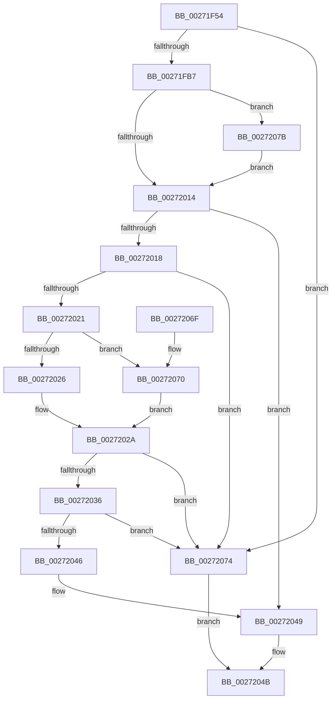

# PnpGetRelatedTargetDevice

- RVA: `0x00271F54`–`0x00272086` (길이 `306` bytes)
- VA: `0x0000000140271F54`
- 실행 섹션: `.text`
- PDB 이름 있음: `예`; PDB Function 태그: `아니요`
- unwind 정보 RVA: `0x00065B4C`
- 디코드: `86`개 명령, `306/306` bytes 표시
- 미해석 바이트: `0` (있으면 어셈블리에 `.byte`로 보존)

> 이 문서는 커널 이미지의 기계어와 PDB 기호를 분석해 생성했습니다. 4번과 5번은 함수 원형과 자료형을 바이너리 사용 방식에서 추정한 C 해석이며 원본 소스 복구 결과는 아닙니다.

## 1. Dependencies

- 직접 호출 지점: **9**; 고유 호출 대상: **9**
- 직접 호출자로 확인된 함수: **7**
- RIP 상대 이미지 참조: **1**

### Outgoing calls
- `0x00271F90` → [KeAcquireQueuedSpinLock](KeAcquireQueuedSpinLock_function_00273D80.md) (function, `0x00273D80`)
- `0x00271F9A` → [IoGetRelatedDeviceObject](../29/IoGetRelatedDeviceObject_function_0029B120.md) (function, `0x0029B120`)
- `0x00271FA9` → [KeReleaseQueuedSpinLock](KeReleaseQueuedSpinLock_function_00272540.md) (function, `0x00272540`)
- `0x00271FC1` → [memset](../6C/memset_function_006C6C40.md) (function, `0x006C6C40`)
- `0x00271FE9` → [PnpSetDeviceAffinityThread](PnpSetDeviceAffinityThread_function_00271EA4.md) (function, `0x00271EA4`)
- `0x00272009` → [IopSynchronousCall](../../page/8F/IopSynchronousCall_function_008FB018.md) (function, `0x008FB018`)
- `0x0027202C` → [ExFreePoolWithTag](../../poolcode/B8/ExFreePoolWithTag_function_00B82870.md) (function, `0x00B82870`)
- `0x00272052` → [_security_check_cookie](../6A/_security_check_cookie_function_006AC640.md) (function, `0x006AC640`)
- `0x0027207F` → [KeRevertToUserGroupAffinityThread](../39/KeRevertToUserGroupAffinityThread_function_00398EC0.md) (function, `0x00398EC0`)

### Direct callers
- [PiUEventGetDmObjectFromUserHandle](../../page/72/PiUEventGetDmObjectFromUserHandle_function_0072DF88.md) at `0x0072DFFE`
- [IoRegisterPlugPlayNotification](../../page/95/IoRegisterPlugPlayNotification_function_009535A0.md) at `0x00953631`
- [RawMountVolume](../../page/9A/RawMountVolume_function_009A4844.md) at `0x009A4A01`
- [PiUEventGetDeviceInstanceIdFromUserHandle](../../page/A3/PiUEventGetDeviceInstanceIdFromUserHandle_function_00A38954.md) at `0x00A389D5`
- [FsRtlNotifyVolumeEventEx](../../page/A6/FsRtlNotifyVolumeEventEx_function_00A66DC0.md) at `0x00A66DE3`
- [IoGetRelatedTargetDevice](../../page/A6/IoGetRelatedTargetDevice_function_00A6DBFC.md) at `0x00A6DC10`
- [NtGetDevicePowerState](../../page/A9/NtGetDevicePowerState_function_00A9B750.md) at `0x00A9B7E4`

### Static image references
- `0x00271F6E` → RVA `0x00E0A740` (`.data`; read)

## 2. Other-region calls and transfers

- 다른 실행 섹션으로 향하는 call: **2**
  - `0x00272009` → [IopSynchronousCall](../../page/8F/IopSynchronousCall_function_008FB018.md) (`.text` → `PAGE`)
  - `0x0027202C` → [ExFreePoolWithTag](../../poolcode/B8/ExFreePoolWithTag_function_00B82870.md) (`.text` → `POOLCODE`)
- 별도 외부 분기/꼬리 이동을 확인하지 못했습니다.

## 3. Assembly (complete function range)

```asm
00271F54  48 89 5C 24 18                  mov qword ptr [rsp + 0x18], rbx
00271F59  48 89 74 24 20                  mov qword ptr [rsp + 0x20], rsi
00271F5E  55                              push rbp
00271F5F  57                              push rdi
00271F60  41 56                           push r14
00271F62  48 8D 6C 24 B9                  lea rbp, [rsp - 0x47]
00271F67  48 81 EC A0 00 00 00            sub rsp, 0xa0
00271F6E  48 8B 05 CB 87 B9 00            mov rax, qword ptr [rip + 0xb987cb]
00271F75  48 33 C4                        xor rax, rsp
00271F78  48 89 45 37                     mov qword ptr [rbp + 0x37], rax
00271F7C  48 83 65 D7 00                  and qword ptr [rbp - 0x29], 0
00271F81  4C 8B F1                        mov r14, rcx
00271F84  48 83 22 00                     and qword ptr [rdx], 0
00271F88  B9 0A 00 00 00                  mov ecx, 0xa
00271F8D  48 8B F2                        mov rsi, rdx
00271F90  E8 EB 1D 00 00                  call 0x140273d80
00271F95  49 8B CE                        mov rcx, r14
00271F98  8A D8                           mov bl, al
00271F9A  E8 81 91 02 00                  call 0x14029b120
00271F9F  8A D3                           mov dl, bl
00271FA1  B9 0A 00 00 00                  mov ecx, 0xa
00271FA6  48 8B F8                        mov rdi, rax
00271FA9  E8 92 05 00 00                  call 0x140272540
00271FAE  48 85 FF                        test rdi, rdi
00271FB1  0F 84 BD 00 00 00               je 0x140272074
00271FB7  33 D2                           xor edx, edx
00271FB9  48 8D 4D DF                     lea rcx, [rbp - 0x21]
00271FBD  44 8D 42 48                     lea r8d, [rdx + 0x48]
00271FC1  E8 7A 4C 45 00                  call 0x1406c6c40
00271FC6  0F 57 C0                        xorps xmm0, xmm0
00271FC9  66 C7 45 DF 1B 07               mov word ptr [rbp - 0x21], 0x71b
00271FCF  48 8D 55 27                     lea rdx, [rbp + 0x27]
00271FD3  C7 45 E7 04 00 00 00            mov dword ptr [rbp - 0x19], 4
00271FDA  48 8B CF                        mov rcx, rdi
00271FDD  48 89 7D 07                     mov qword ptr [rbp + 7], rdi
00271FE1  0F 11 45 27                     movups xmmword ptr [rbp + 0x27], xmm0
00271FE5  4C 89 75 0F                     mov qword ptr [rbp + 0xf], r14
00271FE9  E8 B6 FE FF FF                  call 0x140271ea4
00271FEE  8B D8                           mov ebx, eax
00271FF0  48 8D 55 DF                     lea rdx, [rbp - 0x21]
00271FF4  48 8D 45 D7                     lea rax, [rbp - 0x29]
00271FF8  45 33 C9                        xor r9d, r9d
00271FFB  41 B8 BB 00 00 C0               mov r8d, 0xc00000bb
00272001  48 89 44 24 20                  mov qword ptr [rsp + 0x20], rax
00272006  48 8B CF                        mov rcx, rdi
00272009  E8 0A 90 68 00                  call 0x1408fb018
0027200E  8B F8                           mov edi, eax
00272010  85 DB                           test ebx, ebx
00272012  75 67                           jne 0x14027207b
00272014  85 FF                           test edi, edi
00272016  78 31                           js 0x140272049
00272018  48 8B 4D D7                     mov rcx, qword ptr [rbp - 0x29]
0027201C  48 85 C9                        test rcx, rcx
0027201F  74 53                           je 0x140272074
00272021  83 39 01                        cmp dword ptr [rcx], 1
00272024  75 4A                           jne 0x140272070
00272026  48 8B 59 08                     mov rbx, qword ptr [rcx + 8]
0027202A  33 D2                           xor edx, edx
0027202C  E8 3F 08 91 00                  call 0x140b82870
00272031  48 85 DB                        test rbx, rbx
00272034  74 3E                           je 0x140272074
00272036  48 8B 83 38 01 00 00            mov rax, qword ptr [rbx + 0x138]
0027203D  48 8B 48 28                     mov rcx, qword ptr [rax + 0x28]
00272041  48 85 C9                        test rcx, rcx
00272044  74 2E                           je 0x140272074
00272046  48 89 0E                        mov qword ptr [rsi], rcx
00272049  8B C7                           mov eax, edi
0027204B  48 8B 4D 37                     mov rcx, qword ptr [rbp + 0x37]
0027204F  48 33 CC                        xor rcx, rsp
00272052  E8 E9 A5 43 00                  call 0x1406ac640
00272057  4C 8D 9C 24 A0 00 00 00         lea r11, [rsp + 0xa0]
0027205F  49 8B 5B 30                     mov rbx, qword ptr [r11 + 0x30]
00272063  49 8B 73 38                     mov rsi, qword ptr [r11 + 0x38]
00272067  49 8B E3                        mov rsp, r11
0027206A  41 5E                           pop r14
0027206C  5F                              pop rdi
0027206D  5D                              pop rbp
0027206E  C3                              ret
0027206F  CC                              int3
00272070  33 DB                           xor ebx, ebx
00272072  EB B6                           jmp 0x14027202a
00272074  B8 0E 00 00 C0                  mov eax, 0xc000000e
00272079  EB D0                           jmp 0x14027204b
0027207B  48 8D 4D 27                     lea rcx, [rbp + 0x27]
0027207F  E8 3C 6E 12 00                  call 0x140398ec0
00272084  EB 8E                           jmp 0x140272014
```

## 4. C-style interpretation (structured pseudocode)

```c
__int64 __fastcall PnpGetRelatedTargetDevice(__int64 a1, __int64 a2, __int64 a3, int a4)
{
    __int64 result;
    __int64 v_rbx;
    __int64 v_rsp;
    unsigned __int64 v_stack_m18;
    unsigned __int64 v_stack_m28;
    unsigned __int64 v_stack_m38;
    unsigned __int64 v_stack_m50;
    unsigned __int64 v_stack_m58;
    unsigned __int64 v_stack_m5F;
    unsigned int v_stack_m78;
    unsigned __int64 v_stack_m80;
    unsigned __int64 v_stack_m88;
    unsigned __int64 v_stack_m98;
    unsigned __int64 v_stack_p18;
    unsigned __int64 v_stack_p20;

    v_stack_p18 = v_rbx;
    v_stack_p20 = v_rsi;
    v_rsp = (v_rsp) - (160);
    result = (*(unsigned __int64 *)(v_rip + 12158923)) ^ (v_rsp);
    v_stack_m28 = result;
    result = KeAcquireQueuedSpinLock(10, a2, a3, a4);
    result = IoGetRelatedDeviceObject(a1, a2, a3, a4);
    result = KeReleaseQueuedSpinLock(10, (unsigned __int8)((unsigned __int8)(result)), a3, a4);
    if (result == 0) goto loc_00272074;
    a2 = 0;
    result = memset(v_stack_m80, a2, a2 + 72, a4);
    v_stack_m80 = 0x71BULL;
    v_stack_m78 = 4;
    v_stack_m58 = result;
    v_stack_m38 = v_xmm0;
    v_stack_m50 = a1;
    result = PnpSetDeviceAffinityThread(result, v_stack_m38, a2 + 72, a4);
    a4 = 0;
    v_stack_m98 = v_stack_m88;
    result = IopSynchronousCall(result, v_stack_m80, (unsigned int)(0xC00000BBULL), a4);
    if ((unsigned int)((unsigned int)((unsigned int)(result))) != 0) goto loc_0027207B;
loc_00272014:
    if (sign_flag) goto loc_00272049;
    if (v_stack_m88 == 0) goto loc_00272074;
    if ((*(unsigned int *)(v_stack_m88)) != 1) goto loc_00272070;
loc_0027202A:
    a2 = 0;
    result = ExFreePoolWithTag(v_stack_m88, a2, (unsigned int)(0xC00000BBULL), a4);
    if (*(unsigned __int64 *)(v_stack_m88 + 8) == 0) goto loc_00272074;
    if (*(unsigned __int64 *)(*(unsigned __int64 *)(*(unsigned __int64 *)(v_stack_m88 + 8) + 312) + 40) == 0) goto loc_00272074;
    *(unsigned __int64 *)(a2) = *(unsigned __int64 *)(*(unsigned __int64 *)(*(unsigned __int64 *)(v_stack_m88 + 8) + 312) + 40);
loc_00272049:
loc_0027204B:
    a1 = (v_stack_m28) ^ (v_rsp);
    result = _security_check_cookie(a1, a2, (unsigned int)(0xC00000BBULL), a4);
    return result;
loc_00272070:
    v_rbx = 0;
    goto loc_0027202A;
loc_00272074:
    goto loc_0027204B;
loc_0027207B:
    result = KeRevertToUserGroupAffinityThread(v_stack_m38, a2, (unsigned int)(0xC00000BBULL), a4);
    goto loc_00272014;
}
```

## 5. (Beta) C Style

```c
int64_t PnpGetRelatedTargetDevice(int64_t Arg1, void *Arg2, int64_t Arg3, int32_t Arg4)
{
    uint8_t *arg2 = (uint8_t *)Arg2;

    int64_t result;
    int64_t local_rbx;
    int64_t local_rsp;
    uint64_t v_stack_m18;
    uint64_t v_stack_m28;
    uint64_t v_stack_m38;
    uint64_t v_stack_m50;
    uint64_t v_stack_m58;
    uint64_t v_stack_m5F;
    uint32_t v_stack_m78;
    uint64_t v_stack_m80;
    uint64_t v_stack_m88;
    uint64_t v_stack_m98;
    uint64_t v_stack_p18;
    uint64_t v_stack_p20;

    v_stack_p18 = local_rbx;
    v_stack_p20 = local_rsi;
    local_rsp = (local_rsp) - (160);
    result = (*(uint64_t *)(v_rip + 0xB987CB)) ^ (local_rsp);
    v_stack_m28 = result;
    result = KeAcquireQueuedSpinLock(10, Arg2, Arg3, Arg4);
    result = IoGetRelatedDeviceObject(Arg1, Arg2, Arg3, Arg4);
    result = KeReleaseQueuedSpinLock(10, (uint8_t)((uint8_t)(result)), Arg3, Arg4);
    if (result == 0) goto loc_00272074;
    Arg2 = 0;
    result = memset(v_stack_m80, Arg2, Arg2 + 72, Arg4);
    v_stack_m80 = 0x71BULL;
    v_stack_m78 = 4;
    v_stack_m58 = result;
    v_stack_m38 = v_xmm0;
    v_stack_m50 = Arg1;
    result = PnpSetDeviceAffinityThread(result, v_stack_m38, Arg2 + 72, Arg4);
    Arg4 = 0;
    v_stack_m98 = v_stack_m88;
    result = IopSynchronousCall(result, v_stack_m80, (uint32_t)(0xC00000BBULL), Arg4);
    if ((uint32_t)((uint32_t)((uint32_t)(result))) != 0) goto loc_0027207B;
loc_00272014:
    if (sign_flag) goto loc_00272049;
    if (v_stack_m88 == 0) goto loc_00272074;
    if ((*(uint32_t *)(v_stack_m88)) != 1) goto loc_00272070;
loc_0027202A:
    Arg2 = 0;
    result = ExFreePoolWithTag(v_stack_m88, Arg2, (uint32_t)(0xC00000BBULL), Arg4);
    if (*(uint64_t *)(v_stack_m88 + 0x8) == 0) goto loc_00272074;
    if (*(uint64_t *)(*(uint64_t *)(*(uint64_t *)(v_stack_m88 + 0x8) + 0x138) + 0x28) == 0) goto loc_00272074;
    *(uint64_t *)(arg2) = *(uint64_t *)(*(uint64_t *)(*(uint64_t *)(v_stack_m88 + 0x8) + 0x138) + 0x28);
loc_00272049:
loc_0027204B:
    Arg1 = (v_stack_m28) ^ (local_rsp);
    result = _security_check_cookie(Arg1, Arg2, (uint32_t)(0xC00000BBULL), Arg4);
    return result;
loc_00272070:
    local_rbx = 0;
    goto loc_0027202A;
loc_00272074:
    goto loc_0027204B;
loc_0027207B:
    result = KeRevertToUserGroupAffinityThread(v_stack_m38, Arg2, (uint32_t)(0xC00000BBULL), Arg4);
    goto loc_00272014;
}
```

### 관측된 메모리 오프셋

구조체 형식이 확인되지 않은 접근은 인자 기준의 오프셋으로만 기록했습니다.

| 기준 인자 | 오프셋 표현 | 폭 (bit) | 접근 |
|---|---:|---:|---|
| `Arg2` | `+ 0x0` | `64` | `R/W` |
| `Arg2` | `+ 0x0` | `64` | `W` |

## 6. Execution-region graph

[열기: 2D/3D 그래프와 함수 탐색 컨트롤 패널](../../../control-panel.html?section=text&rva=0x00271F54&view=graph)

- 2D 그래프는 위에서 아래로 흐르고, 3D 그래프는 빈 공간을 드래그해 회전합니다. Shift+드래그는 이동, 휠은 확대·축소, 함수 노드 선택은 대상 보고서 이동입니다.

### Static fallback


