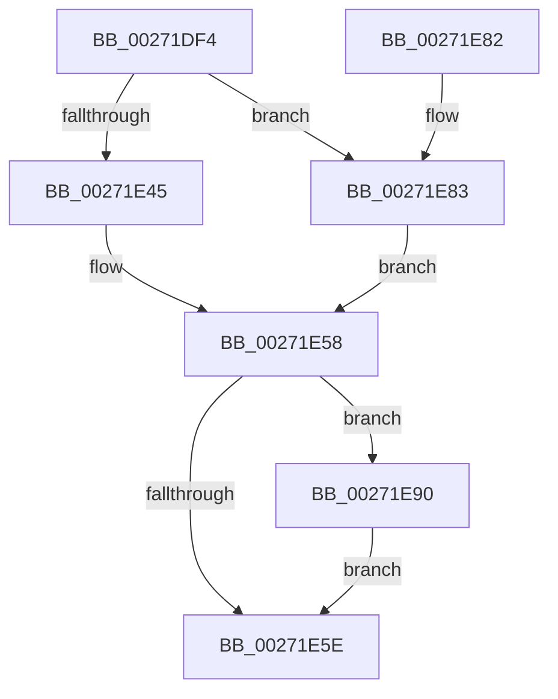

# PnpSendIrp

- RVA: `0x00271DF4`–`0x00271E9C` (길이 `168` bytes)
- VA: `0x0000000140271DF4`
- 실행 섹션: `.text`
- PDB 이름 있음: `예`; PDB Function 태그: `아니요`
- unwind 정보 RVA: `0x00065B18`
- 디코드: `49`개 명령, `168/168` bytes 표시
- 미해석 바이트: `0` (있으면 어셈블리에 `.byte`로 보존)

> 이 문서는 커널 이미지의 기계어와 PDB 기호를 분석해 생성했습니다. 4번과 5번은 함수 원형과 자료형을 바이너리 사용 방식에서 추정한 C 해석이며 원본 소스 복구 결과는 아닙니다.

## 1. Dependencies

- 직접 호출 지점: **5**; 고유 호출 대상: **5**
- 직접 호출자로 확인된 함수: **2**
- RIP 상대 이미지 참조: **1**

### Outgoing calls
- `0x00271E33` → [PnpSetDeviceAffinityThread](PnpSetDeviceAffinityThread_function_00271EA4.md) (function, `0x00271EA4`)
- `0x00271E53` → [IopSynchronousCall](../../page/8F/IopSynchronousCall_function_008FB018.md) (function, `0x008FB018`)
- `0x00271E68` → [_security_check_cookie](../6A/_security_check_cookie_function_006AC640.md) (function, `0x006AC640`)
- `0x00271E89` → [PnpAsynchronousCall](../../page/A6/PnpAsynchronousCall_function_00A635D0.md) (function, `0x00A635D0`)
- `0x00271E95` → [KeRevertToUserGroupAffinityThread](../39/KeRevertToUserGroupAffinityThread_function_00398EC0.md) (function, `0x00398EC0`)

### Direct callers
- [PnpStartDevice](../49/PnpStartDevice_function_00499E60.md) at `0x00499EE3`
- [PnpQueryDeviceRelations](../../page/8F/PnpQueryDeviceRelations_function_008F9FE0.md) at `0x008FA02C`

### Static image references
- `0x00271E06` → RVA `0x00E0A740` (`.data`; read)

## 2. Other-region calls and transfers

- 다른 실행 섹션으로 향하는 call: **2**
  - `0x00271E53` → [IopSynchronousCall](../../page/8F/IopSynchronousCall_function_008FB018.md) (`.text` → `PAGE`)
  - `0x00271E89` → [PnpAsynchronousCall](../../page/A6/PnpAsynchronousCall_function_00A635D0.md) (`.text` → `PAGE`)
- 별도 외부 분기/꼬리 이동을 확인하지 못했습니다.

## 3. Assembly (complete function range)

```asm
00271DF4  48 89 5C 24 10                  mov qword ptr [rsp + 0x10], rbx
00271DF9  48 89 6C 24 18                  mov qword ptr [rsp + 0x18], rbp
00271DFE  56                              push rsi
00271DFF  57                              push rdi
00271E00  41 56                           push r14
00271E02  48 83 EC 50                     sub rsp, 0x50
00271E06  48 8B 05 33 89 B9 00            mov rax, qword ptr [rip + 0xb98933]
00271E0D  48 33 C4                        xor rax, rsp
00271E10  48 89 44 24 40                  mov qword ptr [rsp + 0x40], rax
00271E15  48 8B B4 24 90 00 00 00         mov rsi, qword ptr [rsp + 0x90]
00271E1D  48 8B FA                        mov rdi, rdx
00271E20  0F 57 C0                        xorps xmm0, xmm0
00271E23  48 8D 54 24 30                  lea rdx, [rsp + 0x30]
00271E28  0F 11 44 24 30                  movups xmmword ptr [rsp + 0x30], xmm0
00271E2D  4D 8B F1                        mov r14, r9
00271E30  48 8B D9                        mov rbx, rcx
00271E33  E8 6C 00 00 00                  call 0x140271ea4
00271E38  8B E8                           mov ebp, eax
00271E3A  48 8B D7                        mov rdx, rdi
00271E3D  48 8B CB                        mov rcx, rbx
00271E40  4D 85 F6                        test r14, r14
00271E43  75 3E                           jne 0x140271e83
00271E45  45 33 C9                        xor r9d, r9d
00271E48  48 89 74 24 20                  mov qword ptr [rsp + 0x20], rsi
00271E4D  41 B8 BB 00 00 C0               mov r8d, 0xc00000bb
00271E53  E8 C0 91 68 00                  call 0x1408fb018
00271E58  8B D8                           mov ebx, eax
00271E5A  85 ED                           test ebp, ebp
00271E5C  75 32                           jne 0x140271e90
00271E5E  8B C3                           mov eax, ebx
00271E60  48 8B 4C 24 40                  mov rcx, qword ptr [rsp + 0x40]
00271E65  48 33 CC                        xor rcx, rsp
00271E68  E8 D3 A7 43 00                  call 0x1406ac640
00271E6D  4C 8D 5C 24 50                  lea r11, [rsp + 0x50]
00271E72  49 8B 5B 28                     mov rbx, qword ptr [r11 + 0x28]
00271E76  49 8B 6B 30                     mov rbp, qword ptr [r11 + 0x30]
00271E7A  49 8B E3                        mov rsp, r11
00271E7D  41 5E                           pop r14
00271E7F  5F                              pop rdi
00271E80  5E                              pop rsi
00271E81  C3                              ret
00271E82  CC                              int3
00271E83  4C 8B CE                        mov r9, rsi
00271E86  4D 8B C6                        mov r8, r14
00271E89  E8 42 17 7F 00                  call 0x140a635d0
00271E8E  EB C8                           jmp 0x140271e58
00271E90  48 8D 4C 24 30                  lea rcx, [rsp + 0x30]
00271E95  E8 26 70 12 00                  call 0x140398ec0
00271E9A  EB C2                           jmp 0x140271e5e
```

## 4. C-style interpretation (structured pseudocode)

```c
__int64 __fastcall PnpSendIrp(__int64 a1, __int64 a2, __int64 a3, __int64 a4, __int64 a5)
{
    __int64 result;
    __int64 v_rsp;
    unsigned __int64 v_stack_m18;
    unsigned __int64 v_stack_m20;
    unsigned __int64 v_stack_m28;
    unsigned __int64 v_stack_m38;
    unsigned __int64 v_stack_m48;
    unsigned __int64 v_stack_p10;
    unsigned __int64 v_stack_p18;

    v_stack_p10 = v_rbx;
    v_stack_p18 = v_rbp;
    v_rsp = (v_rsp) - (80);
    result = (*(unsigned __int64 *)(v_rip + 12159283)) ^ (v_rsp);
    v_stack_m28 = result;
    v_stack_m38 = v_xmm0;
    result = PnpSetDeviceAffinityThread(a1, v_stack_m38, a3, a4);
    if (a4 != 0) goto loc_00271E83;
    a4 = 0;
    v_stack_m48 = a5;
    result = IopSynchronousCall(a1, a2, (unsigned int)(0xC00000BBULL), a4);
loc_00271E58:
    if ((unsigned int)((unsigned int)((unsigned int)(result))) != 0) goto loc_00271E90;
loc_00271E5E:
    a1 = (v_stack_m28) ^ (v_rsp);
    result = _security_check_cookie(a1, a2, (unsigned int)(0xC00000BBULL), a4);
    return result;
loc_00271E83:
    result = PnpAsynchronousCall(a1, a2, 0, a5);
    goto loc_00271E58;
loc_00271E90:
    result = KeRevertToUserGroupAffinityThread(v_stack_m20, a2, 0, a5);
    goto loc_00271E5E;
}
```

## 5. (Beta) C Style

```c
int64_t PnpSendIrp(int64_t Arg1, int64_t Arg2, int64_t Arg3, int64_t Arg4, int64_t Arg5)
{
    int64_t result;
    int64_t local_rsp;
    uint64_t v_stack_m18;
    uint64_t v_stack_m20;
    uint64_t v_stack_m28;
    uint64_t v_stack_m38;
    uint64_t v_stack_m48;
    uint64_t v_stack_p10;
    uint64_t v_stack_p18;

    v_stack_p10 = local_rbx;
    v_stack_p18 = local_rbp;
    local_rsp = (local_rsp) - (80);
    result = (*(uint64_t *)(v_rip + 0xB98933)) ^ (local_rsp);
    v_stack_m28 = result;
    v_stack_m38 = v_xmm0;
    result = PnpSetDeviceAffinityThread(Arg1, v_stack_m38, Arg3, Arg4);
    if (Arg4 != 0) goto loc_00271E83;
    Arg4 = 0;
    v_stack_m48 = Arg5;
    result = IopSynchronousCall(Arg1, Arg2, (uint32_t)(0xC00000BBULL), Arg4);
loc_00271E58:
    if ((uint32_t)((uint32_t)((uint32_t)(result))) != 0) goto loc_00271E90;
loc_00271E5E:
    Arg1 = (v_stack_m28) ^ (local_rsp);
    result = _security_check_cookie(Arg1, Arg2, (uint32_t)(0xC00000BBULL), Arg4);
    return result;
loc_00271E83:
    result = PnpAsynchronousCall(Arg1, Arg2, 0, Arg5);
    goto loc_00271E58;
loc_00271E90:
    result = KeRevertToUserGroupAffinityThread(v_stack_m20, Arg2, 0, Arg5);
    goto loc_00271E5E;
}
```

## 6. Execution-region graph

[열기: 2D/3D 그래프와 함수 탐색 컨트롤 패널](../../../control-panel.html?section=text&rva=0x00271DF4&view=graph)

- 2D 그래프는 위에서 아래로 흐르고, 3D 그래프는 빈 공간을 드래그해 회전합니다. Shift+드래그는 이동, 휠은 확대·축소, 함수 노드 선택은 대상 보고서 이동입니다.

### Static fallback


