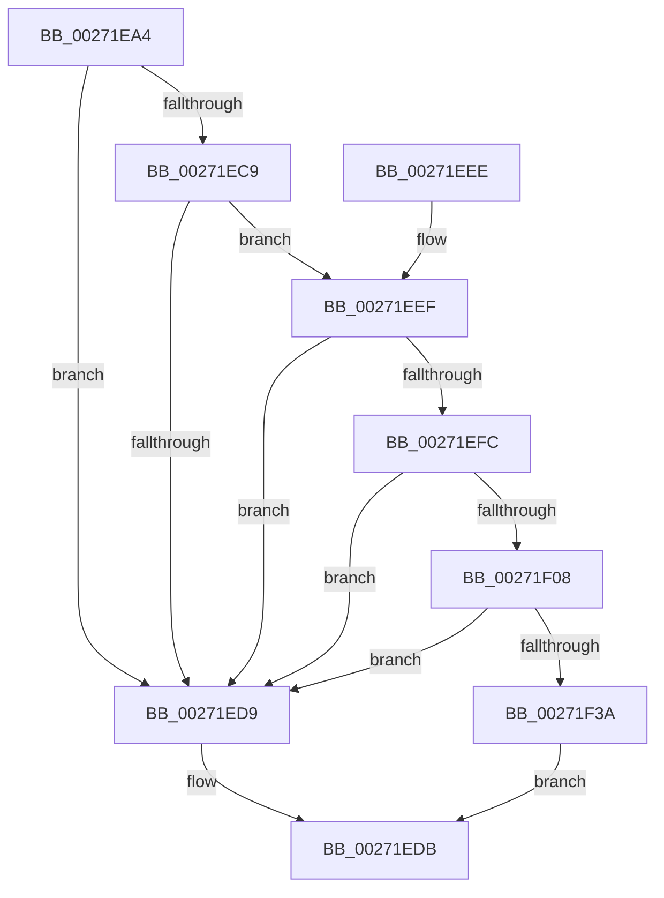

# PnpSetDeviceAffinityThread

- RVA: `0x00271EA4`–`0x00271F4E` (길이 `170` bytes)
- VA: `0x0000000140271EA4`
- 실행 섹션: `.text`
- PDB 이름 있음: `예`; PDB Function 태그: `아니요`
- unwind 정보 RVA: `0x00065B38`
- 디코드: `43`개 명령, `170/170` bytes 표시
- 미해석 바이트: `0` (있으면 어셈블리에 `.byte`로 보존)

> 이 문서는 커널 이미지의 기계어와 PDB 기호를 분석해 생성했습니다. 4번과 5번은 함수 원형과 자료형을 바이너리 사용 방식에서 추정한 C 해석이며 원본 소스 복구 결과는 아닙니다.

## 1. Dependencies

- 직접 호출 지점: **4**; 고유 호출 대상: **4**
- 직접 호출자로 확인된 함수: **3**
- RIP 상대 이미지 참조: **3**

### Outgoing calls
- `0x00271EE3` → [_security_check_cookie](../6A/_security_check_cookie_function_006AC640.md) (function, `0x006AC640`)
- `0x00271F17` → [KeQueryNodeActiveAffinity](../43/KeQueryNodeActiveAffinity_function_0043EF80.md) (function, `0x0043EF80`)
- `0x00271F2D` → [KeAndGroupAffinityEx](../2C/KeAndGroupAffinityEx_function_002CF6B0.md) (function, `0x002CF6B0`)
- `0x00271F42` → [KeSetSystemGroupAffinityThread](../39/KeSetSystemGroupAffinityThread_function_00399140.md) (function, `0x00399140`)

### Direct callers
- [PnpSendIrp](PnpSendIrp_function_00271DF4.md) at `0x00271E33`
- [PnpGetRelatedTargetDevice](PnpGetRelatedTargetDevice_function_00271F54.md) at `0x00271FE9`
- [PnpCallAddDevice](../../page/8F/PnpCallAddDevice_function_008FC164.md) at `0x008FC1B3`

### Static image references
- `0x00271EAA` → RVA `0x00E0A740` (`.data`; read)
- `0x00271EFC` → RVA `0x00FC5000` (`ALMOSTRO`; read)
- `0x00271F26` → RVA `0x00FC7120` (`ALMOSTRO`; read)

## 2. Other-region calls and transfers

- 다른 실행 섹션으로 향하는 call: **0**
- 별도 외부 분기/꼬리 이동을 확인하지 못했습니다.

## 3. Assembly (complete function range)

```asm
00271EA4  40 53                           push rbx
00271EA6  48 83 EC 40                     sub rsp, 0x40
00271EAA  48 8B 05 8F 88 B9 00            mov rax, qword ptr [rip + 0xb9888f]
00271EB1  48 33 C4                        xor rax, rsp
00271EB4  48 89 44 24 30                  mov qword ptr [rsp + 0x30], rax
00271EB9  0F 57 C0                        xorps xmm0, xmm0
00271EBC  48 8B DA                        mov rbx, rdx
00271EBF  0F 11 44 24 20                  movups xmmword ptr [rsp + 0x20], xmm0
00271EC4  48 85 C9                        test rcx, rcx
00271EC7  74 10                           je 0x140271ed9
00271EC9  48 8B 81 38 01 00 00            mov rax, qword ptr [rcx + 0x138]
00271ED0  48 8B 48 28                     mov rcx, qword ptr [rax + 0x28]
00271ED4  48 85 C9                        test rcx, rcx
00271ED7  75 16                           jne 0x140271eef
00271ED9  33 C0                           xor eax, eax
00271EDB  48 8B 4C 24 30                  mov rcx, qword ptr [rsp + 0x30]
00271EE0  48 33 CC                        xor rcx, rsp
00271EE3  E8 58 A7 43 00                  call 0x1406ac640
00271EE8  48 83 C4 40                     add rsp, 0x40
00271EEC  5B                              pop rbx
00271EED  C3                              ret
00271EEE  CC                              int3
00271EEF  44 8B 81 94 02 00 00            mov r8d, dword ptr [rcx + 0x294]
00271EF6  41 83 F8 FD                     cmp r8d, -3
00271EFA  77 DD                           ja 0x140271ed9
00271EFC  0F B7 05 FD 30 D5 00            movzx eax, word ptr [rip + 0xd530fd]
00271F03  44 3B C0                        cmp r8d, eax
00271F06  73 D1                           jae 0x140271ed9
00271F08  0F B7 89 94 02 00 00            movzx ecx, word ptr [rcx + 0x294]
00271F0F  48 8D 54 24 20                  lea rdx, [rsp + 0x20]
00271F14  45 33 C0                        xor r8d, r8d
00271F17  E8 64 D0 1C 00                  call 0x14043ef80
00271F1C  4C 8D 44 24 20                  lea r8, [rsp + 0x20]
00271F21  48 8D 54 24 20                  lea rdx, [rsp + 0x20]
00271F26  48 8D 0D F3 51 D5 00            lea rcx, [rip + 0xd551f3]
00271F2D  E8 7E D7 05 00                  call 0x1402cf6b0
00271F32  48 83 7C 24 20 00               cmp qword ptr [rsp + 0x20], 0
00271F38  74 9F                           je 0x140271ed9
00271F3A  48 8B D3                        mov rdx, rbx
00271F3D  48 8D 4C 24 20                  lea rcx, [rsp + 0x20]
00271F42  E8 F9 71 12 00                  call 0x140399140
00271F47  B8 01 00 00 00                  mov eax, 1
00271F4C  EB 8D                           jmp 0x140271edb
```

## 4. C-style interpretation (structured pseudocode)

```c
__int64 __fastcall PnpSetDeviceAffinityThread(__int64 a1, __int64 a2)
{
    __int64 result;
    __int64 v_rsp;
    unsigned __int64 v_stack_m18;
    unsigned __int64 v_stack_m28;
    unsigned __int64 v_stack_p20;

    v_rsp = (v_rsp) - (64);
    result = (*(unsigned __int64 *)(v_rip + 12159119)) ^ (v_rsp);
    v_stack_m18 = result;
    v_stack_m28 = v_xmm0;
    if (a1 == 0) goto loc_00271ED9;
    if (*(unsigned __int64 *)(*(unsigned __int64 *)(a1 + 312) + 40) != 0) goto loc_00271EEF;
loc_00271ED9:
    result = 0;
loc_00271EDB:
    a1 = (v_stack_m18) ^ (v_rsp);
    result = _security_check_cookie(a1, a2, a3, a4);
    v_rsp = (v_rsp) + (64);
    return result;
loc_00271EEF:
    if (((unsigned int)((unsigned int)(*(unsigned int *)(a1 + 660)))) > -3) goto loc_00271ED9;
    if (((unsigned int)((unsigned int)(*(unsigned int *)(a1 + 660)))) >= ((unsigned int)(*(unsigned __int16 *)(v_rip + 13971709)))) goto loc_00271ED9;
    a3 = 0;
    result = KeQueryNodeActiveAffinity(*(unsigned __int16 *)(a1 + 660), v_stack_p20, a3, a4);
    result = KeAndGroupAffinityEx(v_rip + 13980147, v_stack_p20, v_stack_p20, a4);
    if (v_stack_p20 == 0) goto loc_00271ED9;
    result = KeSetSystemGroupAffinityThread(v_stack_p20, a2, v_stack_p20, a4);
    goto loc_00271EDB;
}
```

## 5. (Beta) C Style

```c
int64_t PnpSetDeviceAffinityThread(int64_t Arg1, int64_t Arg2)
{
    int64_t result;
    int64_t local_rsp;
    uint64_t v_stack_m18;
    uint64_t v_stack_m28;
    uint64_t v_stack_p20;

    local_rsp = (local_rsp) - (64);
    result = (*(uint64_t *)(v_rip + 0xB9888F)) ^ (local_rsp);
    v_stack_m18 = result;
    v_stack_m28 = v_xmm0;
    if (Arg1 == 0) goto loc_00271ED9;
    if (*(uint64_t *)(*(uint64_t *)(Arg1 + 0x138) + 0x28) != 0) goto loc_00271EEF;
loc_00271ED9:
    result = 0;
loc_00271EDB:
    Arg1 = (v_stack_m18) ^ (local_rsp);
    result = _security_check_cookie(Arg1, Arg2, a3, a4);
    local_rsp = (local_rsp) + (64);
    return result;
loc_00271EEF:
    if (((uint32_t)((uint32_t)(*(uint32_t *)(Arg1 + 0x294)))) > -3) goto loc_00271ED9;
    if (((uint32_t)((uint32_t)(*(uint32_t *)(Arg1 + 0x294)))) >= ((uint32_t)(*(uint16_t *)(v_rip + 0xD530FD)))) goto loc_00271ED9;
    a3 = 0;
    result = KeQueryNodeActiveAffinity(*(uint16_t *)(Arg1 + 0x294), v_stack_p20, a3, a4);
    result = KeAndGroupAffinityEx(v_rip + 13980147, v_stack_p20, v_stack_p20, a4);
    if (v_stack_p20 == 0) goto loc_00271ED9;
    result = KeSetSystemGroupAffinityThread(v_stack_p20, Arg2, v_stack_p20, a4);
    goto loc_00271EDB;
}
```

## 6. Execution-region graph

[열기: 2D/3D 그래프와 함수 탐색 컨트롤 패널](../../../control-panel.html?section=text&rva=0x00271EA4&view=graph)

- 2D 그래프는 위에서 아래로 흐르고, 3D 그래프는 빈 공간을 드래그해 회전합니다. Shift+드래그는 이동, 휠은 확대·축소, 함수 노드 선택은 대상 보고서 이동입니다.

### Static fallback


