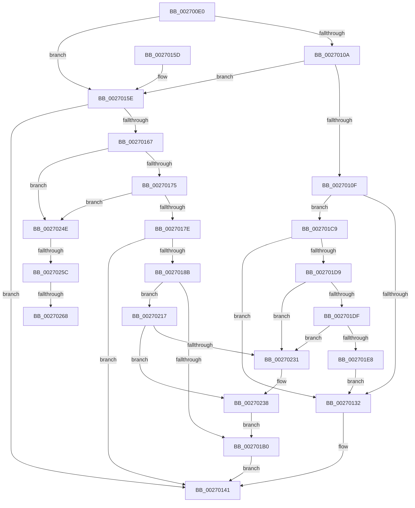

# PoRegisterDeviceForIdleDetection

- RVA: `0x002700E0`–`0x0027026D` (길이 `397` bytes)
- VA: `0x00000001402700E0`
- 실행 섹션: `.text`
- PDB 이름 있음: `예`; PDB Function 태그: `예`
- unwind 정보 RVA: `0x000659D4`
- 디코드: `105`개 명령, `397/397` bytes 표시
- 미해석 바이트: `0` (있으면 어셈블리에 `.byte`로 보존)

> 이 문서는 커널 이미지의 기계어와 PDB 기호를 분석해 생성했습니다. 4번과 5번은 함수 원형과 자료형을 바이너리 사용 방식에서 추정한 C 해석이며 원본 소스 복구 결과는 아닙니다.

## 1. Dependencies

- 직접 호출 지점: **6**; 고유 호출 대상: **4**
- 직접 호출자로 확인된 함수: **1**
- RIP 상대 이미지 참조: **6**

### Outgoing calls
- `0x00270116` → [KeAcquireSpinLockRaiseToDpc](../20/KeAcquireSpinLockRaiseToDpc_function_00208470.md) (function, `0x00208470`)
- `0x0027013C` → [KeReleaseSpinLock](../39/KeReleaseSpinLock_function_00392BA0.md) (function, `0x00392BA0`)
- `0x0027017E` → [PopGetDope](../4C/PopGetDope_function_004CB77C.md) (function, `0x004CB77C`)
- `0x00270192` → [KeAcquireSpinLockRaiseToDpc](../20/KeAcquireSpinLockRaiseToDpc_function_00208470.md) (function, `0x00208470`)
- `0x002701B7` → [KeReleaseSpinLock](../39/KeReleaseSpinLock_function_00392BA0.md) (function, `0x00392BA0`)
- `0x002701BC` → [PopCheckForWork](../48/PopCheckForWork_function_00482CAC.md) (function, `0x00482CAC`)

### Direct callers
- [PoRunDownDeviceObject](../26/PoRunDownDeviceObject_function_0026FFFC.md) at `0x0027001A`

### Static image references
- `0x0027010F` → RVA `0x00F0CBA0` (`.data`; read)
- `0x0027021E` → RVA `0x00F0CB90` (`.data`; read)
- `0x00270225` → RVA `0x00F0CB98` (`.data`; read)
- `0x00270242` → RVA `0x00F0CB98` (`.data`; write)
- `0x0027024E` → RVA `0x00E673A0` (`.data`; read)
- `0x0027025C` → RVA `0x00E6739C` (`.data`; read)

## 2. Other-region calls and transfers

- 다른 실행 섹션으로 향하는 call: **0**
- call이 아닌 외부 분기/꼬리 이동: **3**
  - `0x00270256` → [sub_006DA064](../6D/Unknown_function_006DA064.md) (`tail-transfer`)
  - `0x00270262` → [sub_006DA064](../6D/Unknown_function_006DA064.md) (`tail-transfer`)
  - `0x00270268` → [sub_006DA064 + 0xB](../6D/Unknown_function_006DA064.md) (`tail-transfer`)

## 3. Assembly (complete function range)

```asm
002700E0  48 89 5C 24 08                  mov qword ptr [rsp + 8], rbx
002700E5  48 89 6C 24 10                  mov qword ptr [rsp + 0x10], rbp
002700EA  48 89 74 24 18                  mov qword ptr [rsp + 0x18], rsi
002700EF  57                              push rdi
002700F0  41 56                           push r14
002700F2  41 57                           push r15
002700F4  48 83 EC 20                     sub rsp, 0x20
002700F8  33 DB                           xor ebx, ebx
002700FA  45 8B F1                        mov r14d, r9d
002700FD  41 8B E8                        mov ebp, r8d
00270100  44 8B FA                        mov r15d, edx
00270103  48 8B F9                        mov rdi, rcx
00270106  85 D2                           test edx, edx
00270108  75 54                           jne 0x14027015e
0027010A  45 85 C0                        test r8d, r8d
0027010D  75 4F                           jne 0x14027015e
0027010F  48 8D 0D 8A CA C9 00            lea rcx, [rip + 0xc9ca8a]
00270116  E8 55 83 F9 FF                  call 0x140208470
0027011B  44 8A C8                        mov r9b, al
0027011E  48 8B 87 38 01 00 00            mov rax, qword ptr [rdi + 0x138]
00270125  48 8B 50 18                     mov rdx, qword ptr [rax + 0x18]
00270129  48 85 D2                        test rdx, rdx
0027012C  0F 85 97 00 00 00               jne 0x1402701c9
00270132  41 8A D1                        mov dl, r9b
00270135  48 8D 0D 64 CA C9 00            lea rcx, [rip + 0xc9ca64]
0027013C  E8 5F 2A 12 00                  call 0x140392ba0
00270141  48 8B 6C 24 48                  mov rbp, qword ptr [rsp + 0x48]
00270146  48 8B C3                        mov rax, rbx
00270149  48 8B 5C 24 40                  mov rbx, qword ptr [rsp + 0x40]
0027014E  48 8B 74 24 50                  mov rsi, qword ptr [rsp + 0x50]
00270153  48 83 C4 20                     add rsp, 0x20
00270157  41 5F                           pop r15
00270159  41 5E                           pop r14
0027015B  5F                              pop rdi
0027015C  C3                              ret
0027015D  CC                              int3
0027015E  41 8D 41 FE                     lea eax, [r9 - 2]
00270162  83 F8 02                        cmp eax, 2
00270165  77 DA                           ja 0x140270141
00270167  8B 41 48                        mov eax, dword ptr [rcx + 0x48]
0027016A  8B F3                           mov esi, ebx
0027016C  83 F8 07                        cmp eax, 7
0027016F  0F 84 D9 00 00 00               je 0x14027024e
00270175  83 F8 2D                        cmp eax, 0x2d
00270178  0F 84 D0 00 00 00               je 0x14027024e
0027017E  E8 F9 B5 25 00                  call 0x1404cb77c
00270183  48 8B F8                        mov rdi, rax
00270186  48 85 C0                        test rax, rax
00270189  74 B6                           je 0x140270141
0027018B  48 8D 0D 0E CA C9 00            lea rcx, [rip + 0xc9ca0e]
00270192  E8 D9 82 F9 FF                  call 0x140208470
00270197  8A D0                           mov dl, al
00270199  44 89 7F 10                     mov dword ptr [rdi + 0x10], r15d
0027019D  48 8D 47 20                     lea rax, [rdi + 0x20]
002701A1  89 6F 14                        mov dword ptr [rdi + 0x14], ebp
002701A4  44 89 77 34                     mov dword ptr [rdi + 0x34], r14d
002701A8  89 77 30                        mov dword ptr [rdi + 0x30], esi
002701AB  48 39 00                        cmp qword ptr [rax], rax
002701AE  74 67                           je 0x140270217
002701B0  48 8D 0D E9 C9 C9 00            lea rcx, [rip + 0xc9c9e9]
002701B7  E8 E4 29 12 00                  call 0x140392ba0
002701BC  E8 EB 2A 21 00                  call 0x140482cac
002701C1  48 8B DF                        mov rbx, rdi
002701C4  E9 78 FF FF FF                  jmp 0x140270141
002701C9  48 8D 42 20                     lea rax, [rdx + 0x20]
002701CD  48 8B 08                        mov rcx, qword ptr [rax]
002701D0  48 3B C8                        cmp rcx, rax
002701D3  0F 84 59 FF FF FF               je 0x140270132
002701D9  48 39 41 08                     cmp qword ptr [rcx + 8], rax
002701DD  75 52                           jne 0x140270231
002701DF  4C 8B 40 08                     mov r8, qword ptr [rax + 8]
002701E3  49 39 00                        cmp qword ptr [r8], rax
002701E6  75 49                           jne 0x140270231
002701E8  49 89 08                        mov qword ptr [r8], rcx
002701EB  4C 89 41 08                     mov qword ptr [rcx + 8], r8
002701EF  33 C9                           xor ecx, ecx
002701F1  48 89 5A 30                     mov qword ptr [rdx + 0x30], rbx
002701F5  48 89 5A 10                     mov qword ptr [rdx + 0x10], rbx
002701F9  89 5A 38                        mov dword ptr [rdx + 0x38], ebx
002701FC  89 1A                           mov dword ptr [rdx], ebx
002701FE  89 5A 04                        mov dword ptr [rdx + 4], ebx
00270201  89 5A 08                        mov dword ptr [rdx + 8], ebx
00270204  89 5A 0C                        mov dword ptr [rdx + 0xc], ebx
00270207  48 89 4A 60                     mov qword ptr [rdx + 0x60], rcx
0027020B  48 89 40 08                     mov qword ptr [rax + 8], rax
0027020F  48 89 00                        mov qword ptr [rax], rax
00270212  E9 1B FF FF FF                  jmp 0x140270132
00270217  C7 47 38 01 00 00 00            mov dword ptr [rdi + 0x38], 1
0027021E  4C 8D 05 6B C9 C9 00            lea r8, [rip + 0xc9c96b]
00270225  48 8B 0D 6C C9 C9 00            mov rcx, qword ptr [rip + 0xc9c96c]
0027022C  4C 39 01                        cmp qword ptr [rcx], r8
0027022F  74 07                           je 0x140270238
00270231  B9 03 00 00 00                  mov ecx, 3
00270236  CD 29                           int 0x29
00270238  4C 89 00                        mov qword ptr [rax], r8
0027023B  48 89 48 08                     mov qword ptr [rax + 8], rcx
0027023F  48 89 01                        mov qword ptr [rcx], rax
00270242  48 89 05 4F C9 C9 00            mov qword ptr [rip + 0xc9c94f], rax
00270249  E9 62 FF FF FF                  jmp 0x1402701b0
0027024E  8B 05 4C 71 BF 00               mov eax, dword ptr [rip + 0xbf714c]
00270254  85 C0                           test eax, eax
00270256  0F 84 08 9E 46 00               je 0x1406da064
0027025C  38 1D 3A 71 BF 00               cmp byte ptr [rip + 0xbf713a], bl
00270262  0F 84 FC 9D 46 00               je 0x1406da064
00270268  E9 02 9E 46 00                  jmp 0x1406da06f
```

## 4. C-style interpretation (structured pseudocode)

```c
__int64 __fastcall PoRegisterDeviceForIdleDetection(__int64 a1, int a2, int a3, int a4)
{
    __int64 result;
    __int64 v_rbx;
    __int64 v_rsp;
    unsigned __int64 v_stack_p10;
    unsigned __int64 v_stack_p18;
    unsigned __int64 v_stack_p8;

    v_stack_p8 = v_rbx;
    v_stack_p10 = v_rbp;
    v_stack_p18 = v_rsi;
    v_rsp = (v_rsp) - (32);
    v_rbx = 0;
    if (a2 != 0) goto loc_0027015E;
    if (a3 != 0) goto loc_0027015E;
    result = KeAcquireSpinLockRaiseToDpc(v_rip + 13224586, a2, a3, a4);
    if (*(unsigned __int64 *)(*(unsigned __int64 *)(a1 + 312) + 24) != 0) goto loc_002701C9;
loc_00270132:
    result = KeReleaseSpinLock(v_rip + 13224548, (unsigned __int8)((unsigned __int8)(result)), a3, (unsigned __int8)(result));
loc_00270141:
    v_rsp = (v_rsp) + (32);
    return 0;
loc_0027015E:
    if (((unsigned int)((unsigned __int8)(result) - 2)) > 2) goto loc_00270141;
    if (((unsigned int)((unsigned int)(*(unsigned int *)(v_rip + 13224548 + 72)))) == 7) goto loc_0027024E;
    if (((unsigned int)((unsigned int)(*(unsigned int *)(v_rip + 13224548 + 72)))) == 45) goto loc_0027024E;
    result = PopGetDope(v_rip + 13224548, (unsigned __int8)((unsigned __int8)(result)), a3, (unsigned __int8)(result));
    if (result == 0) goto loc_00270141;
    result = KeAcquireSpinLockRaiseToDpc(v_rip + 13224462, (unsigned __int8)((unsigned __int8)(result)), a3, (unsigned __int8)(result));
    *(unsigned int *)(result + 16) = (unsigned int)((unsigned int)(a2));
    *(unsigned int *)(result + 20) = (unsigned int)(v_stack_p10);
    *(unsigned int *)(result + 52) = (unsigned int)((unsigned int)(a4));
    *(unsigned int *)(result + 48) = (unsigned int)((unsigned int)((unsigned int)(v_stack_p8)));
    if ((*(unsigned __int64 *)(result + 32)) == (result + 32)) goto loc_00270217;
loc_002701B0:
    result = KeReleaseSpinLock(v_rip + 13224425, (unsigned __int8)(result), a3, (unsigned __int8)(result));
    result = PopCheckForWork(v_rip + 13224425, (unsigned __int8)(result), a3, (unsigned __int8)(result));
    goto loc_00270141;
loc_002701C9:
    if ((*(unsigned __int64 *)((unsigned __int8)(result) + 32)) == ((unsigned __int8)(result) + 32)) goto loc_00270132;
    if ((*(unsigned __int64 *)(*(unsigned __int64 *)((unsigned __int8)(result) + 32) + 8)) != ((unsigned __int8)(result) + 32)) goto loc_00270231;
    if ((*(unsigned __int64 *)(*(unsigned __int64 *)((unsigned __int8)(result) + 32 + 8))) != ((unsigned __int8)(result) + 32)) goto loc_00270231;
    *(unsigned __int64 *)(*(unsigned __int64 *)((unsigned __int8)(result) + 32 + 8)) = *(unsigned __int64 *)((unsigned __int8)(result) + 32);
    *(unsigned __int64 *)(*(unsigned __int64 *)((unsigned __int8)(result) + 32) + 8) = *(unsigned __int64 *)((unsigned __int8)(result) + 32 + 8);
    a1 = 0;
    *(unsigned __int64 *)((unsigned __int8)(result) + 48) = result;
    *(unsigned __int64 *)((unsigned __int8)(result) + 16) = result;
    *(unsigned int *)((unsigned __int8)(result) + 56) = (unsigned int)(result);
    *(unsigned int *)((unsigned __int8)(result)) = (unsigned int)(result);
    *(unsigned int *)((unsigned __int8)(result) + 4) = (unsigned int)(result);
    *(unsigned int *)((unsigned __int8)(result) + 8) = (unsigned int)(result);
    *(unsigned int *)((unsigned __int8)(result) + 12) = (unsigned int)(result);
    *(unsigned __int64 *)((unsigned __int8)(result) + 96) = 0;
    *(unsigned __int64 *)((unsigned __int8)(result) + 32 + 8) = (unsigned __int8)(result) + 32;
    *(unsigned __int64 *)((unsigned __int8)(result) + 32) = (unsigned __int8)(result) + 32;
    goto loc_00270132;
loc_00270217:
    *(unsigned int *)(result + 56) = 1;
    if ((*(unsigned __int64 *)(*(unsigned __int64 *)(v_rip + 13224300))) != (v_rip + 13224299)) {
        a1 = 3;
    }
    *(unsigned __int64 *)((unsigned __int8)(result) + 32) = v_rip + 13224299;
    *(unsigned __int64 *)((unsigned __int8)(result) + 32 + 8) = a1;
    *(unsigned __int64 *)(a1) = (unsigned __int8)(result) + 32;
    *(unsigned __int64 *)(v_rip + 13224271) = (unsigned __int8)(result) + 32;
    goto loc_002701B0;
loc_0027024E:
}
```

## 5. (Beta) C Style

```c
int64_t PoRegisterDeviceForIdleDetection(void *Arg1, int32_t Arg2, int32_t Arg3, void *Arg4)
{
    uint8_t *arg1 = (uint8_t *)Arg1;
    uint8_t *arg4 = (uint8_t *)Arg4;

    int64_t result;
    int64_t local_rbx;
    int64_t local_rsp;
    uint64_t v_stack_p10;
    uint64_t v_stack_p18;
    uint64_t v_stack_p8;

    v_stack_p8 = local_rbx;
    v_stack_p10 = local_rbp;
    v_stack_p18 = local_rsi;
    local_rsp = (local_rsp) - (32);
    local_rbx = 0;
    if (Arg2 != 0) goto loc_0027015E;
    if (Arg3 != 0) goto loc_0027015E;
    result = KeAcquireSpinLockRaiseToDpc(v_rip + 13224586, Arg2, Arg3, Arg4);
    if (*(uint64_t *)(*(uint64_t *)(arg1 + 0x138) + 0x18) != 0) goto loc_002701C9;
loc_00270132:
    result = KeReleaseSpinLock(v_rip + 13224548, (uint8_t)((uint8_t)(result)), Arg3, (uint8_t)(result));
loc_00270141:
    local_rsp = (local_rsp) + (32);
    return 0;
loc_0027015E:
    if (((uint32_t)((uint8_t)(result) - 2)) > 2) goto loc_00270141;
    if (((uint32_t)((uint32_t)(*(uint32_t *)(v_rip + 0xC9CA64 + 0x48)))) == 7) goto loc_0027024E;
    if (((uint32_t)((uint32_t)(*(uint32_t *)(v_rip + 0xC9CA64 + 0x48)))) == 45) goto loc_0027024E;
    result = PopGetDope(v_rip + 13224548, (uint8_t)((uint8_t)(result)), Arg3, (uint8_t)(result));
    if (result == 0) goto loc_00270141;
    result = KeAcquireSpinLockRaiseToDpc(v_rip + 13224462, (uint8_t)((uint8_t)(result)), Arg3, (uint8_t)(result));
    *(uint32_t *)(result + 0x10) = (uint32_t)((uint32_t)(Arg2));
    *(uint32_t *)(result + 0x14) = (uint32_t)(v_stack_p10);
    *(uint32_t *)(result + 0x34) = (uint32_t)((uint32_t)(Arg4));
    *(uint32_t *)(result + 0x30) = (uint32_t)((uint32_t)((uint32_t)(v_stack_p8)));
    if ((*(uint64_t *)(result + 0x20)) == (result + 32)) goto loc_00270217;
loc_002701B0:
    result = KeReleaseSpinLock(v_rip + 13224425, (uint8_t)(result), Arg3, (uint8_t)(result));
    result = PopCheckForWork(v_rip + 13224425, (uint8_t)(result), Arg3, (uint8_t)(result));
    goto loc_00270141;
loc_002701C9:
    if ((*(uint64_t *)((uint8_t)(result) + 0x20)) == ((uint8_t)(result) + 32)) goto loc_00270132;
    if ((*(uint64_t *)(*(uint64_t *)((uint8_t)(result) + 0x20) + 0x8)) != ((uint8_t)(result) + 32)) goto loc_00270231;
    if ((*(uint64_t *)(*(uint64_t *)((uint8_t)(result) + 0x20 + 0x8))) != ((uint8_t)(result) + 32)) goto loc_00270231;
    *(uint64_t *)(*(uint64_t *)((uint8_t)(result) + 0x20 + 0x8)) = *(uint64_t *)((uint8_t)(result) + 0x20);
    *(uint64_t *)(*(uint64_t *)((uint8_t)(result) + 0x20) + 0x8) = *(uint64_t *)((uint8_t)(result) + 0x20 + 0x8);
    Arg1 = 0;
    *(uint64_t *)((uint8_t)(result) + 0x30) = result;
    *(uint64_t *)((uint8_t)(result) + 0x10) = result;
    *(uint32_t *)((uint8_t)(result) + 0x38) = (uint32_t)(result);
    *(uint32_t *)((uint8_t)(result)) = (uint32_t)(result);
    *(uint32_t *)((uint8_t)(result) + 0x4) = (uint32_t)(result);
    *(uint32_t *)((uint8_t)(result) + 0x8) = (uint32_t)(result);
    *(uint32_t *)((uint8_t)(result) + 0xC) = (uint32_t)(result);
    *(uint64_t *)((uint8_t)(result) + 0x60) = 0;
    *(uint64_t *)((uint8_t)(result) + 0x20 + 0x8) = (uint8_t)(result) + 32;
    *(uint64_t *)((uint8_t)(result) + 0x20) = (uint8_t)(result) + 32;
    goto loc_00270132;
loc_00270217:
    *(uint32_t *)(result + 0x38) = 1;
    if ((*(uint64_t *)(*(uint64_t *)(v_rip + 0xC9C96C))) != (v_rip + 13224299)) {
        Arg1 = 3;
    }
    *(uint64_t *)((uint8_t)(result) + 0x20) = v_rip + 13224299;
    *(void **)((uint8_t)(result) + 0x20 + 0x8) = Arg1;
    *(uint64_t *)(arg1) = (uint8_t)(result) + 32;
    *(uint64_t *)(v_rip + 0xC9C94F) = (uint8_t)(result) + 32;
    goto loc_002701B0;
loc_0027024E:
}
```

### 관측된 메모리 오프셋

구조체 형식이 확인되지 않은 접근은 인자 기준의 오프셋으로만 기록했습니다.

| 기준 인자 | 오프셋 표현 | 폭 (bit) | 접근 |
|---|---:|---:|---|
| `Arg1` | `+ 0x48` | `32` | `R` |
| `Arg1` | `+ 0x138` | `64` | `R` |
| `Arg4` | `- 0x2` | `32` | `R` |

## 6. Execution-region graph

[열기: 2D/3D 그래프와 함수 탐색 컨트롤 패널](../../../control-panel.html?section=text&rva=0x002700E0&view=graph)

- 2D 그래프는 위에서 아래로 흐르고, 3D 그래프는 빈 공간을 드래그해 회전합니다. Shift+드래그는 이동, 휠은 확대·축소, 함수 노드 선택은 대상 보고서 이동입니다.

### Static fallback


