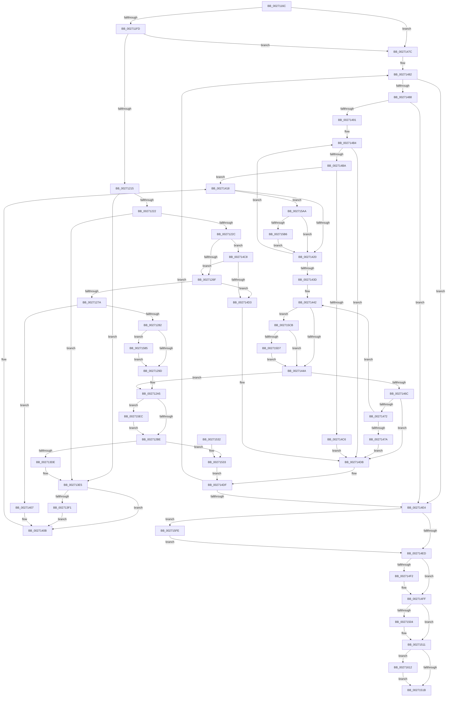

# PopAllocateIrp

- RVA: `0x0027116C`–`0x00271621` (길이 `1,205` bytes)
- VA: `0x000000014027116C`
- 실행 섹션: `.text`
- PDB 이름 있음: `예`; PDB Function 태그: `아니요`
- unwind 정보 RVA: `0x00065AB8`
- 디코드: `294`개 명령, `1,205/1,205` bytes 표시
- 미해석 바이트: `0` (있으면 어셈블리에 `.byte`로 보존)

> 이 문서는 커널 이미지의 기계어와 PDB 기호를 분석해 생성했습니다. 4번과 5번은 함수 원형과 자료형을 바이너리 사용 방식에서 추정한 C 해석이며 원본 소스 복구 결과는 아닙니다.

## 1. Dependencies

- 직접 호출 지점: **20**; 고유 호출 대상: **17**
- 직접 호출자로 확인된 함수: **2**
- RIP 상대 이미지 참조: **9**

### Outgoing calls
- `0x002711D8` → [IoGetAttachedDeviceReferenceWithTag](IoGetAttachedDeviceReferenceWithTag_function_00273B84.md) (function, `0x00273B84`)
- `0x002711E8` → [IoGetDeviceAttachmentBaseRefWithTag](IoGetDeviceAttachmentBaseRefWithTag_function_00272788.md) (function, `0x00272788`)
- `0x0027125F` → [PopFxAllocatePowerIrp](../2C/PopFxAllocatePowerIrp_function_002C0920.md) (function, `0x002C0920`)
- `0x002712AD` → [IoReuseIrp](../24/IoReuseIrp_function_0024DD70.md) (function, `0x0024DD70`)
- `0x002712DB` → [memset](../6C/memset_function_006C6C40.md) (function, `0x006C6C40`)
- `0x002713B2` → [KeAcquireInStackQueuedSpinLock](KeAcquireInStackQueuedSpinLock_function_002757A0.md) (function, `0x002757A0`)
- `0x002713F6` → [PopFxLockDevice](../26/PopFxLockDevice_function_0026F950.md) (function, `0x0026F950`)
- `0x0027142C` → [ExAllocateFromNPagedLookasideList](../38/ExAllocateFromNPagedLookasideList_function_0038E6C0.md) (function, `0x0038E6C0`)
- `0x00271457` → [IoAllocateIrp](../20/IoAllocateIrp_function_002065D0.md) (function, `0x002065D0`)
- `0x002714AE` → [KeBugCheckEx](../4F/KeBugCheckEx_function_004FD660.md) (function, `0x004FD660`)
- `0x002714FA` → [ObfDereferenceObjectWithTag](../2F/ObfDereferenceObjectWithTag_function_002F78E0.md) (function, `0x002F78E0`)
- `0x0027150C` → [ObfDereferenceObjectWithTag](../2F/ObfDereferenceObjectWithTag_function_002F78E0.md) (function, `0x002F78E0`)
- `0x00271553` → [KeReleaseInStackQueuedSpinLock](../34/KeReleaseInStackQueuedSpinLock_function_00342CE0.md) (function, `0x00342CE0`)
- `0x0027158F` → [ObfDereferenceObjectWithTag](../2F/ObfDereferenceObjectWithTag_function_002F78E0.md) (function, `0x002F78E0`)
- `0x0027159B` → [ObfReferenceObjectWithTag](../21/ObfReferenceObjectWithTag_function_00210710.md) (function, `0x00210710`)
- `0x002715BE` → [KeDelayExecutionThread](../20/KeDelayExecutionThread_function_00209550.md) (function, `0x00209550`)
- `0x002715DF` → [KeDelayExecutionThread](../20/KeDelayExecutionThread_function_00209550.md) (function, `0x00209550`)
- `0x002715F4` → [VfIrpWatermark](../../pagevrfy/B9/VfIrpWatermark_function_00B9E070.md) (function, `0x00B9E070`)
- `0x00271608` → [ExFreeToNPagedLookasideList](../38/ExFreeToNPagedLookasideList_function_0038D9D0.md) (function, `0x0038D9D0`)
- `0x00271617` → [PopFxDereferenceDevice](PopFxDereferenceDevice_function_0027038C.md) (function, `0x0027038C`)

### Direct callers
- [PopRequestPowerIrp](PopRequestPowerIrp_function_00270ED4.md) at `0x00270F61`
- [PopNotifyDevice](../../pagelk/B7/PopNotifyDevice_function_00B7DAAC.md) at `0x00B7DB55`

### Static image references
- `0x002712B2` → RVA `0x00F048E0` (`.data`; read)
- `0x00271318` → RVA `0x00F0BCD8` (`.data`; read/write)
- `0x00271357` → RVA `0x0026F030` (`PopHandleDevicePowerIrpCompletion`; read)
- `0x0027139F` → RVA `0x00F0CA50` (`.data`; read)
- `0x002713C0` → RVA `0x00F0CA40` (`.data`; read)
- `0x002713C7` → RVA `0x00F0BD28` (`.data`; write)
- `0x002713CE` → RVA `0x00F0CA48` (`.data`; read)
- `0x00271425` → RVA `0x00E27640` (`.data`; read)
- `0x0027154C` → RVA `0x00F0CA48` (`.data`; write)

## 2. Other-region calls and transfers

- 다른 실행 섹션으로 향하는 call: **1**
  - `0x002715F4` → [VfIrpWatermark](../../pagevrfy/B9/VfIrpWatermark_function_00B9E070.md) (`.text` → `PAGEVRFY`)
- 별도 외부 분기/꼬리 이동을 확인하지 못했습니다.

## 3. Assembly (complete function range)

```asm
0027116C  48 8B C4                        mov rax, rsp
0027116F  44 89 48 20                     mov dword ptr [rax + 0x20], r9d
00271173  44 88 40 18                     mov byte ptr [rax + 0x18], r8b
00271177  48 89 50 10                     mov qword ptr [rax + 0x10], rdx
0027117B  48 89 48 08                     mov qword ptr [rax + 8], rcx
0027117F  55                              push rbp
00271180  53                              push rbx
00271181  56                              push rsi
00271182  57                              push rdi
00271183  41 54                           push r12
00271185  41 55                           push r13
00271187  41 56                           push r14
00271189  41 57                           push r15
0027118B  48 8D 68 B9                     lea rbp, [rax - 0x47]
0027118F  48 81 EC 88 00 00 00            sub rsp, 0x88
00271196  33 FF                           xor edi, edi
00271198  33 C0                           xor eax, eax
0027119A  48 89 45 F7                     mov qword ptr [rbp - 9], rax
0027119E  0F 57 C0                        xorps xmm0, xmm0
002711A1  48 8B 85 97 00 00 00            mov rax, qword ptr [rbp + 0x97]
002711A8  BA 50 6F 49 72                  mov edx, 0x72496f50
002711AD  45 8A F8                        mov r15b, r8b
002711B0  48 89 7D C7                     mov qword ptr [rbp - 0x39], rdi
002711B4  48 8B D9                        mov rbx, rcx
002711B7  48 89 7D CF                     mov qword ptr [rbp - 0x31], rdi
002711BB  0F 11 45 E7                     movups xmmword ptr [rbp - 0x19], xmm0
002711BF  48 89 38                        mov qword ptr [rax], rdi
002711C2  8B F7                           mov esi, edi
002711C4  48 8B 85 9F 00 00 00            mov rax, qword ptr [rbp + 0x9f]
002711CB  44 8B F7                        mov r14d, edi
002711CE  44 8B E7                        mov r12d, edi
002711D1  40 88 7D 57                     mov byte ptr [rbp + 0x57], dil
002711D5  48 89 38                        mov qword ptr [rax], rdi
002711D8  E8 A7 29 00 00                  call 0x140273b84
002711DD  BA 50 6F 49 72                  mov edx, 0x72496f50
002711E2  48 8B CB                        mov rcx, rbx
002711E5  4C 8B E8                        mov r13, rax
002711E8  E8 9B 15 00 00                  call 0x140272788
002711ED  48 89 45 D7                     mov qword ptr [rbp - 0x29], rax
002711F1  48 8B D8                        mov rbx, rax
002711F4  48 85 C0                        test rax, rax
002711F7  0F 84 7F 02 00 00               je 0x14027147c
002711FD  48 8B 80 38 01 00 00            mov rax, qword ptr [rax + 0x138]
00271204  48 8B 48 28                     mov rcx, qword ptr [rax + 0x28]
00271208  48 89 4D DF                     mov qword ptr [rbp - 0x21], rcx
0027120C  48 85 C9                        test rcx, rcx
0027120F  0F 84 67 02 00 00               je 0x14027147c
00271215  8B 5D 6F                        mov ebx, dword ptr [rbp + 0x6f]
00271218  41 80 FF 02                     cmp r15b, 2
0027121C  0F 85 C3 01 00 00               jne 0x1402713e5
00271222  83 7D 67 01                     cmp dword ptr [rbp + 0x67], 1
00271226  0F 85 B9 01 00 00               jne 0x1402713e5
0027122C  4C 8B 8D 87 00 00 00            mov r9, qword ptr [rbp + 0x87]
00271233  48 8D 45 CF                     lea rax, [rbp - 0x31]
00271237  48 8B 55 4F                     mov rdx, qword ptr [rbp + 0x4f]
0027123B  44 8B C3                        mov r8d, ebx
0027123E  48 89 44 24 38                  mov qword ptr [rsp + 0x38], rax
00271243  48 8D 45 C7                     lea rax, [rbp - 0x39]
00271247  48 89 44 24 30                  mov qword ptr [rsp + 0x30], rax
0027124C  8A 45 7F                        mov al, byte ptr [rbp + 0x7f]
0027124F  88 44 24 28                     mov byte ptr [rsp + 0x28], al
00271253  48 8B 85 8F 00 00 00            mov rax, qword ptr [rbp + 0x8f]
0027125A  48 89 44 24 20                  mov qword ptr [rsp + 0x20], rax
0027125F  E8 BC F6 04 00                  call 0x1402c0920
00271264  44 8B F8                        mov r15d, eax
00271267  85 C0                           test eax, eax
00271269  0F 88 59 02 00 00               js 0x1402714c8
0027126F  3D 03 01 00 00                  cmp eax, 0x103
00271274  0F 84 59 02 00 00               je 0x1402714d3
0027127A  85 C0                           test eax, eax
0027127C  0F 88 85 01 00 00               js 0x140271407
00271282  4C 8B 65 DF                     mov r12, qword ptr [rbp - 0x21]
00271286  4D 8B 64 24 50                  mov r12, qword ptr [r12 + 0x50]
0027128B  49 8B 44 24 10                  mov rax, qword ptr [r12 + 0x10]
00271290  8A 48 42                        mov cl, byte ptr [rax + 0x42]
00271293  41 38 4D 4C                     cmp byte ptr [r13 + 0x4c], cl
00271297  0F 8F E8 02 00 00               jg 0x140271585
0027129D  48 8B 75 C7                     mov rsi, qword ptr [rbp - 0x39]
002712A1  4C 8B 75 CF                     mov r14, qword ptr [rbp - 0x31]
002712A5  BA BB 00 00 C0                  mov edx, 0xc00000bb
002712AA  48 8B CE                        mov rcx, rsi
002712AD  E8 BE CA FD FF                  call 0x14024dd70
002712B2  39 3D 28 36 C9 00               cmp dword ptr [rip + 0xc93628], edi
002712B8  0F 85 2E 03 00 00               jne 0x1402715ec
002712BE  48 8D 86 A8 00 00 00            lea rax, [rsi + 0xa8]
002712C5  48 89 7E 38                     mov qword ptr [rsi + 0x38], rdi
002712C9  33 D2                           xor edx, edx
002712CB  48 89 40 08                     mov qword ptr [rax + 8], rax
002712CF  41 B8 38 01 00 00               mov r8d, 0x138
002712D5  48 89 00                        mov qword ptr [rax], rax
002712D8  49 8B CE                        mov rcx, r14
002712DB  E8 60 59 45 00                  call 0x1406c6c40
002712E0  48 8B 45 D7                     mov rax, qword ptr [rbp - 0x29]
002712E4  44 8A 45 5F                     mov r8b, byte ptr [rbp + 0x5f]
002712E8  4D 89 6E 20                     mov qword ptr [r14 + 0x20], r13
002712EC  49 89 46 18                     mov qword ptr [r14 + 0x18], rax
002712F0  8B 45 67                        mov eax, dword ptr [rbp + 0x67]
002712F3  45 88 86 B8 00 00 00            mov byte ptr [r14 + 0xb8], r8b
002712FA  41 89 86 BC 00 00 00            mov dword ptr [r14 + 0xbc], eax
00271301  B8 01 00 00 00                  mov eax, 1
00271306  41 89 9E C0 00 00 00            mov dword ptr [r14 + 0xc0], ebx
0027130D  49 89 76 10                     mov qword ptr [r14 + 0x10], rsi
00271311  4D 89 A6 C8 00 00 00            mov qword ptr [r14 + 0xc8], r12
00271318  F0 0F C1 05 B8 A9 C9 00         lock xadd dword ptr [rip + 0xc9a9b8], eax
00271320  48 8B 55 CF                     mov rdx, qword ptr [rbp - 0x31]
00271324  FF C0                           inc eax
00271326  48 8B 4D C7                     mov rcx, qword ptr [rbp - 0x39]
0027132A  89 82 D4 00 00 00               mov dword ptr [rdx + 0xd4], eax
00271330  48 8B 85 87 00 00 00            mov rax, qword ptr [rbp + 0x87]
00271337  48 89 82 D8 00 00 00            mov qword ptr [rdx + 0xd8], rax
0027133E  48 8B 85 8F 00 00 00            mov rax, qword ptr [rbp + 0x8f]
00271345  48 89 82 E0 00 00 00            mov qword ptr [rdx + 0xe0], rax
0027134C  48 8B 45 4F                     mov rax, qword ptr [rbp + 0x4f]
00271350  48 89 82 E8 00 00 00            mov qword ptr [rdx + 0xe8], rax
00271357  48 8D 05 D2 DC FF FF            lea rax, [rip - 0x232e]
0027135E  48 89 BA 20 01 00 00            mov qword ptr [rdx + 0x120], rdi
00271365  48 89 82 08 01 00 00            mov qword ptr [rdx + 0x108], rax
0027136C  48 89 92 10 01 00 00            mov qword ptr [rdx + 0x110], rdx
00271373  48 89 BA F8 00 00 00            mov qword ptr [rdx + 0xf8], rdi
0027137A  48 8B 81 B8 00 00 00            mov rax, qword ptr [rcx + 0xb8]
00271381  48 89 50 F8                     mov qword ptr [rax - 8], rdx
00271385  48 8D 55 E7                     lea rdx, [rbp - 0x19]
00271389  48 89 78 E0                     mov qword ptr [rax - 0x20], rdi
0027138D  48 83 81 B8 00 00 00 B8         add qword ptr [rcx + 0xb8], -0x48
00271395  48 8B 81 B8 00 00 00            mov rax, qword ptr [rcx + 0xb8]
0027139C  FE 49 43                        dec byte ptr [rcx + 0x43]
0027139F  48 8D 0D AA B6 C9 00            lea rcx, [rip + 0xc9b6aa]
002713A6  C6 40 B8 16                     mov byte ptr [rax - 0x48], 0x16
002713AA  44 88 40 B9                     mov byte ptr [rax - 0x47], r8b
002713AE  4C 89 68 E0                     mov qword ptr [rax - 0x20], r13
002713B2  E8 E9 43 00 00                  call 0x1402757a0
002713B7  65 48 8B 04 25 88 01 00 00      mov rax, qword ptr gs:[0x188]
002713C0  48 8D 0D 79 B6 C9 00            lea rcx, [rip + 0xc9b679]
002713C7  48 89 05 5A A9 C9 00            mov qword ptr [rip + 0xc9a95a], rax
002713CE  48 8B 05 73 B6 C9 00            mov rax, qword ptr [rip + 0xc9b673]
002713D5  48 39 08                        cmp qword ptr [rax], rcx
002713D8  0F 84 55 01 00 00               je 0x140271533
002713DE  B9 03 00 00 00                  mov ecx, 3
002713E3  CD 29                           int 0x29
002713E5  41 BF B6 02 00 C0               mov r15d, 0xc00002b6
002713EB  40 38 7D 5F                     cmp byte ptr [rbp + 0x5f], dil
002713EF  75 1A                           jne 0x14027140b
002713F1  45 33 C0                        xor r8d, r8d
002713F4  33 D2                           xor edx, edx
002713F6  E8 55 E5 FF FF                  call 0x14026f950
002713FB  48 85 C0                        test rax, rax
002713FE  4C 8B E0                        mov r12, rax
00271401  0F 95 45 57                     setne byte ptr [rbp + 0x57]
00271405  EB 04                           jmp 0x14027140b
00271407  48 8B 75 C7                     mov rsi, qword ptr [rbp - 0x39]
0027140B  8B CF                           mov ecx, edi
0027140D  48 C7 45 DF E0 5E F8 FF         mov qword ptr [rbp - 0x21], 0xfffffffffff85ee0
00271415  89 4D BF                        mov dword ptr [rbp - 0x41], ecx
00271418  85 C9                           test ecx, ecx
0027141A  0F 85 8A 01 00 00               jne 0x1402715aa
00271420  FF C1                           inc ecx
00271422  89 4D BF                        mov dword ptr [rbp - 0x41], ecx
00271425  48 8D 0D 14 62 BB 00            lea rcx, [rip + 0xbb6214]
0027142C  E8 8F D2 11 00                  call 0x14038e6c0
00271431  48 89 45 CF                     mov qword ptr [rbp - 0x31], rax
00271435  4C 8B F0                        mov r14, rax
00271438  48 85 C0                        test rax, rax
0027143B  74 77                           je 0x1402714b4
0027143D  8B CF                           mov ecx, edi
0027143F  89 4D BF                        mov dword ptr [rbp - 0x41], ecx
00271442  85 C9                           test ecx, ecx
00271444  0F 85 81 01 00 00               jne 0x1402715cb
0027144A  FF C1                           inc ecx
0027144C  33 D2                           xor edx, edx
0027144E  89 4D BF                        mov dword ptr [rbp - 0x41], ecx
00271451  41 8A 4D 4C                     mov cl, byte ptr [r13 + 0x4c]
00271455  FE C1                           inc cl
00271457  E8 74 51 F9 FF                  call 0x1402065d0
0027145C  48 89 45 C7                     mov qword ptr [rbp - 0x39], rax
00271460  48 8B F0                        mov rsi, rax
00271463  48 85 C0                        test rax, rax
00271466  0F 85 39 FE FF FF               jne 0x1402712a5
0027146C  40 38 7D 77                     cmp byte ptr [rbp + 0x77], dil
00271470  74 69                           je 0x1402714db
00271472  8B 4D BF                        mov ecx, dword ptr [rbp - 0x41]
00271475  83 F9 0A                        cmp ecx, 0xa
00271478  72 C8                           jb 0x140271442
0027147A  EB 5F                           jmp 0x1402714db
0027147C  41 BF 10 00 00 C0               mov r15d, 0xc0000010
00271482  40 38 7D 77                     cmp byte ptr [rbp + 0x77], dil
00271486  74 5C                           je 0x1402714e4
00271488  41 81 FF 03 01 00 00            cmp r15d, 0x103
0027148F  74 53                           je 0x1402714e4
00271491  39 7D 67                        cmp dword ptr [rbp + 0x67], edi
00271494  BA 01 00 00 00                  mov edx, 1
00271499  4D 8B CD                        mov r9, r13
0027149C  B9 A0 00 00 00                  mov ecx, 0xa0
002714A1  40 0F 95 C7                     setne dil
002714A5  48 89 7C 24 20                  mov qword ptr [rsp + 0x20], rdi
002714AA  44 8D 42 05                     lea r8d, [rdx + 5]
002714AE  E8 AD C1 28 00                  call 0x1404fd660
002714B3  CC                              int3
002714B4  40 38 7D 77                     cmp byte ptr [rbp + 0x77], dil
002714B8  74 21                           je 0x1402714db
002714BA  8B 4D BF                        mov ecx, dword ptr [rbp - 0x41]
002714BD  83 F9 0A                        cmp ecx, 0xa
002714C0  0F 82 52 FF FF FF               jb 0x140271418
002714C6  EB 13                           jmp 0x1402714db
002714C8  3D B6 02 00 C0                  cmp eax, 0xc00002b6
002714CD  0F 84 9C FD FF FF               je 0x14027126f
002714D3  48 8B 75 C7                     mov rsi, qword ptr [rbp - 0x39]
002714D7  4C 8B 75 CF                     mov r14, qword ptr [rbp - 0x31]
002714DB  48 8B 5D D7                     mov rbx, qword ptr [rbp - 0x29]
002714DF  48 85 F6                        test rsi, rsi
002714E2  74 9E                           je 0x140271482
002714E4  4D 85 F6                        test r14, r14
002714E7  0F 85 11 01 00 00               jne 0x1402715fe
002714ED  4D 85 ED                        test r13, r13
002714F0  74 0D                           je 0x1402714ff
002714F2  BA 50 6F 49 72                  mov edx, 0x72496f50
002714F7  49 8B CD                        mov rcx, r13
002714FA  E8 E1 63 08 00                  call 0x1402f78e0
002714FF  48 85 DB                        test rbx, rbx
00271502  74 0D                           je 0x140271511
00271504  BA 50 6F 49 72                  mov edx, 0x72496f50
00271509  48 8B CB                        mov rcx, rbx
0027150C  E8 CF 63 08 00                  call 0x1402f78e0
00271511  40 38 7D 57                     cmp byte ptr [rbp + 0x57], dil
00271515  0F 85 F7 00 00 00               jne 0x140271612
0027151B  41 8B C7                        mov eax, r15d
0027151E  48 81 C4 88 00 00 00            add rsp, 0x88
00271525  41 5F                           pop r15
00271527  41 5E                           pop r14
00271529  41 5D                           pop r13
0027152B  41 5C                           pop r12
0027152D  5F                              pop rdi
0027152E  5E                              pop rsi
0027152F  5B                              pop rbx
00271530  5D                              pop rbp
00271531  C3                              ret
00271532  CC                              int3
00271533  48 8B 5D CF                     mov rbx, qword ptr [rbp - 0x31]
00271537  48 89 3D EA A7 C9 00            mov qword ptr [rip + 0xc9a7ea], rdi
0027153E  48 89 0B                        mov qword ptr [rbx], rcx
00271541  48 8D 4D E7                     lea rcx, [rbp - 0x19]
00271545  48 89 43 08                     mov qword ptr [rbx + 8], rax
00271549  48 89 18                        mov qword ptr [rax], rbx
0027154C  48 89 1D F5 B4 C9 00            mov qword ptr [rip + 0xc9b4f5], rbx
00271553  E8 88 17 0D 00                  call 0x140342ce0
00271558  48 8B 85 97 00 00 00            mov rax, qword ptr [rbp + 0x97]
0027155F  4C 8B EF                        mov r13, rdi
00271562  48 8B 75 C7                     mov rsi, qword ptr [rbp - 0x39]
00271566  4C 8B F7                        mov r14, rdi
00271569  40 88 7D 57                     mov byte ptr [rbp + 0x57], dil
0027156D  44 8B FF                        mov r15d, edi
00271570  48 89 30                        mov qword ptr [rax], rsi
00271573  48 8B 85 9F 00 00 00            mov rax, qword ptr [rbp + 0x9f]
0027157A  48 89 18                        mov qword ptr [rax], rbx
0027157D  48 8B DF                        mov rbx, rdi
00271580  E9 5A FF FF FF                  jmp 0x1402714df
00271585  BE 50 6F 49 72                  mov esi, 0x72496f50
0027158A  49 8B CD                        mov rcx, r13
0027158D  8B D6                           mov edx, esi
0027158F  E8 4C 63 08 00                  call 0x1402f78e0
00271594  49 8B 4C 24 68                  mov rcx, qword ptr [r12 + 0x68]
00271599  8B D6                           mov edx, esi
0027159B  E8 70 F1 F9 FF                  call 0x140210710
002715A0  4D 8B 6C 24 68                  mov r13, qword ptr [r12 + 0x68]
002715A5  E9 F3 FC FF FF                  jmp 0x14027129d
002715AA  44 0F 20 C0                     mov rax, cr8
002715AE  3C 01                           cmp al, 1
002715B0  0F 87 6A FE FF FF               ja 0x140271420
002715B6  4C 8D 45 DF                     lea r8, [rbp - 0x21]
002715BA  33 D2                           xor edx, edx
002715BC  33 C9                           xor ecx, ecx
002715BE  E8 8D 7F F9 FF                  call 0x140209550
002715C3  8B 4D BF                        mov ecx, dword ptr [rbp - 0x41]
002715C6  E9 55 FE FF FF                  jmp 0x140271420
002715CB  44 0F 20 C0                     mov rax, cr8
002715CF  3C 01                           cmp al, 1
002715D1  0F 87 73 FE FF FF               ja 0x14027144a
002715D7  4C 8D 45 DF                     lea r8, [rbp - 0x21]
002715DB  33 D2                           xor edx, edx
002715DD  33 C9                           xor ecx, ecx
002715DF  E8 6C 7F F9 FF                  call 0x140209550
002715E4  8B 4D BF                        mov ecx, dword ptr [rbp - 0x41]
002715E7  E9 5E FE FF FF                  jmp 0x14027144a
002715EC  BA 01 00 00 00                  mov edx, 1
002715F1  48 8B CE                        mov rcx, rsi
002715F4  E8 77 CA 92 00                  call 0x140b9e070
002715F9  E9 C0 FC FF FF                  jmp 0x1402712be
002715FE  49 8B D6                        mov rdx, r14
00271601  48 8D 0D 38 60 BB 00            lea rcx, [rip + 0xbb6038]
00271608  E8 C3 C3 11 00                  call 0x14038d9d0
0027160D  E9 DB FE FF FF                  jmp 0x1402714ed
00271612  33 D2                           xor edx, edx
00271614  49 8B CC                        mov rcx, r12
00271617  E8 70 ED FF FF                  call 0x14027038c
0027161C  E9 FA FE FF FF                  jmp 0x14027151b
```

## 4. C-style interpretation (structured pseudocode)

```c
__int64 __fastcall PopAllocateIrp(__int64 a1, __int64 a2, unsigned __int8 a3, int a4)
{
    __int64 result;
    __int64 v_rdi;
    __int64 v_rsp;
    unsigned __int64 v_stack_m90;
    unsigned __int64 v_stack_m98;
    unsigned __int8 v_stack_mA0;
    unsigned __int64 v_stack_mA8;

    *(unsigned int *)(v_rsp + 32) = a4;
    *(unsigned __int8 *)(v_rsp + 24) = a3;
    *(unsigned __int64 *)(v_rsp + 16) = a2;
    *(unsigned __int64 *)(v_rsp + 8) = a1;
    v_rsp = (v_rsp) - (136);
    v_rdi = 0;
    result = 0;
    *(unsigned __int64 *)(v_rsp - 71 - 9) = 0;
    *(unsigned __int64 *)(v_rsp - 71 - 57) = 0;
    *(unsigned __int64 *)(v_rsp - 71 - 49) = 0;
    *(unsigned __int64 *)(v_rsp - 71 - 25) = v_xmm0;
    *(unsigned __int64 *)(*(unsigned __int64 *)(v_rsp - 71 + 151)) = 0;
    *(unsigned __int8 *)(v_rsp - 71 + 87) = 0;
    *(unsigned __int64 *)(*(unsigned __int64 *)(v_rsp - 71 + 159)) = 0;
    result = IoGetAttachedDeviceReferenceWithTag(a1, (unsigned int)(0x72496F50ULL), a3, a4);
    result = IoGetDeviceAttachmentBaseRefWithTag(a1, (unsigned int)(0x72496F50ULL), a3, a4);
    *(unsigned __int64 *)(v_rsp - 71 - 41) = result;
    if (result == 0) goto loc_0027147C;
    *(unsigned __int64 *)(v_rsp - 71 - 33) = *(unsigned __int64 *)(*(unsigned __int64 *)(result + 312) + 40);
    if (*(unsigned __int64 *)(*(unsigned __int64 *)(result + 312) + 40) == 0) goto loc_0027147C;
    if (a3 != 2) goto loc_002713E5;
    if ((*(unsigned int *)(v_rsp - 71 + 103)) != 1) goto loc_002713E5;
    v_stack_m90 = v_rsp - 71 - 49;
    v_stack_m98 = v_rsp - 71 - 57;
    v_stack_mA0 = (unsigned __int8)(*(unsigned __int8 *)(v_rsp - 71 + 127));
    v_stack_mA8 = *(unsigned __int64 *)(v_rsp - 71 + 143);
    result = PopFxAllocatePowerIrp(*(unsigned __int64 *)(*(unsigned __int64 *)(result + 312) + 40), *(unsigned __int64 *)(v_rsp - 71 + 79), (unsigned int)((unsigned int)((unsigned int)(*(unsigned int *)(v_rsp - 71 + 111)))), *(unsigned __int64 *)(v_rsp - 71 + 135));
    if (sign_flag) goto loc_002714C8;
loc_0027126F:
    if (((unsigned int)(result)) == 259) goto loc_002714D3;
    if (sign_flag) goto loc_00271407;
    if ((*(unsigned __int8 *)(result + 76)) > ((unsigned __int8)(*(unsigned __int8 *)(*(unsigned __int64 *)(*(unsigned __int64 *)(*(unsigned __int64 *)(v_rsp - 71 - 33) + 80) + 16) + 66)))) goto loc_00271585;
loc_0027129D:
loc_002712A5:
    result = IoReuseIrp(*(unsigned __int64 *)(v_rsp - 71 - 57), (unsigned int)(0xC00000BBULL), (unsigned int)((unsigned int)((unsigned int)(*(unsigned int *)(v_rsp - 71 + 111)))), *(unsigned __int64 *)(v_rsp - 71 + 135));
    if ((*(unsigned int *)(v_rip + 13186600)) != 0) goto loc_002715EC;
loc_002712BE:
    *(unsigned __int64 *)(*(unsigned __int64 *)(v_rsp - 71 - 57) + 56) = 0;
    a2 = 0;
    *(unsigned __int64 *)(*(unsigned __int64 *)(v_rsp - 71 - 57) + 168 + 8) = *(unsigned __int64 *)(v_rsp - 71 - 57) + 168;
    *(unsigned __int64 *)(*(unsigned __int64 *)(v_rsp - 71 - 57) + 168) = *(unsigned __int64 *)(v_rsp - 71 - 57) + 168;
    result = memset(*(unsigned __int64 *)(v_rsp - 71 - 49), a2, 312, *(unsigned __int64 *)(v_rsp - 71 + 135));
    *(unsigned __int64 *)(*(unsigned __int64 *)(v_rsp - 71 - 49) + 32) = result;
    *(unsigned __int64 *)(*(unsigned __int64 *)(v_rsp - 71 - 49) + 24) = *(unsigned __int64 *)(v_rsp - 71 - 41);
    *(unsigned __int8 *)(*(unsigned __int64 *)(v_rsp - 71 - 49) + 184) = (unsigned __int8)(*(unsigned __int8 *)(v_rsp - 71 + 95));
    *(unsigned int *)(*(unsigned __int64 *)(v_rsp - 71 - 49) + 188) = (unsigned int)((unsigned int)(*(unsigned int *)(v_rsp - 71 + 103)));
    *(unsigned int *)(*(unsigned __int64 *)(v_rsp - 71 - 49) + 192) = (unsigned int)((unsigned int)(*(unsigned int *)(v_rsp - 71 + 111)));
    *(unsigned __int64 *)(*(unsigned __int64 *)(v_rsp - 71 - 49) + 16) = *(unsigned __int64 *)(v_rsp - 71 - 57);
    *(unsigned __int64 *)(*(unsigned __int64 *)(v_rsp - 71 - 49) + 200) = *(unsigned __int64 *)(*(unsigned __int64 *)(v_rsp - 71 - 33) + 80);
    result = (unsigned int)((1) + 1);
    *(unsigned int *)(*(unsigned __int64 *)(v_rsp - 71 - 49) + 212) = (unsigned int)(result);
    *(unsigned __int64 *)(*(unsigned __int64 *)(v_rsp - 71 - 49) + 216) = *(unsigned __int64 *)(v_rsp - 71 + 135);
    *(unsigned __int64 *)(*(unsigned __int64 *)(v_rsp - 71 - 49) + 224) = *(unsigned __int64 *)(v_rsp - 71 + 143);
    *(unsigned __int64 *)(*(unsigned __int64 *)(v_rsp - 71 - 49) + 232) = *(unsigned __int64 *)(v_rsp - 71 + 79);
    *(unsigned __int64 *)(*(unsigned __int64 *)(v_rsp - 71 - 49) + 288) = 0;
    *(unsigned __int64 *)(*(unsigned __int64 *)(v_rsp - 71 - 49) + 264) = v_rip - 9006;
    *(unsigned __int64 *)(*(unsigned __int64 *)(v_rsp - 71 - 49) + 272) = *(unsigned __int64 *)(v_rsp - 71 - 49);
    *(unsigned __int64 *)(*(unsigned __int64 *)(v_rsp - 71 - 49) + 248) = 0;
    *(unsigned __int64 *)(*(unsigned __int64 *)(*(unsigned __int64 *)(v_rsp - 71 - 57) + 184) - 8) = *(unsigned __int64 *)(v_rsp - 71 - 49);
    *(unsigned __int64 *)(*(unsigned __int64 *)(*(unsigned __int64 *)(v_rsp - 71 - 57) + 184) - 32) = 0;
    *(unsigned __int8 *)(*(unsigned __int64 *)(*(unsigned __int64 *)(v_rsp - 71 - 57) + 184) - 72) = 22;
    *(unsigned __int8 *)(*(unsigned __int64 *)(*(unsigned __int64 *)(v_rsp - 71 - 57) + 184) - 71) = (unsigned __int8)(*(unsigned __int8 *)(v_rsp - 71 + 95));
    *(unsigned __int64 *)(*(unsigned __int64 *)(*(unsigned __int64 *)(v_rsp - 71 - 57) + 184) - 32) = result;
    result = KeAcquireInStackQueuedSpinLock(v_rip + 13219498, v_rsp - 71 - 25, *(unsigned __int8 *)(v_rsp - 71 + 95), *(unsigned __int64 *)(v_rsp - 71 + 135));
    *(unsigned __int64 *)(v_rip + 13216090) = *(unsigned __int64 *)(gs_base + (0 + 392));
    if ((*(unsigned __int64 *)(*(unsigned __int64 *)(v_rip + 13219443))) == (v_rip + 13219449)) goto loc_00271533;
loc_002713E5:
    if ((*(unsigned __int8 *)(v_rsp - 71 + 95)) != 0) goto loc_0027140B;
    a3 = 0;
    a2 = 0;
    result = PopFxLockDevice(3, a2, a3, *(unsigned __int64 *)(v_rsp - 71 + 135));
    goto loc_0027140B;
loc_00271407:
loc_0027140B:
    *(unsigned __int64 *)(v_rsp - 71 - 33) = 0xFFFFFFFFFFF85EE0ULL;
    *(unsigned int *)(v_rsp - 71 - 65) = 0;
loc_00271418:
    if (0 != 0) goto loc_002715AA;
loc_00271420:
    a1 = (unsigned int)((0) + 1);
    *(unsigned int *)(v_rsp - 71 - 65) = (unsigned int)(a1);
    result = ExAllocateFromNPagedLookasideList(v_rip + 12280340, a2, a3, *(unsigned __int64 *)(v_rsp - 71 + 135));
    *(unsigned __int64 *)(v_rsp - 71 - 49) = result;
    if (result == 0) goto loc_002714B4;
    *(unsigned int *)(v_rsp - 71 - 65) = 0;
loc_00271442:
    if (0 != 0) goto loc_002715CB;
loc_0027144A:
    a1 = (unsigned int)((0) + 1);
    a2 = 0;
    *(unsigned int *)(v_rsp - 71 - 65) = (unsigned int)(a1);
    a1 = (unsigned __int8)((*(unsigned __int8 *)(result + 76)) + 1);
    result = IoAllocateIrp(a1, a2, a3, *(unsigned __int64 *)(v_rsp - 71 + 135));
    *(unsigned __int64 *)(v_rsp - 71 - 57) = result;
    if (result != 0) goto loc_002712A5;
    if ((*(unsigned __int8 *)(v_rsp - 71 + 119)) == 0) goto loc_002714DB;
    if (((unsigned int)((unsigned int)(*(unsigned int *)(v_rsp - 71 - 65)))) < 10) goto loc_00271442;
    goto loc_002714DB;
loc_0027147C:
loc_00271482:
    if ((*(unsigned __int8 *)(v_rsp - 71 + 119)) == 0) goto loc_002714E4;
    if (((unsigned int)((unsigned int)(0xC0000010ULL))) == 259) goto loc_002714E4;
    v_rdi = ((*(unsigned int *)(v_rsp - 71 + 103)) != 0) ? 1 : 0;
    v_stack_mA8 = v_rdi;
    result = KeBugCheckEx(160, 1, 1 + 5, result);
loc_002714B4:
    if ((*(unsigned __int8 *)(v_rsp - 71 + 119)) == ((unsigned __int8)(v_rdi))) goto loc_002714DB;
    if (((unsigned int)((unsigned int)(*(unsigned int *)(v_rsp - 71 - 65)))) < 10) goto loc_00271418;
    goto loc_002714DB;
loc_002714C8:
    if (((unsigned int)(result)) == 0xC00002B6ULL) goto loc_0027126F;
loc_002714D3:
loc_002714DB:
loc_002714DF:
    if (*(unsigned __int64 *)(v_rsp - 71 - 57) == 0) goto loc_00271482;
loc_002714E4:
    if (*(unsigned __int64 *)(v_rsp - 71 - 49) != 0) goto loc_002715FE;
loc_002714ED:
    if (result != 0) {
        a2 = 0x72496F50ULL;
        a1 = result;
        result = ObfDereferenceObjectWithTag(a1, a2, 1 + 5, result);
    }
    if (*(unsigned __int64 *)(v_rsp - 71 - 41) != 0) {
        a2 = 0x72496F50ULL;
        a1 = *(unsigned __int64 *)(v_rsp - 71 - 41);
        result = ObfDereferenceObjectWithTag(a1, a2, 1 + 5, result);
    }
    if ((*(unsigned __int8 *)(v_rsp - 71 + 87)) != ((unsigned __int8)(v_rdi))) goto loc_00271612;
loc_0027151B:
    v_rsp = (v_rsp) + (136);
    return (unsigned int)((unsigned int)((unsigned int)(0xC0000010ULL)));
loc_00271533:
    *(unsigned __int64 *)(v_rip + 13215722) = v_rdi;
    *(unsigned __int64 *)(*(unsigned __int64 *)(v_rsp - 71 - 49)) = a1;
    *(unsigned __int64 *)(*(unsigned __int64 *)(v_rsp - 71 - 49) + 8) = (unsigned int)((unsigned int)((unsigned int)(0xC0000010ULL)));
    *(unsigned __int64 *)((unsigned int)((unsigned int)((unsigned int)(0xC0000010ULL)))) = *(unsigned __int64 *)(v_rsp - 71 - 49);
    *(unsigned __int64 *)(v_rip + 13219061) = *(unsigned __int64 *)(v_rsp - 71 - 49);
    result = KeReleaseInStackQueuedSpinLock(v_rsp - 71 - 25, a2, 1 + 5, result);
    *(unsigned __int8 *)(v_rsp - 71 + 87) = (unsigned __int8)(v_rdi);
    *(unsigned __int64 *)(*(unsigned __int64 *)(v_rsp - 71 + 151)) = *(unsigned __int64 *)(v_rsp - 71 - 57);
    *(unsigned __int64 *)(*(unsigned __int64 *)(v_rsp - 71 + 159)) = *(unsigned __int64 *)(v_rsp - 71 - 49);
    goto loc_002714DF;
loc_00271585:
    result = ObfDereferenceObjectWithTag(v_rdi, (unsigned int)((unsigned int)((unsigned int)(0x72496F50ULL))), 1 + 5, result);
    result = ObfReferenceObjectWithTag(*(unsigned __int64 *)(result + 104), (unsigned int)((unsigned int)((unsigned int)(0x72496F50ULL))), 1 + 5, result);
    goto loc_0027129D;
loc_002715AA:
    if (((unsigned __int8)(v_cr8)) > 1) goto loc_00271420;
    a2 = 0;
    a1 = 0;
    result = KeDelayExecutionThread(a1, a2, v_rsp - 71 - 33, result);
    goto loc_00271420;
loc_002715CB:
    if (((unsigned __int8)(v_cr8)) > 1) goto loc_0027144A;
    a2 = 0;
    a1 = 0;
    result = KeDelayExecutionThread(a1, a2, v_rsp - 71 - 33, result);
    goto loc_0027144A;
loc_002715EC:
    result = VfIrpWatermark((unsigned int)(0x72496F50ULL), 1, v_rsp - 71 - 33, result);
    goto loc_002712BE;
loc_002715FE:
    result = ExFreeToNPagedLookasideList(v_rip + 12279864, v_rdi, v_rsp - 71 - 33, result);
    goto loc_002714ED;
loc_00271612:
    a2 = 0;
    result = PopFxDereferenceDevice(result, a2, v_rsp - 71 - 33, result);
    goto loc_0027151B;
}
```

## 5. (Beta) C Style

```c
int64_t PopAllocateIrp(int64_t Arg1, int64_t Arg2, uint8_t Arg3, int32_t Arg4)
{
    int64_t result;
    int64_t local_rdi;
    int64_t local_rsp;
    uint64_t v_stack_m90;
    uint64_t v_stack_m98;
    uint8_t v_stack_mA0;
    uint64_t v_stack_mA8;

    *(uint32_t *)(local_rsp + 0x20) = Arg4;
    *(uint8_t *)(local_rsp + 0x18) = Arg3;
    *(uint64_t *)(local_rsp + 0x10) = Arg2;
    *(uint64_t *)(local_rsp + 0x8) = Arg1;
    local_rsp = (local_rsp) - (136);
    local_rdi = 0;
    result = 0;
    *(uint64_t *)(local_rsp - 0x47 - 0x9) = 0;
    *(uint64_t *)(local_rsp - 0x47 - 0x39) = 0;
    *(uint64_t *)(local_rsp - 0x47 - 0x31) = 0;
    *(uint64_t *)(local_rsp - 0x47 - 0x19) = v_xmm0;
    *(uint64_t *)(*(uint64_t *)(local_rsp - 0x47 + 0x97)) = 0;
    *(uint8_t *)(local_rsp - 0x47 + 0x57) = 0;
    *(uint64_t *)(*(uint64_t *)(local_rsp - 0x47 + 0x9F)) = 0;
    result = IoGetAttachedDeviceReferenceWithTag(Arg1, (uint32_t)(0x72496F50ULL), Arg3, Arg4);
    result = IoGetDeviceAttachmentBaseRefWithTag(Arg1, (uint32_t)(0x72496F50ULL), Arg3, Arg4);
    *(uint64_t *)(local_rsp - 0x47 - 0x29) = result;
    if (result == 0) goto loc_0027147C;
    *(uint64_t *)(local_rsp - 0x47 - 0x21) = *(uint64_t *)(*(uint64_t *)(result + 0x138) + 0x28);
    if (*(uint64_t *)(*(uint64_t *)(result + 0x138) + 0x28) == 0) goto loc_0027147C;
    if (Arg3 != 2) goto loc_002713E5;
    if ((*(uint32_t *)(local_rsp - 0x47 + 0x67)) != 1) goto loc_002713E5;
    v_stack_m90 = local_rsp - 71 - 49;
    v_stack_m98 = local_rsp - 71 - 57;
    v_stack_mA0 = (uint8_t)(*(uint8_t *)(local_rsp - 0x47 + 0x7F));
    v_stack_mA8 = *(uint64_t *)(local_rsp - 0x47 + 0x8F);
    result = PopFxAllocatePowerIrp(*(uint64_t *)(*(uint64_t *)(result + 0x138) + 0x28), *(uint64_t *)(local_rsp - 0x47 + 0x4F), (uint32_t)((uint32_t)((uint32_t)(*(uint32_t *)(local_rsp - 0x47 + 0x6F)))), *(uint64_t *)(local_rsp - 0x47 + 0x87));
    if (sign_flag) goto loc_002714C8;
loc_0027126F:
    if (((uint32_t)(result)) == 259) goto loc_002714D3;
    if (sign_flag) goto loc_00271407;
    if ((*(uint8_t *)(result + 0x4C)) > ((uint8_t)(*(uint8_t *)(*(uint64_t *)(*(uint64_t *)(*(uint64_t *)(local_rsp - 0x47 - 0x21) + 0x50) + 0x10) + 0x42)))) goto loc_00271585;
loc_0027129D:
loc_002712A5:
    result = IoReuseIrp(*(uint64_t *)(local_rsp - 0x47 - 0x39), (uint32_t)(0xC00000BBULL), (uint32_t)((uint32_t)((uint32_t)(*(uint32_t *)(local_rsp - 0x47 + 0x6F)))), *(uint64_t *)(local_rsp - 0x47 + 0x87));
    if ((*(uint32_t *)(v_rip + 0xC93628)) != 0) goto loc_002715EC;
loc_002712BE:
    *(uint64_t *)(*(uint64_t *)(local_rsp - 0x47 - 0x39) + 0x38) = 0;
    Arg2 = 0;
    *(uint64_t *)(*(uint64_t *)(local_rsp - 0x47 - 0x39) + 0xA8 + 0x8) = *(uint64_t *)(local_rsp - 0x47 - 0x39) + 168;
    *(uint64_t *)(*(uint64_t *)(local_rsp - 0x47 - 0x39) + 0xA8) = *(uint64_t *)(local_rsp - 0x47 - 0x39) + 168;
    result = memset(*(uint64_t *)(local_rsp - 0x47 - 0x31), Arg2, 312, *(uint64_t *)(local_rsp - 0x47 + 0x87));
    *(uint64_t *)(*(uint64_t *)(local_rsp - 0x47 - 0x31) + 0x20) = result;
    *(uint64_t *)(*(uint64_t *)(local_rsp - 0x47 - 0x31) + 0x18) = *(uint64_t *)(local_rsp - 0x47 - 0x29);
    *(uint8_t *)(*(uint64_t *)(local_rsp - 0x47 - 0x31) + 0xB8) = (uint8_t)(*(uint8_t *)(local_rsp - 0x47 + 0x5F));
    *(uint32_t *)(*(uint64_t *)(local_rsp - 0x47 - 0x31) + 0xBC) = (uint32_t)((uint32_t)(*(uint32_t *)(local_rsp - 0x47 + 0x67)));
    *(uint32_t *)(*(uint64_t *)(local_rsp - 0x47 - 0x31) + 0xC0) = (uint32_t)((uint32_t)(*(uint32_t *)(local_rsp - 0x47 + 0x6F)));
    *(uint64_t *)(*(uint64_t *)(local_rsp - 0x47 - 0x31) + 0x10) = *(uint64_t *)(local_rsp - 0x47 - 0x39);
    *(uint64_t *)(*(uint64_t *)(local_rsp - 0x47 - 0x31) + 0xC8) = *(uint64_t *)(*(uint64_t *)(local_rsp - 0x47 - 0x21) + 0x50);
    result = (uint32_t)((1) + 1);
    *(uint32_t *)(*(uint64_t *)(local_rsp - 0x47 - 0x31) + 0xD4) = (uint32_t)(result);
    *(uint64_t *)(*(uint64_t *)(local_rsp - 0x47 - 0x31) + 0xD8) = *(uint64_t *)(local_rsp - 0x47 + 0x87);
    *(uint64_t *)(*(uint64_t *)(local_rsp - 0x47 - 0x31) + 0xE0) = *(uint64_t *)(local_rsp - 0x47 + 0x8F);
    *(uint64_t *)(*(uint64_t *)(local_rsp - 0x47 - 0x31) + 0xE8) = *(uint64_t *)(local_rsp - 0x47 + 0x4F);
    *(uint64_t *)(*(uint64_t *)(local_rsp - 0x47 - 0x31) + 0x120) = 0;
    *(uint64_t *)(*(uint64_t *)(local_rsp - 0x47 - 0x31) + 0x108) = v_rip - 9006;
    *(uint64_t *)(*(uint64_t *)(local_rsp - 0x47 - 0x31) + 0x110) = *(uint64_t *)(local_rsp - 0x47 - 0x31);
    *(uint64_t *)(*(uint64_t *)(local_rsp - 0x47 - 0x31) + 0xF8) = 0;
    *(uint64_t *)(*(uint64_t *)(*(uint64_t *)(local_rsp - 0x47 - 0x39) + 0xB8) - 0x8) = *(uint64_t *)(local_rsp - 0x47 - 0x31);
    *(uint64_t *)(*(uint64_t *)(*(uint64_t *)(local_rsp - 0x47 - 0x39) + 0xB8) - 0x20) = 0;
    *(uint8_t *)(*(uint64_t *)(*(uint64_t *)(local_rsp - 0x47 - 0x39) + 0xB8) - 0x48) = 22;
    *(uint8_t *)(*(uint64_t *)(*(uint64_t *)(local_rsp - 0x47 - 0x39) + 0xB8) - 0x47) = (uint8_t)(*(uint8_t *)(local_rsp - 0x47 + 0x5F));
    *(uint64_t *)(*(uint64_t *)(*(uint64_t *)(local_rsp - 0x47 - 0x39) + 0xB8) - 0x20) = result;
    result = KeAcquireInStackQueuedSpinLock(v_rip + 13219498, local_rsp - 71 - 25, *(uint8_t *)(local_rsp - 0x47 + 0x5F), *(uint64_t *)(local_rsp - 0x47 + 0x87));
    *(uint64_t *)(v_rip + 0xC9A95A) = *(uint64_t *)(gs_base + (0 + 0x188));
    if ((*(uint64_t *)(*(uint64_t *)(v_rip + 0xC9B673))) == (v_rip + 13219449)) goto loc_00271533;
loc_002713E5:
    if ((*(uint8_t *)(local_rsp - 0x47 + 0x5F)) != 0) goto loc_0027140B;
    Arg3 = 0;
    Arg2 = 0;
    result = PopFxLockDevice(3, Arg2, Arg3, *(uint64_t *)(local_rsp - 0x47 + 0x87));
    goto loc_0027140B;
loc_00271407:
loc_0027140B:
    *(uint64_t *)(local_rsp - 0x47 - 0x21) = 0xFFFFFFFFFFF85EE0ULL;
    *(uint32_t *)(local_rsp - 0x47 - 0x41) = 0;
loc_00271418:
    if (0 != 0) goto loc_002715AA;
loc_00271420:
    Arg1 = (uint32_t)((0) + 1);
    *(uint32_t *)(local_rsp - 0x47 - 0x41) = (uint32_t)(Arg1);
    result = ExAllocateFromNPagedLookasideList(v_rip + 12280340, Arg2, Arg3, *(uint64_t *)(local_rsp - 0x47 + 0x87));
    *(uint64_t *)(local_rsp - 0x47 - 0x31) = result;
    if (result == 0) goto loc_002714B4;
    *(uint32_t *)(local_rsp - 0x47 - 0x41) = 0;
loc_00271442:
    if (0 != 0) goto loc_002715CB;
loc_0027144A:
    Arg1 = (uint32_t)((0) + 1);
    Arg2 = 0;
    *(uint32_t *)(local_rsp - 0x47 - 0x41) = (uint32_t)(Arg1);
    Arg1 = (uint8_t)((*(uint8_t *)(result + 0x4C)) + 1);
    result = IoAllocateIrp(Arg1, Arg2, Arg3, *(uint64_t *)(local_rsp - 0x47 + 0x87));
    *(uint64_t *)(local_rsp - 0x47 - 0x39) = result;
    if (result != 0) goto loc_002712A5;
    if ((*(uint8_t *)(local_rsp - 0x47 + 0x77)) == 0) goto loc_002714DB;
    if (((uint32_t)((uint32_t)(*(uint32_t *)(local_rsp - 0x47 - 0x41)))) < 10) goto loc_00271442;
    goto loc_002714DB;
loc_0027147C:
loc_00271482:
    if ((*(uint8_t *)(local_rsp - 0x47 + 0x77)) == 0) goto loc_002714E4;
    if (((uint32_t)((uint32_t)(0xC0000010ULL))) == 259) goto loc_002714E4;
    local_rdi = ((*(uint32_t *)(local_rsp - 0x47 + 0x67)) != 0) ? 1 : 0;
    v_stack_mA8 = local_rdi;
    result = KeBugCheckEx(160, 1, 1 + 5, result);
loc_002714B4:
    if ((*(uint8_t *)(local_rsp - 0x47 + 0x77)) == ((uint8_t)(local_rdi))) goto loc_002714DB;
    if (((uint32_t)((uint32_t)(*(uint32_t *)(local_rsp - 0x47 - 0x41)))) < 10) goto loc_00271418;
    goto loc_002714DB;
loc_002714C8:
    if (((uint32_t)(result)) == 0xC00002B6ULL) goto loc_0027126F;
loc_002714D3:
loc_002714DB:
loc_002714DF:
    if (*(uint64_t *)(local_rsp - 0x47 - 0x39) == 0) goto loc_00271482;
loc_002714E4:
    if (*(uint64_t *)(local_rsp - 0x47 - 0x31) != 0) goto loc_002715FE;
loc_002714ED:
    if (result != 0) {
        Arg2 = 0x72496F50ULL;
        Arg1 = result;
        result = ObfDereferenceObjectWithTag(Arg1, Arg2, 1 + 5, result);
    }
    if (*(uint64_t *)(local_rsp - 0x47 - 0x29) != 0) {
        Arg2 = 0x72496F50ULL;
        Arg1 = *(uint64_t *)(local_rsp - 0x47 - 0x29);
        result = ObfDereferenceObjectWithTag(Arg1, Arg2, 1 + 5, result);
    }
    if ((*(uint8_t *)(local_rsp - 0x47 + 0x57)) != ((uint8_t)(local_rdi))) goto loc_00271612;
loc_0027151B:
    local_rsp = (local_rsp) + (136);
    return (uint32_t)((uint32_t)((uint32_t)(0xC0000010ULL)));
loc_00271533:
    *(uint64_t *)(v_rip + 0xC9A7EA) = local_rdi;
    *(uint64_t *)(*(uint64_t *)(local_rsp - 0x47 - 0x31)) = Arg1;
    *(uint64_t *)(*(uint64_t *)(local_rsp - 0x47 - 0x31) + 0x8) = (uint32_t)((uint32_t)((uint32_t)(0xC0000010ULL)));
    *(uint64_t *)((uint32_t)((uint32_t)((uint32_t)(0xC0000010ULL)))) = *(uint64_t *)(local_rsp - 0x47 - 0x31);
    *(uint64_t *)(v_rip + 0xC9B4F5) = *(uint64_t *)(local_rsp - 0x47 - 0x31);
    result = KeReleaseInStackQueuedSpinLock(local_rsp - 71 - 25, Arg2, 1 + 5, result);
    *(uint8_t *)(local_rsp - 0x47 + 0x57) = (uint8_t)(local_rdi);
    *(uint64_t *)(*(uint64_t *)(local_rsp - 0x47 + 0x97)) = *(uint64_t *)(local_rsp - 0x47 - 0x39);
    *(uint64_t *)(*(uint64_t *)(local_rsp - 0x47 + 0x9F)) = *(uint64_t *)(local_rsp - 0x47 - 0x31);
    goto loc_002714DF;
loc_00271585:
    result = ObfDereferenceObjectWithTag(local_rdi, (uint32_t)((uint32_t)((uint32_t)(0x72496F50ULL))), 1 + 5, result);
    result = ObfReferenceObjectWithTag(*(uint64_t *)(result + 0x68), (uint32_t)((uint32_t)((uint32_t)(0x72496F50ULL))), 1 + 5, result);
    goto loc_0027129D;
loc_002715AA:
    if (((uint8_t)(v_cr8)) > 1) goto loc_00271420;
    Arg2 = 0;
    Arg1 = 0;
    result = KeDelayExecutionThread(Arg1, Arg2, local_rsp - 71 - 33, result);
    goto loc_00271420;
loc_002715CB:
    if (((uint8_t)(v_cr8)) > 1) goto loc_0027144A;
    Arg2 = 0;
    Arg1 = 0;
    result = KeDelayExecutionThread(Arg1, Arg2, local_rsp - 71 - 33, result);
    goto loc_0027144A;
loc_002715EC:
    result = VfIrpWatermark((uint32_t)(0x72496F50ULL), 1, local_rsp - 71 - 33, result);
    goto loc_002712BE;
loc_002715FE:
    result = ExFreeToNPagedLookasideList(v_rip + 12279864, local_rdi, local_rsp - 71 - 33, result);
    goto loc_002714ED;
loc_00271612:
    Arg2 = 0;
    result = PopFxDereferenceDevice(result, Arg2, local_rsp - 71 - 33, result);
    goto loc_0027151B;
}
```

## 6. Execution-region graph

[열기: 2D/3D 그래프와 함수 탐색 컨트롤 패널](../../../control-panel.html?section=text&rva=0x0027116C&view=graph)

- 2D 그래프는 위에서 아래로 흐르고, 3D 그래프는 빈 공간을 드래그해 회전합니다. Shift+드래그는 이동, 휠은 확대·축소, 함수 노드 선택은 대상 보고서 이동입니다.

### Static fallback


