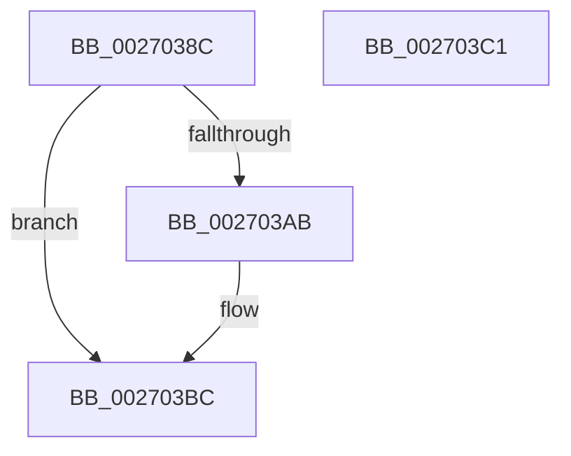

# PopFxDereferenceDevice

- RVA: `0x0027038C`–`0x002703C2` (길이 `54` bytes)
- VA: `0x000000014027038C`
- 실행 섹션: `.text`
- PDB 이름 있음: `예`; PDB Function 태그: `아니요`
- unwind 정보 RVA: `0x0005C788`
- 디코드: `14`개 명령, `54/54` bytes 표시
- 미해석 바이트: `0` (있으면 어셈블리에 `.byte`로 보존)

> 이 문서는 커널 이미지의 기계어와 PDB 기호를 분석해 생성했습니다. 4번과 5번은 함수 원형과 자료형을 바이너리 사용 방식에서 추정한 C 해석이며 원본 소스 복구 결과는 아닙니다.

## 1. Dependencies

- 직접 호출 지점: **1**; 고유 호출 대상: **1**
- 직접 호출자로 확인된 함수: **30**
- RIP 상대 이미지 참조: **0**

### Outgoing calls
- `0x002703B7` → [KeSetEvent](../33/KeSetEvent_function_0033F310.md) (function, `0x0033F310`)

### Direct callers
- [PoFxNotifySurprisePowerOn](../26/PoFxNotifySurprisePowerOn_function_0026E620.md) at `0x0026E67C`
- [PopRequestCompletion](../26/PopRequestCompletion_function_0026EEF0.md) at `0x0026F009`
- [PopFxReleasePowerIrp](PopFxReleasePowerIrp_function_00270274.md) at `0x00270326`
- [PopRequestPowerIrp](PopRequestPowerIrp_function_00270ED4.md) at `0x00271117`
- [PopAllocateIrp](PopAllocateIrp_function_0027116C.md) at `0x00271617`
- [sub_002BD6E6](../2B/Unknown_function_002BD6E6.md) at `0x002BD89A`
- [PopFxCompleteComponentActivation](../2B/PopFxCompleteComponentActivation_function_002BDDE4.md) at `0x002BDE35`
- [PopFxAllocatePowerIrp](../2C/PopFxAllocatePowerIrp_function_002C0920.md) at `0x002C0AA5`
- [PopFxActivateDevice](../4A/PopFxActivateDevice_function_004A0DC8.md) at `0x004A0F77`
- [PopFxPlatformIdleVeto](../4A/PopFxPlatformIdleVeto_function_004AABC0.md) at `0x004AAC64`
- [PopFxClearDeviceConstraints](../4B/PopFxClearDeviceConstraints_function_004B05F8.md) at `0x004B0746`
- [PoFxPowerControl](../4B/PoFxPowerControl_function_004B2E70.md) at `0x004B2EF6`
- [PopFxDirectedPowerTransitionWorker](../4C/PopFxDirectedPowerTransitionWorker_function_004C4020.md) at `0x004C4047`
- [PopFxDestroyDirectedDripsCandidateDeviceList](../4D/PopFxDestroyDirectedDripsCandidateDeviceList_function_004D2D98.md) at `0x004D2DD2`
- [PopFxCompleteDirectedPowerTransition](../4F/PopFxCompleteDirectedPowerTransition_function_004FB330.md) at `0x004FB46F`
- [PoFxAddComponentRelation](../5D/PoFxAddComponentRelation_function_005D15E0.md) at `0x005D1819`
- [PoFxAddDeviceRelation](../5D/PoFxAddDeviceRelation_function_005D1850.md) at `0x005D19DB`
- [PoFxRemoveComponentRelation](../5D/PoFxRemoveComponentRelation_function_005D1C90.md) at `0x005D1EB8`
- [PoFxRemoveDeviceRelation](../5D/PoFxRemoveDeviceRelation_function_005D1EF0.md) at `0x005D20D5`
- [PopFxComponentPerfWork](../5D/PopFxComponentPerfWork_function_005D21A0.md) at `0x005D21FA`
- [PopFxDeviceWork](../5D/PopFxDeviceWork_function_005D27B0.md) at `0x005D27FD`
- [PopFxProcessorIdleVeto](../5D/PopFxProcessorIdleVeto_function_005D2FF0.md) at `0x005D3094`
- [PopFxUpdatePlatformIdleState](../5D/PopFxUpdatePlatformIdleState_function_005D3880.md) at `0x005D392F`
- [PopFxUpdateProcessorIdleState](../5D/PopFxUpdateProcessorIdleState_function_005D3960.md) at `0x005D3A0F`
- [PopPepPlatformStateRegistered](../5D/PopPepPlatformStateRegistered_function_005DCDB8.md) at `0x005DCF5D`
- [PopFxDestroyDripsBlockingDeviceList](../../page/75/PopFxDestroyDripsBlockingDeviceList_function_00758DEC.md) at `0x00758E49`
- [PopFxRegisterDevice](../../page/75/PopFxRegisterDevice_function_00759B80.md) at `0x00759DD1`
- [PoFxSetTargetDripsDevicePowerState](../../page/A8/PoFxSetTargetDripsDevicePowerState_function_00A88EB0.md) at `0x00A88FEC`
- [PopFxUpdateVetoMaskWork](../../page/AB/PopFxUpdateVetoMaskWork_function_00AB2800.md) at `0x00AB28F0`
- [PopSystemIrpCompletion](../../pagelk/B7/PopSystemIrpCompletion_function_00B70CC0.md) at `0x00B70DA2`

### Static image references
- 디코드된 RIP-relative 메모리 참조가 없습니다.

## 2. Other-region calls and transfers

- 다른 실행 섹션으로 향하는 call: **0**
- 별도 외부 분기/꼬리 이동을 확인하지 못했습니다.

## 3. Assembly (complete function range)

```asm
0027038C  48 83 EC 28                     sub rsp, 0x28
00270390  48 63 C2                        movsxd rax, edx
00270393  F0 FF 8C 81 10 01 00 00         lock dec dword ptr [rcx + rax*4 + 0x110]
0027039B  83 C8 FF                        or eax, 0xffffffff
0027039E  F0 0F C1 81 F4 00 00 00         lock xadd dword ptr [rcx + 0xf4], eax
002703A6  83 F8 01                        cmp eax, 1
002703A9  75 11                           jne 0x1402703bc
002703AB  48 81 C1 F8 00 00 00            add rcx, 0xf8
002703B2  45 33 C0                        xor r8d, r8d
002703B5  33 D2                           xor edx, edx
002703B7  E8 54 EF 0C 00                  call 0x14033f310
002703BC  48 83 C4 28                     add rsp, 0x28
002703C0  C3                              ret
002703C1  CC                              int3
```

## 4. C-style interpretation (structured pseudocode)

```c
__int64 __fastcall PopFxDereferenceDevice(__int64 a1, int a2, int a3)
{
    __int64 result;
    __int64 v_rsp;

    v_rsp = (v_rsp) - (40);
    result = (unsigned int)(((int)(a2)) | (0xFFFFFFFFULL));
    if (((unsigned int)(result)) == 1) {
        a1 = (a1) + (248);
        a3 = 0;
        a2 = 0;
        result = KeSetEvent(a1, a2, a3, a4);
    }
    v_rsp = (v_rsp) + (40);
    return result;
}
```

## 5. (Beta) C Style

```c
int64_t PopFxDereferenceDevice(void *Arg1, int32_t Arg2, int32_t Arg3)
{
    uint8_t *arg1 = (uint8_t *)Arg1;

    int64_t result;
    int64_t local_rsp;

    local_rsp = (local_rsp) - (40);
    result = (uint32_t)(((int32_t)(Arg2)) | (0xFFFFFFFFULL));
    if (((uint32_t)(result)) == 1) {
        Arg1 = (Arg1) + (248);
        Arg3 = 0;
        Arg2 = 0;
        result = KeSetEvent(Arg1, Arg2, Arg3, a4);
    }
    local_rsp = (local_rsp) + (40);
    return result;
}
```

### 관측된 메모리 오프셋

구조체 형식이 확인되지 않은 접근은 인자 기준의 오프셋으로만 기록했습니다.

| 기준 인자 | 오프셋 표현 | 폭 (bit) | 접근 |
|---|---:|---:|---|
| `Arg1` | `+ 0xF4` | `32` | `R/W` |
| `Arg1` | `+ 0x110 + rax*4` | `32` | `R/W` |

## 6. Execution-region graph

[열기: 2D/3D 그래프와 함수 탐색 컨트롤 패널](../../../control-panel.html?section=text&rva=0x0027038C&view=graph)

- 2D 그래프는 위에서 아래로 흐르고, 3D 그래프는 빈 공간을 드래그해 회전합니다. Shift+드래그는 이동, 휠은 확대·축소, 함수 노드 선택은 대상 보고서 이동입니다.

### Static fallback


