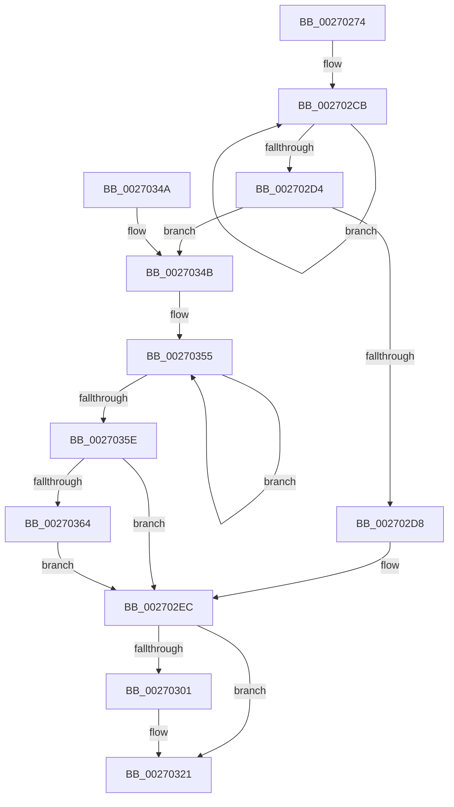

# PopFxReleasePowerIrp

- RVA: `0x00270274`–`0x00270384` (길이 `272` bytes)
- VA: `0x0000000140270274`
- 실행 섹션: `.text`
- PDB 이름 있음: `예`; PDB Function 태그: `아니요`
- unwind 정보 RVA: `0x00065A00`
- 디코드: `71`개 명령, `272/272` bytes 표시
- 미해석 바이트: `0` (있으면 어셈블리에 `.byte`로 보존)

> 이 문서는 커널 이미지의 기계어와 PDB 기호를 분석해 생성했습니다. 4번과 5번은 함수 원형과 자료형을 바이너리 사용 방식에서 추정한 C 해석이며 원본 소스 복구 결과는 아닙니다.

## 1. Dependencies

- 직접 호출 지점: **5**; 고유 호출 대상: **5**
- 직접 호출자로 확인된 함수: **1**
- RIP 상대 이미지 참조: **0**

### Outgoing calls
- `0x0027029C` → [ExAcquireSpinLockExclusive](../24/ExAcquireSpinLockExclusive_function_00248690.md) (function, `0x00248690`)
- `0x002702E7` → [KeSetEvent](../33/KeSetEvent_function_0033F310.md) (function, `0x0033F310`)
- `0x002702F7` → [ExReleaseSpinLockExclusive](../2C/ExReleaseSpinLockExclusive_function_002C0EF0.md) (function, `0x002C0EF0`)
- `0x0027031C` → [PopRequestPowerIrp](PopRequestPowerIrp_function_00270ED4.md) (function, `0x00270ED4`)
- `0x00270326` → [PopFxDereferenceDevice](PopFxDereferenceDevice_function_0027038C.md) (function, `0x0027038C`)

### Direct callers
- [PopFreeIrp](../26/PopFreeIrp_function_0026FAA0.md) at `0x0026FB56`

### Static image references
- 디코드된 RIP-relative 메모리 참조가 없습니다.

## 2. Other-region calls and transfers

- 다른 실행 섹션으로 향하는 call: **0**
- 별도 외부 분기/꼬리 이동을 확인하지 못했습니다.

## 3. Assembly (complete function range)

```asm
00270274  48 8B C4                        mov rax, rsp
00270277  48 89 58 08                     mov qword ptr [rax + 8], rbx
0027027B  48 89 68 10                     mov qword ptr [rax + 0x10], rbp
0027027F  48 89 70 18                     mov qword ptr [rax + 0x18], rsi
00270283  48 89 78 20                     mov qword ptr [rax + 0x20], rdi
00270287  41 54                           push r12
00270289  41 56                           push r14
0027028B  41 57                           push r15
0027028D  48 83 EC 40                     sub rsp, 0x40
00270291  48 8B F9                        mov rdi, rcx
00270294  48 8B 49 30                     mov rcx, qword ptr [rcx + 0x30]
00270298  48 83 C1 58                     add rcx, 0x58
0027029C  E8 EF 83 FD FF                  call 0x140248690
002702A1  44 8A E0                        mov r12b, al
002702A4  F0 83 67 20 EF                  lock and dword ptr [rdi + 0x20], 0xffffffef
002702A9  48 8B AF 28 02 00 00            mov rbp, qword ptr [rdi + 0x228]
002702B0  4C 8B B7 40 02 00 00            mov r14, qword ptr [rdi + 0x240]
002702B7  4C 8B BF 50 02 00 00            mov r15, qword ptr [rdi + 0x250]
002702BE  8B 9F 38 02 00 00               mov ebx, dword ptr [rdi + 0x238]
002702C4  0F 0D 4F 20                     prefetchw byte ptr [rdi + 0x20]
002702C8  8B 47 20                        mov eax, dword ptr [rdi + 0x20]
002702CB  8B C8                           mov ecx, eax
002702CD  F0 0F B1 4F 20                  lock cmpxchg dword ptr [rdi + 0x20], ecx
002702D2  75 F7                           jne 0x1402702cb
002702D4  A8 20                           test al, 0x20
002702D6  75 73                           jne 0x14027034b
002702D8  40 32 F6                        xor sil, sil
002702DB  48 8D 8F 60 02 00 00            lea rcx, [rdi + 0x260]
002702E2  45 33 C0                        xor r8d, r8d
002702E5  33 D2                           xor edx, edx
002702E7  E8 24 F0 0C 00                  call 0x14033f310
002702EC  48 8B 4F 30                     mov rcx, qword ptr [rdi + 0x30]
002702F0  41 8A D4                        mov dl, r12b
002702F3  48 83 C1 58                     add rcx, 0x58
002702F7  E8 F4 0B 05 00                  call 0x1402c0ef0
002702FC  40 84 F6                        test sil, sil
002702FF  74 20                           je 0x140270321
00270301  48 83 64 24 30 00               and qword ptr [rsp + 0x30], 0
00270307  4D 8B CE                        mov r9, r14
0027030A  C6 44 24 28 01                  mov byte ptr [rsp + 0x28], 1
0027030F  44 8B C3                        mov r8d, ebx
00270312  B2 02                           mov dl, 2
00270314  4C 89 7C 24 20                  mov qword ptr [rsp + 0x20], r15
00270319  48 8B CD                        mov rcx, rbp
0027031C  E8 B3 0B 00 00                  call 0x140270ed4
00270321  33 D2                           xor edx, edx
00270323  48 8B CF                        mov rcx, rdi
00270326  E8 61 00 00 00                  call 0x14027038c
0027032B  48 8B 5C 24 60                  mov rbx, qword ptr [rsp + 0x60]
00270330  48 8B 6C 24 68                  mov rbp, qword ptr [rsp + 0x68]
00270335  48 8B 74 24 70                  mov rsi, qword ptr [rsp + 0x70]
0027033A  48 8B 7C 24 78                  mov rdi, qword ptr [rsp + 0x78]
0027033F  48 83 C4 40                     add rsp, 0x40
00270343  41 5F                           pop r15
00270345  41 5E                           pop r14
00270347  41 5C                           pop r12
00270349  C3                              ret
0027034A  CC                              int3
0027034B  40 B6 01                        mov sil, 1
0027034E  0F 0D 4F 20                     prefetchw byte ptr [rdi + 0x20]
00270352  8B 47 20                        mov eax, dword ptr [rdi + 0x20]
00270355  8B C8                           mov ecx, eax
00270357  F0 0F B1 4F 20                  lock cmpxchg dword ptr [rdi + 0x20], ecx
0027035C  75 F7                           jne 0x140270355
0027035E  0F BA E0 08                     bt eax, 8
00270362  73 88                           jae 0x1402702ec
00270364  48 8B AF 30 02 00 00            mov rbp, qword ptr [rdi + 0x230]
0027036B  4C 8B B7 48 02 00 00            mov r14, qword ptr [rdi + 0x248]
00270372  4C 8B BF 58 02 00 00            mov r15, qword ptr [rdi + 0x258]
00270379  8B 9F 3C 02 00 00               mov ebx, dword ptr [rdi + 0x23c]
0027037F  E9 68 FF FF FF                  jmp 0x1402702ec
```

## 4. C-style interpretation (structured pseudocode)

```c
__int64 __fastcall PopFxReleasePowerIrp(__int64 a1, int a2, int a3)
{
    __int64 result;
    __int64 v_rsi;
    __int64 v_rsp;
    unsigned __int64 v_stack_m28;
    unsigned __int8 v_stack_m30;
    unsigned __int64 v_stack_m38;
    unsigned __int64 v_stack_p10;
    unsigned __int64 v_stack_p18;
    unsigned __int64 v_stack_p20;
    unsigned __int64 v_stack_p8;

    *(unsigned __int64 *)(v_rsp + 8) = v_rbx;
    *(unsigned __int64 *)(v_rsp + 16) = v_rbp;
    *(unsigned __int64 *)(v_rsp + 24) = v_rsi;
    *(unsigned __int64 *)(v_rsp + 32) = v_rdi;
    v_rsp = (v_rsp) - (64);
    a1 = (*(unsigned __int64 *)(a1 + 48)) + (88);
    result = ExAcquireSpinLockExclusive(a1, a2, a3, a4);
loc_002702CB:
    if (condition_is_not_equal) goto loc_002702CB;
    if ((((unsigned __int8)((unsigned int)(*(unsigned int *)(a1 + 32)))) & (32)) != 0) goto loc_0027034B;
    v_rsi = 0;
    a3 = 0;
    a2 = 0;
    result = KeSetEvent(a1 + 608, a2, a3, a4);
loc_002702EC:
    a1 = (*(unsigned __int64 *)(a1 + 48)) + (88);
    result = ExReleaseSpinLockExclusive(a1, (unsigned __int8)((unsigned __int8)(result)), a3, a4);
    if (0 != 0) {
        a4 = *(unsigned __int64 *)(a1 + 576);
        v_stack_m30 = 1;
        a3 = (unsigned int)((unsigned int)(*(unsigned int *)(a1 + 568)));
        a2 = 2;
        v_stack_m38 = *(unsigned __int64 *)(a1 + 592);
        a1 = *(unsigned __int64 *)(a1 + 552);
        result = PopRequestPowerIrp(a1, a2, a3, a4);
    }
    a2 = 0;
    result = PopFxDereferenceDevice(a1, a2, a3, a4);
    v_rsp = (v_rsp) + (64);
    return result;
loc_0027034B:
loc_00270355:
    if (condition_is_not_equal) goto loc_00270355;
    if (condition_is_above_or_equal) goto loc_002702EC;
    goto loc_002702EC;
}
```

## 5. (Beta) C Style

```c
int64_t PopFxReleasePowerIrp(void *Arg1, int32_t Arg2, int32_t Arg3)
{
    uint8_t *arg1 = (uint8_t *)Arg1;

    int64_t result;
    int64_t local_rsi;
    int64_t local_rsp;
    uint64_t v_stack_m28;
    uint8_t v_stack_m30;
    uint64_t v_stack_m38;
    uint64_t v_stack_p10;
    uint64_t v_stack_p18;
    uint64_t v_stack_p20;
    uint64_t v_stack_p8;

    *(uint64_t *)(local_rsp + 0x8) = local_rbx;
    *(uint64_t *)(local_rsp + 0x10) = local_rbp;
    *(uint64_t *)(local_rsp + 0x18) = local_rsi;
    *(uint64_t *)(local_rsp + 0x20) = local_rdi;
    local_rsp = (local_rsp) - (64);
    Arg1 = (*(uint64_t *)(arg1 + 0x30)) + (88);
    result = ExAcquireSpinLockExclusive(Arg1, Arg2, Arg3, a4);
loc_002702CB:
    if (condition_is_not_equal) goto loc_002702CB;
    if ((((uint8_t)((uint32_t)(*(uint32_t *)(arg1 + 0x20)))) & (32)) != 0) goto loc_0027034B;
    local_rsi = 0;
    Arg3 = 0;
    Arg2 = 0;
    result = KeSetEvent(Arg1 + 608, Arg2, Arg3, a4);
loc_002702EC:
    Arg1 = (*(uint64_t *)(arg1 + 0x30)) + (88);
    result = ExReleaseSpinLockExclusive(Arg1, (uint8_t)((uint8_t)(result)), Arg3, a4);
    if (0 != 0) {
        a4 = *(uint64_t *)(arg1 + 0x240);
        v_stack_m30 = 1;
        Arg3 = (uint32_t)((uint32_t)(*(uint32_t *)(arg1 + 0x238)));
        Arg2 = 2;
        v_stack_m38 = *(uint64_t *)(arg1 + 0x250);
        Arg1 = *(uint64_t *)(arg1 + 0x228);
        result = PopRequestPowerIrp(Arg1, Arg2, Arg3, a4);
    }
    Arg2 = 0;
    result = PopFxDereferenceDevice(Arg1, Arg2, Arg3, a4);
    local_rsp = (local_rsp) + (64);
    return result;
loc_0027034B:
loc_00270355:
    if (condition_is_not_equal) goto loc_00270355;
    if (condition_is_above_or_equal) goto loc_002702EC;
    goto loc_002702EC;
}
```

### 관측된 메모리 오프셋

구조체 형식이 확인되지 않은 접근은 인자 기준의 오프셋으로만 기록했습니다.

| 기준 인자 | 오프셋 표현 | 폭 (bit) | 접근 |
|---|---:|---:|---|
| `Arg1` | `+ 0x20` | `8` | `R` |
| `Arg1` | `+ 0x20` | `32` | `R` |
| `Arg1` | `+ 0x20` | `32` | `R/W` |
| `Arg1` | `+ 0x30` | `64` | `R` |
| `Arg1` | `+ 0x228` | `64` | `R` |
| `Arg1` | `+ 0x230` | `64` | `R` |
| `Arg1` | `+ 0x238` | `32` | `R` |
| `Arg1` | `+ 0x23C` | `32` | `R` |
| `Arg1` | `+ 0x240` | `64` | `R` |
| `Arg1` | `+ 0x248` | `64` | `R` |
| `Arg1` | `+ 0x250` | `64` | `R` |
| `Arg1` | `+ 0x258` | `64` | `R` |
| `Arg1` | `+ 0x260` | `64` | `R` |

## 6. Execution-region graph

[열기: 2D/3D 그래프와 함수 탐색 컨트롤 패널](../../../control-panel.html?section=text&rva=0x00270274&view=graph)

- 2D 그래프는 위에서 아래로 흐르고, 3D 그래프는 빈 공간을 드래그해 회전합니다. Shift+드래그는 이동, 휠은 확대·축소, 함수 노드 선택은 대상 보고서 이동입니다.

### Static fallback


