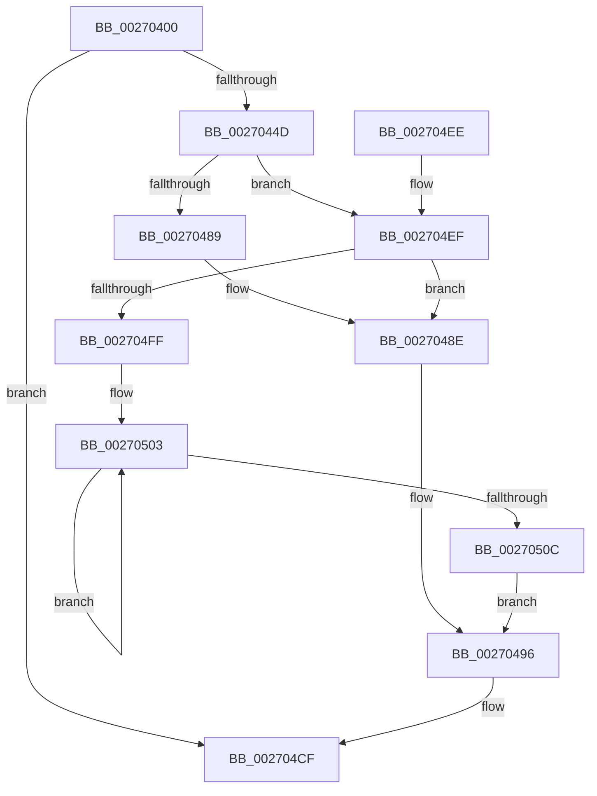

# PopLogNotifyDevice

- RVA: `0x00270400`–`0x00270535` (길이 `309` bytes)
- VA: `0x0000000140270400`
- 실행 섹션: `.text`
- PDB 이름 있음: `예`; PDB Function 태그: `아니요`
- unwind 정보 RVA: `0x00065A20`
- 디코드: `77`개 명령, `309/309` bytes 표시
- 미해석 바이트: `0` (있으면 어셈블리에 `.byte`로 보존)

> 이 문서는 커널 이미지의 기계어와 PDB 기호를 분석해 생성했습니다. 4번과 5번은 함수 원형과 자료형을 바이너리 사용 방식에서 추정한 C 해석이며 원본 소스 복구 결과는 아닙니다.

## 1. Dependencies

- 직접 호출 지점: **4**; 고유 호출 대상: **4**
- 직접 호출자로 확인된 함수: **2**
- RIP 상대 이미지 참조: **2**

### Outgoing calls
- `0x00270438` → [memset](../6C/memset_function_006C6C40.md) (function, `0x006C6C40`)
- `0x002704CA` → [EtwTraceKernelEvent](../23/EtwTraceKernelEvent_function_00235350.md) (function, `0x00235350`)
- `0x002704D6` → [_security_check_cookie](../6A/_security_check_cookie_function_006AC640.md) (function, `0x006AC640`)
- `0x0027052B` → [RtlStringCchCopyW](../26/RtlStringCchCopyW_function_0026E9A4.md) (function, `0x0026E9A4`)

### Direct callers
- [PopRequestPowerIrp](PopRequestPowerIrp_function_00270ED4.md) at `0x00270FEA`
- [PopNotifyDevice](../../pagelk/B7/PopNotifyDevice_function_00B7DAAC.md) at `0x00B7DBCC`

### Static image references
- `0x00270414` → RVA `0x00E0A740` (`.data`; read)
- `0x0027043D` → RVA `0x00FC6B10` (`ALMOSTRO`; read)

## 2. Other-region calls and transfers

- 다른 실행 섹션으로 향하는 call: **0**
- 별도 외부 분기/꼬리 이동을 확인하지 못했습니다.

## 3. Assembly (complete function range)

```asm
00270400  48 89 5C 24 20                  mov qword ptr [rsp + 0x20], rbx
00270405  55                              push rbp
00270406  56                              push rsi
00270407  57                              push rdi
00270408  48 8D 6C 24 B0                  lea rbp, [rsp - 0x50]
0027040D  48 81 EC 50 01 00 00            sub rsp, 0x150
00270414  48 8B 05 25 A3 B9 00            mov rax, qword ptr [rip + 0xb9a325]
0027041B  48 33 C4                        xor rax, rsp
0027041E  48 89 45 40                     mov qword ptr [rbp + 0x40], rax
00270422  49 8B F8                        mov rdi, r8
00270425  48 8B DA                        mov rbx, rdx
00270428  48 8B F1                        mov rsi, rcx
0027042B  33 D2                           xor edx, edx
0027042D  41 B8 00 01 00 00               mov r8d, 0x100
00270433  48 8D 4C 24 30                  lea rcx, [rsp + 0x30]
00270438  E8 03 68 45 00                  call 0x1406c6c40
0027043D  F7 05 C9 66 D5 00 00 80 00 00   test dword ptr [rip + 0xd566c9], 0x8000
00270447  0F 84 82 00 00 00               je 0x1402704cf
0027044D  48 8B 97 B8 00 00 00            mov rdx, qword ptr [rdi + 0xb8]
00270454  48 8B 46 08                     mov rax, qword ptr [rsi + 8]
00270458  48 89 7C 24 30                  mov qword ptr [rsp + 0x30], rdi
0027045D  33 FF                           xor edi, edi
0027045F  48 8B 48 18                     mov rcx, qword ptr [rax + 0x18]
00270463  48 89 4C 24 38                  mov qword ptr [rsp + 0x38], rcx
00270468  8A 42 B8                        mov al, byte ptr [rdx - 0x48]
0027046B  88 44 24 41                     mov byte ptr [rsp + 0x41], al
0027046F  8A 42 B9                        mov al, byte ptr [rdx - 0x47]
00270472  88 44 24 42                     mov byte ptr [rsp + 0x42], al
00270476  8B 42 C8                        mov eax, dword ptr [rdx - 0x38]
00270479  89 44 24 44                     mov dword ptr [rsp + 0x44], eax
0027047D  8B 42 D0                        mov eax, dword ptr [rdx - 0x30]
00270480  89 44 24 48                     mov dword ptr [rsp + 0x48], eax
00270484  48 85 DB                        test rbx, rbx
00270487  75 66                           jne 0x1402704ef
00270489  40 88 7C 24 40                  mov byte ptr [rsp + 0x40], dil
0027048E  66 89 7C 24 50                  mov word ptr [rsp + 0x50], di
00270493  44 8B DF                        mov r11d, edi
00270496  48 8D 44 24 30                  lea rax, [rsp + 0x30]
0027049B  89 7D 3C                        mov dword ptr [rbp + 0x3c], edi
0027049E  48 89 45 30                     mov qword ptr [rbp + 0x30], rax
002704A2  48 8D 4D 30                     lea rcx, [rbp + 0x30]
002704A6  42 8D 04 5D 28 00 00 00         lea eax, [r11*2 + 0x28]
002704AE  C7 44 24 20 02 18 50 00         mov dword ptr [rsp + 0x20], 0x501802
002704B6  41 B9 26 12 00 00               mov r9d, 0x1226
002704BC  89 45 38                        mov dword ptr [rbp + 0x38], eax
002704BF  BA 01 00 00 00                  mov edx, 1
002704C4  41 B8 00 80 00 80               mov r8d, 0x80008000
002704CA  E8 81 4E FC FF                  call 0x140235350
002704CF  48 8B 4D 40                     mov rcx, qword ptr [rbp + 0x40]
002704D3  48 33 CC                        xor rcx, rsp
002704D6  E8 65 C1 43 00                  call 0x1406ac640
002704DB  48 8B 9C 24 88 01 00 00         mov rbx, qword ptr [rsp + 0x188]
002704E3  48 81 C4 50 01 00 00            add rsp, 0x150
002704EA  5F                              pop rdi
002704EB  5E                              pop rsi
002704EC  5D                              pop rbp
002704ED  C3                              ret
002704EE  CC                              int3
002704EF  48 8B 4B 48                     mov rcx, qword ptr [rbx + 0x48]
002704F3  8A 43 38                        mov al, byte ptr [rbx + 0x38]
002704F6  88 44 24 40                     mov byte ptr [rsp + 0x40], al
002704FA  48 85 C9                        test rcx, rcx
002704FD  74 8F                           je 0x14027048e
002704FF  48 83 C8 FF                     or rax, 0xffffffffffffffff
00270503  48 FF C0                        inc rax
00270506  66 39 3C 41                     cmp word ptr [rcx + rax*2], di
0027050A  75 F7                           jne 0x140270503
0027050C  BA 6C 00 00 00                  mov edx, 0x6c
00270511  44 8B D8                        mov r11d, eax
00270514  3B C2                           cmp eax, edx
00270516  44 0F 47 DA                     cmova r11d, edx
0027051A  BA 6D 00 00 00                  mov edx, 0x6d
0027051F  41 2B C3                        sub eax, r11d
00270522  4C 8D 04 41                     lea r8, [rcx + rax*2]
00270526  48 8D 4C 24 50                  lea rcx, [rsp + 0x50]
0027052B  E8 74 E4 FF FF                  call 0x14026e9a4
00270530  E9 61 FF FF FF                  jmp 0x140270496
```

## 4. C-style interpretation (structured pseudocode)

```c
__int64 __fastcall PopLogNotifyDevice(__int64 a1, __int64 a2, __int64 a3)
{
    __int64 result;
    __int64 v_r11;
    __int64 v_rdi;
    __int64 v_rsp;
    unsigned __int16 v_stack_m118;
    unsigned int v_stack_m120;
    unsigned int v_stack_m124;
    unsigned __int8 v_stack_m126;
    unsigned __int8 v_stack_m127;
    unsigned __int8 v_stack_m128;
    unsigned __int64 v_stack_m130;
    unsigned __int64 v_stack_m138;
    unsigned int v_stack_m148;
    unsigned __int64 v_stack_m28;
    unsigned int v_stack_m2C;
    unsigned int v_stack_m30;
    unsigned __int64 v_stack_m38;
    unsigned __int64 v_stack_m68;
    unsigned __int64 v_stack_p20;
    unsigned __int8 v_stack_p40;
    unsigned __int64 v_stack_p50;

    v_stack_p20 = v_rbx;
    v_rsp = (v_rsp) - (336);
    result = (*(unsigned __int64 *)(v_rip + 12165925)) ^ (v_rsp);
    v_stack_m28 = result;
    a2 = 0;
    result = memset(v_stack_m138, a2, 256, a4);
    if (((*(unsigned int *)(v_rip + 13985481)) & (0x8000ULL)) == 0) goto loc_002704CF;
    v_stack_m138 = a3;
    v_rdi = 0;
    v_stack_m130 = *(unsigned __int64 *)(*(unsigned __int64 *)(a1 + 8) + 24);
    v_stack_m127 = (unsigned __int8)(*(unsigned __int8 *)(*(unsigned __int64 *)(a3 + 184) - 72));
    v_stack_m126 = (unsigned __int8)(*(unsigned __int8 *)(*(unsigned __int64 *)(a3 + 184) - 71));
    v_stack_m124 = (unsigned int)((unsigned int)(*(unsigned int *)(*(unsigned __int64 *)(a3 + 184) - 56)));
    v_stack_m120 = (unsigned int)((unsigned int)(*(unsigned int *)(*(unsigned __int64 *)(a3 + 184) - 48)));
    if (0 != 0) goto loc_002704EF;
    v_stack_m128 = 0;
loc_0027048E:
    v_stack_m118 = 0;
loc_00270496:
    v_stack_m2C = 0;
    v_stack_m38 = v_stack_m138;
    v_stack_m148 = 0x501802ULL;
    v_stack_m30 = (unsigned int)(0 * 2 + 40);
    result = EtwTraceKernelEvent(v_stack_m38, 1, (unsigned int)(0x80008000ULL), (unsigned int)(0x1226ULL));
loc_002704CF:
    a1 = (v_stack_m28) ^ (v_rsp);
    result = _security_check_cookie(a1, 1, (unsigned int)(0x80008000ULL), (unsigned int)(0x1226ULL));
    v_rsp = (v_rsp) + (336);
    return result;
loc_002704EF:
    v_stack_p40 = (unsigned __int8)(*(unsigned __int8 *)(v_stack_p20 + 56));
    if (*(unsigned __int64 *)(v_stack_p20 + 72) == 0) goto loc_0027048E;
    result = (*(unsigned __int8 *)(v_stack_p20 + 56)) | (-1);
loc_00270503:
    result = (result) + 1;
    if ((*(unsigned __int16 *)(*(unsigned __int64 *)(v_stack_p20 + 72) + result * 2)) != 0) goto loc_00270503;
    v_r11 = (unsigned int)((unsigned int)(result));
    if (((unsigned int)(result)) > 108) { v_r11 = 108; }
    result = (unsigned int)((result) - ((unsigned int)(v_r11)));
    result = RtlStringCchCopyW(v_stack_p50, 109, *(unsigned __int64 *)(v_stack_p20 + 72) + result * 2, (unsigned int)(0x1226ULL));
    goto loc_00270496;
}
```

## 5. (Beta) C Style

```c
int64_t PopLogNotifyDevice(void *Arg1, int64_t Arg2, void *Arg3)
{
    uint8_t *arg1 = (uint8_t *)Arg1;
    uint8_t *arg3 = (uint8_t *)Arg3;

    int64_t result;
    int64_t local_r11;
    int64_t local_rdi;
    int64_t local_rsp;
    uint16_t v_stack_m118;
    uint32_t v_stack_m120;
    uint32_t v_stack_m124;
    uint8_t v_stack_m126;
    uint8_t v_stack_m127;
    uint8_t v_stack_m128;
    uint64_t v_stack_m130;
    uint64_t v_stack_m138;
    uint32_t v_stack_m148;
    uint64_t v_stack_m28;
    uint32_t v_stack_m2C;
    uint32_t v_stack_m30;
    uint64_t v_stack_m38;
    uint64_t v_stack_m68;
    uint64_t v_stack_p20;
    uint8_t v_stack_p40;
    uint64_t v_stack_p50;

    v_stack_p20 = local_rbx;
    local_rsp = (local_rsp) - (336);
    result = (*(uint64_t *)(v_rip + 0xB9A325)) ^ (local_rsp);
    v_stack_m28 = result;
    Arg2 = 0;
    result = memset(v_stack_m138, Arg2, 256, a4);
    if (((*(uint32_t *)(v_rip + 0xD566C9)) & (0x8000ULL)) == 0) goto loc_002704CF;
    v_stack_m138 = Arg3;
    local_rdi = 0;
    v_stack_m130 = *(uint64_t *)(*(uint64_t *)(arg1 + 0x8) + 0x18);
    v_stack_m127 = (uint8_t)(*(uint8_t *)(*(uint64_t *)(arg3 + 0xB8) - 0x48));
    v_stack_m126 = (uint8_t)(*(uint8_t *)(*(uint64_t *)(arg3 + 0xB8) - 0x47));
    v_stack_m124 = (uint32_t)((uint32_t)(*(uint32_t *)(*(uint64_t *)(arg3 + 0xB8) - 0x38)));
    v_stack_m120 = (uint32_t)((uint32_t)(*(uint32_t *)(*(uint64_t *)(arg3 + 0xB8) - 0x30)));
    if (0 != 0) goto loc_002704EF;
    v_stack_m128 = 0;
loc_0027048E:
    v_stack_m118 = 0;
loc_00270496:
    v_stack_m2C = 0;
    v_stack_m38 = v_stack_m138;
    v_stack_m148 = 0x501802ULL;
    v_stack_m30 = (uint32_t)(0 * 2 + 40);
    result = EtwTraceKernelEvent(v_stack_m38, 1, (uint32_t)(0x80008000ULL), (uint32_t)(0x1226ULL));
loc_002704CF:
    Arg1 = (v_stack_m28) ^ (local_rsp);
    result = _security_check_cookie(Arg1, 1, (uint32_t)(0x80008000ULL), (uint32_t)(0x1226ULL));
    local_rsp = (local_rsp) + (336);
    return result;
loc_002704EF:
    v_stack_p40 = (uint8_t)(*(uint8_t *)(v_stack_p20 + 0x38));
    if (*(uint64_t *)(v_stack_p20 + 0x48) == 0) goto loc_0027048E;
    result = (*(uint8_t *)(v_stack_p20 + 0x38)) | (-1);
loc_00270503:
    result = (result) + 1;
    if ((*(uint16_t *)(*(uint64_t *)(v_stack_p20 + 0x48) + result * 2)) != 0) goto loc_00270503;
    local_r11 = (uint32_t)((uint32_t)(result));
    if (((uint32_t)(result)) > 108) { local_r11 = 108; }
    result = (uint32_t)((result) - ((uint32_t)(local_r11)));
    result = RtlStringCchCopyW(v_stack_p50, 109, *(uint64_t *)(v_stack_p20 + 0x48) + result * 2, (uint32_t)(0x1226ULL));
    goto loc_00270496;
}
```

### 관측된 메모리 오프셋

구조체 형식이 확인되지 않은 접근은 인자 기준의 오프셋으로만 기록했습니다.

| 기준 인자 | 오프셋 표현 | 폭 (bit) | 접근 |
|---|---:|---:|---|
| `Arg1` | `+ 0x8` | `64` | `R` |
| `Arg3` | `+ 0xB8` | `64` | `R` |

## 6. Execution-region graph

[열기: 2D/3D 그래프와 함수 탐색 컨트롤 패널](../../../control-panel.html?section=text&rva=0x00270400&view=graph)

- 2D 그래프는 위에서 아래로 흐르고, 3D 그래프는 빈 공간을 드래그해 회전합니다. Shift+드래그는 이동, 휠은 확대·축소, 함수 노드 선택은 대상 보고서 이동입니다.

### Static fallback


