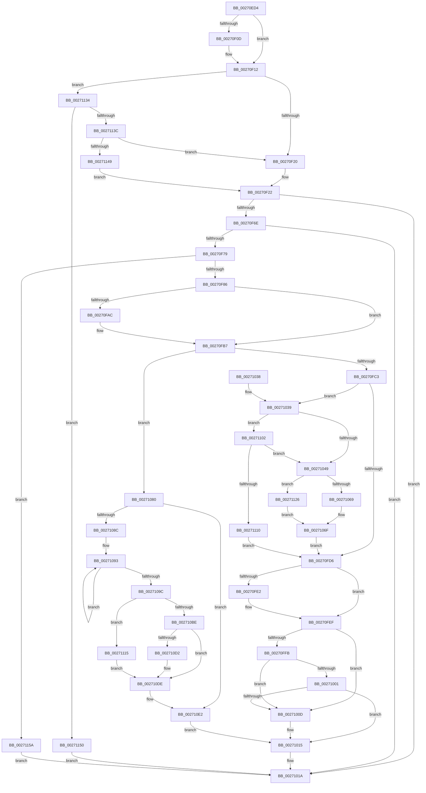

# PopRequestPowerIrp

- RVA: `0x00270ED4`–`0x00271164` (길이 `656` bytes)
- VA: `0x0000000140270ED4`
- 실행 섹션: `.text`
- PDB 이름 있음: `예`; PDB Function 태그: `아니요`
- unwind 정보 RVA: `0x00065A98`
- 디코드: `170`개 명령, `656/656` bytes 표시
- 미해석 바이트: `0` (있으면 어셈블리에 `.byte`로 보존)

> 이 문서는 커널 이미지의 기계어와 PDB 기호를 분석해 생성했습니다. 4번과 5번은 함수 원형과 자료형을 바이너리 사용 방식에서 추정한 C 해석이며 원본 소스 복구 결과는 아닙니다.

## 1. Dependencies

- 직접 호출 지점: **9**; 고유 호출 대상: **9**
- 직접 호출자로 확인된 함수: **4**
- RIP 상대 이미지 참조: **5**

### Outgoing calls
- `0x00270F61` → [PopAllocateIrp](PopAllocateIrp_function_0027116C.md) (function, `0x0027116C`)
- `0x00270FEA` → [PopLogNotifyDevice](PopLogNotifyDevice_function_00270400.md) (function, `0x00270400`)
- `0x00271004` → [PopFxNotifyPreDIrpIssue](../26/PopFxNotifyPreDIrpIssue_function_0026FD40.md) (function, `0x0026FD40`)
- `0x00271010` → [PopQueueQuerySetIrp](../2B/PopQueueQuerySetIrp_function_002BEF18.md) (function, `0x002BEF18`)
- `0x002710D9` → [PopPepUpdateConstraints](../26/PopPepUpdateConstraints_function_0026F5C8.md) (function, `0x0026F5C8`)
- `0x002710E8` → [PopDiagTraceIrpStart](../47/PopDiagTraceIrpStart_function_0047CBBC.md) (function, `0x0047CBBC`)
- `0x002710F8` → [IofCallDriverSpecifyReturn](../4A/IofCallDriverSpecifyReturn_function_004A8AE0.md) (function, `0x004A8AE0`)
- `0x00271102` → [PopFxGetDeviceDStateReason](../26/PopFxGetDeviceDStateReason_function_0026D8A0.md) (function, `0x0026D8A0`)
- `0x00271117` → [PopFxDereferenceDevice](PopFxDereferenceDevice_function_0027038C.md) (function, `0x0027038C`)

### Direct callers
- [PopFxReleasePowerIrp](PopFxReleasePowerIrp_function_00270274.md) at `0x0027031C`
- [PoRequestPowerIrp](PoRequestPowerIrp_function_002703D0.md) at `0x002703ED`
- [PopScanIdleList](../49/PopScanIdleList_function_00497F04.md) at `0x00498105`
- [DifPoRequestPowerIrpWrapper](../63/DifPoRequestPowerIrpWrapper_function_0063A410.md) at `0x0063A534`

### Static image references
- `0x00270F94` → RVA `0x0026EEF0` (`PopRequestCompletion`; read)
- `0x00270FCD` → RVA `0x00F0BCC0` (`.data`; read)
- `0x00270FD6` → RVA `0x00FC6B10` (`ALMOSTRO`; read)
- `0x00271049` → RVA `0x00F0BCC4` (`.data`; read)
- `0x00271054` → RVA `0x00F0BCC8` (`.data`; read)

## 2. Other-region calls and transfers

- 다른 실행 섹션으로 향하는 call: **0**
- 별도 외부 분기/꼬리 이동을 확인하지 못했습니다.

## 3. Assembly (complete function range)

```asm
00270ED4  48 8B C4                        mov rax, rsp
00270ED7  48 89 58 08                     mov qword ptr [rax + 8], rbx
00270EDB  48 89 70 10                     mov qword ptr [rax + 0x10], rsi
00270EDF  48 89 78 18                     mov qword ptr [rax + 0x18], rdi
00270EE3  4C 89 60 20                     mov qword ptr [rax + 0x20], r12
00270EE7  55                              push rbp
00270EE8  41 56                           push r14
00270EEA  41 57                           push r15
00270EEC  48 8B EC                        mov rbp, rsp
00270EEF  48 83 EC 70                     sub rsp, 0x70
00270EF3  48 83 65 F0 00                  and qword ptr [rbp - 0x10], 0
00270EF8  4D 8B D1                        mov r10, r9
00270EFB  48 8B 75 50                     mov rsi, qword ptr [rbp + 0x50]
00270EFF  41 8B D8                        mov ebx, r8d
00270F02  44 8A FA                        mov r15b, dl
00270F05  4C 8B E1                        mov r12, rcx
00270F08  48 85 F6                        test rsi, rsi
00270F0B  74 05                           je 0x140270f12
00270F0D  33 C0                           xor eax, eax
00270F0F  48 87 06                        xchg qword ptr [rsi], rax
00270F12  48 83 65 50 00                  and qword ptr [rbp + 0x50], 0
00270F17  45 84 FF                        test r15b, r15b
00270F1A  0F 85 14 02 00 00               jne 0x140271134
00270F20  32 C9                           xor cl, cl
00270F22  45 33 C9                        xor r9d, r9d
00270F25  48 8D 45 F0                     lea rax, [rbp - 0x10]
00270F29  48 89 44 24 50                  mov qword ptr [rsp + 0x50], rax
00270F2E  45 84 FF                        test r15b, r15b
00270F31  48 8D 45 50                     lea rax, [rbp + 0x50]
00270F35  45 8A C7                        mov r8b, r15b
00270F38  48 89 44 24 48                  mov qword ptr [rsp + 0x48], rax
00270F3D  41 0F 95 C1                     setne r9b
00270F41  48 8B 45 40                     mov rax, qword ptr [rbp + 0x40]
00270F45  48 89 44 24 40                  mov qword ptr [rsp + 0x40], rax
00270F4A  8A 45 48                        mov al, byte ptr [rbp + 0x48]
00270F4D  4C 89 54 24 38                  mov qword ptr [rsp + 0x38], r10
00270F52  88 44 24 30                     mov byte ptr [rsp + 0x30], al
00270F56  88 4C 24 28                     mov byte ptr [rsp + 0x28], cl
00270F5A  49 8B CC                        mov rcx, r12
00270F5D  89 5C 24 20                     mov dword ptr [rsp + 0x20], ebx
00270F61  E8 06 02 00 00                  call 0x14027116c
00270F66  85 C0                           test eax, eax
00270F68  0F 88 AC 00 00 00               js 0x14027101a
00270F6E  3D 03 01 00 00                  cmp eax, 0x103
00270F73  0F 84 A1 00 00 00               je 0x14027101a
00270F79  48 8B 7D 50                     mov rdi, qword ptr [rbp + 0x50]
00270F7D  48 85 FF                        test rdi, rdi
00270F80  0F 84 D4 01 00 00               je 0x14027115a
00270F86  4C 8B 75 F0                     mov r14, qword ptr [rbp - 0x10]
00270F8A  48 8D 8F B8 00 00 00            lea rcx, [rdi + 0xb8]
00270F91  48 8B 01                        mov rax, qword ptr [rcx]
00270F94  48 8D 15 55 DF FF FF            lea rdx, [rip - 0x20ab]
00270F9B  48 89 50 F0                     mov qword ptr [rax - 0x10], rdx
00270F9F  4C 89 70 F8                     mov qword ptr [rax - 8], r14
00270FA3  C6 40 BB E0                     mov byte ptr [rax - 0x45], 0xe0
00270FA7  48 85 F6                        test rsi, rsi
00270FAA  74 0B                           je 0x140270fb7
00270FAC  48 87 3E                        xchg qword ptr [rsi], rdi
00270FAF  48 8B 7D 50                     mov rdi, qword ptr [rbp + 0x50]
00270FB3  4C 8B 75 F0                     mov r14, qword ptr [rbp - 0x10]
00270FB7  48 8B 31                        mov rsi, qword ptr [rcx]
00270FBA  45 84 FF                        test r15b, r15b
00270FBD  0F 84 BD 00 00 00               je 0x140271080
00270FC3  C7 46 C8 01 00 00 00            mov dword ptr [rsi - 0x38], 1
00270FCA  89 5E D0                        mov dword ptr [rsi - 0x30], ebx
00270FCD  80 3D EC AC C9 00 00            cmp byte ptr [rip + 0xc9acec], 0
00270FD4  75 63                           jne 0x140271039
00270FD6  F7 05 30 5B D5 00 00 80 00 00   test dword ptr [rip + 0xd55b30], 0x8000
00270FE0  74 0D                           je 0x140270fef
00270FE2  4C 8B C7                        mov r8, rdi
00270FE5  33 D2                           xor edx, edx
00270FE7  49 8B CC                        mov rcx, r12
00270FEA  E8 11 F4 FF FF                  call 0x140270400
00270FEF  49 8B 8E C8 00 00 00            mov rcx, qword ptr [r14 + 0xc8]
00270FF6  48 85 C9                        test rcx, rcx
00270FF9  74 12                           je 0x14027100d
00270FFB  41 80 FF 02                     cmp r15b, 2
00270FFF  75 0C                           jne 0x14027100d
00271001  48 8B D7                        mov rdx, rdi
00271004  E8 37 ED FF FF                  call 0x14026fd40
00271009  84 C0                           test al, al
0027100B  74 08                           je 0x140271015
0027100D  48 8B CF                        mov rcx, rdi
00271010  E8 03 DF 04 00                  call 0x1402bef18
00271015  B8 03 01 00 00                  mov eax, 0x103
0027101A  4C 8D 5C 24 70                  lea r11, [rsp + 0x70]
0027101F  49 8B 5B 20                     mov rbx, qword ptr [r11 + 0x20]
00271023  49 8B 73 28                     mov rsi, qword ptr [r11 + 0x28]
00271027  49 8B 7B 30                     mov rdi, qword ptr [r11 + 0x30]
0027102B  4D 8B 63 38                     mov r12, qword ptr [r11 + 0x38]
0027102F  49 8B E3                        mov rsp, r11
00271032  41 5F                           pop r15
00271034  41 5E                           pop r14
00271036  5D                              pop rbp
00271037  C3                              ret
00271038  CC                              int3
00271039  49 8B 8E C8 00 00 00            mov rcx, qword ptr [r14 + 0xc8]
00271040  48 85 C9                        test rcx, rcx
00271043  0F 85 B9 00 00 00               jne 0x140271102
00271049  8B 05 75 AC C9 00               mov eax, dword ptr [rip + 0xc9ac75]
0027104F  B9 03 00 00 00                  mov ecx, 3
00271054  8B 15 6E AC C9 00               mov edx, dword ptr [rip + 0xc9ac6e]
0027105A  C1 E8 0C                        shr eax, 0xc
0027105D  83 E0 0F                        and eax, 0xf
00271060  83 FA 07                        cmp edx, 7
00271063  0F 84 BD 00 00 00               je 0x140271126
00271069  83 F8 05                        cmp eax, 5
0027106C  0F 45 CA                        cmovne ecx, edx
0027106F  89 4E D8                        mov dword ptr [rsi - 0x28], ecx
00271072  8B 05 4C AC C9 00               mov eax, dword ptr [rip + 0xc9ac4c]
00271078  89 46 C0                        mov dword ptr [rsi - 0x40], eax
0027107B  E9 56 FF FF FF                  jmp 0x140270fd6
00271080  49 8B 96 C8 00 00 00            mov rdx, qword ptr [r14 + 0xc8]
00271087  48 85 D2                        test rdx, rdx
0027108A  74 56                           je 0x1402710e2
0027108C  0F 0D 4A 20                     prefetchw byte ptr [rdx + 0x20]
00271090  8B 42 20                        mov eax, dword ptr [rdx + 0x20]
00271093  8B C8                           mov ecx, eax
00271095  F0 0F B1 4A 20                  lock cmpxchg dword ptr [rdx + 0x20], ecx
0027109A  75 F7                           jne 0x140271093
0027109C  48 8B 4D F0                     mov rcx, qword ptr [rbp - 0x10]
002710A0  BA 01 00 00 00                  mov edx, 1
002710A5  22 C2                           and al, dl
002710A7  88 81 D0 00 00 00               mov byte ptr [rcx + 0xd0], al
002710AD  32 C2                           xor al, dl
002710AF  88 81 D1 00 00 00               mov byte ptr [rcx + 0xd1], al
002710B5  49 8B 8E C8 00 00 00            mov rcx, qword ptr [r14 + 0xc8]
002710BC  74 57                           je 0x140271115
002710BE  48 8B 49 38                     mov rcx, qword ptr [rcx + 0x38]
002710C2  8B C2                           mov eax, edx
002710C4  F0 0F C1 81 80 00 00 00         lock xadd dword ptr [rcx + 0x80], eax
002710CC  03 C2                           add eax, edx
002710CE  3B C2                           cmp eax, edx
002710D0  75 0C                           jne 0x1402710de
002710D2  45 33 C0                        xor r8d, r8d
002710D5  41 8D 50 05                     lea edx, [r8 + 5]
002710D9  E8 EA E4 FF FF                  call 0x14026f5c8
002710DE  48 8B 7D 50                     mov rdi, qword ptr [rbp + 0x50]
002710E2  48 8B D7                        mov rdx, rdi
002710E5  89 5E C0                        mov dword ptr [rsi - 0x40], ebx
002710E8  E8 CF BA 20 00                  call 0x14047cbbc
002710ED  4C 8B 45 18                     mov r8, qword ptr [rbp + 0x18]
002710F1  48 8B D7                        mov rdx, rdi
002710F4  48 8B 4E E0                     mov rcx, qword ptr [rsi - 0x20]
002710F8  E8 E3 79 23 00                  call 0x1404a8ae0
002710FD  E9 13 FF FF FF                  jmp 0x140271015
00271102  E8 99 C7 FF FF                  call 0x14026d8a0
00271107  83 F8 01                        cmp eax, 1
0027110A  0F 84 39 FF FF FF               je 0x140271049
00271110  E9 C1 FE FF FF                  jmp 0x140270fd6
00271115  33 D2                           xor edx, edx
00271117  E8 70 F2 FF FF                  call 0x14027038c
0027111C  49 83 A6 C8 00 00 00 00         and qword ptr [r14 + 0xc8], 0
00271124  EB B8                           jmp 0x1402710de
00271126  83 E8 05                        sub eax, 5
00271129  F7 D8                           neg eax
0027112B  1B C0                           sbb eax, eax
0027112D  03 C8                           add ecx, eax
0027112F  E9 3B FF FF FF                  jmp 0x14027106f
00271134  41 8D 47 FE                     lea eax, [r15 - 2]
00271138  3C 01                           cmp al, 1
0027113A  77 14                           ja 0x140271150
0027113C  80 3D 7D AB C9 00 00            cmp byte ptr [rip + 0xc9ab7d], 0
00271143  0F 84 D7 FD FF FF               je 0x140270f20
00271149  B1 01                           mov cl, 1
0027114B  E9 D2 FD FF FF                  jmp 0x140270f22
00271150  B8 F0 00 00 C0                  mov eax, 0xc00000f0
00271155  E9 C0 FE FF FF                  jmp 0x14027101a
0027115A  B8 9A 00 00 C0                  mov eax, 0xc000009a
0027115F  E9 B6 FE FF FF                  jmp 0x14027101a
```

## 4. C-style interpretation (structured pseudocode)

```c
__int64 __fastcall PopRequestPowerIrp(__int64 a1, unsigned __int8 a2, int a3, __int64 a4, __int64 a5, unsigned __int8 a6, __int64 a7)
{
    __int64 result;
    __int64 v_r14;
    __int64 v_rdi;
    __int64 v_rsp;
    unsigned __int64 v_stack_m18;
    unsigned __int64 v_stack_m28;
    unsigned __int64 v_stack_m38;
    unsigned __int64 v_stack_m40;
    unsigned __int64 v_stack_m48;
    unsigned __int64 v_stack_m50;
    unsigned __int8 v_stack_m58;
    unsigned __int8 v_stack_m60;
    unsigned int v_stack_m68;
    unsigned __int64 v_stack_p0;

    *(unsigned __int64 *)(v_rsp + 8) = v_rbx;
    *(unsigned __int64 *)(v_rsp + 16) = v_rsi;
    *(unsigned __int64 *)(v_rsp + 24) = v_rdi;
    *(unsigned __int64 *)(v_rsp + 32) = v_r12;
    v_rsp = (v_rsp) - (112);
    result = v_rsp;
    if (a7 != 0) {
        result = 0;
    }
    if (a2 != 0) goto loc_00271134;
loc_00270F20:
    a1 = 0;
loc_00270F22:
    a4 = 0;
    v_stack_m38 = v_stack_m28;
    v_stack_m40 = a7;
    a4 = (a2 != 0) ? 1 : 0;
    v_stack_m48 = a5;
    v_stack_m50 = a4;
    v_stack_m58 = a6;
    v_stack_m60 = 0;
    v_stack_m68 = (unsigned int)((unsigned int)(a3));
    result = PopAllocateIrp(0, a2, a2, a4);
    if (sign_flag) goto loc_0027101A;
    if (((unsigned int)(result)) == 259) goto loc_0027101A;
    if (a7 == 0) goto loc_0027115A;
    *(unsigned __int64 *)(*(unsigned __int64 *)(a7 + 184) - 16) = v_rip - 8363;
    *(unsigned __int64 *)(*(unsigned __int64 *)(a7 + 184) - 8) = v_stack_m28;
    *(unsigned __int8 *)(*(unsigned __int64 *)(a7 + 184) - 69) = 224;
    v_rdi = a7;
    v_r14 = v_stack_m28;
    if (a7 != 0) {
        v_rdi = a7;
        v_r14 = v_stack_m28;
    }
    if (a2 == 0) goto loc_00271080;
    *(unsigned int *)(*(unsigned __int64 *)(a7 + 184) - 56) = 1;
    *(unsigned int *)(*(unsigned __int64 *)(a7 + 184) - 48) = (unsigned int)((unsigned int)(a3));
    if ((*(unsigned __int8 *)(v_rip + 13217004)) != 0) goto loc_00271039;
loc_00270FD6:
    result = *(unsigned __int64 *)(a7 + 184);
    if (((*(unsigned int *)(v_rip + 13982512)) & (0x8000ULL)) != 0) {
        a3 = v_rdi;
        a2 = 0;
        a1 = 0;
        result = PopLogNotifyDevice(a1, a2, a3, a4);
    }
    if (*(unsigned __int64 *)(v_r14 + 200) == 0) goto loc_0027100D;
    if (0 != 2) goto loc_0027100D;
    result = PopFxNotifyPreDIrpIssue(*(unsigned __int64 *)(v_r14 + 200), v_rdi, a3, a4);
    if ((unsigned __int8)(result) != 0) {
        a1 = v_rdi;
        result = PopQueueQuerySetIrp(a1, v_rdi, a3, a4);
    }
loc_0027101A:
    return 259;
loc_00271039:
    if (*(unsigned __int64 *)(v_r14 + 200) != 0) goto loc_00271102;
loc_00271049:
    result = (unsigned int)(((unsigned int)(*(unsigned int *)(v_rip + 13216885))) >> (12));
    result = (unsigned int)((result) & (15));
    if (((unsigned int)((unsigned int)(*(unsigned int *)(v_rip + 13216878)))) == 7) goto loc_00271126;
    a1 = 3;
    if (((unsigned int)(result)) != 5) { a1 = (unsigned int)((unsigned int)(*(unsigned int *)(v_rip + 13216878))); }
loc_0027106F:
    *(unsigned int *)(*(unsigned __int64 *)(v_stack_m18 + 40) - 40) = (unsigned int)(a1);
    *(unsigned int *)(*(unsigned __int64 *)(v_stack_m18 + 40) - 64) = (unsigned int)((unsigned int)(*(unsigned int *)(v_rip + 13216844)));
    goto loc_00270FD6;
loc_00271080:
    if (*(unsigned __int64 *)(v_r14 + 200) == 0) goto loc_002710E2;
loc_00271093:
    if (*(unsigned __int64 *)(v_r14 + 200) != 0) goto loc_00271093;
    result = (unsigned __int8)(((unsigned int)(*(unsigned int *)(*(unsigned __int64 *)(v_r14 + 200) + 32))) & (1));
    *(unsigned __int8 *)(v_stack_m28 + 208) = (unsigned __int8)(result);
    result = (unsigned __int8)((result) ^ (1));
    *(unsigned __int8 *)(v_stack_m28 + 209) = (unsigned __int8)(result);
    if (condition_is_equal) goto loc_00271115;
    result = (unsigned int)((1) + (1));
    if (((unsigned int)(result)) == 1) {
        a3 = 0;
        a2 = a3 + 5;
        result = PopPepUpdateConstraints(*(unsigned __int64 *)(*(unsigned __int64 *)(v_r14 + 200) + 56), a2, a3, a4);
    }
loc_002710E2:
    *(unsigned int *)(*(unsigned __int64 *)(v_stack_m18 + 40) - 64) = (unsigned int)(*(unsigned __int64 *)(v_stack_m18 + 32));
    result = PopDiagTraceIrpStart(*(unsigned __int64 *)(*(unsigned __int64 *)(v_r14 + 200) + 56), a7, a3, a4);
    result = IofCallDriverSpecifyReturn(*(unsigned __int64 *)(*(unsigned __int64 *)(v_stack_m18 + 40) - 32), a7, v_stack_p0, a4);
    goto loc_00271015;
loc_00271102:
    result = PopFxGetDeviceDStateReason(*(unsigned __int64 *)(*(unsigned __int64 *)(v_stack_m18 + 40) - 32), a7, v_stack_p0, a4);
    if (((unsigned int)(result)) == 1) goto loc_00271049;
    goto loc_00270FD6;
loc_00271115:
    a2 = 0;
    result = PopFxDereferenceDevice(*(unsigned __int64 *)(*(unsigned __int64 *)(v_stack_m18 + 40) - 32), a2, v_stack_p0, a4);
    goto loc_002710DE;
loc_00271126:
    result = (unsigned int)((result) - (5));
    result = (unsigned int)(-(result));
    a1 = (unsigned int)((*(unsigned __int64 *)(*(unsigned __int64 *)(v_stack_m18 + 40) - 32)) + ((unsigned int)(result)));
    goto loc_0027106F;
loc_00271134:
    if (((unsigned __int8)(a2 - 2)) > 1) goto loc_00271150;
    if ((*(unsigned __int8 *)(v_rip + 13216637)) == 0) goto loc_00270F20;
    goto loc_00270F22;
loc_00271150:
    goto loc_0027101A;
loc_0027115A:
    goto loc_0027101A;
}
```

## 5. (Beta) C Style

```c
int64_t PopRequestPowerIrp(int64_t Arg1, uint8_t Arg2, int32_t Arg3, int64_t Arg4, int64_t Arg5, uint8_t Arg6, int64_t Arg7)
{
    int64_t result;
    int64_t local_r14;
    int64_t local_rdi;
    int64_t local_rsp;
    uint64_t v_stack_m18;
    uint64_t v_stack_m28;
    uint64_t v_stack_m38;
    uint64_t v_stack_m40;
    uint64_t v_stack_m48;
    uint64_t v_stack_m50;
    uint8_t v_stack_m58;
    uint8_t v_stack_m60;
    uint32_t v_stack_m68;
    uint64_t v_stack_p0;

    *(uint64_t *)(local_rsp + 0x8) = local_rbx;
    *(uint64_t *)(local_rsp + 0x10) = local_rsi;
    *(uint64_t *)(local_rsp + 0x18) = local_rdi;
    *(uint64_t *)(local_rsp + 0x20) = local_r12;
    local_rsp = (local_rsp) - (112);
    result = local_rsp;
    if (Arg7 != 0) {
        result = 0;
    }
    if (Arg2 != 0) goto loc_00271134;
loc_00270F20:
    Arg1 = 0;
loc_00270F22:
    Arg4 = 0;
    v_stack_m38 = v_stack_m28;
    v_stack_m40 = Arg7;
    Arg4 = (Arg2 != 0) ? 1 : 0;
    v_stack_m48 = Arg5;
    v_stack_m50 = Arg4;
    v_stack_m58 = Arg6;
    v_stack_m60 = 0;
    v_stack_m68 = (uint32_t)((uint32_t)(Arg3));
    result = PopAllocateIrp(0, Arg2, Arg2, Arg4);
    if (sign_flag) goto loc_0027101A;
    if (((uint32_t)(result)) == 259) goto loc_0027101A;
    if (Arg7 == 0) goto loc_0027115A;
    *(uint64_t *)(*(uint64_t *)(Arg7 + 0xB8) - 0x10) = v_rip - 8363;
    *(uint64_t *)(*(uint64_t *)(Arg7 + 0xB8) - 0x8) = v_stack_m28;
    *(uint8_t *)(*(uint64_t *)(Arg7 + 0xB8) - 0x45) = 224;
    local_rdi = Arg7;
    local_r14 = v_stack_m28;
    if (Arg7 != 0) {
        local_rdi = Arg7;
        local_r14 = v_stack_m28;
    }
    if (Arg2 == 0) goto loc_00271080;
    *(uint32_t *)(*(uint64_t *)(Arg7 + 0xB8) - 0x38) = 1;
    *(uint32_t *)(*(uint64_t *)(Arg7 + 0xB8) - 0x30) = (uint32_t)((uint32_t)(Arg3));
    if ((*(uint8_t *)(v_rip + 0xC9ACEC)) != 0) goto loc_00271039;
loc_00270FD6:
    result = *(uint64_t *)(Arg7 + 0xB8);
    if (((*(uint32_t *)(v_rip + 0xD55B30)) & (0x8000ULL)) != 0) {
        Arg3 = local_rdi;
        Arg2 = 0;
        Arg1 = 0;
        result = PopLogNotifyDevice(Arg1, Arg2, Arg3, Arg4);
    }
    if (*(uint64_t *)(local_r14 + 0xC8) == 0) goto loc_0027100D;
    if (0 != 2) goto loc_0027100D;
    result = PopFxNotifyPreDIrpIssue(*(uint64_t *)(local_r14 + 0xC8), local_rdi, Arg3, Arg4);
    if ((uint8_t)(result) != 0) {
        Arg1 = local_rdi;
        result = PopQueueQuerySetIrp(Arg1, local_rdi, Arg3, Arg4);
    }
loc_0027101A:
    return 259;
loc_00271039:
    if (*(uint64_t *)(local_r14 + 0xC8) != 0) goto loc_00271102;
loc_00271049:
    result = (uint32_t)(((uint32_t)(*(uint32_t *)(v_rip + 0xC9AC75))) >> (12));
    result = (uint32_t)((result) & (15));
    if (((uint32_t)((uint32_t)(*(uint32_t *)(v_rip + 0xC9AC6E)))) == 7) goto loc_00271126;
    Arg1 = 3;
    if (((uint32_t)(result)) != 5) { Arg1 = (uint32_t)((uint32_t)(*(uint32_t *)(v_rip + 0xC9AC6E))); }
loc_0027106F:
    *(uint32_t *)(*(uint64_t *)(v_stack_m18 + 0x28) - 0x28) = (uint32_t)(Arg1);
    *(uint32_t *)(*(uint64_t *)(v_stack_m18 + 0x28) - 0x40) = (uint32_t)((uint32_t)(*(uint32_t *)(v_rip + 0xC9AC4C)));
    goto loc_00270FD6;
loc_00271080:
    if (*(uint64_t *)(local_r14 + 0xC8) == 0) goto loc_002710E2;
loc_00271093:
    if (*(uint64_t *)(local_r14 + 0xC8) != 0) goto loc_00271093;
    result = (uint8_t)(((uint32_t)(*(uint32_t *)(*(uint64_t *)(local_r14 + 0xC8) + 0x20))) & (1));
    *(uint8_t *)(v_stack_m28 + 0xD0) = (uint8_t)(result);
    result = (uint8_t)((result) ^ (1));
    *(uint8_t *)(v_stack_m28 + 0xD1) = (uint8_t)(result);
    if (condition_is_equal) goto loc_00271115;
    result = (uint32_t)((1) + (1));
    if (((uint32_t)(result)) == 1) {
        Arg3 = 0;
        Arg2 = Arg3 + 5;
        result = PopPepUpdateConstraints(*(uint64_t *)(*(uint64_t *)(local_r14 + 0xC8) + 0x38), Arg2, Arg3, Arg4);
    }
loc_002710E2:
    *(uint32_t *)(*(uint64_t *)(v_stack_m18 + 0x28) - 0x40) = (uint32_t)(*(uint64_t *)(v_stack_m18 + 0x20));
    result = PopDiagTraceIrpStart(*(uint64_t *)(*(uint64_t *)(local_r14 + 0xC8) + 0x38), Arg7, Arg3, Arg4);
    result = IofCallDriverSpecifyReturn(*(uint64_t *)(*(uint64_t *)(v_stack_m18 + 0x28) - 0x20), Arg7, v_stack_p0, Arg4);
    goto loc_00271015;
loc_00271102:
    result = PopFxGetDeviceDStateReason(*(uint64_t *)(*(uint64_t *)(v_stack_m18 + 0x28) - 0x20), Arg7, v_stack_p0, Arg4);
    if (((uint32_t)(result)) == 1) goto loc_00271049;
    goto loc_00270FD6;
loc_00271115:
    Arg2 = 0;
    result = PopFxDereferenceDevice(*(uint64_t *)(*(uint64_t *)(v_stack_m18 + 0x28) - 0x20), Arg2, v_stack_p0, Arg4);
    goto loc_002710DE;
loc_00271126:
    result = (uint32_t)((result) - (5));
    result = (uint32_t)(-(result));
    Arg1 = (uint32_t)((*(uint64_t *)(*(uint64_t *)(v_stack_m18 + 0x28) - 0x20)) + ((uint32_t)(result)));
    goto loc_0027106F;
loc_00271134:
    if (((uint8_t)(Arg2 - 2)) > 1) goto loc_00271150;
    if ((*(uint8_t *)(v_rip + 0xC9AB7D)) == 0) goto loc_00270F20;
    goto loc_00270F22;
loc_00271150:
    goto loc_0027101A;
loc_0027115A:
    goto loc_0027101A;
}
```

## 6. Execution-region graph

[열기: 2D/3D 그래프와 함수 탐색 컨트롤 패널](../../../control-panel.html?section=text&rva=0x00270ED4&view=graph)

- 2D 그래프는 위에서 아래로 흐르고, 3D 그래프는 빈 공간을 드래그해 회전합니다. Shift+드래그는 이동, 휠은 확대·축소, 함수 노드 선택은 대상 보고서 이동입니다.

### Static fallback


