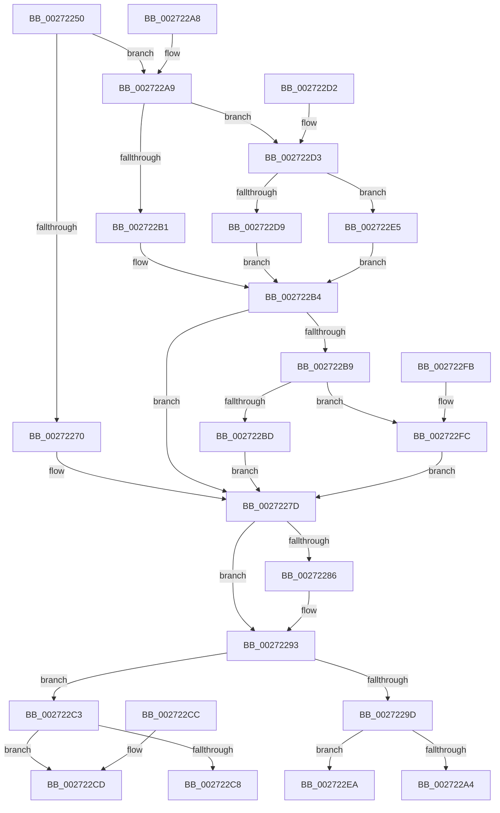

# RtlRbReplaceNode

- RVA: `0x00272250`–`0x0027231C` (길이 `204` bytes)
- VA: `0x0000000140272250`
- 실행 섹션: `.text`
- PDB 이름 있음: `예`; PDB Function 태그: `아니요`
- unwind 정보 RVA: `0x000DB714`
- 디코드: `70`개 명령, `204/204` bytes 표시
- 미해석 바이트: `0` (있으면 어셈블리에 `.byte`로 보존)

> 이 문서는 커널 이미지의 기계어와 PDB 기호를 분석해 생성했습니다. 4번과 5번은 함수 원형과 자료형을 바이너리 사용 방식에서 추정한 C 해석이며 원본 소스 복구 결과는 아닙니다.

## 1. Dependencies

- 직접 호출 지점: **0**; 고유 호출 대상: **0**
- 직접 호출자로 확인된 함수: **1**
- RIP 상대 이미지 참조: **0**

### Outgoing calls
- 직접 디코드된 call 명령이 없습니다.

### Direct callers
- [sub_00248B10](../24/Unknown_function_00248B10.md) at `0x00248BC8`

### Static image references
- 디코드된 RIP-relative 메모리 참조가 없습니다.

## 2. Other-region calls and transfers

- 다른 실행 섹션으로 향하는 call: **0**
- 별도 외부 분기/꼬리 이동을 확인하지 못했습니다.

## 3. Assembly (complete function range)

```asm
00272250  0F 10 02                        movups xmm0, xmmword ptr [rdx]
00272253  4C 8B D1                        mov r10, rcx
00272256  45 33 DB                        xor r11d, r11d
00272259  41 0F 11 00                     movups xmmword ptr [r8], xmm0
0027225D  F2 0F 10 4A 10                  movsd xmm1, qword ptr [rdx + 0x10]
00272262  F2 41 0F 11 48 10               movsd qword ptr [r8 + 0x10], xmm1
00272268  49 8B 08                        mov rcx, qword ptr [r8]
0027226B  48 85 C9                        test rcx, rcx
0027226E  74 39                           je 0x1402722a9
00272270  8B 41 10                        mov eax, dword ptr [rcx + 0x10]
00272273  83 E0 03                        and eax, 3
00272276  49 0B C0                        or rax, r8
00272279  48 89 41 10                     mov qword ptr [rcx + 0x10], rax
0027227D  49 8B 48 08                     mov rcx, qword ptr [r8 + 8]
00272281  48 85 C9                        test rcx, rcx
00272284  74 0D                           je 0x140272293
00272286  8B 41 10                        mov eax, dword ptr [rcx + 0x10]
00272289  83 E0 03                        and eax, 3
0027228C  49 0B C0                        or rax, r8
0027228F  48 89 41 10                     mov qword ptr [rcx + 0x10], rax
00272293  49 8B 40 10                     mov rax, qword ptr [r8 + 0x10]
00272297  48 83 E0 FC                     and rax, 0xfffffffffffffffc
0027229B  75 26                           jne 0x1402722c3
0027229D  41 F6 42 08 01                  test byte ptr [r10 + 8], 1
002722A2  75 46                           jne 0x1402722ea
002722A4  4D 89 02                        mov qword ptr [r10], r8
002722A7  C3                              ret
002722A8  CC                              int3
002722A9  49 8B 42 08                     mov rax, qword ptr [r10 + 8]
002722AD  A8 01                           test al, 1
002722AF  75 22                           jne 0x1402722d3
002722B1  48 8B C8                        mov rcx, rax
002722B4  48 3B CA                        cmp rcx, rdx
002722B7  75 C4                           jne 0x14027227d
002722B9  A8 01                           test al, 1
002722BB  75 3F                           jne 0x1402722fc
002722BD  4D 89 42 08                     mov qword ptr [r10 + 8], r8
002722C1  EB BA                           jmp 0x14027227d
002722C3  48 39 10                        cmp qword ptr [rax], rdx
002722C6  75 05                           jne 0x1402722cd
002722C8  4C 89 00                        mov qword ptr [rax], r8
002722CB  C3                              ret
002722CC  CC                              int3
002722CD  4C 89 40 08                     mov qword ptr [rax + 8], r8
002722D1  C3                              ret
002722D2  CC                              int3
002722D3  48 83 F8 01                     cmp rax, 1
002722D7  74 0C                           je 0x1402722e5
002722D9  49 8B CA                        mov rcx, r10
002722DC  48 83 C9 01                     or rcx, 1
002722E0  48 33 C8                        xor rcx, rax
002722E3  EB CF                           jmp 0x1402722b4
002722E5  49 8B CB                        mov rcx, r11
002722E8  EB CA                           jmp 0x1402722b4
002722EA  49 8B C2                        mov rax, r10
002722ED  49 33 C0                        xor rax, r8
002722F0  4D 85 C0                        test r8, r8
002722F3  4C 0F 45 D8                     cmovne r11, rax
002722F7  4D 89 1A                        mov qword ptr [r10], r11
002722FA  C3                              ret
002722FB  CC                              int3
002722FC  49 8B C2                        mov rax, r10
002722FF  49 8B CB                        mov rcx, r11
00272302  49 33 C0                        xor rax, r8
00272305  4D 85 C0                        test r8, r8
00272308  48 0F 45 C8                     cmovne rcx, rax
0027230C  49 89 4A 08                     mov qword ptr [r10 + 8], rcx
00272310  80 C9 01                        or cl, 1
00272313  41 88 4A 08                     mov byte ptr [r10 + 8], cl
00272317  E9 61 FF FF FF                  jmp 0x14027227d
```

## 4. C-style interpretation (structured pseudocode)

```c
__int64 __fastcall RtlRbReplaceNode(__int64 a1, __int64 a2, __int64 a3)
{
    __int64 result;
    __int64 v_r11;

    v_r11 = 0;
    *(unsigned __int64 *)(a3) = v_xmm0;
    *(unsigned __int64 *)(a3 + 16) = v_xmm1;
    if (*(unsigned __int64 *)(a3) == 0) goto loc_002722A9;
    result = (unsigned int)(((unsigned int)(*(unsigned int *)(*(unsigned __int64 *)(a3) + 16))) & (3));
    result = (result) | (a3);
    *(unsigned __int64 *)(*(unsigned __int64 *)(a3) + 16) = result;
loc_0027227D:
    if (*(unsigned __int64 *)(a3 + 8) != 0) {
        result = *(unsigned int *)(*(unsigned __int64 *)(a3 + 8) + 16);
        result = (unsigned int)((result) & (3));
        result = (result) | (a3);
        *(unsigned __int64 *)(*(unsigned __int64 *)(a3 + 8) + 16) = result;
    }
    result = (*(unsigned __int64 *)(a3 + 16)) & (-4);
    if (condition_is_not_equal) goto loc_002722C3;
    if (((*(unsigned __int8 *)(a1 + 8)) & (1)) != 0) goto loc_002722EA;
    *(unsigned __int64 *)(a1) = a3;
    return result;
loc_002722A9:
    if ((((unsigned __int8)(*(unsigned __int64 *)(a1 + 8))) & (1)) != 0) goto loc_002722D3;
loc_002722B4:
    if ((*(unsigned __int64 *)(a1 + 8)) != a2) goto loc_0027227D;
    if ((((unsigned __int8)(*(unsigned __int64 *)(a1 + 8))) & (1)) != 0) goto loc_002722FC;
    *(unsigned __int64 *)(a1 + 8) = a3;
    goto loc_0027227D;
loc_002722C3:
    if ((*(unsigned __int64 *)(*(unsigned __int64 *)(a1 + 8))) != a2) goto loc_002722CD;
    *(unsigned __int64 *)(*(unsigned __int64 *)(a1 + 8)) = a3;
    return *(unsigned __int64 *)(a1 + 8);
loc_002722CD:
    *(unsigned __int64 *)(*(unsigned __int64 *)(a1 + 8) + 8) = a3;
    return *(unsigned __int64 *)(a1 + 8);
loc_002722D3:
    if ((*(unsigned __int64 *)(a1 + 8)) == 1) goto loc_002722E5;
    a1 = (a1) | (1);
    a1 = (a1) ^ (*(unsigned __int64 *)(a1 + 8));
    goto loc_002722B4;
loc_002722E5:
    goto loc_002722B4;
loc_002722EA:
    result = (a1) ^ (a3);
    if (a3 != 0) { v_r11 = result; }
    *(unsigned __int64 *)(a1) = v_r11;
    return result;
loc_002722FC:
    result = (a1) ^ (a3);
    a1 = v_r11;
    if (a3 != 0) { a1 = result; }
    *(unsigned __int64 *)(a1 + 8) = a1;
    a1 = (unsigned __int8)((a1) | (1));
    *(unsigned __int8 *)(a1 + 8) = (unsigned __int8)(a1);
    goto loc_0027227D;
}
```

## 5. (Beta) C Style

```c
int64_t RtlRbReplaceNode(void *Arg1, void *Arg2, void *Arg3)
{
    uint8_t *arg1 = (uint8_t *)Arg1;
    uint8_t *arg2 = (uint8_t *)Arg2;
    uint8_t *arg3 = (uint8_t *)Arg3;

    int64_t result;
    int64_t local_r11;

    local_r11 = 0;
    *(uint64_t *)(arg3) = v_xmm0;
    *(uint64_t *)(arg3 + 0x10) = v_xmm1;
    if (*(uint64_t *)(arg3) == 0) goto loc_002722A9;
    result = (uint32_t)(((uint32_t)(*(uint32_t *)(*(uint64_t *)(arg3) + 0x10))) & (3));
    result = (result) | (Arg3);
    *(uint64_t *)(*(uint64_t *)(arg3) + 0x10) = result;
loc_0027227D:
    if (*(uint64_t *)(arg3 + 0x8) != 0) {
        result = *(uint32_t *)(*(uint64_t *)(arg3 + 0x8) + 0x10);
        result = (uint32_t)((result) & (3));
        result = (result) | (Arg3);
        *(uint64_t *)(*(uint64_t *)(arg3 + 0x8) + 0x10) = result;
    }
    result = (*(uint64_t *)(arg3 + 0x10)) & (-4);
    if (condition_is_not_equal) goto loc_002722C3;
    if (((*(uint8_t *)(arg1 + 0x8)) & (1)) != 0) goto loc_002722EA;
    *(void **)(arg1) = Arg3;
    return result;
loc_002722A9:
    if ((((uint8_t)(*(uint64_t *)(arg1 + 0x8))) & (1)) != 0) goto loc_002722D3;
loc_002722B4:
    if ((*(uint64_t *)(arg1 + 0x8)) != Arg2) goto loc_0027227D;
    if ((((uint8_t)(*(uint64_t *)(arg1 + 0x8))) & (1)) != 0) goto loc_002722FC;
    *(void **)(arg1 + 0x8) = Arg3;
    goto loc_0027227D;
loc_002722C3:
    if ((*(uint64_t *)(*(uint64_t *)(arg1 + 0x8))) != Arg2) goto loc_002722CD;
    *(void **)(*(uint64_t *)(arg1 + 0x8)) = Arg3;
    return *(uint64_t *)(arg1 + 0x8);
loc_002722CD:
    *(void **)(*(uint64_t *)(arg1 + 0x8) + 0x8) = Arg3;
    return *(uint64_t *)(arg1 + 0x8);
loc_002722D3:
    if ((*(uint64_t *)(arg1 + 0x8)) == 1) goto loc_002722E5;
    Arg1 = (Arg1) | (1);
    Arg1 = (Arg1) ^ (*(uint64_t *)(arg1 + 0x8));
    goto loc_002722B4;
loc_002722E5:
    goto loc_002722B4;
loc_002722EA:
    result = (Arg1) ^ (Arg3);
    if (Arg3 != NULL) { local_r11 = result; }
    *(uint64_t *)(arg1) = local_r11;
    return result;
loc_002722FC:
    result = (Arg1) ^ (Arg3);
    Arg1 = local_r11;
    if (Arg3 != NULL) { Arg1 = result; }
    *(void **)(arg1 + 0x8) = Arg1;
    Arg1 = (uint8_t)((Arg1) | (1));
    *(uint8_t *)(arg1 + 0x8) = (uint8_t)(Arg1);
    goto loc_0027227D;
}
```

### 관측된 메모리 오프셋

구조체 형식이 확인되지 않은 접근은 인자 기준의 오프셋으로만 기록했습니다.

| 기준 인자 | 오프셋 표현 | 폭 (bit) | 접근 |
|---|---:|---:|---|
| `Arg1` | `+ 0x0` | `64` | `W` |
| `Arg1` | `+ 0x8` | `8` | `R` |
| `Arg1` | `+ 0x8` | `8` | `W` |
| `Arg1` | `+ 0x8` | `64` | `R` |
| `Arg1` | `+ 0x8` | `64` | `W` |
| `Arg2` | `+ 0x0` | `128` | `R` |
| `Arg2` | `+ 0x10` | `64` | `R` |
| `Arg3` | `+ 0x0` | `64` | `R` |
| `Arg3` | `+ 0x0` | `128` | `R` |
| `Arg3` | `+ 0x10` | `64` | `W` |

## 6. Execution-region graph

[열기: 2D/3D 그래프와 함수 탐색 컨트롤 패널](../../../control-panel.html?section=text&rva=0x00272250&view=graph)

- 2D 그래프는 위에서 아래로 흐르고, 3D 그래프는 빈 공간을 드래그해 회전합니다. Shift+드래그는 이동, 휠은 확대·축소, 함수 노드 선택은 대상 보고서 이동입니다.

### Static fallback


