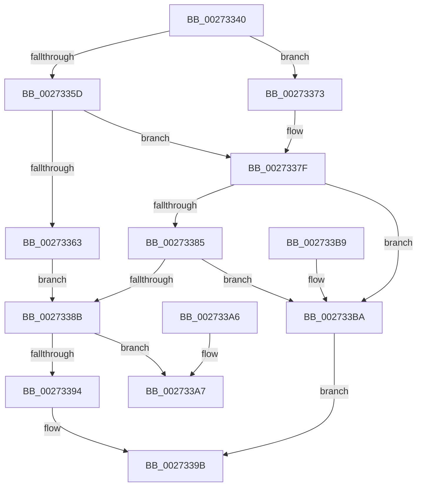

# SetVacb

- RVA: `0x00273340`–`0x002733C0` (길이 `128` bytes)
- VA: `0x0000000140273340`
- 실행 섹션: `.text`
- PDB 이름 있음: `예`; PDB Function 태그: `아니요`
- unwind 정보 RVA: `0x00065CCC`
- 디코드: `39`개 명령, `128/128` bytes 표시
- 미해석 바이트: `0` (있으면 어셈블리에 `.byte`로 보존)

> 이 문서는 커널 이미지의 기계어와 PDB 기호를 분석해 생성했습니다. 4번과 5번은 함수 원형과 자료형을 바이너리 사용 방식에서 추정한 C 해석이며 원본 소스 복구 결과는 아닙니다.

## 1. Dependencies

- 직접 호출 지점: **1**; 고유 호출 대상: **1**
- 직접 호출자로 확인된 함수: **3**
- RIP 상대 이미지 참조: **0**

### Outgoing calls
- `0x00273376` → [CcSetVacbLargeOffset](CcSetVacbLargeOffset_function_002733D0.md) (function, `0x002733D0`)

### Direct callers
- [CcPinFileData](../33/CcPinFileData_function_0033FB40.md) at `0x00340C81`
- [CcDereferenceFileOffset](../4E/CcDereferenceFileOffset_function_004E004C.md) at `0x004E0080`
- [sub_006E2024](../6E/Unknown_function_006E2024.md) at `0x006E2047`

### Static image references
- 디코드된 RIP-relative 메모리 참조가 없습니다.

## 2. Other-region calls and transfers

- 다른 실행 섹션으로 향하는 call: **0**
- 별도 외부 분기/꼬리 이동을 확인하지 못했습니다.

## 3. Assembly (complete function range)

```asm
00273340  48 89 5C 24 10                  mov qword ptr [rsp + 0x10], rbx
00273345  57                              push rdi
00273346  48 83 EC 20                     sub rsp, 0x20
0027334A  48 81 79 20 00 00 00 02         cmp qword ptr [rcx + 0x20], 0x2000000
00273352  49 8B D8                        mov rbx, r8
00273355  41 B0 01                        mov r8b, 1
00273358  48 8B F9                        mov rdi, rcx
0027335B  7F 16                           jg 0x140273373
0027335D  48 83 FB FE                     cmp rbx, -2
00273361  73 1C                           jae 0x14027337f
00273363  48 8B 47 58                     mov rax, qword ptr [rdi + 0x58]
00273367  8B CA                           mov ecx, edx
00273369  48 C1 E9 12                     shr rcx, 0x12
0027336D  48 89 1C C8                     mov qword ptr [rax + rcx*8], rbx
00273371  EB 18                           jmp 0x14027338b
00273373  4C 8B C3                        mov r8, rbx
00273376  E8 55 00 00 00                  call 0x1402733d0
0027337B  44 0F B6 C0                     movzx r8d, al
0027337F  48 83 FB FF                     cmp rbx, -1
00273383  74 35                           je 0x1402733ba
00273385  48 83 FB FE                     cmp rbx, -2
00273389  74 2F                           je 0x1402733ba
0027338B  41 0F B6 C0                     movzx eax, r8b
0027338F  48 85 DB                        test rbx, rbx
00273392  75 13                           jne 0x1402733a7
00273394  F0 FF 8F 24 02 00 00            lock dec dword ptr [rdi + 0x224]
0027339B  48 8B 5C 24 38                  mov rbx, qword ptr [rsp + 0x38]
002733A0  48 83 C4 20                     add rsp, 0x20
002733A4  5F                              pop rdi
002733A5  C3                              ret
002733A6  CC                              int3
002733A7  F0 FF 87 24 02 00 00            lock inc dword ptr [rdi + 0x224]
002733AE  48 8B 5C 24 38                  mov rbx, qword ptr [rsp + 0x38]
002733B3  48 83 C4 20                     add rsp, 0x20
002733B7  5F                              pop rdi
002733B8  C3                              ret
002733B9  CC                              int3
002733BA  41 0F B6 C0                     movzx eax, r8b
002733BE  EB DB                           jmp 0x14027339b
```

## 4. C-style interpretation (structured pseudocode)

```c
__int64 __fastcall SetVacb(__int64 a1, int a2, __int64 a3)
{
    __int64 result;
    __int64 v_rsp;
    unsigned __int64 v_stack_p10;
    unsigned __int64 v_stack_p38;

    v_stack_p10 = v_rbx;
    v_rsp = (v_rsp) - (32);
    if ((*(unsigned __int64 *)(a1 + 32)) > 0x2000000ULL) goto loc_00273373;
    if (a3 >= -2) goto loc_0027337F;
    a1 = ((unsigned int)(a2)) >> (18);
    *(unsigned __int64 *)(*(unsigned __int64 *)(a1 + 88) + a1 * 8) = a3;
    goto loc_0027338B;
loc_00273373:
    result = CcSetVacbLargeOffset(a1, a2, a3, a4);
loc_0027337F:
    if (a3 == -1) goto loc_002733BA;
    if (a3 == -2) goto loc_002733BA;
loc_0027338B:
    if (a3 != 0) goto loc_002733A7;
loc_0027339B:
    v_rsp = (v_rsp) + (32);
    return (unsigned __int8)((unsigned __int8)(result));
loc_002733A7:
    v_rsp = (v_rsp) + (32);
    return (unsigned __int8)((unsigned __int8)(result));
loc_002733BA:
    goto loc_0027339B;
}
```

## 5. (Beta) C Style

```c
int64_t SetVacb(void *Arg1, int32_t Arg2, int64_t Arg3)
{
    uint8_t *arg1 = (uint8_t *)Arg1;

    int64_t result;
    int64_t local_rsp;
    uint64_t v_stack_p10;
    uint64_t v_stack_p38;

    v_stack_p10 = local_rbx;
    local_rsp = (local_rsp) - (32);
    if ((*(uint64_t *)(arg1 + 0x20)) > 0x2000000ULL) goto loc_00273373;
    if (Arg3 >= -2) goto loc_0027337F;
    Arg1 = ((uint32_t)(Arg2)) >> (18);
    *(uint64_t *)(*(uint64_t *)(arg1 + 0x58) + arg1 * 8) = Arg3;
    goto loc_0027338B;
loc_00273373:
    result = CcSetVacbLargeOffset(Arg1, Arg2, Arg3, a4);
loc_0027337F:
    if (Arg3 == -1) goto loc_002733BA;
    if (Arg3 == -2) goto loc_002733BA;
loc_0027338B:
    if (Arg3 != 0) goto loc_002733A7;
loc_0027339B:
    local_rsp = (local_rsp) + (32);
    return (uint8_t)((uint8_t)(result));
loc_002733A7:
    local_rsp = (local_rsp) + (32);
    return (uint8_t)((uint8_t)(result));
loc_002733BA:
    goto loc_0027339B;
}
```

### 관측된 메모리 오프셋

구조체 형식이 확인되지 않은 접근은 인자 기준의 오프셋으로만 기록했습니다.

| 기준 인자 | 오프셋 표현 | 폭 (bit) | 접근 |
|---|---:|---:|---|
| `Arg1` | `+ 0x20` | `64` | `R` |
| `Arg1` | `+ 0x58` | `64` | `R` |
| `Arg1` | `+ 0x224` | `32` | `R/W` |

## 6. Execution-region graph

[열기: 2D/3D 그래프와 함수 탐색 컨트롤 패널](../../../control-panel.html?section=text&rva=0x00273340&view=graph)

- 2D 그래프는 위에서 아래로 흐르고, 3D 그래프는 빈 공간을 드래그해 회전합니다. Shift+드래그는 이동, 휠은 확대·축소, 함수 노드 선택은 대상 보고서 이동입니다.

### Static fallback


