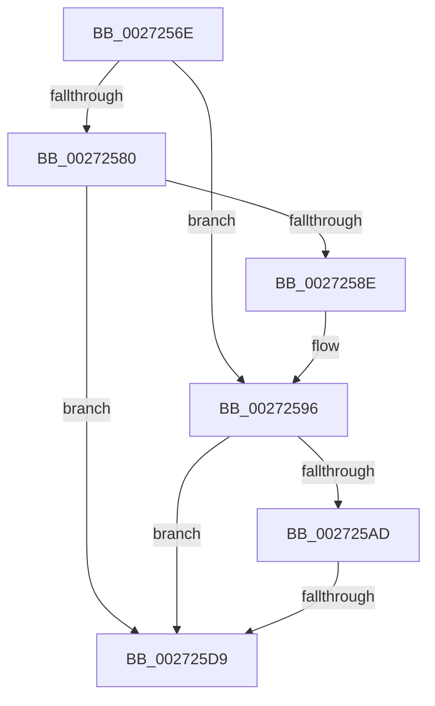

# sub_0027256E

- RVA: `0x0027256E`–`0x002725DE` (길이 `112` bytes)
- VA: `0x000000014027256E`
- 실행 섹션: `.text`
- PDB 이름 있음: `아니요`; PDB Function 태그: `아니요`
- unwind 정보 RVA: `0x00065BE4`
- 디코드: `32`개 명령, `112/112` bytes 표시
- 미해석 바이트: `0` (있으면 어셈블리에 `.byte`로 보존)

> 이 문서는 커널 이미지의 기계어와 PDB 기호를 분석해 생성했습니다. 4번과 5번은 함수 원형과 자료형을 바이너리 사용 방식에서 추정한 C 해석이며 원본 소스 복구 결과는 아닙니다.

## 1. Dependencies

- 직접 호출 지점: **3**; 고유 호출 대상: **3**
- 직접 호출자로 확인된 함수: **0**
- RIP 상대 이미지 참조: **1**

### Outgoing calls
- `0x00272591` → [KxWaitForLockChainValid](../21/KxWaitForLockChainValid_function_00217AA0.md) (function, `0x00217AA0`)
- `0x002725C0` → [KeDisableInterrupts](../21/KeDisableInterrupts_function_00217BE0.md) (function, `0x00217BE0`)
- `0x002725CF` → [KiHaltOnAddressWakeEntireList](../21/KiHaltOnAddressWakeEntireList_function_00217AF4.md) (function, `0x00217AF4`)

### Direct callers
- 이 함수 시작 RVA로 연결되는 직접 call은 확인되지 않았습니다. 간접 호출은 완전히 역산할 수 없습니다.

### Static image references
- `0x002725B5` → RVA `0x00F21B20` (`.data`; read)

## 2. Other-region calls and transfers

- 다른 실행 섹션으로 향하는 call: **0**
- call이 아닌 외부 분기/꼬리 이동: **1**
  - `0x002725D7` → [sub_00272621](Unknown_function_00272621.md) (`tail-transfer`)

## 3. Assembly (complete function range)

```asm
0027256E  48 89 5C 24 30                  mov qword ptr [rsp + 0x30], rbx
00272573  0F 0D 0F                        prefetchw byte ptr [rdi]
00272576  48 8B 07                        mov rax, qword ptr [rdi]
00272579  33 DB                           xor ebx, ebx
0027257B  48 85 C0                        test rax, rax
0027257E  75 16                           jne 0x140272596
00272580  48 8B 4F 08                     mov rcx, qword ptr [rdi + 8]
00272584  48 8B C7                        mov rax, rdi
00272587  F0 48 0F B1 19                  lock cmpxchg qword ptr [rcx], rbx
0027258C  74 4B                           je 0x1402725d9
0027258E  48 8B CF                        mov rcx, rdi
00272591  E8 0A 55 FA FF                  call 0x140217aa0
00272596  4C 8D 40 08                     lea r8, [rax + 8]
0027259A  48 89 1F                        mov qword ptr [rdi], rbx
0027259D  48 8B 4F 08                     mov rcx, qword ptr [rdi + 8]
002725A1  48 8B C1                        mov rax, rcx
002725A4  49 87 00                        xchg qword ptr [r8], rax
002725A7  32 C1                           xor al, cl
002725A9  A8 04                           test al, 4
002725AB  74 2C                           je 0x1402725d9
002725AD  F0 09 1C 24                     lock or dword ptr [rsp], ebx
002725B1  49 C1 E8 05                     shr r8, 5
002725B5  4C 8D 0D 64 F5 CA 00            lea r9, [rip + 0xcaf564]
002725BC  41 83 E0 7F                     and r8d, 0x7f
002725C0  E8 1B 56 FA FF                  call 0x140217be0
002725C5  4B 87 1C C1                     xchg qword ptr [r9 + r8*8], rbx
002725C9  48 8B D3                        mov rdx, rbx
002725CC  0F B6 F8                        movzx edi, al
002725CF  E8 20 55 FA FF                  call 0x140217af4
002725D4  40 84 FF                        test dil, dil
002725D7  75 48                           jne 0x140272621
002725D9  48 8B 5C 24 30                  mov rbx, qword ptr [rsp + 0x30]
```

## 4. C-style interpretation (structured pseudocode)

```c
__int64 __fastcall sub_0027256E(__int64 a1, __int64 a2, __int64 a3, __int64 a4, __int64 a5, __int64 a6)
{
    __int64 result;
    __int64 v_rbx;
    unsigned int v_stack_p0;
    unsigned __int64 v_stack_p30;

    v_stack_p30 = v_rbx;
    v_rbx = 0;
    if (*(unsigned __int64 *)(v_rdi) != 0) goto loc_00272596;
    if (*(unsigned __int64 *)(v_rdi) == 0) goto loc_002725D9;
    result = KxWaitForLockChainValid(v_rdi, a2, a3, a4);
loc_00272596:
    *(unsigned __int64 *)(v_rdi) = 0;
    result = (unsigned __int8)((*(unsigned __int64 *)(v_rdi + 8)) ^ ((unsigned __int8)(*(unsigned __int64 *)(v_rdi + 8))));
    if ((((unsigned __int8)(result)) & (4)) == 0) goto loc_002725D9;
    a3 = (result + 8) >> (5);
    a3 = (unsigned int)((a3) & (127));
    result = KeDisableInterrupts(*(unsigned __int64 *)(v_rdi + 8), a2, a3, v_rip + 13301092);
    result = KiHaltOnAddressWakeEntireList(*(unsigned __int64 *)(v_rdi + 8), 0, a3, v_rip + 13301092);
loc_002725D9:
    return result;
}
```

## 5. (Beta) C Style

```c
int64_t sub_0027256E(int64_t Arg1, int64_t Arg2, int64_t Arg3, int64_t Arg4, uint64_t Arg5, int64_t Arg6)
{
    int64_t result;
    int64_t local_rbx;
    uint32_t v_stack_p0;
    uint64_t v_stack_p30;

    v_stack_p30 = local_rbx;
    local_rbx = 0;
    if (*(uint64_t *)(local_rdi) != 0) goto loc_00272596;
    if (*(uint64_t *)(local_rdi) == 0) goto loc_002725D9;
    result = KxWaitForLockChainValid(local_rdi, Arg2, Arg3, Arg4);
loc_00272596:
    *(uint64_t *)(local_rdi) = 0;
    result = (uint8_t)((*(uint64_t *)(local_rdi + 0x8)) ^ ((uint8_t)(*(uint64_t *)(local_rdi + 0x8))));
    if ((((uint8_t)(result)) & (4)) == 0) goto loc_002725D9;
    Arg3 = (result + 8) >> (5);
    Arg3 = (uint32_t)((Arg3) & (127));
    result = KeDisableInterrupts(*(uint64_t *)(local_rdi + 0x8), Arg2, Arg3, v_rip + 13301092);
    result = KiHaltOnAddressWakeEntireList(*(uint64_t *)(local_rdi + 0x8), 0, Arg3, v_rip + 13301092);
loc_002725D9:
    return result;
}
```

## 6. Execution-region graph

[열기: 2D/3D 그래프와 함수 탐색 컨트롤 패널](../../../control-panel.html?section=text&rva=0x0027256E&view=graph)

- 2D 그래프는 위에서 아래로 흐르고, 3D 그래프는 빈 공간을 드래그해 회전합니다. Shift+드래그는 이동, 휠은 확대·축소, 함수 노드 선택은 대상 보고서 이동입니다.

### Static fallback


