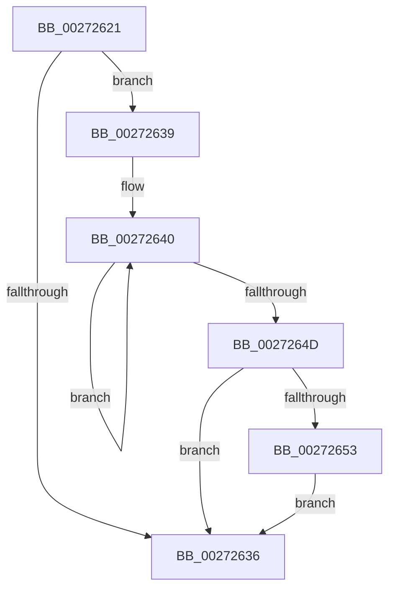

# sub_00272621

- RVA: `0x00272621`–`0x0027265A` (길이 `57` bytes)
- VA: `0x0000000140272621`
- 실행 섹션: `.text`
- PDB 이름 있음: `아니요`; PDB Function 태그: `아니요`
- unwind 정보 RVA: `0x00065C30`
- 디코드: `16`개 명령, `57/57` bytes 표시
- 미해석 바이트: `0` (있으면 어셈블리에 `.byte`로 보존)

> 이 문서는 커널 이미지의 기계어와 PDB 기호를 분석해 생성했습니다. 4번과 5번은 함수 원형과 자료형을 바이너리 사용 방식에서 추정한 C 해석이며 원본 소스 복구 결과는 아닙니다.

## 1. Dependencies

- 직접 호출 지점: **1**; 고유 호출 대상: **1**
- 직접 호출자로 확인된 함수: **0**
- RIP 상대 이미지 참조: **0**

### Outgoing calls
- `0x00272653` → [KiRemoveSystemWorkPriorityKick](../26/KiRemoveSystemWorkPriorityKick_function_002631D0.md) (function, `0x002631D0`)

### Direct callers
- 이 함수 시작 RVA로 연결되는 직접 call은 확인되지 않았습니다. 간접 호출은 완전히 역산할 수 없습니다.

### Static image references
- 디코드된 RIP-relative 메모리 참조가 없습니다.

## 2. Other-region calls and transfers

- 다른 실행 섹션으로 향하는 call: **0**
- call이 아닌 외부 분기/꼬리 이동: **1**
  - `0x00272637` → [sub_0027256E + 0x6B](Unknown_function_0027256E.md) (`tail-transfer`)

## 3. Assembly (complete function range)

```asm
00272621  65 48 8B 0C 25 20 00 00 00      mov rcx, qword ptr gs:[0x20]
0027262A  4C 8B 81 B8 8E 00 00            mov r8, qword ptr [rcx + 0x8eb8]
00272631  4D 85 C0                        test r8, r8
00272634  75 03                           jne 0x140272639
00272636  FB                              sti
00272637  EB A0                           jmp 0x1402725d9
00272639  41 0F 0D 08                     prefetchw byte ptr [r8]
0027263D  41 8B 00                        mov eax, dword ptr [r8]
00272640  8B D0                           mov edx, eax
00272642  0F BA F2 15                     btr edx, 0x15
00272646  F0 41 0F B1 10                  lock cmpxchg dword ptr [r8], edx
0027264B  75 F3                           jne 0x140272640
0027264D  0F BA E0 15                     bt eax, 0x15
00272651  73 E3                           jae 0x140272636
00272653  E8 78 0B FF FF                  call 0x1402631d0
00272658  EB DC                           jmp 0x140272636
```

## 4. C-style interpretation (structured pseudocode)

```c
__int64 __fastcall sub_00272621(void)
{
    __int64 result;

    if (*(unsigned __int64 *)(*(unsigned __int64 *)(gs_base + (0 + 32)) + 36536) != 0) goto loc_00272639;
loc_00272636:
loc_00272639:
loc_00272640:
    if (*(unsigned __int64 *)(*(unsigned __int64 *)(gs_base + (0 + 32)) + 36536) != 0) goto loc_00272640;
    if (condition_is_above_or_equal) goto loc_00272636;
    result = KiRemoveSystemWorkPriorityKick(*(unsigned __int64 *)(gs_base + (0 + 32)), (unsigned int)((unsigned int)((unsigned int)(*(unsigned int *)(*(unsigned __int64 *)(*(unsigned __int64 *)(gs_base + (0 + 32)) + 36536))))), *(unsigned __int64 *)(*(unsigned __int64 *)(gs_base + (0 + 32)) + 36536), a4);
    goto loc_00272636;
}
```

## 5. (Beta) C Style

```c
void sub_00272621(void)
{
    int64_t result;

    if (*(uint64_t *)(*(uint64_t *)(gs_base + (0 + 0x20)) + 0x8EB8) != 0) goto loc_00272639;
loc_00272636:
loc_00272639:
loc_00272640:
    if (*(uint64_t *)(*(uint64_t *)(gs_base + (0 + 0x20)) + 0x8EB8) != 0) goto loc_00272640;
    if (condition_is_above_or_equal) goto loc_00272636;
    result = KiRemoveSystemWorkPriorityKick(*(uint64_t *)(gs_base + (0 + 0x20)), (uint32_t)((uint32_t)((uint32_t)(*(uint32_t *)(*(uint64_t *)(*(uint64_t *)(gs_base + (0 + 0x20)) + 0x8EB8))))), *(uint64_t *)(*(uint64_t *)(gs_base + (0 + 0x20)) + 0x8EB8), a4);
    goto loc_00272636;
}
```

## 6. Execution-region graph

[열기: 2D/3D 그래프와 함수 탐색 컨트롤 패널](../../../control-panel.html?section=text&rva=0x00272621&view=graph)

- 2D 그래프는 위에서 아래로 흐르고, 3D 그래프는 빈 공간을 드래그해 회전합니다. Shift+드래그는 이동, 휠은 확대·축소, 함수 노드 선택은 대상 보고서 이동입니다.

### Static fallback


