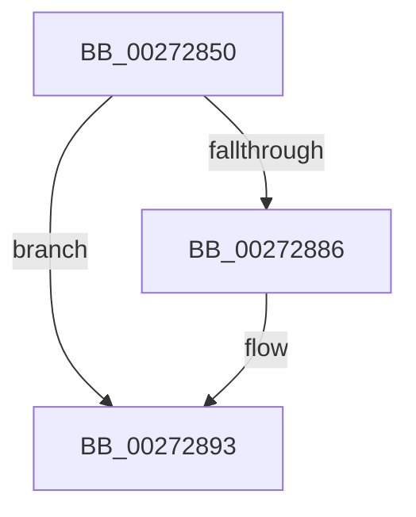

# sub_00272850

- RVA: `0x00272850`–`0x0027289E` (길이 `78` bytes)
- VA: `0x0000000140272850`
- 실행 섹션: `.text`
- PDB 이름 있음: `아니요`; PDB Function 태그: `아니요`
- unwind 정보 RVA: `0x00065C6C`
- 디코드: `18`개 명령, `78/78` bytes 표시
- 미해석 바이트: `0` (있으면 어셈블리에 `.byte`로 보존)

> 이 문서는 커널 이미지의 기계어와 PDB 기호를 분석해 생성했습니다. 4번과 5번은 함수 원형과 자료형을 바이너리 사용 방식에서 추정한 C 해석이며 원본 소스 복구 결과는 아닙니다.

## 1. Dependencies

- 직접 호출 지점: **3**; 고유 호출 대상: **3**
- 직접 호출자로 확인된 함수: **0**
- RIP 상대 이미지 참조: **1**

### Outgoing calls
- `0x00272855` → [KeAcquireQueuedSpinLock](KeAcquireQueuedSpinLock_function_00273D80.md) (function, `0x00273D80`)
- `0x00272878` → [KeReleaseInStackQueuedSpinLockFromDpcLevel](../21/KeReleaseInStackQueuedSpinLockFromDpcLevel_function_002171B0.md) (function, `0x002171B0`)
- `0x0027288E` → [KiLowerIrqlProcessIrqlFlags](../4F/KiLowerIrqlProcessIrqlFlags_function_004F5698.md) (function, `0x004F5698`)

### Direct callers
- 이 함수 시작 RVA로 연결되는 직접 call은 확인되지 않았습니다. 간접 호출은 완전히 역산할 수 없습니다.

### Static image references
- `0x0027287D` → RVA `0x00FC6D20` (`ALMOSTRO`; read)

## 2. Other-region calls and transfers

- 다른 실행 섹션으로 향하는 call: **0**
- call이 아닌 외부 분기/꼬리 이동: **1**
  - `0x0027289C` → [IopIncrementVpbRefCount + 0x19](IopIncrementVpbRefCount_function_00272820.md) (`tail-transfer`)

## 3. Assembly (complete function range)

```asm
00272850  48 89 74 24 40                  mov qword ptr [rsp + 0x40], rsi
00272855  E8 26 15 00 00                  call 0x140273d80
0027285A  8B 57 1C                        mov edx, dword ptr [rdi + 0x1c]
0027285D  FF C2                           inc edx
0027285F  0F B6 F0                        movzx esi, al
00272862  89 57 1C                        mov dword ptr [rdi + 0x1c], edx
00272865  8B 5F 1C                        mov ebx, dword ptr [rdi + 0x1c]
00272868  65 48 8B 0C 25 28 00 00 00      mov rcx, qword ptr gs:[0x28]
00272871  48 81 C1 90 00 00 00            add rcx, 0x90
00272878  E8 33 49 FA FF                  call 0x1402171b0
0027287D  83 3D 9C 44 D5 00 00            cmp dword ptr [rip + 0xd5449c], 0
00272884  74 0D                           je 0x140272893
00272886  44 0F 20 C1                     mov rcx, cr8
0027288A  40 0F B6 D6                     movzx edx, sil
0027288E  E8 05 2E 28 00                  call 0x1404f5698
00272893  44 0F 22 C6                     mov cr8, rsi
00272897  48 8B 74 24 40                  mov rsi, qword ptr [rsp + 0x40]
0027289C  EB 9B                           jmp 0x140272839
```

## 4. C-style interpretation (structured pseudocode)

```c
__int64 __fastcall sub_00272850(__int64 a1, __int64 a2, __int64 a3, __int64 a4, __int64 a5, __int64 a6, __int64 a7, __int64 a8)
{
    __int64 result;
    unsigned __int64 v_stack_p40;

    v_stack_p40 = v_rsi;
    result = KeAcquireQueuedSpinLock(a1, a2, a3, a4);
    a2 = (unsigned int)(((unsigned int)(*(unsigned int *)(v_rdi + 28))) + 1);
    *(unsigned int *)(v_rdi + 28) = (unsigned int)(a2);
    a1 = (*(unsigned __int64 *)(gs_base + (0 + 40))) + (144);
    result = KeReleaseInStackQueuedSpinLockFromDpcLevel(a1, a2, a3, a4);
    if ((*(unsigned int *)(v_rip + 13976732)) != 0) {
        a1 = v_cr8;
        a2 = (unsigned __int8)((unsigned __int8)(result));
        result = KiLowerIrqlProcessIrqlFlags(a1, a2, a3, a4);
    }
}
```

## 5. (Beta) C Style

```c
int64_t sub_00272850(int64_t Arg1, int64_t Arg2, int64_t Arg3, int64_t Arg4, uint64_t Arg5, uint64_t Arg6, uint64_t Arg7, int64_t Arg8)
{
    int64_t result;
    uint64_t v_stack_p40;

    v_stack_p40 = local_rsi;
    result = KeAcquireQueuedSpinLock(Arg1, Arg2, Arg3, Arg4);
    Arg2 = (uint32_t)(((uint32_t)(*(uint32_t *)(local_rdi + 0x1C))) + 1);
    *(uint32_t *)(local_rdi + 0x1C) = (uint32_t)(Arg2);
    Arg1 = (*(uint64_t *)(gs_base + (0 + 0x28))) + (144);
    result = KeReleaseInStackQueuedSpinLockFromDpcLevel(Arg1, Arg2, Arg3, Arg4);
    if ((*(uint32_t *)(v_rip + 0xD5449C)) != 0) {
        Arg1 = v_cr8;
        Arg2 = (uint8_t)((uint8_t)(result));
        result = KiLowerIrqlProcessIrqlFlags(Arg1, Arg2, Arg3, Arg4);
    }
}
```

## 6. Execution-region graph

[열기: 2D/3D 그래프와 함수 탐색 컨트롤 패널](../../../control-panel.html?section=text&rva=0x00272850&view=graph)

- 2D 그래프는 위에서 아래로 흐르고, 3D 그래프는 빈 공간을 드래그해 회전합니다. Shift+드래그는 이동, 휠은 확대·축소, 함수 노드 선택은 대상 보고서 이동입니다.

### Static fallback


