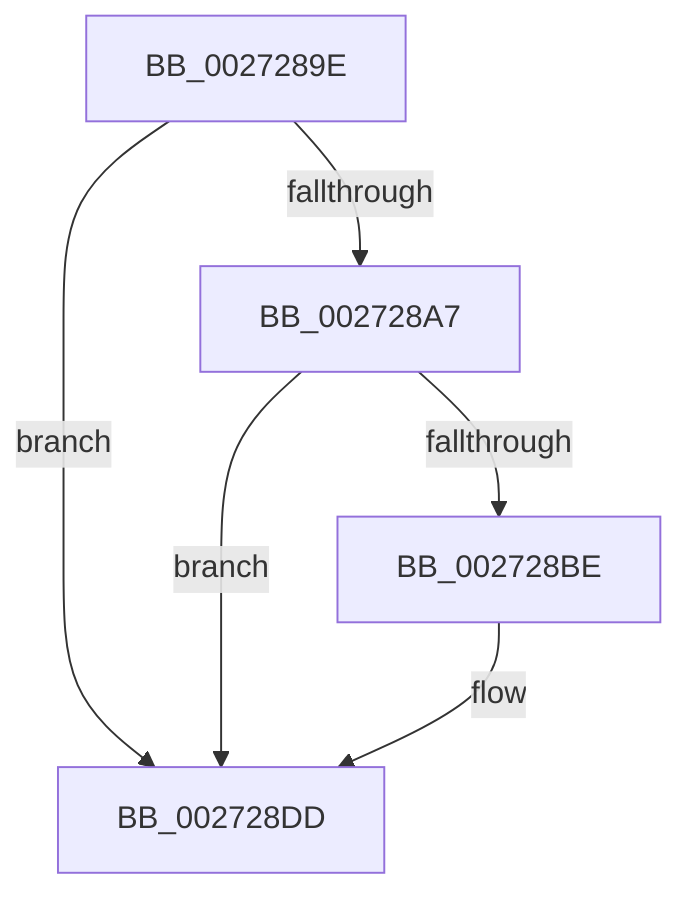

# sub_0027289E

- RVA: `0x0027289E`–`0x002728F9` (길이 `91` bytes)
- VA: `0x000000014027289E`
- 실행 섹션: `.text`
- PDB 이름 있음: `아니요`; PDB Function 태그: `아니요`
- unwind 정보 RVA: `0x00065C80`
- 디코드: `24`개 명령, `91/91` bytes 표시
- 미해석 바이트: `0` (있으면 어셈블리에 `.byte`로 보존)

> 이 문서는 커널 이미지의 기계어와 PDB 기호를 분석해 생성했습니다. 4번과 5번은 함수 원형과 자료형을 바이너리 사용 방식에서 추정한 C 해석이며 원본 소스 복구 결과는 아닙니다.

## 1. Dependencies

- 직접 호출 지점: **4**; 고유 호출 대상: **2**
- 직접 호출자로 확인된 함수: **0**
- RIP 상대 이미지 참조: **0**

### Outgoing calls
- `0x002728AC` → [IoAddTriageDumpDataBlock](../42/IoAddTriageDumpDataBlock_function_00428374.md) (function, `0x00428374`)
- `0x002728C3` → [IoAddTriageDumpDataBlock](../42/IoAddTriageDumpDataBlock_function_00428374.md) (function, `0x00428374`)
- `0x002728D8` → [IoAddTriageDumpDataBlock](../42/IoAddTriageDumpDataBlock_function_00428374.md) (function, `0x00428374`)
- `0x002728F3` → [KeBugCheckEx](../4F/KeBugCheckEx_function_004FD660.md) (function, `0x004FD660`)

### Direct callers
- 이 함수 시작 RVA로 연결되는 직접 call은 확인되지 않았습니다. 간접 호출은 완전히 역산할 수 없습니다.

### Static image references
- 디코드된 RIP-relative 메모리 참조가 없습니다.

## 2. Other-region calls and transfers

- 다른 실행 섹션으로 향하는 call: **0**
- 별도 외부 분기/꼬리 이동을 확인하지 못했습니다.

## 3. Assembly (complete function range)

```asm
0027289E  48 8B 4F 08                     mov rcx, qword ptr [rdi + 8]
002728A2  48 85 C9                        test rcx, rcx
002728A5  74 36                           je 0x1402728dd
002728A7  BA 50 01 00 00                  mov edx, 0x150
002728AC  E8 C3 5A 1B 00                  call 0x140428374
002728B1  48 8B 47 08                     mov rax, qword ptr [rdi + 8]
002728B5  48 8B 48 08                     mov rcx, qword ptr [rax + 8]
002728B9  48 85 C9                        test rcx, rcx
002728BC  74 1F                           je 0x1402728dd
002728BE  BA 50 01 00 00                  mov edx, 0x150
002728C3  E8 AC 5A 1B 00                  call 0x140428374
002728C8  48 8B 47 08                     mov rax, qword ptr [rdi + 8]
002728CC  48 8B 48 08                     mov rcx, qword ptr [rax + 8]
002728D0  0F B7 51 38                     movzx edx, word ptr [rcx + 0x38]
002728D4  48 8B 49 40                     mov rcx, qword ptr [rcx + 0x40]
002728D8  E8 97 5A 1B 00                  call 0x140428374
002728DD  8B 47 1C                        mov eax, dword ptr [rdi + 0x1c]
002728E0  33 D2                           xor edx, edx
002728E2  41 B9 07 00 00 00               mov r9d, 7
002728E8  48 89 44 24 20                  mov qword ptr [rsp + 0x20], rax
002728ED  4C 8B C7                        mov r8, rdi
002728F0  8D 4A 18                        lea ecx, [rdx + 0x18]
002728F3  E8 68 AD 28 00                  call 0x1404fd660
002728F8  CC                              int3
```

## 4. C-style interpretation (structured pseudocode)

```c
__int64 __fastcall sub_0027289E(void)
{
    __int64 result;
    unsigned __int64 v_stack_p20;

    if (*(unsigned __int64 *)(v_rdi + 8) == 0) goto loc_002728DD;
    result = IoAddTriageDumpDataBlock(*(unsigned __int64 *)(v_rdi + 8), 336, a3, a4);
    result = *(unsigned __int64 *)(v_rdi + 8);
    if (*(unsigned __int64 *)(*(unsigned __int64 *)(v_rdi + 8) + 8) != 0) {
        a2 = 336;
        result = IoAddTriageDumpDataBlock(*(unsigned __int64 *)(*(unsigned __int64 *)(v_rdi + 8) + 8), a2, a3, a4);
        result = *(unsigned __int64 *)(v_rdi + 8);
        a1 = *(unsigned __int64 *)(result + 8);
        a2 = *(unsigned __int16 *)(a1 + 56);
        a1 = *(unsigned __int64 *)(a1 + 64);
        result = IoAddTriageDumpDataBlock(a1, a2, a3, a4);
    }
    a2 = 0;
    v_stack_p20 = (unsigned int)(*(unsigned int *)(v_rdi + 28));
    result = KeBugCheckEx(a2 + 24, a2, v_rdi, 7);
    return result;
}
```

## 5. (Beta) C Style

```c
void sub_0027289E(void)
{
    int64_t result;
    uint64_t v_stack_p20;

    if (*(uint64_t *)(local_rdi + 0x8) == 0) goto loc_002728DD;
    result = IoAddTriageDumpDataBlock(*(uint64_t *)(local_rdi + 0x8), 336, a3, a4);
    result = *(uint64_t *)(local_rdi + 0x8);
    if (*(uint64_t *)(*(uint64_t *)(local_rdi + 0x8) + 0x8) != 0) {
        a2 = 336;
        result = IoAddTriageDumpDataBlock(*(uint64_t *)(*(uint64_t *)(local_rdi + 0x8) + 0x8), a2, a3, a4);
        result = *(uint64_t *)(local_rdi + 0x8);
        a1 = *(uint64_t *)(result + 0x8);
        a2 = *(uint16_t *)(a1 + 0x38);
        a1 = *(uint64_t *)(a1 + 0x40);
        result = IoAddTriageDumpDataBlock(a1, a2, a3, a4);
    }
    a2 = 0;
    v_stack_p20 = (uint32_t)(*(uint32_t *)(local_rdi + 0x1C));
    result = KeBugCheckEx(a2 + 24, a2, local_rdi, 7);
    return result;
}
```

## 6. Execution-region graph

[열기: 2D/3D 그래프와 함수 탐색 컨트롤 패널](../../../control-panel.html?section=text&rva=0x0027289E&view=graph)

- 2D 그래프는 위에서 아래로 흐르고, 3D 그래프는 빈 공간을 드래그해 회전합니다. Shift+드래그는 이동, 휠은 확대·축소, 함수 노드 선택은 대상 보고서 이동입니다.

### Static fallback


