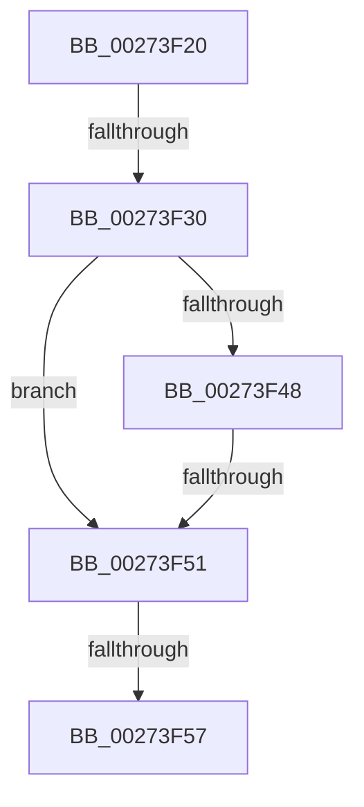

# sub_00273F20

- RVA: `0x00273F20`–`0x00273F75` (길이 `85` bytes)
- VA: `0x0000000140273F20`
- 실행 섹션: `.text`
- PDB 이름 있음: `아니요`; PDB Function 태그: `아니요`
- unwind 정보 RVA: `0x00065D88`
- 디코드: `19`개 명령, `85/85` bytes 표시
- 미해석 바이트: `0` (있으면 어셈블리에 `.byte`로 보존)

> 이 문서는 커널 이미지의 기계어와 PDB 기호를 분석해 생성했습니다. 4번과 5번은 함수 원형과 자료형을 바이너리 사용 방식에서 추정한 C 해석이며 원본 소스 복구 결과는 아닙니다.

## 1. Dependencies

- 직접 호출 지점: **1**; 고유 호출 대상: **1**
- 직접 호출자로 확인된 함수: **0**
- RIP 상대 이미지 참조: **2**

### Outgoing calls
- `0x00273F6F` → [KeBugCheckEx](../4F/KeBugCheckEx_function_004FD660.md) (function, `0x004FD660`)

### Direct callers
- 이 함수 시작 RVA로 연결되는 직접 call은 확인되지 않았습니다. 간접 호출은 완전히 역산할 수 없습니다.

### Static image references
- `0x00273F30` → RVA `0x00FC6B04` (`ALMOSTRO`; read)
- `0x00273F48` → RVA `0x00EFAC10` (`.data`; read)

## 2. Other-region calls and transfers

- 다른 실행 섹션으로 향하는 call: **0**
- call이 아닌 외부 분기/꼬리 이동: **3**
  - `0x00273F2A` → [sub_00273F95 + 0x260](Unknown_function_00273F95.md) (`tail-transfer`)
  - `0x00273F4F` → [sub_00273F95](Unknown_function_00273F95.md) (`tail-transfer`)
  - `0x00273F55` → [sub_00273F95](Unknown_function_00273F95.md) (`tail-transfer`)

## 3. Assembly (complete function range)

```asm
00273F20  4C 89 AC 24 60 01 00 00         mov qword ptr [rsp + 0x160], r13
00273F28  84 D2                           test dl, dl
00273F2A  0F 89 C5 02 00 00               jns 0x1402741f5
00273F30  44 8B 25 CD 2B D5 00            mov r12d, dword ptr [rip + 0xd52bcd]
00273F37  41 81 E4 00 00 02 00            and r12d, 0x20000
00273F3E  4C 89 7C 24 70                  mov qword ptr [rsp + 0x70], r15
00273F43  66 85 C9                        test cx, cx
00273F46  75 09                           jne 0x140273f51
00273F48  44 39 3D C1 6C C8 00            cmp dword ptr [rip + 0xc86cc1], r15d
00273F4F  74 44                           je 0x140273f95
00273F51  48 39 73 30                     cmp qword ptr [rbx + 0x30], rsi
00273F55  74 3E                           je 0x140273f95
00273F57  4C 8B 4B 10                     mov r9, qword ptr [rbx + 0x10]
00273F5B  4C 8B C6                        mov r8, rsi
00273F5E  48 8B D3                        mov rdx, rbx
00273F61  48 C7 44 24 20 01 00 00 00      mov qword ptr [rsp + 0x20], 1
00273F6A  B9 E3 00 00 00                  mov ecx, 0xe3
00273F6F  E8 EC 96 28 00                  call 0x1404fd660
00273F74  CC                              int3
```

## 4. C-style interpretation (structured pseudocode)

```c
__int64 __fastcall sub_00273F20(unsigned __int16 a1, unsigned __int8 a2)
{
    __int64 result;
    __int64 v_r12;
    unsigned __int64 v_stack_p160;
    unsigned __int64 v_stack_p20;
    unsigned __int64 v_stack_p70;

    v_stack_p160 = v_r13;
    v_r12 = (unsigned int)(((unsigned int)(*(unsigned int *)(v_rip + 13970381))) & (0x20000ULL));
    v_stack_p70 = v_r15;
    if (a1 != 0) goto loc_00273F51;
loc_00273F51:
    v_stack_p20 = 1;
    result = KeBugCheckEx(227, v_rbx, v_rsi, *(unsigned __int64 *)(v_rbx + 16));
    return result;
}
```

## 5. (Beta) C Style

```c
int64_t sub_00273F20(uint16_t Arg1, uint8_t Arg2)
{
    int64_t result;
    int64_t local_r12;
    uint64_t v_stack_p160;
    uint64_t v_stack_p20;
    uint64_t v_stack_p70;

    v_stack_p160 = local_r13;
    local_r12 = (uint32_t)(((uint32_t)(*(uint32_t *)(v_rip + 0xD52BCD))) & (0x20000ULL));
    v_stack_p70 = local_r15;
    if (Arg1 != 0) goto loc_00273F51;
loc_00273F51:
    v_stack_p20 = 1;
    result = KeBugCheckEx(227, local_rbx, local_rsi, *(uint64_t *)(local_rbx + 0x10));
    return result;
}
```

## 6. Execution-region graph

[열기: 2D/3D 그래프와 함수 탐색 컨트롤 패널](../../../control-panel.html?section=text&rva=0x00273F20&view=graph)

- 2D 그래프는 위에서 아래로 흐르고, 3D 그래프는 빈 공간을 드래그해 회전합니다. Shift+드래그는 이동, 휠은 확대·축소, 함수 노드 선택은 대상 보고서 이동입니다.

### Static fallback


