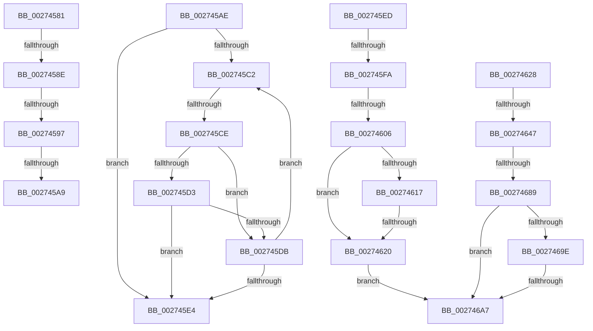

# sub_00274581

- RVA: `0x00274581`–`0x002746AC` (길이 `299` bytes)
- VA: `0x0000000140274581`
- 실행 섹션: `.text`
- PDB 이름 있음: `아니요`; PDB Function 태그: `아니요`
- unwind 정보 RVA: `0x00065DD0`
- 디코드: `75`개 명령, `299/299` bytes 표시
- 미해석 바이트: `0` (있으면 어셈블리에 `.byte`로 보존)

> 이 문서는 커널 이미지의 기계어와 PDB 기호를 분석해 생성했습니다. 4번과 5번은 함수 원형과 자료형을 바이너리 사용 방식에서 추정한 C 해석이며 원본 소스 복구 결과는 아닙니다.

## 1. Dependencies

- 직접 호출 지점: **1**; 고유 호출 대상: **1**
- 직접 호출자로 확인된 함수: **0**
- RIP 상대 이미지 참조: **1**

### Outgoing calls
- `0x00274666` → [KiAcquireKobjectLockSafe](../25/KiAcquireKobjectLockSafe_function_00251C90.md) (function, `0x00251C90`)

### Direct callers
- 이 함수 시작 RVA로 연결되는 직접 call은 확인되지 않았습니다. 간접 호출은 완전히 역산할 수 없습니다.

### Static image references
- `0x0027463A` → RVA `0x00FC6D20` (`ALMOSTRO`; read)

## 2. Other-region calls and transfers

- 다른 실행 섹션으로 향하는 call: **0**
- call이 아닌 외부 분기/꼬리 이동: **12**
  - `0x00274588` → [sub_00273F95 + 0x2AA](Unknown_function_00273F95.md) (`tail-transfer`)
  - `0x00274591` → [sub_00273F95 + 0x2AA](Unknown_function_00273F95.md) (`tail-transfer`)
  - `0x002745A3` → [sub_00273F95 + 0x2AA](Unknown_function_00273F95.md) (`tail-transfer`)
  - `0x002745A9` → [sub_0027475D + 0x18](Unknown_function_0027475D.md) (`tail-transfer`)
  - `0x002745C8` → [sub_0027475D](Unknown_function_0027475D.md) (`tail-transfer`)
  - `0x002745E8` → [sub_00273F95 + 0x2C0](Unknown_function_00273F95.md) (`tail-transfer`)
  - `0x002745F4` → [sub_0027475D + 0x64D](Unknown_function_0027475D.md) (`tail-transfer`)
  - `0x00274600` → [sub_0027475D + 0x62B](Unknown_function_0027475D.md) (`tail-transfer`)
  - `0x0027461A` → [sub_0027475D + 0x7EE](Unknown_function_0027475D.md) (`tail-transfer`)
  - `0x00274641` → [sub_0027475D + 0x7FA](Unknown_function_0027475D.md) (`tail-transfer`)
  - `0x00274683` → [sub_0027475D + 0x5D1](Unknown_function_0027475D.md) (`tail-transfer`)
  - `0x002746A1` → [sub_0027475D + 0x584](Unknown_function_0027475D.md) (`tail-transfer`)

## 3. Assembly (complete function range)

```asm
00274581  48 8B 53 10                     mov rdx, qword ptr [rbx + 0x10]
00274585  48 85 D2                        test rdx, rdx
00274588  0F 84 B1 FC FF FF               je 0x14027423f
0027458E  3B 42 08                        cmp eax, dword ptr [rdx + 8]
00274591  0F 83 A8 FC FF FF               jae 0x14027423f
00274597  8B F8                           mov edi, eax
00274599  48 C1 E7 04                     shl rdi, 4
0027459D  48 03 FA                        add rdi, rdx
002745A0  48 39 37                        cmp qword ptr [rdi], rsi
002745A3  0F 85 96 FC FF FF               jne 0x14027423f
002745A9  E9 C7 01 00 00                  jmp 0x140274775
002745AE  44 8B 47 08                     mov r8d, dword ptr [rdi + 8]
002745B2  49 C1 E0 04                     shl r8, 4
002745B6  4C 03 C7                        add r8, rdi
002745B9  48 83 C7 10                     add rdi, 0x10
002745BD  48 3B CA                        cmp rcx, rdx
002745C0  73 22                           jae 0x1402745e4
002745C2  48 8B 07                        mov rax, qword ptr [rdi]
002745C5  48 3B C6                        cmp rax, rsi
002745C8  0F 84 8F 01 00 00               je 0x14027475d
002745CE  48 85 C0                        test rax, rax
002745D1  74 08                           je 0x1402745db
002745D3  48 FF C1                        inc rcx
002745D6  48 3B CA                        cmp rcx, rdx
002745D9  74 09                           je 0x1402745e4
002745DB  48 83 C7 10                     add rdi, 0x10
002745DF  49 3B F8                        cmp rdi, r8
002745E2  75 DE                           jne 0x1402745c2
002745E4  48 8B 7B 10                     mov rdi, qword ptr [rbx + 0x10]
002745E8  E9 68 FC FF FF                  jmp 0x140274255
002745ED  48 8B 4B 28                     mov rcx, qword ptr [rbx + 0x28]
002745F1  48 85 C9                        test rcx, rcx
002745F4  0F 84 B0 07 00 00               je 0x140274daa
002745FA  48 8B 01                        mov rax, qword ptr [rcx]
002745FD  48 3B C1                        cmp rax, rcx
00274600  0F 84 82 07 00 00               je 0x140274d88
00274606  48 89 43 28                     mov qword ptr [rbx + 0x28], rax
0027460A  48 8B 11                        mov rdx, qword ptr [rcx]
0027460D  48 8B 41 08                     mov rax, qword ptr [rcx + 8]
00274611  48 39 4A 08                     cmp qword ptr [rdx + 8], rcx
00274615  75 09                           jne 0x140274620
00274617  48 39 08                        cmp qword ptr [rax], rcx
0027461A  0F 84 2B 09 00 00               je 0x140274f4b
00274620  41 BE 03 00 00 00               mov r14d, 3
00274626  EB 7F                           jmp 0x1402746a7
00274628  44 0F 20 C0                     mov rax, cr8
0027462C  48 89 44 24 78                  mov qword ptr [rsp + 0x78], rax
00274631  B9 02 00 00 00                  mov ecx, 2
00274636  44 0F 22 C1                     mov cr8, rcx
0027463A  83 3D DF 26 D5 00 00            cmp dword ptr [rip + 0xd526df], 0
00274641  0F 85 10 09 00 00               jne 0x140274f57
00274647  65 48 8B 04 25 20 00 00 00      mov rax, qword ptr gs:[0x20]
00274650  4C 8B 6C 24 70                  mov r13, qword ptr [rsp + 0x70]
00274655  48 89 44 24 68                  mov qword ptr [rsp + 0x68], rax
0027465A  49 8B 45 00                     mov rax, qword ptr [r13]
0027465E  49 8D 4D 18                     lea rcx, [r13 + 0x18]
00274662  48 89 45 88                     mov qword ptr [rbp - 0x78], rax
00274666  E8 25 D6 FD FF                  call 0x140251c90
0027466B  4D 8D 4D 18                     lea r9, [r13 + 0x18]
0027466F  41 89 75 1C                     mov dword ptr [r13 + 0x1c], esi
00274673  49 8B 49 08                     mov rcx, qword ptr [r9 + 8]
00274677  49 8D 41 08                     lea rax, [r9 + 8]
0027467B  48 89 44 24 60                  mov qword ptr [rsp + 0x60], rax
00274680  48 3B C8                        cmp rcx, rax
00274683  0F 84 A5 06 00 00               je 0x140274d2e
00274689  48 8B 11                        mov rdx, qword ptr [rcx]
0027468C  48 8B C1                        mov rax, rcx
0027468F  48 8B 49 08                     mov rcx, qword ptr [rcx + 8]
00274693  48 89 54 24 38                  mov qword ptr [rsp + 0x38], rdx
00274698  48 39 42 08                     cmp qword ptr [rdx + 8], rax
0027469C  75 09                           jne 0x1402746a7
0027469E  48 39 01                        cmp qword ptr [rcx], rax
002746A1  0F 84 3A 06 00 00               je 0x140274ce1
002746A7  49 8B CE                        mov rcx, r14
002746AA  CD 29                           int 0x29
```

## 4. C-style interpretation (structured pseudocode)

```c
__int64 __fastcall sub_00274581(__int64 a1)
{
    __int64 v_rdi;
    unsigned __int64 v_stack_p38;
    unsigned __int64 v_stack_p60;
    unsigned __int64 v_stack_p68;
    unsigned __int64 v_stack_p70;
    unsigned __int64 v_stack_p78;

    v_rdi = ((unsigned int)((unsigned int)(result))) << (4);
    v_rdi = (v_rdi) + (*(unsigned __int64 *)(v_rbx + 16));
}
```

## 5. (Beta) C Style

```c
int64_t sub_00274581(int64_t Arg1)
{
    int64_t local_rdi;
    uint64_t v_stack_p38;
    uint64_t v_stack_p60;
    uint64_t v_stack_p68;
    uint64_t v_stack_p70;
    uint64_t v_stack_p78;

    local_rdi = ((uint32_t)((uint32_t)(result))) << (4);
    local_rdi = (local_rdi) + (*(uint64_t *)(local_rbx + 0x10));
}
```

## 6. Execution-region graph

[열기: 2D/3D 그래프와 함수 탐색 컨트롤 패널](../../../control-panel.html?section=text&rva=0x00274581&view=graph)

- 2D 그래프는 위에서 아래로 흐르고, 3D 그래프는 빈 공간을 드래그해 회전합니다. Shift+드래그는 이동, 휠은 확대·축소, 함수 노드 선택은 대상 보고서 이동입니다.

### Static fallback


