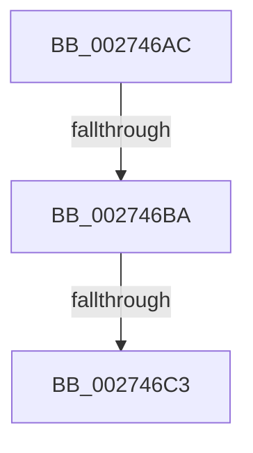

# sub_002746AC

- RVA: `0x002746AC`–`0x002746E8` (길이 `60` bytes)
- VA: `0x00000001402746AC`
- 실행 섹션: `.text`
- PDB 이름 있음: `아니요`; PDB Function 태그: `아니요`
- unwind 정보 RVA: `0x00065DE4`
- 디코드: `15`개 명령, `60/60` bytes 표시
- 미해석 바이트: `0` (있으면 어셈블리에 `.byte`로 보존)

> 이 문서는 커널 이미지의 기계어와 PDB 기호를 분석해 생성했습니다. 4번과 5번은 함수 원형과 자료형을 바이너리 사용 방식에서 추정한 C 해석이며 원본 소스 복구 결과는 아닙니다.

## 1. Dependencies

- 직접 호출 지점: **2**; 고유 호출 대상: **2**
- 직접 호출자로 확인된 함수: **0**
- RIP 상대 이미지 참조: **0**

### Outgoing calls
- `0x002746D3` → [KeBugCheckEx](../4F/KeBugCheckEx_function_004FD660.md) (function, `0x004FD660`)
- `0x002746DE` → [KxWaitForLockOwnerShip](../25/KxWaitForLockOwnerShip_function_00257EB0.md) (function, `0x00257EB0`)

### Direct callers
- 이 함수 시작 RVA로 연결되는 직접 call은 확인되지 않았습니다. 간접 호출은 완전히 역산할 수 없습니다.

### Static image references
- 디코드된 RIP-relative 메모리 참조가 없습니다.

## 2. Other-region calls and transfers

- 다른 실행 섹션으로 향하는 call: **0**
- call이 아닌 외부 분기/꼬리 이동: **3**
  - `0x002746B4` → [sub_00273F20](Unknown_function_00273F20.md) (`tail-transfer`)
  - `0x002746BD` → [sub_00273F20](Unknown_function_00273F20.md) (`tail-transfer`)
  - `0x002746E3` → [ExpReleaseResourceForThreadLite + 0x89](ExpReleaseResourceForThreadLite_function_00273E70.md) (`tail-transfer`)

## 3. Assembly (complete function range)

```asm
002746AC  40 0F B6 C6                     movzx eax, sil
002746B0  24 03                           and al, 3
002746B2  3C 03                           cmp al, 3
002746B4  0F 84 66 F8 FF FF               je 0x140273f20
002746BA  49 3B F0                        cmp rsi, r8
002746BD  0F 84 5D F8 FF FF               je 0x140273f20
002746C3  4C 8B CE                        mov r9, rsi
002746C6  4C 89 7C 24 20                  mov qword ptr [rsp + 0x20], r15
002746CB  48 8B D3                        mov rdx, rbx
002746CE  B9 6E 01 00 00                  mov ecx, 0x16e
002746D3  E8 88 8F 28 00                  call 0x1404fd660
002746D8  CC                              int3
002746D9  48 8D 4C 24 48                  lea rcx, [rsp + 0x48]
002746DE  E8 CD 37 FE FF                  call 0x140257eb0
002746E3  E9 11 F8 FF FF                  jmp 0x140273ef9
```

## 4. C-style interpretation (structured pseudocode)

```c
__int64 __fastcall sub_002746AC(__int64 a1, __int64 a2, __int64 a3, __int64 a4, __int64 a5, __int64 a6, __int64 a7, __int64 a8, __int64 a9)
{
    __int64 result;
    unsigned __int64 v_stack_p20;

    result = (unsigned __int8)(((unsigned __int8)(v_rsi)) & (3));
    v_stack_p20 = v_r15;
    result = KeBugCheckEx(366, v_rbx, a3, v_rsi);
    result = KxWaitForLockOwnerShip(a9, v_rbx, a3, v_rsi);
}
```

## 5. (Beta) C Style

```c
int64_t sub_002746AC(int64_t Arg1, int64_t Arg2, int64_t Arg3, int64_t Arg4, uint64_t Arg5, uint64_t Arg6, uint64_t Arg7, uint64_t Arg8, int64_t Arg9)
{
    int64_t result;
    uint64_t v_stack_p20;

    result = (uint8_t)(((uint8_t)(local_rsi)) & (3));
    v_stack_p20 = local_r15;
    result = KeBugCheckEx(366, local_rbx, Arg3, local_rsi);
    result = KxWaitForLockOwnerShip(Arg9, local_rbx, Arg3, local_rsi);
}
```

## 6. Execution-region graph

[열기: 2D/3D 그래프와 함수 탐색 컨트롤 패널](../../../control-panel.html?section=text&rva=0x002746AC&view=graph)

- 2D 그래프는 위에서 아래로 흐르고, 3D 그래프는 빈 공간을 드래그해 회전합니다. Shift+드래그는 이동, 휠은 확대·축소, 함수 노드 선택은 대상 보고서 이동입니다.

### Static fallback


